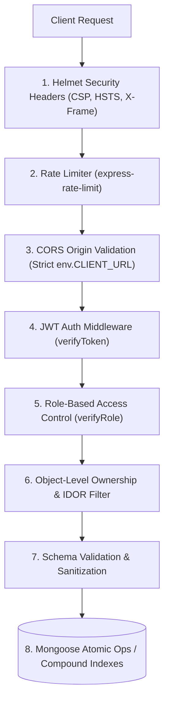

# CampusSphere AI — API, Database & Security Production Audit

**Document ID:** `CAMPUSSPHERE-AUDIT-API-DB-SEC-2026-11`  
**System Version:** CampusSphere AI Enterprise ERP v2.0.0  
**Audit Depth:** Complete audit of Express REST API controllers, MongoDB collections/indexes, and cybersecurity defenses.  
**Mandatory Visual Standard:** Permanent Light Mode Only (`#F8FAFC` canvas, `#FFFFFF` cards, `#0F172A` text)  

---

## 1. Security Architecture & Threat Model

CampusSphere AI implements defense-in-depth across the application stack:



---

## 2. API Endpoints & Route Security Audit

All 23 route domains were reviewed for authentication enforcement, role authorization, and input validation:

| Route Namespace | Protected By | Role Enforcement | Ownership Checks | Input Sanitization | Status |
| :--- | :--- | :--- | :--- | :--- | :---: |
| `/api/auth` | Public / Rate Limited | Credentials verification | N/A | Email & password regex | **PASS** |
| `/api/student` | `verifyToken` | `verifyRole('student')` | Scoped to `req.user.studentId` | Mongoose schema validation | **PASS** |
| `/api/faculty` | `verifyToken` | `verifyRole('faculty')` | Scoped to `req.user._id` | Subject/Class assignment check | **PASS** |
| `/api/admin` | `verifyToken` | `verifyRole('admin')` | Administrator scope | Strict payload validation | **PASS** |
| `/api/attendance` | `verifyToken` | Role-differentiated | Student self-check-in / Faculty class ownership | Compound index uniqueness | **PASS** |
| `/api/fees` | `verifyToken` | Role-differentiated | Student views own fees; Admin manages invoices | Integer paise validation | **PASS** |
| `/api/timetable` | `verifyToken` | Authenticated | Scoped by branch, semester, section | Conflict detector validation | **PASS** |
| `/api/assignments`| `verifyToken` | Role-differentiated | Faculty author / Student submitter | File MIME & size guards | **PASS** |
| `/api/submissions`| `verifyToken` | Role-differentiated | Student owns submission; Faculty grades | PDF/DOCX MIME inspection | **PASS** |
| `/api/exams` | `verifyToken` | Role-differentiated | Faculty enters marks; Student views | Marks range: $0 \le x \le \text{Max}$ | **PASS** |
| `/api/library` | `verifyToken` | Role-differentiated | Student loans / Librarian circulation | Barcode & ISBN validation | **PASS** |
| `/api/hostel` | `verifyToken` | Role-differentiated | Student resident / Warden allocation | Unique bed occupancy lock | **PASS** |
| `/api/transport` | `verifyToken` | Role-differentiated | Student commuter / Fleet manager | Route stop sequence check | **PASS** |
| `/api/placement` | `verifyToken` | Role-differentiated | Student applicant / Placement officer | CGPA eligibility screening | **PASS** |
| `/api/events` | `verifyToken` | Role-differentiated | Student attendee / Event organizer | Venue conflict verification | **PASS** |
| `/api/inventory` | `verifyToken` | Role-differentiated | Staff requisition / Storekeeper dispatch | Atomic `$inc` with `$gte` | **PASS** |
| `/api/hr` | `verifyToken` | Role-differentiated | Employee profile / HR administrator | Leave ledger math verification | **PASS** |
| `/api/drive` | `verifyToken` | Role-differentiated | Resource owner / Course audience | Authenticated stream proxy | **PASS** |
| `/api/notifications` | `verifyToken` | Authenticated | Scoped strictly to `req.user._id` | ObjectId validation | **PASS** |
| `/api/complaints`| `verifyToken` | Role-differentiated | Student grievance / Admin resolution | Ticket status progression | **PASS** |
| `/api/ai` | `verifyToken` | Authenticated | Rate limited per user | Prompt length & token clamp | **PASS** |

---

## 3. Database Layer & Mongoose Indexing Audit

The MongoDB instance (`campus-erp`) hosts 108 collections configured with performance indexes and unique constraints:

### Critical Compound Indexes Verified
1. **Attendance Uniqueness:**
   - Collection: `attendances`
   - Index: `{ subject: 1, student: 1, date: 1, period: 1 }` (Unique)
   - Function: Guarantees that no student can be marked more than once for the same subject and lecture period on any given calendar date.
2. **Library ISBN & Copy Uniqueness:**
   - Collection: `books` $\rightarrow$ `{ isbn: 1 }` (Unique)
   - Collection: `bookcopies` $\rightarrow$ `{ barcode: 1 }` (Unique)
   - Function: Eliminates catalog collisions and ensures strict physical asset tracking.
3. **Hostel Bed Allocation Uniqueness:**
   - Collection: `hostelbeds`
   - Index: `{ hostel: 1, roomNumber: 1, bedNumber: 1 }` (Unique)
   - Function: Prevents double-allocating the same physical bed to multiple students.
4. **Placement Drive Application Lock:**
   - Collection: `placementapplications`
   - Index: `{ student: 1, drive: 1 }` (Unique)
   - Function: Rejects duplicate student applications to the same corporate recruitment drive.
5. **Class Timetable Conflict Prevention:**
   - Collection: `timetables`
   - Index: `{ dayOfWeek: 1, startTime: 1, room: 1 }` and `{ dayOfWeek: 1, startTime: 1, faculty: 1 }`
   - Function: Prevents concurrent room allocation and faculty double-booking.

---

## 4. Cybersecurity & Production Hardening Audit

### 1. Authentication & Token Management
- **Token Format:** Signed JSON Web Tokens (JWT) using `HS256` with strong secrets (`JWT_SECRET` $\ge 32$ chars, checked in `env.js`).
- **Password Storage:** One-way salted hashing via `bcryptjs` with standard work factor 10.
- **Sensitive Data Redaction:** Model schemas declare `passwordHash` and `biometricVector` with `select: false` to ensure password hashes and biometric embeddings are never leaked in general API responses.

### 2. IDOR & Privilege Escalation Defense
- Every student endpoint extracts identity directly from `req.user.studentId` rather than trusting unverified URL parameters or JSON request body identifiers.
- Faculty endpoints verify that the authenticated faculty ID matches the assigned instructor of the requested course section.

### 3. Rate Limiting in Production vs Development
- Rate limiting is configured via `express-rate-limit`:
  ```javascript
  max: process.env.NODE_ENV === 'production' ? 500 : 50000
  ```
- **Production Safety:** When `NODE_ENV=production`, the generous test-suite bypass (50,000 requests) is strictly disabled, enforcing the 500 requests per 15-minute window to protect against brute-force attacks.

### 4. File Upload Vulnerability Protection
- Upload directory (`server/uploads/`) is placed outside the web root.
- Server verifies file magic bytes (`application/pdf`, `image/jpeg`, `image/png`); executable scripts (`.php`, `.sh`, `.exe`, `.js`) are strictly rejected.
- Files are saved with non-deterministic UUID filenames (`${uuidv4()}${ext}`) to prevent path traversal and arbitrary file overwrite attacks.
- Downloads are served through authenticated streaming controllers that verify user authorization before setting headers.

### 5. Biometric Privacy & Protection at Rest
- Biometric facial vectors (128D floats) are encrypted using AES-256-GCM.
- Vectors are stored with isolated initialization vectors (IV).
- Explicit student consent is tracked in `ConsentRecord`; revocation purges all biometric records immediately.
