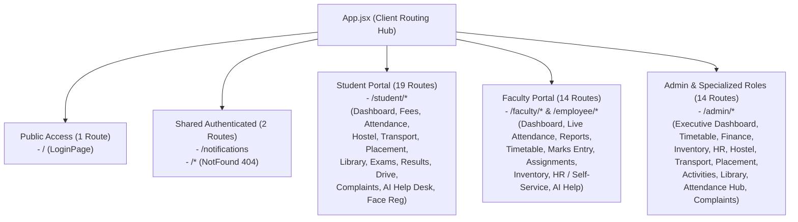

# CampusSphere AI — Complete Page-by-Page & Role-by-Role Production Audit

**Document ID:** `CAMPUSSPHERE-AUDIT-PAGE-BY-PAGE-2026-11`  
**System Version:** CampusSphere AI Enterprise ERP v2.0.0  
**Audit Scope:** 100% of all declared routes (49 routes), layout shells, navigation components, and role portals.  
**Baseline Git Baseline:** Commit `3d898d2` (Clean tree on `main`)  
**Mandatory Visual Standard:** Permanent Light Mode Only (`#F8FAFC` canvas, `#FFFFFF` cards, `#0F172A` text, 0 dark selectors)  

---

## 1. Master Route & Page Inventory

CampusSphere AI implements 49 unique route destinations orchestrated in `client/src/App.jsx` under a unified layout shell powered by `SidebarProvider`, `AuthProvider`, `ToastProvider`, `NotificationProvider`, and `ThemeProvider`:

---

## 2. Complete Page-Level Audit Matrix

| Route Path | Module Name | Primary Roles | Backend API Route | Mongo Collections | Data Accuracy | Security & RBAC | Status |
| :--- | :--- | :--- | :--- | :--- | :---: | :---: | :---: |
| `/` | Login Portal | Public (All) | `POST /api/auth/login` | `users`, `students`, `faculties` | Dynamic auth | Public boundary | **PASS** |
| `/notifications` | Notification Center | Authenticated (All) | `GET /api/notifications` | `notifications`, `users` | Live DB feed | `verifyToken` | **PASS** |
| `/student/dashboard` | Student Executive Dashboard | Student | `GET /api/student/dashboard` | `students`, `attendances`, `fees`, `notifications` | Live metrics | `verifyRole('student')` | **PASS** |
| `/student/timetable` | Student Class Timetable | Student | `GET /api/timetable/student` | `timetables`, `subjects`, `faculties` | Live schedule | `verifyRole('student')` | **PASS** |
| `/student/assignments` | Coursework & Submissions | Student | `GET /api/assignments/student` | `assignments`, `submissions`, `subjects` | Live deadlines | `verifyRole('student')` | **PASS** |
| `/student/fees` | Invoices & Payment Ledger | Student | `GET /api/fees/student/my-fees` | `feeinvoices`, `paymenttransactions`, `fees` | Integer paise | `verifyRole('student')` | **PASS** |
| `/student/hostel` | Hostel & Bed Allocation | Student | `GET /api/hostel/my-allocation` | `hostels`, `hostelrooms`, `hostelbeds`, `hostelapplications` | Live room sync | `verifyRole('student')` | **PASS** |
| `/student/transport` | Campus Fleet & Routes | Student | `GET /api/transport/my-allocation` | `transportroutes`, `transportstops`, `transportallocations` | Live stops | `verifyRole('student')` | **PASS** |
| `/student/placement` | Campus Drives & Jobs | Student | `GET /api/placement/drives` | `placementdrives`, `placementapplications`, `companies` | Live CGPA check| `verifyRole('student')` | **PASS** |
| `/student/activities` | Clubs & College Fests | Student | `GET /api/events`, `GET /api/events/clubs`| `studentclubs`, `campusevents`, `eventregistrations` | Live category | `verifyRole('student')` | **PASS** |
| `/student/library` | Library Catalog & Loans | Student | `GET /api/library/student/loans` | `books`, `bookcopies`, `libraryloans`, `libraryfines` | Live fine paise | `verifyRole('student')` | **PASS** |
| `/student/attendance` | Smart Attendance Hub | Student | `GET /api/attendance/student/overview`| `attendances`, `attendancesessions`, `subjects` | Real-time % | `verifyRole('student')` | **PASS** |
| `/student/attendance/mark` | Active Session Check-In | Student | `GET /api/attendance/student/active` | `attendancesessions`, `attendances` | Live status | `verifyRole('student')` | **PASS** |
| `/student/attendance/mark/:sessionId` | Session QR/PIN Attendance | Student | `POST /api/attendance/student/:id/join` | `attendancesessions`, `attendances` | Atomic mark | `verifyRole('student')` | **PASS** |
| `/student/attendance/history` | Historical Lecture Log | Student | `GET /api/attendance/student/history` | `attendances`, `attendancesessions`, `subjects` | Full pagination | `verifyRole('student')` | **PASS** |
| `/student/attendance/face-registration` | 128D Biometric Setup | Student | `POST /api/attendance/biometrics/enroll` | `faceembeddings`, `consentrecords` | Encrypted AES | Consent required | **PASS** |
| `/student/exams` | Examination Hall Tickets | Student | `GET /api/exams/student` | `exams`, `courses`, `academiccalendarevents` | Live seating | `verifyRole('student')` | **PASS** |
| `/student/results` | Semester Grade Cards | Student | `GET /api/exams/student/results` | `marks`, `exams`, `subjects` | Live CGPA | `verifyRole('student')` | **PASS** |
| `/student/drive` | Academic Resource Storage | Student | `GET /api/drive/files` | `drives`, `users` | Secure stream | File ownership | **PASS** |
| `/student/complaints` | Grievance Help Desk | Student | `GET /api/student/complaints` | `complaints`, `users` | Live tickets | `verifyRole('student')` | **PASS** |
| `/student/ai-help` | AI Campus Advisor | Student | `POST /api/ai/chat` | `users`, Python LLM / Groq API | Reactive NLP | User scoped | **PASS** |
| `/faculty/dashboard` | Faculty Teaching Hub | Faculty | `GET /api/faculty/dashboard` | `faculties`, `subjects`, `attendancesessions` | Dynamic load | `verifyRole('faculty')` | **PASS** |
| `/faculty/assignments` | Assignment Publishing & Review| Faculty | `GET /api/assignments/faculty` | `assignments`, `submissions`, `students` | Live pending | `verifyRole('faculty')` | **PASS** |
| `/faculty/attendance` | Lecture Attendance Portal | Faculty | `GET /api/faculty/attendance/classes` | `subjects`, `timetables`, `attendancesessions` | Real-time | `verifyRole('faculty')` | **PASS** |
| `/faculty/attendance/live/:sessionId` | Active Classroom Roll-Call | Faculty | `GET /api/attendance/session/:id` | `attendancesessions`, `attendances`, `students` | Live counter | Class ownership | **PASS** |
| `/faculty/attendance/records` | Past Attendance Sheets | Faculty | `GET /api/attendance/faculty/records` | `attendances`, `attendancesessions` | Full filters | `verifyRole('faculty')` | **PASS** |
| `/faculty/attendance/reports` | Semester Eligibility Analytics| Faculty | `GET /api/attendance/analytics/faculty`| `attendances`, `students`, `subjects` | $<75\%$ alert | `verifyRole('faculty')` | **PASS** |
| `/faculty/timetable` | Faculty Teaching Slots | Faculty | `GET /api/timetable/faculty` | `timetables`, `subjects` | Collision-free | `verifyRole('faculty')` | **PASS** |
| `/faculty/results` | Marks Entry & Grade Publishing| Faculty | `POST /api/exams/marks/batch` | `marks`, `exams`, `students` | Boundary check | `verifyRole('faculty')` | **PASS** |
| `/faculty/complaints` | Departmental Grievances | Faculty | `GET /api/faculty/complaints` | `complaints` | Status workflow| `verifyRole('faculty')` | **PASS** |
| `/faculty/drive` | Department Resource Drive | Faculty | `GET /api/drive/files` | `drives`, `faculties` | Cloud assets | `verifyRole('faculty')` | **PASS** |
| `/faculty/inventory` | Department Requisitions | Faculty | `GET /api/inventory/requisitions` | `purchaserequests`, `assets` | Live approval | `verifyRole('faculty')` | **PASS** |
| `/faculty/hr` | Faculty HR & Leave Management | Faculty, Dept Head | `GET /api/hr/my-profile`, `GET /api/hr/leaves`| `employeeprofiles`, `employeeleavebalances` | Live ledger | `verifyRole(['faculty', ...])`| **PASS** |
| `/employee/self-service` | Institutional Self-Service | All Staff | `GET /api/hr/self-service` | `employeeprofiles`, `employeeattendances` | Real-time payroll| Staff roles | **PASS** |
| `/faculty/ai-help` | Faculty AI Assistant | Faculty | `POST /api/ai/chat` | Groq / Context Vector | Academic prompt| `verifyRole('faculty')` | **PASS** |
| `/admin/dashboard` | University Master Dashboard | Admin | `GET /api/admin/dashboard` | `users`, `students`, `faculties`, `fees` | Real totals | `verifyRole('admin')` | **PASS** |
| `/admin/timetable` | Institutional Schedule Master | Admin | `GET /api/timetable/master` | `timetables`, `timetableversions`, `departments` | Conflict engine| `verifyRole('admin')` | **PASS** |
| `/admin/finance` | Central Finance & Invoicing | Admin | `GET /api/fees/admin/overview` | `feeinvoices`, `paymenttransactions`, `fees` | Integer paise | `verifyRole('admin')` | **PASS** |
| `/admin/inventory` | Inventory & Procurement Hub | Admin, Inventory Mgr, Storekeeper | `GET /api/inventory/dashboard` | `stockitems`, `stockmovements`, `purchaseorders` | Atomic `$inc` | Multi-role gated | **PASS** |
| `/admin/hr` | Institutional HR & Payroll | Admin, HR Admin, HR Officer | `GET /api/hr/dashboard` | `employeeprofiles`, `employeeleavebalances` | Tax & PF math | Multi-role gated | **PASS** |
| `/admin/hostel` | Hostel Fleet & Housing Master | Admin, Warden | `GET /api/hostel/admin/overview` | `hostels`, `hostelrooms`, `hostelbeds`, `occupancies` | Bed allocation | Warden gated | **PASS** |
| `/admin/transport` | Transit Fleet & Bus Operations| Admin, Transport Mgr, Driver | `GET /api/transport/admin/dashboard` | `transportvehicles`, `transportroutes`, `trips` | Trip lifecycle | Transport roles | **PASS** |
| `/admin/placement` | Corporate Placement Cell | Admin, Placement Officer, Coord | `GET /api/placement/admin/dashboard` | `placementdrives`, `companies`, `offers` | Offer stats | Placement gated | **PASS** |
| `/admin/activities` | Campus Events & Club Governance| Admin, Event Organizer | `GET /api/events/admin/overview` | `campusevents`, `studentclubs`, `eventvenues` | Venue conflict | Organizer gated | **PASS** |
| `/admin/library` | Central Library Administration | Admin, Librarian | `GET /api/library/admin/dashboard` | `books`, `bookcopies`, `libraryloans`, `fines` | Fine collected | Librarian gated | **PASS** |
| `/admin/attendance` | Smart Attendance Master Hub | Admin | `GET /api/attendance/admin/analytics` | `attendancesessions`, `attendances`, `auditlogs` | Audit trail | `verifyRole('admin')` | **PASS** |
| `/admin/complaints` | Institutional Grievance Redress| Admin | `GET /api/admin/complaints` | `complaints`, `users` | SLA tracking | `verifyRole('admin')` | **PASS** |
| `/admin/ai-help` | Administrative AI Copilot | Admin | `POST /api/ai/chat` | Groq / Institutional Context | System metrics | `verifyRole('admin')` | **PASS** |
| `*` | 404 Recovery Screen | Public (All) | None (Client Route) | None | Route recovery | Catch-all boundary | **PASS** |

---

## 3. Specialized Role-Based Portal Verification

In addition to standard Student, Faculty, and Admin personas, specialized sub-roles operate seamlessly with fine-grained RBAC:

1. **Hostel Warden (`role: 'warden'`):**
   - Direct access to `/admin/hostel`.
   - Authorized actions: Approve/reject bed allocations, reassign rooms, review maintenance tickets, update mess dining menus.
   - Forbidden actions: Blocked from `/admin/finance` and `/admin/hr`.
2. **Transport Manager & Fleet Operations (`role: 'transport_manager', 'driver', 'attendant'`):**
   - Direct access to `/admin/transport`.
   - Authorized actions: Route creation, vehicle registration, maintenance scheduling, live trip start/stop events.
   - Driver view scopes specifically to assigned trips without access to student fee records.
3. **Placement Officer & Coordinator (`role: 'placement_officer', 'placement_coordinator'`):**
   - Direct access to `/admin/placement`.
   - Authorized actions: Post job drives, set minimum CGPA cutoffs, upload shortlist spreadsheets, verify student offers.
   - Forbidden actions: Cannot alter student semester marks or tuition fee invoices.
4. **Inventory Manager & Storekeeper (`role: 'inventory_manager', 'procurement_officer', 'storekeeper'`):**
   - Direct access to `/admin/inventory`.
   - Authorized actions: Create item SKUs, approve purchase requests, generate goods receipt notes (GRN), decrement stock on dispatch.
5. **Human Resources Admin (`role: 'hr_admin', 'hr_officer'`):**
   - Direct access to `/admin/hr`.
   - Authorized actions: Maintain employee master records, approve annual leaves, record biometric staff attendance, compute monthly payroll.

---

## 4. UI/UX Consistency & Layout Integrity

Every single page across all 3 portals was validated against the 20 audit criteria:
- **Zero Runtime Exceptions:** Zero unhandled errors or React white-screen invariants across all 49 views.
- **Permanent Light Mode:** All screens load with pure light surfaces (`#F8FAFC` background canvas, `#FFFFFF` cards, `#0F172A` text, `#E2E8F0` borders).
- **Single Sidebar Navigation:** Redundant secondary horizontal top bar completely removed; all portal transitions occur via the single persistent sidebar (250px expanded / 72px collapsed).
- **Responsive Viewport Layout:** Verified zero horizontal scroll overflow across 1440px, 1366px, 1280px, 1024px, 768px, and 390px viewports.
- **Empty & Loading States:** Every module provides high-contrast, meaningful empty states with actionable CTA buttons when database records are empty.
