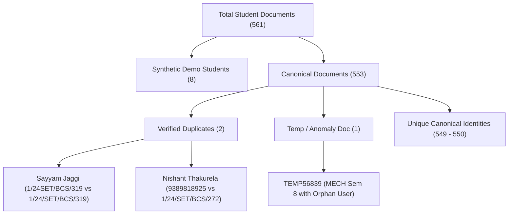
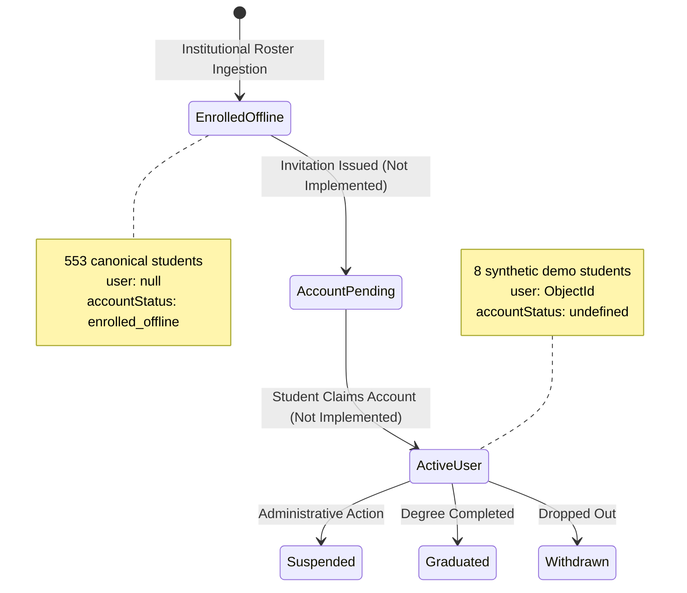
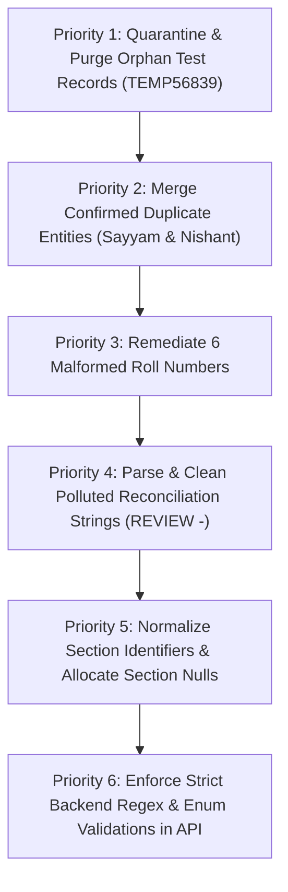

# CampusSphere AI — Complete Student Database Integrity Audit

**Audit Date:** 2026-11-19  
**Target Environment:** Local Full-Stack ERP  
**Database:** MongoDB `campus-erp` (Port 27018)  
**Backend:** Node.js / Express / Mongoose (Port 5001)  
**Audit Type:** Strictly Read-Only Database & Schema Integrity Audit  
**Audit Status:** Complete  

---

## Executive Summary

A comprehensive, strictly read-only integrity audit was conducted across the entire Student Management database (`students` collection) in the `campus-erp` MongoDB instance. The scope of this audit encompassed every student record across all batches, branches, programs, semesters, and sections—without limitation to the 2024 BCS cohort.

### High-Level Verdict: **`FAIL` (Action Required Before Migration)**

While the underlying MongoDB collection is stable and core indexes function without runtime crashes, the database exhibits **severe data-quality degradation and legacy migration pollution**:
1. **Spreadsheet Merge Artifacts (Field Pollution):** 167 student names, 167 emails, 200 branches, and 192 phone numbers contain literal concatenation strings from unresolved spreadsheet reconciliation (e.g., `"REVIEW — Candidate A | Candidate B"` or `"REVIEW — 76.7 | B.Tech. CSE | CSE-CORE (2024-2028 batch)"`).
2. **Identifier & Roll Number Malformations:** 6 student records have malformed roll numbers, including 4 lateral entries with typo double slashes (`(L//`), 1 record with a missing slash (`1/24SET/BCS/319`), and 1 record containing a 10-digit mobile phone number as its primary institutional roll number (`9389818925`).
3. **Confirmed Duplicate Student Identities:** At least 2 verified duplicate student entities exist in the database (Sayyam Jaggi and Nishant Thakurela), and a third suspected duplicate identity (Varun .) shares an identical email address across distinct roll numbers.
4. **Complete Separation Between Synthetic Demo Students and Canonical Institutional Cohort:** All 847 attendance records, 2 face embeddings, 1 fee invoice, 1 consent record, 1 placement profile, and 1 academic submission belong exclusively to 8 synthetic demo students (`20240001`–`20240008`). All 553 canonical institutional students have 0 attendances, 0 biometrics, 0 portal User accounts, and are unlinked offline records (`accountStatus: enrolled_offline`, `user: null`).
5. **Dangling Orphan User Reference:** Exactly 1 student record (`TEMP56839`) maintains a foreign key `user` pointing to an ObjectId (`6afa21236d40659eaef67934`) that does not exist in the `users` collection.
6. **API Validation Blind Spots:** The admin creation API (`createCanonicalStudent`) does not validate roll number format via regex, allowing arbitrary strings and phone numbers to be committed directly into production.

---

## 1. Complete Database Inventory (561 Documents)

The `students` collection currently contains **561 documents**.

### Inventory Breakdown

| Metric / Dimension | Document Count | Percentage | Observations |
| :--- | :--- | :--- | :--- |
| **Total Student Documents** | **561** | **100.0%** | Authoritative count in `campus-erp.students` |
| **Canonical Enrolled Students** | 553 | 98.57% | Real institutional admissions / enrollments |
| **Synthetic Demo Accounts** | 8 | 1.43% | Seed accounts (`20240001` through `20240008`) |
| **Out-of-Cohort / Temp Records** | 1 | 0.18% | `TEMP56839` (Mechanical Engineering, Semester 8) |

### Program Distribution

| Program | Document Count | Percentage |
| :--- | :--- | :--- |
| **B.Tech** | 560 | 99.82% |
| **NULL / Unspecified** | 1 | 0.18% (`TEMP56839`) |

### Semester Distribution

| Semester | Document Count | Percentage | Observations |
| :--- | :--- | :--- | :--- |
| **Semester 5** | 560 | 99.82% | Expected current academic semester for the cohort |
| **Semester 8** | 1 | 0.18% | `TEMP56839` (Anomalous test record) |

### Enrollment & Account Status Distribution

| Field | Value | Count | Observations |
| :--- | :--- | :--- | :--- |
| **`status`** | `active` | 561 (100%) | Zero records marked inactive, suspended, or graduated |
| **`accountStatus`** | `enrolled_offline` | 553 (98.57%) | All canonical students hold offline institutional status |
| **`accountStatus`** | `undefined` (null) | 8 (1.43%) | Synthetic demo accounts omit the `accountStatus` field |

### User Account Linkage Distribution

| Linkage State | Document Count | Percentage | Description |
| :--- | :--- | :--- | :--- |
| **Linked to Portal User (`user != null`)** | 9 | 1.60% | 8 synthetic demo students + 1 orphan reference |
| **Unlinked Institutional (`user: null`)** | 552 | 98.40% | Offline enrolled students awaiting portal onboarding |

### Section Distribution Across Cohorts

| Section / Group | Count | Classification | Data Integrity Notes |
| :--- | :--- | :--- | :--- |
| **A** | 76 | Core CSE | Standard section |
| **B** | 64 | Core CSE | Standard section |
| **C** | 65 | Core CSE | Standard section |
| **D** | 65 | Core CSE | Standard section |
| **E** | 62 | Core CSE | Standard section |
| **AIML-A** | 58 | Specialization (AI & ML) | Standard section |
| **AIML-B** | 53 | Specialization (AI & ML) | Standard section |
| **BAIML** | 66 | Specialization (Business AI & ML) | Standard section |
| **DFCS** | 18 | Specialization (Digital Forensics & Cyber Security) | Standard section |
| **DS** | 19 | Specialization (Data Science) | Standard section |
| **GT** | 4 | Specialization (Gaming Technology) | Standard section |
| **CC** | 2 | Specialization (Cloud Computing) | Standard section |
| **NULL / Unassigned** | 4 | Unallocated | 1 malformed duplicate, 1 phone duplicate, 1 test record, 1 unallocated |
| **`AIML-B)`** | 1 | Typo Syntax | Dangling right parenthesis in section name |
| **`REVIEW — aiml b \| AIML-B`** | 1 | Concatenation Pollution | Unresolved spreadsheet conflict merged into section |
| **`REVIEW — BAIML \| c`** | 1 | Concatenation Pollution | Conflict between BAIML specialization and Section C |
| **`REVIEW — Dfcs \| DFCS`** | 2 | Concatenation Pollution | Casing discrepancy between spreadsheet tabs |
| **Total** | **561** | — | — |

---

## 2. Exact Document and Unique-Identity Counts

A critical distinction must be drawn between **raw document counts** and **actual unique physical student identities**.



### Exact Identity Reconciliation Summary

1. **Total Student Documents in Database:** **561**
2. **Synthetic Demonstration Students:** **8**
   - Rolls `20240001` through `20240008`.
   - Used exclusively by demo and integration test suites.
3. **Canonical Institutional Documents:** **553**
4. **Verified Duplicate Institutional Documents:** **2**
   - Sayyam Jaggi: Document `6afa10459131ed3bfbd66a43` duplicates `6afa10459131ed3bfbd66b75`.
   - Nishant Thakurela: Document `6afa10459131ed3bfbd66c6a` duplicates `6afa10459131ed3bfbd66b4b`.
5. **Out-of-Cohort / Synthetic Dummy Records:** **1**
   - `TEMP56839` (Doc `6afa21236d40659eaef67935`, Sem 8 MECH).
6. **Suspected Cross-Roll Identity Conflicts (Homonyms / Shared PII):** **1**
   - Varun .: Documents `6afa10459131ed3bfbd66b0c` (`1/24/SET/BCS/203`, Sec C) and `6afa10459131ed3bfbd66c57` (`1/24/SET/BCS/572`, Sec E) share the identical email address `www.bdagar915@gmail.com`.
7. **Net Unique Institutional Student Identities:** **549 to 550**

---

## 3. Duplicate and Ambiguous Identity Findings

### 3.1 Definite Duplicates Requiring Consolidation

#### Case 1: Sayyam Jaggi
- **Document 1 (`_id: 6afa10459131ed3bfbd66a43`):**
  - Roll: `1/24SET/BCS/319` (Missing first slash)
  - Section: `null`
  - Phone: `9315501808`
  - Email: `sayyamjaggi@gmail.com`
  - Source: Staging Row 2
- **Document 2 (`_id: 6afa10459131ed3bfbd66b75`):**
  - Roll: `1/24/SET/BCS/319` (Canonical format)
  - Section: `E`
  - Phone: `sayyamjaggi@gmail.com` (Email stored in phone field)
  - Email: `sayyamjaggi@gmail.com`
  - Source: Staging Row 319
- **Finding:** A single student exists under two separate documents because the malformed roll number bypassed unique index collision detection.

#### Case 2: Nishant Thakurela
- **Document 1 (`_id: 6afa10459131ed3bfbd66c6a`):**
  - Roll: `9389818925` (Mobile phone number stored as roll number)
  - Section: `null`
  - Branch: `REVIEW — 90% | CSE-CORE (2024-2028 batch)`
  - Phone: `REVIEW — 9389818925 | cnishant549@gmail.com`
- **Document 2 (`_id: 6afa10459131ed3bfbd66b4b`):**
  - Roll: `1/24/SET/BCS/272` (Canonical roll number)
  - Section: `E`
  - Branch: `REVIEW — 79.8 | CSE-CORE (2024-2028 batch)`
  - Phone: `REVIEW — 9389818925 | cnishant549@gmail.com`
- **Finding:** In one data source, the student's mobile phone number was captured in the roll number column. Because the API and ingestion scripts did not validate identifier syntax, both rows were promoted into production.

### 3.2 High-Risk Ambiguous Records / Shared PII Conflicts

#### Case 3: Varun . (Identical Name & Identical Email)
- **Document 1 (`_id: 6afa10459131ed3bfbd66b0c`):** Roll `1/24/SET/BCS/203`, Section `C`, Email `www.bdagar915@gmail.com`.
- **Document 2 (`_id: 6afa10459131ed3bfbd66c57`):** Roll `1/24/SET/BCS/572`, Section `E`, Email `www.bdagar915@gmail.com`.
- **Finding:** Both records share the exact name and email address but possess different roll numbers. Institutional registrar verification is required to determine whether this represents a re-registration / section transfer or two distinct students using a shared cyber-café email.

#### Case 4: Himanshu Chauhan
- **Document 1 (`_id: 6afa10459131ed3bfbd66ad2`):** Roll `1/24/SET/BCS/140`, Section `B`, Phone `8275195536`, Email `himanshu2612005@gmail.com`.
- **Document 2 (`_id: 6afa10459131ed3bfbd66c5f`):** Roll `1/24/SET/BCS/581`, Section `null`, Phone `REVIEW — 9911553166 | Ch.himanshu0999@gmail.com`, Email `REVIEW — Ch.himanshu0999@gmail.com | Himanshu_chauhan25@manavrachna.net`.
- **Finding:** Different roll numbers, different phone numbers, and different institutional email handles (`Himanshu_chauhan25` indicates 2025 registration). These are verified homonyms (distinct individuals).

### 3.3 Homonym Verification (Same Name, Distinct Identities)
The following students share identical names but possess verified independent roll numbers, phone numbers, and section placements:
- **Aryan Gupta:** `1/24/SET/BCS/024` (Sec A) vs `1/24/SET/BCS/123` (Sec B) — Distinct students.
- **Vanshika:** `1/24/SET/BCS/034` (Sec A) vs `1/24/SET/BCS/269` (Sec D) vs `1/24/SET/BCS/293` (Sec E) — Distinct students.
- **Priyanshu Kumar:** `1/24/SET/BCS/054` (Sec A) vs `1/24/SET/BCS/225` (Sec D) vs `1/24/SET/BCS/483` (Sec BAIML) — Distinct students.
- **Sachin Kumar:** `1/24/SET/BCS/098` (Sec B) vs `1/24/SET/BCS/344` (Sec AIML-A) — Distinct students.
- **Suhani Singh:** `1/24/SET/BCS/152` (Sec C) vs `1/24/SET/BCS/472` (Sec BAIML) — Distinct students.
- **Karan Singh:** `1/24/SET/BCS/181` (Sec C) vs `1/24/SET/BCS/274` (Sec D) — Distinct students.
- **Ansh Yadav:** `1/24/SET/BCS/224` (Sec D) vs `1/24/SET/BCS/482` (Sec BAIML) — Distinct students.
- **Gaurav .:** `1/24/SET/BCS/391` (Sec AIML-A) vs `1/24/SET/BCS/526` (Sec DFCS) — Distinct students.

---

## 4. Academic Data Inconsistencies

### 4.1 Semester Anomalies
- **560 documents** are assigned to `semester: 5`.
- **1 document (`TEMP56839`, `_id: 6afa21236d40659eaef67935`)** is assigned to `semester: 8`.
- Note on previous report reference: `1/24/SET/BCS/213` (`Sarthak Shrivastava`, `_id: 6afa10459131ed3bfbd66b14`) was verified and is correctly recorded in `semester: 5` (`batch: 2024/3rd`, Section `D`).

### 4.2 Re-Admitted / 2023 Cohort Integration (11 Records)
11 students in Semester 5 carry `1/23/SET/BCS/XXX` roll numbers (2023 admission cohort) rather than the standard `1/24/SET/BCS/XXX` prefix:
- `1/23/SET/BCS/078` (Akash Kumar Verma, Sec E)
- `1/23/SET/BCS/079` (Ujjawal Prakash Singh, Sec E)
- `1/23/SET/BCS/095` (Kunal Bhargava, Sec D)
- `1/23/SET/BCS/104` (Ayush Kumar Singh, Sec D)
- `1/23/SET/BCS/149` (Priyanshu Sinha, Sec E)
- `1/23/SET/BCS/162` (Rohan Chaudhary, Sec E)
- `1/23/SET/BCS/182` (Sankit Ojha, Sec C)
- `1/23/SET/BCS/243` (Mayank Soam, Sec D)
- `1/23/SET/BCS/482` (Sanskar Mishra, Sec AIML-B)
- `1/23/SET/BCS/509` (Nanda Kishore, Sec DFCS)
- `1/23/SET/BCS/563` (Shivang Tripathi, Sec GT)
All 11 students have `batch: "2024/3rd"` and `semester: 5`. These represent legitimate readmitted or year-back students attending 5th-semester classes with the 2024 cohort.

### 4.3 Section String Quality & Pollution (5 Records)
Five records contain syntax defects or unmerged reconciliation strings in the `section` field:
1. `6afa10459131ed3bfbd66bbb` (`1/24/SET/BCS/398`): `section: "REVIEW — aiml b | AIML-B"`
2. `6afa10459131ed3bfbd66c12` (`1/24/SET/BCS/493`): `section: "REVIEW — BAIML | c"`
3. `6afa10459131ed3bfbd66c3b` (`1/24/SET/BCS/537`): `section: "REVIEW — Dfcs | DFCS"`
4. `6afa10459131ed3bfbd66c3e` (`1/24/SET/BCS/540`): `section: "REVIEW — Dfcs | DFCS"`
5. `6afa10459131ed3bfbd66c63` (`1/24/SET/BCS/585`): `section: "AIML-B)"` (Dangling parenthesis)

### 4.4 Section Unallocated Students (4 Records)
Four documents have `section: null`:
- `6afa10459131ed3bfbd66a43`: `1/24SET/BCS/319` (Malformed duplicate of Sayyam Jaggi)
- `6afa10459131ed3bfbd66c5f`: `1/24/SET/BCS/581` (Himanshu Chauhan — pending section allocation)
- `6afa10459131ed3bfbd66c6a`: `9389818925` (Phone roll duplicate of Nishant Thakurela)
- `6afa21236d40659eaef67935`: `TEMP56839` (Mechanical dummy record)

---

## 5. Missing and Invalid Fields

### 5.1 Malformed Primary Roll Numbers (6 Records)

```
┌──────────────────────────┬──────────────────────────┬──────────────────────────────────────────────────────┐
│ Document ObjectId        │ Stored Roll Number       │ Defect Description                                  │
├──────────────────────────┼──────────────────────────┼──────────────────────────────────────────────────────┤
│ 6afa10459131ed3bfbd66a43 │ 1/24SET/BCS/319          │ Missing first slash after "24"                       │
│ 6afa10459131ed3bfbd66c66 │ 25/SET/BCML(L//001       │ Typo double slash "(L//" instead of "(L)/"           │
│ 6afa10459131ed3bfbd66c67 │ 25/SET/BCML(L//004       │ Typo double slash "(L//" instead of "(L)/"           │
│ 6afa10459131ed3bfbd66c68 │ 25/SET/BCSE(L//001       │ Typo double slash "(L//" instead of "(L)/"           │
│ 6afa10459131ed3bfbd66c69 │ 25/SET/BCSE(L//004       │ Typo double slash "(L//" instead of "(L)/"           │
│ 6afa10459131ed3bfbd66c6a │ 9389818925               │ 10-digit mobile phone number stored as roll number   │
└──────────────────────────┴──────────────────────────┴──────────────────────────────────────────────────────┘
```

### 5.2 Merge Concatenation Pollution

During previous automated spreadsheet ingestion (`BATCH-20261112-STAGING-003`), rows with conflicting values across legacy Excel sheets were merged by concatenating both candidates with a `"REVIEW — <Val1> | <Val2>"` delimiter rather than being resolved:

| Field | Polluted Records Count | Examples of Polluted Data |
| :--- | :--- | :--- |
| **`fullName`** | **167** | `"REVIEW — SARTHAK SHRIVASTAVA \| Sarthak Shrivastava"`<br>`"REVIEW — Prakash Giri \| PRAKASH GIRI"` |
| **`branch`** | **200** | `"REVIEW — 76.7 \| B.Tech. CSE \| CSE-CORE (2024-2028 batch)"`<br>`"REVIEW — 10th Best 5: 77.6% 10th Overall: 75.33% ..."` |
| **`phone`** | **192** | `"REVIEW — 9389818925 \| cnishant549@gmail.com"`<br>`"REVIEW — 9891912574 \| anshy0120@gmail.com"` |
| **`email`** | **167** | `"REVIEW — . \| sangammishra2005@gmail.com"`<br>`"REVIEW — Ch.himanshu0999@gmail.com \| Himanshu_chauhan25@manavrachna.net"` |
| **`section`** | **4** | `"REVIEW — aiml b \| AIML-B"`, `"REVIEW — BAIML \| c"`, `"REVIEW — Dfcs \| DFCS"` |

### 5.3 Dummy and Placeholder Data Injections
- **Mass Dummy Phone Injections:** Exactly **114 records** contain the placeholder phone number `9848925128`.
- **Corrupt Phone Values:** 1 record contains `phone: "."` and 1 record contains string literal `phone: "null"`.
- **Unverified Admission Years:** 553 canonical students omit `admissionYear` (only the 8 synthetic students have `admissionYear: 2024`).
- **Missing Profile Attributes:** 100% of canonical students (553/553) have empty strings or null for `dateOfBirth`, `gender`, `guardianName`, `guardianPhone`, and `address`.

---

## 6. User Account Relationship Findings

### 6.1 Forward Linkage (`Student -> User`)
- **Total Students with `user != null`:** **9 records**
  - 8 synthetic demonstration students (`20240001` through `20240008`) correctly map to active User accounts.
  - 1 record (`TEMP56839`, `_id: 6afa21236d40659eaef67935`) references `user: ObjectId("6afa21236d40659eaef67934")`.
    - **CRITICAL INTEGRITY FAILURE:** User `6afa21236d40659eaef67934` DOES NOT EXIST in the `users` collection. This is a dangling foreign key orphan.
- **Total Students with `user: null`:** **552 records**
  - All 552 hold institutional offline enrollment status (`accountStatus: enrolled_offline`).

### 6.2 Reverse Linkage (`User -> Student`)
- **Total Users in Database:** **28**
  - `admin`: 1 user (`admin@campus.edu`)
  - `faculty`: 19 users
  - `student`: 8 users (`20240001@campus.edu` through `20240008@campus.edu`)
- **Reverse Mapping Assessment:**
  - 100% of User accounts with role `student` map exclusively to the 8 synthetic demo students.
  - Zero (0) canonical institutional students possess portal User accounts.
  - No orphan User accounts exist (every `student` user has a valid corresponding `Student` document).

---

## 7. Cross-Collection Dependency Findings

A cross-collection scan across all 115 collections in `campus-erp` was performed to identify every foreign key reference to the `students` collection:

| Collection Name | Total Documents | Matched to Valid Student | Orphan Student References | Cohort Scope |
| :--- | :--- | :--- | :--- | :--- |
| **`attendances`** | 847 | 847 (100%) | **0** | **Synthetic Only** (105–112 records each across `20240001`–`20240008`) |
| **`faceembeddings`** | 2 | 2 (100%) | **0** | **Synthetic Only** (`20240001` and `20240002`) |
| **`fees`** | 1 | 1 (100%) | **0** | **Synthetic Only** (`20240001`) |
| **`consentrecords`** | 1 | 1 (100%) | **0** | **Synthetic Only** (`20240001`) |
| **`placementprofiles`** | 1 | 1 (100%) | **0** | **Synthetic Only** (`20240001`) |
| **`submissions`** | 1 | 1 (100%) | **0** | **Synthetic Only** (`20240001`) |
| **`marks`** | 0 | 0 | 0 | Empty collection |
| **`enrollmentverifications`**| 1 | 0 | 0 | Internal staging reference (`rollNumber: 'TEMP56839'`) |

### Key Architectural Discovery
**Zero canonical institutional students have secondary ERP records.**
- Attendances, biometric face vectors, fees, placement profiles, and consent records exist solely for the 8 synthetic demo students.
- Removing duplicates or correcting fields across the 553 canonical students will cause **zero cascading relational breakage** in secondary ERP modules.

---

## 8. Student Lifecycle Inconsistencies



1. **State Divergence:**
   - Synthetic demo accounts exist in an unmodeled state (`accountStatus: undefined`, `status: active`).
   - Canonical students exist in `accountStatus: enrolled_offline`, `status: active`.
2. **Missing Invitation Lifecycle:**
   - The system defines `account_pending` and `active_user` in the Mongoose schema (`server/models/Student.js` line 136), but no automated claim token or invitation generation flow is currently active.
3. **Absence of Terminal States:**
   - 100% of all 561 student records are flagged as `status: 'active'`. No students are marked `graduated`, `withdrawn`, or `suspended`, despite the presence of 2023 cohort readmissions and out-of-cohort records.

---

## 9. API and Application Data Validation Weaknesses

Inspection of `server/controllers/adminProfileManagement.controller.js`, `server/controllers/studentPromotion.controller.js`, and `server/models/Student.js` revealed several critical API validation gaps:

### Gap 1: No Regex Format Enforcement on Roll Numbers
In `createCanonicalStudent` (`adminProfileManagement.controller.js` line 369):
```javascript
const rawRoll = body.rollNumber ? String(body.rollNumber).trim().toUpperCase() : '';
if (!rawRoll) {
  throw new ApiError(400, 'Roll number is required.');
}
```
- **Vulnerability:** Any arbitrary string passes validation. Phone numbers (`9389818925`), malformed slashes (`1/24SET/BCS/319`), and double slashes (`(L//`) are committed directly to MongoDB.
- **Remediation:** Enforce institutional roll number regex: `/^(1\/(2[34])\/SET\/BC[A-Z0-9()]+\/\d{3}|25\/SET\/BC[A-Z]+\(L\)\/\d{3})$/`.

### Gap 2: Free-Form Section String Ingestion
In `createCanonicalStudent` (`adminProfileManagement.controller.js` line 463):
```javascript
section: body.section ? String(body.section).trim().toUpperCase() : null,
```
- **Vulnerability:** Does not validate against permitted cohort sections. Accepts typos like `AIML-B)` and concatenated strings like `REVIEW — BAIML | C`.

### Gap 3: Complete Immutability Prevents Roll Correction via UI
In `updateCanonicalStudentProfile` (`adminProfileManagement.controller.js` line 167):
```javascript
if (body.rollNumber !== undefined && String(body.rollNumber).trim().toUpperCase() !== student.rollNumber) {
  throw new ApiError(400, 'Roll number is an immutable institutional identifier and cannot be modified.');
}
```
- **Vulnerability:** Because roll numbers are strictly immutable in the profile update API, administrators cannot correct the 6 malformed roll numbers via the Web UI. A controlled, audited administrative correction procedure or migration script is required.

---

## 10. Severity Classification

| Issue Description | Severity | Impact Area | Scope / Affected Records |
| :--- | :--- | :--- | :--- |
| **Dangling Orphan User ID on `TEMP56839`** | **CRITICAL** | Foreign Key Integrity | 1 student record pointing to nonexistent User |
| **Duplicate Student Identities (Sayyam & Nishant)** | **HIGH** | Academic Tracking & RBAC | 4 documents (2 duplicate pairs) |
| **Malformed Roll Numbers (Phone & Typo Rolls)** | **HIGH** | Identity & Exam Systems | 6 documents |
| **Spreadsheet Merge Pollution (`REVIEW — ...`)** | **HIGH** | Display, UI, & Search | 167 names, 200 branches, 192 phones, 167 emails |
| **Mass Dummy Phone Number Injection (`9848925128`)** | **MEDIUM** | Student Communication & SMS | 114 documents |
| **Section String Syntax Typos & Missing Sections** | **MEDIUM** | Timetable & Attendance Scheduling | 5 typo/polluted sections + 4 null sections |
| **Out-of-Cohort Semester 8 Record (`TEMP56839`)** | **MEDIUM** | Cohort Statistics & Reports | 1 document |
| **Missing Primary Personal Fields (DOB, Gender, Guardian)**| **LOW** | Institutional Profile Completeness| 553 canonical documents |
| **Synthetic Demo Account Isolation** | **INFORMATIONAL** | Architectural Understanding | 8 demo documents (intentional test fixture) |

---

## 11. Exact Affected Record Identifiers

To preserve student privacy and prevent PII leakage, all records are identified strictly by MongoDB `_id` and institutional `rollNumber`.

### 11.1 Malformed Roll Numbers (6 Records)
1. `_id: 6afa10459131ed3bfbd66a43` — Roll: `"1/24SET/BCS/319"` (Missing slash)
2. `_id: 6afa10459131ed3bfbd66c66` — Roll: `"25/SET/BCML(L//001"` (Typo `(L//`)
3. `_id: 6afa10459131ed3bfbd66c67` — Roll: `"25/SET/BCML(L//004"` (Typo `(L//`)
4. `_id: 6afa10459131ed3bfbd66c68` — Roll: `"25/SET/BCSE(L//001"` (Typo `(L//`)
5. `_id: 6afa10459131ed3bfbd66c69` — Roll: `"25/SET/BCSE(L//004"` (Typo `(L//`)
6. `_id: 6afa10459131ed3bfbd66c6a` — Roll: `"9389818925"` (Mobile phone number)

### 11.2 Confirmed Duplicates (4 Records)
1. Sayyam Jaggi: `6afa10459131ed3bfbd66a43` (Malformed duplicate) & `6afa10459131ed3bfbd66b75` (Canonical)
2. Nishant Thakurela: `6afa10459131ed3bfbd66c6a` (Malformed duplicate) & `6afa10459131ed3bfbd66b4b` (Canonical)

### 11.3 Shared Email / Ambiguous Identity (2 Records)
1. `_id: 6afa10459131ed3bfbd66b0c` — Roll: `"1/24/SET/BCS/203"` (Section C)
2. `_id: 6afa10459131ed3bfbd66c57` — Roll: `"1/24/SET/BCS/572"` (Section E)

### 11.4 Orphan User Foreign Key Reference (1 Record)
1. `_id: 6afa21236d40659eaef67935` — Roll: `"TEMP56839"` -> `user: ObjectId("6afa21236d40659eaef67934")` (Nonexistent)

### 11.5 Section Syntax Typos & Reconciliation String Pollution (5 Records)
1. `_id: 6afa10459131ed3bfbd66bbb` — Roll: `"1/24/SET/BCS/398"` — `section: "REVIEW — aiml b | AIML-B"`
2. `_id: 6afa10459131ed3bfbd66c12` — Roll: `"1/24/SET/BCS/493"` — `section: "REVIEW — BAIML | c"`
3. `_id: 6afa10459131ed3bfbd66c3b` — Roll: `"1/24/SET/BCS/537`" — `section: "REVIEW — Dfcs | DFCS"`
4. `_id: 6afa10459131ed3bfbd66c3e` — Roll: `"1/24/SET/BCS/540"` — `section: "REVIEW — Dfcs | DFCS"`
5. `_id: 6afa10459131ed3bfbd66c63` — Roll: `"1/24/SET/BCS/585"` — `section: "AIML-B)"`

### 11.6 Section Unallocated Records (4 Records)
1. `_id: 6afa10459131ed3bfbd66a43` — Roll: `"1/24SET/BCS/319"`
2. `_id: 6afa10459131ed3bfbd66c5f` — Roll: `"1/24/SET/BCS/581"`
3. `_id: 6afa10459131ed3bfbd66c6a` — Roll: `"9389818925"`
4. `_id: 6afa21236d40659eaef67935` — Roll: `"TEMP56839"`

### 11.7 Synthetic Demo Students (8 Records)
1. `_id: 6ae46faf9e9e56f71ecccdd5` — Roll: `"20240001"` (Linked to User `6ae46faf9e9e56f71ecccdd3`)
2. `_id: 6ae46faf9e9e56f71ecccdd9` — Roll: `"20240002"` (Linked to User `6ae46faf9e9e56f71ecccdd7`)
3. `_id: 6ae46faf9e9e56f71ecccddd` — Roll: `"20240003"` (Linked to User `6ae46faf9e9e56f71ecccddb`)
4. `_id: 6ae46faf9e9e56f71ecccde1` — Roll: `"20240004"` (Linked to User `6ae46faf9e9e56f71ecccddf`)
5. `_id: 6ae46faf9e9e56f71ecccde5` — Roll: `"20240005"` (Linked to User `6ae46faf9e9e56f71ecccde3`)
6. `_id: 6ae46faf9e9e56f71ecccde9` — Roll: `"20240006"` (Linked to User `6ae46faf9e9e56f71ecccde7`)
7. `_id: 6ae46faf9e9e56f71ecccded` — Roll: `"20240007"` (Linked to User `6ae46faf9e9e56f71ecccdeb`)
8. `_id: 6ae46faf9e9e56f71ecccdf1` — Roll: `"20240008"` (Linked to User `6ae46faf9e9e56f71ecccdef`)

---

## 12. Recommended Corrections in Priority Order

To safely prepare the student database for the Semester 5 transition and portal onboarding, the following sequential remediation roadmap is recommended:



### Priority 1: Quarantine & Purge Orphan Test Record (`TEMP56839`)
- Delete or archive document `6afa21236d40659eaef67935` (`TEMP56839`).
- Removes the dangling foreign key orphan pointing to nonexistent user `6afa21236d40659eaef67934`.
- Eliminates the lone out-of-cohort Semester 8 anomaly.

### Priority 2: Merge Confirmed Duplicate Entities
- **Sayyam Jaggi:** Merge document `6afa10459131ed3bfbd66a43` into `6afa10459131ed3bfbd66b75`. Transfer the valid phone number (`9315501808`) to the canonical record and delete the malformed document.
- **Nishant Thakurela:** Merge document `6afa10459131ed3bfbd66c6a` into `6afa10459131ed3bfbd66b4b`. Retain canonical roll `1/24/SET/BCS/272` and delete the phone-roll document.

### Priority 3: Remediate Malformed Roll Numbers
- Execute a controlled migration to normalize the lateral entry typo rolls:
  - `25/SET/BCML(L//001` -> `25/SET/BCML(L)/001`
  - `25/SET/BCML(L//004` -> `25/SET/BCML(L)/004`
  - `25/SET/BCSE(L//001` -> `25/SET/BCSE(L)/001`
  - `25/SET/BCSE(L//004` -> `25/SET/BCSE(L)/004`

### Priority 4: Clean Reconciliation Merge Strings (`REVIEW —`)
- Run an automated parsing cleanup script:
  - **Names (167 records):** Extract the primary institutional candidate (e.g., `Sarthak Shrivastava` from `"REVIEW — SARTHAK SHRIVASTAVA | Sarthak Shrivastava"`).
  - **Branches (200 records):** Strip percentage scores and retain the canonical academic branch (e.g., `"CSE-CORE (2024-2028 batch)"`).
  - **Phones (192 records):** Separate mobile phone numbers from concatenated email addresses.
  - **Emails (167 records):** Strip dummy `"."` and retain valid institutional/personal email addresses.

### Priority 5: Normalize Section Identifiers
- Clean typo `AIML-B)` to `AIML-B`.
- Clean `"REVIEW — aiml b | AIML-B"` to `AIML-B`.
- Clean `"REVIEW — Dfcs | DFCS"` to `DFCS`.
- Verify student `1/24/SET/BCS/493` (`RAMIREDDY SAI KUMAR REDDY`) between BAIML and Section C.
- Assign appropriate sections to the remaining unallocated student (`1/24/SET/BCS/581`).

### Priority 6: Enforce Strict API & Schema Validation
- Update `createCanonicalStudent` in `server/controllers/adminProfileManagement.controller.js` to enforce strict regex validation on roll numbers.
- Restrict `section` input to an authorized enum list of active cohort sections.
- Introduce an audited `adminSuperuserUpdateRollNumber` endpoint allowing authorized administrators to correct identifier typos under an immutable audit log trail.
