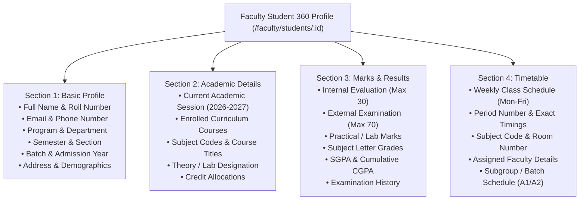
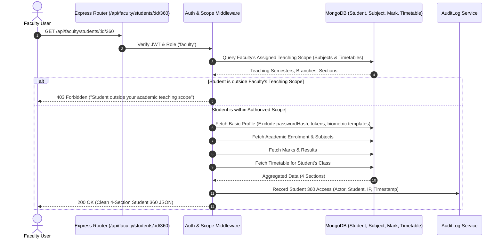

# CampusSphere AI — Faculty Student 360 Audit & Architecture Specification

**Audit Date:** 2026-11-11  
**Target Environment:** CampusSphere AI ERP (`/Users/abhinikesh/AI-Campus_Help_Desk`)  
**Phase:** Phase 1 — Architecture Audit & Implementation Specification  
**Status:** Strictly READ-ONLY Planning & Audit  

---

## 1. Executive Summary & Core Objective

The Faculty Portal currently lacks a unified, dedicated student search and comprehensive profile viewer. While local filtering exists inside grading tables (`FacultyResults/index.jsx:344`) and classroom attendance session rosters (`FacultyAttendance/`), a faculty member cannot quickly look up a student across their classes, review academic standing, inspect subject-wise marks, or check a student's daily schedule.

This audit establishes the architecture, backend authorization boundaries, database query patterns, and UI/UX design for a **Faculty Student Search & Student 360 Profile**.

### Critical Scope Constraint Enforced
Per institutional specification, the Student 360 Profile is strictly scoped to **EXACTLY FOUR MAIN SECTIONS**:
1. **Basic Profile** (Demographics, identification, batch, contact, address)
2. **Academic Details** (Session, programme, department, semester, section, enrolled subjects)
3. **Marks & Results** (Subject-wise internal, external, practical/lab, grades, SGPA/CGPA, exam history)
4. **Timetable** (Day, period, timing, subject, faculty, room, group-specific schedule)

> [!IMPORTANT]
> **Strict Scope Exclusions:** In compliance with explicit project instructions, sections for **Attendance, Assignments, Certificates, and Learning Progress are NOT included** in the Faculty Student 360 profile.

---

## 2. Existing System Inspection & Integration Location

### 2.1 Current Frontend Faculty Architecture
Inspection of `client/src/App.jsx:123-152` and `client/src/pages/FacultyDashboard/index.jsx:15-24` reveals:
- Current Faculty Portal navigation includes:
  - `/faculty/dashboard` — Overview cards, today's schedule, quick actions.
  - `/faculty/timetable` — Class-wise weekly teaching schedule.
  - `/faculty/attendance` — Session creation, live QR/biometric tracking, attendance records.
  - `/faculty/results` — Gradebook and marks entry (contains local `searchRoster` state).
  - `/faculty/assignments` — Course assignment creation and grading.
  - `/faculty/drive` — Course material uploads.
  - `/faculty/inventory` — Department asset requests.
  - `/faculty/hr` — Faculty leave and payroll self-service.
- **Identified Gap:** No dedicated route or unified navigation item exists for Student Search or Student 360.
- **Recommended Integration Location:**
  1. **Primary Dedicated Route:** Add `/faculty/students` (Student Search Directory) and `/faculty/students/:id` (Student 360 Profile).
  2. **Sidebar Navigation Item:** Add `Student 360` with icon `GraduationCap` into `Sidebar.jsx` under the Faculty navigation menu.
  3. **Dashboard Quick Link:** Add a "Student 360 Search" search bar and quick action card directly on the `FacultyDashboard` top banner.

### 2.2 Current Backend Faculty Controller Audit
Inspection of `server/controllers/faculty.controller.js:563-574`:
```javascript
// Current implementation in server/controllers/faculty.controller.js
const getStudents = asyncHandler(async (req, res) => {
  const { branch, semester } = req.query;
  const filter = {};
  if (branch) filter.branch = branch;
  if (semester) filter.semester = Number(semester);

  const students = await Student.find(filter)
    .populate('user', 'name email loginId')
    .sort({ rollNumber: 1 });

  return res.status(200).json({ success: true, data: students, message: 'OK' });
});
```

#### Deficiencies in Existing Backend Implementation:
1. **No Keyword / Identifying Search:** Does not support searching by student name, roll number, student ID, email, or section.
2. **Missing Authorization Scoping:** If no `branch` or `semester` is provided, it performs an unrestricted dump of all students in the database, violating faculty data boundaries.
3. **No Student 360 Aggregation Endpoint:** No endpoint exists to consolidate student identity, academic enrolment, marks/results, and class timetable in a single authorized call.

---

## 3. Search Engine Design & Ranking Algorithm

### 3.1 Supported Identifying Fields
The search query will match against verified database fields in `Student` and `User` models:
- **Student Name:** `Student.fullName` and `User.name` (case-insensitive regex and text match).
- **University Roll Number:** `Student.rollNumber` (e.g., `1/24/SET/BCS/231` or `20240001` — exact match and prefix match).
- **Student ID:** `Student._id` (exact BSON ObjectId lookup if valid).
- **Institutional Email:** `Student.email` or `User.email` (lowercase prefix/exact match).
- **Academic Coordinates:** `Student.branch` (Department/Branch), `Student.semester`, `Student.section`.
- **Phone Number:** `Student.phone` (only if authorized; masked in preview unless full profile is viewed).

### 3.2 Ranking & Relevancy Precedence
When a faculty member types into the search box, results are ranked deterministically:
1. **Tier 1 (Exact Match):** Exact match on `rollNumber` or `email` (Weight: 100).
2. **Tier 2 (Prefix Match):** `rollNumber` begins with query (e.g. typing `1/24/SET` or `2024`) (Weight: 80).
3. **Tier 3 (Name Match):** `fullName` starts with or exactly contains query tokens (Weight: 60).
4. **Tier 4 (Class Match):** Student belongs to faculty's currently active semester and section (Weight: 40).
5. **Tier 5 (Alphabetical):** Fallback sort by `fullName` ascending.

---

## 4. The Four Exact Student 360 Profile Sections



### 4.1 Section 1: Basic Profile
- **Source Model:** `Student` populated with `User`.
- **Displayed Fields:**
  - Full Name (`Student.fullName`)
  - University Roll Number (`Student.rollNumber`)
  - Institutional Email (`Student.email` / `User.email`)
  - Phone Number (`Student.phone` — displayed with appropriate privacy masking for unauthorized roles)
  - Programme (`Student.program`, e.g. "B.Tech")
  - Department / Branch (`Student.branch`, e.g. "Computer Science & Engineering")
  - Semester & Section (`Student.semester`, `Student.section`, e.g. "5th Semester, Section A")
  - Batch / Admission Year (`Student.admissionYear`, e.g. "Batch 2024–2028")
  - Status (`Student.status`, e.g. "Active")
  - Residential Address (`Student.address`)
  - Guardian Name & Contact (`Student.guardianName`, `Student.guardianPhone`)

### 4.2 Section 2: Academic Details
- **Source Models:** `Student`, `Subject`, `Department`.
- **Displayed Fields:**
  - Academic Session: `2026–2027 (Odd Semester)`
  - Enrolled Curriculum Subjects:
    - Queries `Subject.find({ branch: student.branch, semester: student.semester })`.
    - Subject Code (e.g. `CS501`, `CS502`, `CS508L`)
    - Subject Title (e.g. "Design Analysis of Algorithms", "Formal Languages & Automata Theory")
    - Course Type: Theory vs Practical / Laboratory
    - Credit Hours: e.g. 4 Credits
    - Assigned Faculty In-Charge: Instructor name and department.

### 4.3 Section 3: Marks & Results
- **Source Models:** `Mark` populated with `Subject` and `Exam`.
- **Displayed Fields:**
  - Subject-wise Mark Breakdown:
    - Internal Continuous Assessment (e.g. Scored / 30)
    - End-Semester External Examination (e.g. Scored / 70)
    - Practical / Lab Examination Marks (where applicable)
    - Total Marks Scored (e.g. Scored / 100)
    - Letter Grade (UGC 10-point scale: `O`, `A+`, `A`, `B+`, `B`, `C`, `P`, `F` computed via `server/utils/grades.js`)
    - Pass / Fail Status
  - Cumulative Academic Standing:
    - Current Semester SGPA (Credit-weighted grade point average)
    - Cumulative CGPA across completed semesters
  - Historical Examination Ledger:
    - List of examinations (`Exam` titles, dates, semester, evaluation status).

### 4.4 Section 4: Timetable
- **Source Model:** `Timetable` populated with `Subject` and `User` (Faculty).
- **Displayed Fields:**
  - Student's Weekly Schedule:
    - Queries `Timetable.find({ department: student.branch, semester: student.semester, section: student.section, status: 'published' })`.
    - Handles subgroup filtering: displays `batch: 'All'` plus the student's assigned group (e.g. `3CSE-A1`).
  - Period-by-Period Grid (Monday through Friday):
    - Period Number (1 to 10) & Start/End Timings (e.g. `08:10 AM – 09:00 AM`)
    - Subject Name and Code Badge (`CS501`)
    - Classroom / Laboratory Hall (`AF13`, `CF09`, `AS11`)
    - Faculty Name / Instructor abbreviation
    - Session Type badge (`Lecture` vs `Lab`)

---

## 5. Security & Authorization Enforcement Architecture



### 5.1 Strict Backend Scoping Rules
1. **Teaching Scope Derivation:**
   - Identify all classes taught by the faculty member:
     ```javascript
     const assignedSubjects = await Subject.find({ faculty: req.user.userId });
     const assignedTimetables = await Timetable.find({ faculty: req.user.userId });
     ```
   - Build a permissible scope set of `(branch, semester, section)` tuples.
2. **Access Control Evaluation:**
   - A faculty member can only query students whose `branch`, `semester`, and `section` match their assigned teaching scope (or who are enrolled in their specific subjects).
   - If an unauthorized student ID is requested, return `403 Forbidden` with a generic message to prevent ID enumeration.
3. **Data Sanitization & Privacy:**
   - Strictly exclude sensitive authentication fields: `passwordHash`, `resetPasswordToken`, `refreshToken`.
   - Strictly exclude biometric data: `FaceEmbedding` records, encrypted vectors, and consent history are never projected.
   - Financial fee ledgers, disciplinary actions, and complaint histories are excluded from the Student 360 response.
4. **Audit Logging:**
   - Record every Student 360 profile view in `AuditLog` with `actorId`, `actorRole: "faculty"`, `targetStudentId`, `action: "view_student_360"`, `ipAddress`, and `timestamp`.

---

## 6. API Endpoint Design

### 6.1 Search Endpoint
- **Route:** `GET /api/faculty/students/search`
- **Auth:** Bearer JWT (`role: 'faculty'`)
- **Query Parameters:**
  - `q` (string, required): Search query (roll number, name, email).
  - `semester` (number, optional): Filter by semester.
  - `section` (string, optional): Filter by section.
  - `limit` (number, default: 20, max: 50).
- **Response Format:**
  ```json
  {
    "success": true,
    "count": 2,
    "data": [
      {
        "_id": "6ae46faf9e9e56f71ecccdd5",
        "rollNumber": "20240001",
        "fullName": "Arjun Sharma",
        "email": "arjun.sharma@campus.edu",
        "program": "B.Tech",
        "branch": "CSE",
        "semester": 5,
        "section": "A",
        "status": "active"
      }
    ]
  }
  ```

### 6.2 Consolidated Student 360 Endpoint
- **Route:** `GET /api/faculty/students/:id/360`
- **Auth:** Bearer JWT (`role: 'faculty'`) + `authorizeFacultyStudentAccess` middleware.
- **Response Format:**
  ```json
  {
    "success": true,
    "data": {
      "basicProfile": {
        "_id": "6ae46faf9e9e56f71ecccdd5",
        "fullName": "Arjun Sharma",
        "rollNumber": "20240001",
        "email": "arjun.sharma@campus.edu",
        "phone": "+91 98765 43210",
        "program": "B.Tech",
        "department": "Computer Science & Engineering",
        "branch": "CSE",
        "semester": 5,
        "section": "A",
        "batch": "2024-2028",
        "admissionYear": 2024,
        "gender": "male",
        "dateOfBirth": "2005-04-12T00:00:00.000Z",
        "address": "14/2 Park Street, New Delhi",
        "guardianName": "Ramesh Sharma",
        "guardianPhone": "+91 98765 11223",
        "status": "active"
      },
      "academicDetails": {
        "academicSession": "2026-2027",
        "program": "B.Tech",
        "department": "Computer Science & Engineering",
        "semester": 5,
        "section": "A",
        "enrolledSubjects": [
          {
            "_id": "6ae62db1dddbc260975cb0be",
            "code": "CS501",
            "name": "Design Analysis of Algorithms",
            "credits": 4,
            "type": "Theory",
            "faculty": "Prof. Neha Singh"
          }
        ]
      },
      "marksAndResults": {
        "cgpa": 8.6,
        "sgpa": 8.8,
        "subjects": [
          {
            "subjectCode": "CS501",
            "subjectName": "Design Analysis of Algorithms",
            "credits": 4,
            "internalMarks": 27,
            "maxInternal": 30,
            "externalMarks": 62,
            "maxExternal": 70,
            "totalMarks": 89,
            "maxMarks": 100,
            "grade": "A+",
            "isPassed": true
          }
        ],
        "examHistory": []
      },
      "timetable": {
        "effectiveDate": "2026-10-21",
        "schedule": [
          {
            "dayOfWeek": 1,
            "dayName": "Monday",
            "period": 1,
            "startTime": "08:10 AM",
            "endTime": "09:00 AM",
            "subjectCode": "CS501",
            "subjectName": "Design Analysis of Algorithms",
            "room": "AF13",
            "faculty": "Prof. Neha Singh",
            "batch": "All"
          }
        ]
      }
    }
  }
  ```

---

## 7. Frontend UI/UX Design Specifications

1. **Light Mode Consistency:** Pure light surfaces (`#FFFFFF` cards, `#F8FAFC` canvas, subtle `#E2E8F0` borders). Zero dark-mode classes.
2. **Tabbed Navigation:**
   - 4 accessible tabs using ARIA tab pattern:
     - `Tab 1: Basic Profile` (Demographic summary, contact info, guardian cards).
     - `Tab 2: Academic Details` (Session overview, enrolled curriculum subject list table).
     - `Tab 3: Marks & Results` (SGPA/CGPA metric pills, subject-wise score table, grade badges).
     - `Tab 4: Timetable` (Weekly Monday-to-Friday schedule grid with time and room badges).
3. **Empty & Error States:**
   - Search: Clean empty state ("No students found matching query within your teaching scope").
   - Profile tabs: If marks are unreleased, display "Marks pending evaluation" badge rather than blank screen.
   - Skeletons: Shimmering loading skeletons for cards and tables during fetch.

---

**Report Authored By:** Antigravity AI Engineering Specialist  
**Deliverable Status:** COMPLETE & READY FOR PHASE 1 IMPLEMENTATION
