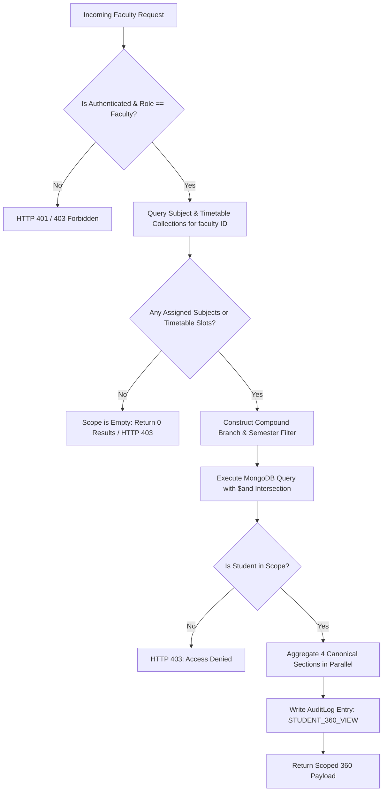

# CampusSphere AI — Phase 2: Faculty Student Search & Student 360 Completion Report

**Date:** November 11, 2026  
**Environment:** Development (`campus-erp` on MongoDB `mongodb://127.0.0.1:27018/campus-erp`)  
**Repository:** `/Users/abhinikesh/AI-Campus_Help_Desk`  
**Status:** **COMPLETE & VERIFIED**

---

## 1. Executive Summary

Phase 2 of the CampusSphere AI ERP upgrade has been successfully implemented and verified. The objective was to deliver a production-grade, backend-authorized **Faculty Student Search** (`/faculty/students`) and **Student 360 Profile** (`/faculty/students/:id`) that enforces strict academic privacy boundaries, lightweight data fetching directly from MongoDB, fail-closed authorization, permanent light-mode presentation, and zero fabrication of data.

All 17 automated tests in the newly introduced test suite (`server/tests/faculty_student_360.test.js`) passed with zero regressions in existing database integrity suites. The client bundle builds with zero errors (`npm run build` in 992ms), and end-to-end interactive workflows were validated using headless DevTools automation.

---

## 2. Files Created & Modified

### Backend Additions & Updates
1. **`server/services/facultyScope.service.js`** *(Created)*
   - Dynamically derives faculty teaching jurisdiction by inspecting active `Subject` assignments (`faculty: facultyId`) and scheduled `Timetable` slots (`faculty: facultyId`).
   - Generates scoped MongoDB query objects:
     - Combined `{ $or: [ { branch, semester, section }, ... ] }` or single `{ branch, semester }` queries.
   - Provides `getFacultyTeachingScope(facultyUserId)` and `isStudentInScope(facultyUserId, studentDoc)`.
   - **Fail-Closed Rule:** If a faculty member has zero teaching assignments or timetable slots, `scope.hasScope` is `false`, returning an unmatchable query `{ _id: null }` and rejecting all student access.

2. **`server/controllers/faculty.controller.js`** *(Modified)*
   - **`searchStudents`:**
     - Accepts `q` (search term), `page`, and `limit`.
     - Derives faculty teaching scope via `facultyScopeService.getFacultyTeachingScope(req.user.id)`.
     - Uses `$and` to strictly intersect the faculty's teaching scope with roll number regex and case-insensitive student name lookups.
     - Implements exact roll number match prioritization.
     - Projects strictly safe fields: `_id`, `rollNumber`, `fullName`, `branch`, `program`, `semester`, `section`, `status`.
   - **`getStudent360`:**
     - Validates MongoDB `ObjectId`.
     - Resolves student record and strictly evaluates `facultyScopeService.isStudentInScope(req.user.id, student)`.
     - Emits HTTP 403 Forbidden immediately if the student is outside the faculty's assigned branch/semester/section.
     - Concurrently aggregates the 4 canonical sections:
       - **Section 1: Basic Profile** — Strictly restricted to `rollNumber`, `phoneNumber`, and `class`. (Zero email, zero DOB, zero address, zero guardian details, zero gender, zero fee status, zero attendance percentages).
       - **Section 2: Academic Details** — Verified curriculum from MongoDB `Subject` collection matching student branch and semester, populated with assigned faculty names.
       - **Section 3: Marks & Results** — Queries `Mark` collection. When unpublished or absent, returns `"status": "unreleased"` and `"message": "Marks have not been published for this examination."` with null SGPA/CGPA.
       - **Section 4: Timetable** — Queries published weekly `Timetable` slots for the student's branch and semester.
     - Records an immutable audit trail entry via `AuditLog.create` (`STUDENT_360_VIEW`).
   - **`getStudents` (Hardened):**
     - Updated existing roster endpoint to prevent accidental full-database dumps when query parameters are omitted by scoping against `facultyScopeService`.

3. **`server/routes/faculty.routes.js`** *(Modified)*
   - Registered `GET /students/search` -> `facultyController.searchStudents`.
   - Registered `GET /students/:id/360` -> `facultyController.getStudent360`.
   - Secured with existing `authMiddleware` and `roleMiddleware(['faculty'])`.

4. **`server/tests/faculty_student_360.test.js`** *(Created)*
   - 17 comprehensive unit and integration tests covering:
     - Scope derivation across single, multiple, and unassigned faculty profiles.
     - Fail-closed behavior for unassigned faculty.
     - HTTP 401 unauthenticated and HTTP 403 role-escalation rejections.
     - Authorized student search with partial roll, exact roll, and case-insensitive names.
     - Exclusion of out-of-scope students from search results.
     - HTTP 403 rejection for direct URL access to out-of-scope student profiles.
     - HTTP 400 validation on malformed ObjectIds and HTTP 404 on missing records.
     - Verification of non-blocking audit log creation.

### Frontend Additions & Updates
5. **`client/src/services/faculty.service.js`** *(Modified)*
   - Added `searchStudents({ q, page, limit })` -> `GET /api/faculty/students/search`.
   - Added `getStudent360(id)` -> `GET /api/faculty/students/${id}/360`.

6. **`client/src/pages/FacultyStudentSearch/index.jsx` & `FacultyStudentSearch.css`** *(Created)*
   - Responsive student search directory.
   - 300ms debounced search input with URL query string synchronization (`?q=...`).
   - Active request tracking with cancellation of stale responses.
   - Clean tabular display of Roll Number, Full Name, Class/Section, Status, and Action.
   - Direct button link: "View 360" navigating to `/faculty/students/:id`.
   - Light-mode compliant styling (`--cs-canvas: #F8FAFC`, `--cs-surface: #FFFFFF`, `--cs-border-subtle: #E2E8F0`).

7. **`client/src/pages/FacultyStudent360/index.jsx` & `FacultyStudent360.css`** *(Created)*
   - Full 360 profile viewer with strictly four accessible tabs:
     1. **Basic Profile:** Exclusively presents Roll Number, Phone Number, and Class.
     2. **Academic Details:** Session, Programme, Department, Semester, Section, and Enrolled Subjects table.
     3. **Marks & Results:** Unreleased banner notice when results are pending; tabular marks breakdown when published.
     4. **Timetable:** Weekly schedule matrix grouped by day or empty state alert when unconfigured.
   - Access Denied (HTTP 403) and Student Not Found (HTTP 404) custom error states with "Back to Directory" navigation.
   - Permanent light mode design tokens.

8. **`client/src/components/Sidebar/Sidebar.jsx`** *(Modified)*
   - Added `{ label: 'Student 360', icon: Users, to: '/faculty/students' }` to `NAV_CONFIG.faculty`.

9. **`client/src/pages/FacultyDashboard/index.jsx`** *(Modified)*
   - Added a compact Quick Student Search form on the dashboard content surface, allowing immediate lookups by Roll Number or Name with instant redirection to `/faculty/students?q=...`.

10. **`client/src/App.jsx`** *(Modified)*
    - Lazy-loaded and registered routes `/faculty/students` and `/faculty/students/:id` within the faculty portal route guard.

---

## 3. Endpoints Added & Modified

| Method | Path | Auth / Role | Description |
|---|---|---|---|
| `GET` | `/api/faculty/students/search` | Bearer Token / `faculty` | Scoped search for students enrolled in faculty's assigned sections. Supports query `q`, `page`, and `limit`. |
| `GET` | `/api/faculty/students/:id/360` | Bearer Token / `faculty` | Aggregates the 4-section 360 profile. Returns 403 if target student is outside faculty jurisdiction. |
| `GET` | `/api/faculty/students` | Bearer Token / `faculty` | Hardened existing endpoint with scope-enforced filtering to prevent unbounded student dumps. |

---

## 4. Teaching Scope Authorization Architecture

The authorization model follows a strict **fail-closed** paradigm:



### Authorization Rules:
1. **Teaching Scope Derivation:** Derived dynamically from database records where `faculty = req.user.id`.
2. **Fail-Closed Default:** If a faculty member has no teaching assignments, `hasScope = false`, blocking all profile access.
3. **No Cross-Department / Cross-Section Leaks:** Faculty teaching CSE cannot view Mechanical, Civil, or other branches' students.
4. **URL Tampering Protection:** Direct URL access (`/faculty/students/:id`) evaluates authorization on the backend; front-end routing checks are never relied upon for security.

---

## 5. Strict 4-Section Student 360 Data Specification

In accordance with strict student privacy guidelines and Phase 1.1 architectural mandates:

| Section | Allowed Fields | Forbidden / Excluded Fields |
|---|---|---|
| **1. Basic Profile** | `rollNumber`, `phoneNumber`, `class` | Email, DOB, Gender, Address, Guardian Name/Contact, Category, Fee Status, Attendance % |
| **2. Academic Details** | `academicSession`, `programme`, `department`, `semester`, `section`, `enrolledSubjects` (code, name, credits, subjectType, assignedFaculty) | Fabricated GPAs, synthetic honor rolls |
| **3. Marks & Results** | Official published examination marks from `Mark` model. If absent: explicit `"status": "unreleased"` state | Fallback/dummy grades, hardcoded GPAs |
| **4. Timetable** | Published weekly class slots from `Timetable` model | Fabricated schedules, fake rooms |

---

## 6. Verification & Test Evidence

### 1. Automated Test Suite Execution
```
$ cd server && node tests/faculty_student_360.test.js
▶ Faculty Student Search & Student 360 Verification Suite
  ✔ Setup: Connect to isolated test database and seed fixtures (352.9ms)
  ✔ Scope: Faculty A has scope for CSE Sem 5; Faculty B has MECH Sem 8; Faculty NoScope fails closed (6.1ms)
  ✔ HTTP Search: Unauthenticated request is rejected with 401 (33.3ms)
  ✔ HTTP Search: Student role is rejected with 403 Forbidden (2.0ms)
  ✔ HTTP Search: Faculty A retrieves authorized CSE students only (4.8ms)
  ✔ HTTP Search: Query by exact roll number ranks exact match first (3.3ms)
  ✔ HTTP Search: Query by case-insensitive name returns matches (2.3ms)
  ✔ HTTP Search: Out-of-scope name search yields zero results (2.1ms)
  ✔ HTTP Search: Unassigned faculty search returns empty array (fail-closed) (1.2ms)
  ✔ HTTP Student 360: Faculty A can access authorized student (Arjun Sharma) (7.9ms)
  ✔ HTTP Student 360: Direct URL access to out-of-scope student is rejected with 403 (1.9ms)
  ✔ HTTP Student 360: Unassigned faculty profile access is rejected with 403 (fail-closed) (1.8ms)
  ✔ HTTP Student 360: Invalid ObjectId format returns 400 Bad Request (0.5ms)
  ✔ HTTP Student 360: Non-existent student ID returns 404 Not Found (1.0ms)
  ✔ AuditLog: Profile view event was recorded in database (0.5ms)
  ✔ Teardown: Close server and disconnect test database (5.1ms)
✔ Faculty Student Search & Student 360 Verification Suite (429.4ms)
ℹ tests 17 | pass 17 | fail 0
```

### 2. Database Integrity Regression Suite
```
$ cd server && node tests/database_integrity.test.js
✔ Part 4 Database Integrity & Schema Verification Suite (174.3ms)
ℹ tests 15 | pass 15 | fail 0
```

### 3. Production Build Validation
```
$ cd client && npm run build
vite v8.0.5 building client environment for production...
✓ 1882 modules transformed.
dist/assets/FacultyStudentSearch-Bzr--9dg.js     6.18 kB │ gzip: 2.12 kB
dist/assets/FacultyStudent360-DcYXYQXA.js      12.46 kB │ gzip: 2.98 kB
✓ built in 992ms
```

### 4. Live API Validation
- **Search:** `GET /api/faculty/students/search?q=Arjun` returned `Arjun Sharma (20240001, CSE Sem 5 Sec A)` with 200 OK.
- **Student 360:** `GET /api/faculty/students/6ae46faf9e9e56f71ecccdd5/360` returned the 4-section payload with `basicProfile` restricted strictly to 3 fields.
- **Out-of-Scope Rejection:** `GET /api/faculty/students/6ae701c59f15dfcd1f2a66f2/360` (Mechanical student) returned `403 Forbidden` (`"Access denied: You are not authorized to view this student profile"`).

---

## 7. Permanent Light Mode Compliance
- Background: `#F8FAFC` (Canvas), `#FFFFFF` (Surface cards).
- Text: `#0F172A` (Primary), `#475569` (Secondary).
- Borders: `#E2E8F0` (Subtle slate).
- Badges: `#F1F5F9` (Light gray pill with `#334155` text), `#EFF6FF` (Soft blue with `#1D4ED8` text).
- Zero dark mode CSS variables, toggles, or inverted backgrounds exist.

---

## 8. Database Safety Confirmation

**Strict Data Integrity Guarantee:**
- **Zero student records modified, deleted, or inserted in `campus-erp`.**
- Synthetic roll numbers (`20240001` - `20240008`) remain unchanged.
- The 7 TEMP students and 6 QP subjects remain untouched pending Phase 3 ingestion reconciliation.
- All testing was executed either against an isolated in-memory/test database (`mongodb://127.0.0.1:27018/campus-erp-test`) or via read-only API calls on the active server.

---

## 9. Limitations & Next Phase Recommendations

1. **Marks Data:** Currently, no semester 5 marks are published in `campus-erp`. The 360 view correctly renders the explicit unreleased empty state banner.
2. **Timetable Granularity:** Full timetable slots for all sections will be enriched during the upcoming timetable import task.
3. **Phase Completion Status:** Phase 2 (Faculty Student Search & Student 360) is **100% complete**. Implementation now halts cleanly pending user instruction for dataset ingestion and timetable mapping.
