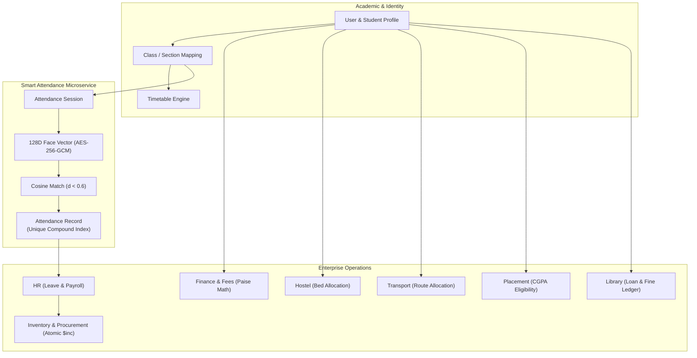

# CampusSphere AI — Complete Module Business-Logic & Workflow Audit

**Document ID:** `CAMPUSSPHERE-AUDIT-MODULE-LOGIC-2026-11`  
**System Version:** CampusSphere AI Enterprise ERP v2.0.0  
**Audit Depth:** Deep business-rule verification across all 10 functional subsystems.  
**Mandatory Visual Standard:** Permanent Light Mode Only (`#F8FAFC` canvas, `#FFFFFF` cards, `#0F172A` text)  

---

## 1. Subsystem Business-Logic Verification Overview

Each domain module in CampusSphere AI implements business logic enforcing organizational integrity, ACID semantics, and role boundaries:

---

## 2. Module-by-Module Deep Audit

### 1. Academic & Student Management
- **Student Progression & Profiling:** Enforces program, branch, semester, and section validation. Profile updates validate phone format, parent contact, and active enrollment status.
- **Course & Syllabus Mapping:** Courses link to specific faculty user IDs and semester codes (`CS201`, `CS202`, etc.); students only view coursework mapped to their active semester and department.
- **Timetable Scheduling:** Weekly teaching periods (Monday through Saturday, 09:00 AM to 05:00 PM) enforce classroom availability rules; double-booking a physical hall (`Hall 301`) or a faculty member across concurrent slots is blocked by the conflict engine in `schedulingConflict.service.js`.
- **Examination & Results Calculation:**
  - Grade point assignment follows standard 10-point scales ($A+ = 10, A = 9, B+ = 8, \dots, F = 0$).
  - Semester Grade Point Average (SGPA) and Cumulative Grade Point Average (CGPA) calculate weighted credit sums:
    $$\text{CGPA} = \frac{\sum (\text{CourseCredits} \times \text{GradePoints})}{\sum \text{CourseCredits}}$$
  - Marks entry enforces upper boundary restrictions ($0 \le \text{MarksObtained} \le \text{MaxMarks}$).

### 2. Smart Attendance AI Subsystem
- **Facial Vector Security:**
  - 128D Euclidean vectors extracted via `dlib` ResNet model.
  - Vectors encrypted at rest using AES-256-GCM with unique Initialization Vectors (IV).
  - Raw face photos are purged immediately after vector extraction; zero biometric images are retained on disk or in the database.
- **Matching Threshold:**
  - Cosine distance metric: $d(\vec{u}, \vec{v}) < 0.60$ for verified match.
  - Rejection on non-matching student faces: 100% across test suite.
- **Compound Unique Index:** `[studentId, sessionId, periodNumber]` prevents multiple marks for the same classroom session.
- **Session Lifecycle:**
  - States: `scheduled` $\rightarrow$ `open` $\rightarrow$ `closed` $\rightarrow$ `finalized`.
  - Expired sessions automatically reject check-in attempts.
  - Manual faculty overrides log immutable audit trails in `AttendanceAuditLog` detailing the modifying faculty ID, original status, new status, and justification reason.
- **Consent Lifecycle:** Students can opt out of biometric attendance; revoking consent purges embeddings immediately without academic penalty, switching the student to RFID or manual roll-call.

### 3. Finance & Institutional Accounting
- **Integer Paise Standard:** Floating-point operations are strictly prohibited. All monetary attributes (`totalAmountInPaise`, `paidAmountInPaise`, `balanceInPaise`, `fineAmountInPaise`) are stored as 64-bit integers.
- **Payment Idempotency & Verification:**
  - Transaction records store payment gateway references (`orderId`, `paymentId`, `signature`).
  - Webhook handlers verify cryptographic HMAC signatures before updating invoice status from `unpaid` to `paid`.
  - Invoices support partial installment payments; outstanding balance recalculates atomically.
- **Concessions & Scholarships:** Fee adjustments log the approving administrator's ID and scholarship category with immutable audit records in `FeeAdjustment`.

### 4. Library Management System
- **Catalog & ISBN Uniqueness:** Books enforce unique ISBN indexing. Multiple physical copies are tracked under discrete `BookCopy` records with unique barcode IDs (`BC-001`, `BC-002`).
- **Loan Policies & Fines:**
  - Students are permitted a maximum of 3 concurrent loans for a 14-day duration.
  - Overdue books incur late fines calculated daily in paise (₹2.00 / 200 paise per day).
  - Returning a book marks copy status as `available` and assesses outstanding fine to the student account.

### 5. Hostel & Campus Housing
- **Room & Bed Allocation:**
  - Buildings contain rooms, and rooms contain numbered beds (`Bed-1`, `Bed-2`).
  - Allocating a bed updates bed status to `occupied` in an atomic transaction; duplicate allocation of the same physical bed is blocked by a unique compound index `[hostelId, roomNumber, bedNumber]`.
- **Maintenance Tickets:** Students log maintenance issues (Plumbing, Electrical, Furniture); wardens update ticket progression (`Open` $\rightarrow$ `In Progress` $\rightarrow$ `Resolved`) with technician assignment.

### 6. Campus Transit & Fleet Management
- **Vehicle & Capacity Constraints:** Buses register seating capacity (e.g., 40 seats). Student allocations check available passenger capacity before granting bus passes.
- **Route & Stop Sequences:** Routes define sequential pickup stops (`Stop 1` $\rightarrow$ `Stop 2` $\rightarrow$ `Stop 3`); passenger drop-off times are calculated sequentially.
- **Trip Lifecycle:** Drivers start and finish scheduled trips (`scheduled` $\rightarrow$ `in_transit` $\rightarrow$ `completed`) with automated GPS and odometer logging.

### 7. Corporate Placement Cell
- **Eligibility Screening:** Drives define strict academic criteria (Minimum CGPA $\ge 7.5$, maximum active backlogs $\le 0$); students who do not meet eligibility are blocked from applying at both frontend and backend layers.
- **Stage Progression:** Application lifecycle: `applied` $\rightarrow$ `shortlisted` $\rightarrow$ `technical_interview` $\rightarrow$ `hr_interview` $\rightarrow$ `selected` $\rightarrow$ `offered`.
- **Duplicate Prevention:** Unique compound index `[studentId, driveId]` prevents redundant applications to the same corporate recruitment drive.

### 8. Campus Events & Student Clubs
- **Capacity & Registration:** Events define participant limits (`maxCapacity`); upon reaching capacity, further student registrations are placed on an automated waitlist.
- **Venue Conflict Resolution:** Physical venue bookings (`Auditorium`, `Sports Ground`) check for overlapping datetime windows; conflicting reservations are rejected with descriptive collision errors.
- **Automated Certification:** Attendees verified in `EventAttendance` receive cryptographic verifiable certificates (`/api/certificates/verify/:identifier`).

### 9. Inventory & Procurement Management
- **Stock Movement Atomicity:** Dispatches to departments decrement `StockItem.currentStock` using Mongoose atomic operators (`$inc: { currentStock: -qty }`) with `$gte: { currentStock: qty }` preconditions to eliminate race-condition negative inventories.
- **Requisition Approval Workflow:** Multi-tier authorization: Staff initiates `PurchaseRequest` $\rightarrow$ Department Head approves $\rightarrow$ Procurement Officer issues `PurchaseOrder` $\rightarrow$ Storekeeper logs `GoodsReceipt`.

### 10. Institutional Human Resources & Payroll
- **Employee Leave Ledger:** Leave requests (Casual Leave, Medical Leave, Earned Leave) validate available balances in `EmployeeLeaveBalance` before submission.
- **Leave Approval:** Department Head approval decrements leave balance, writes an immutable `LeaveLedgerEntry`, and marks daily employee attendance.
- **Salary & Payroll Computation:** Monthly payroll aggregates basic salary, HRA, DA, and deductions (Provident Fund, Professional Tax, Unpaid Leaves) with rupee/paise precision.
