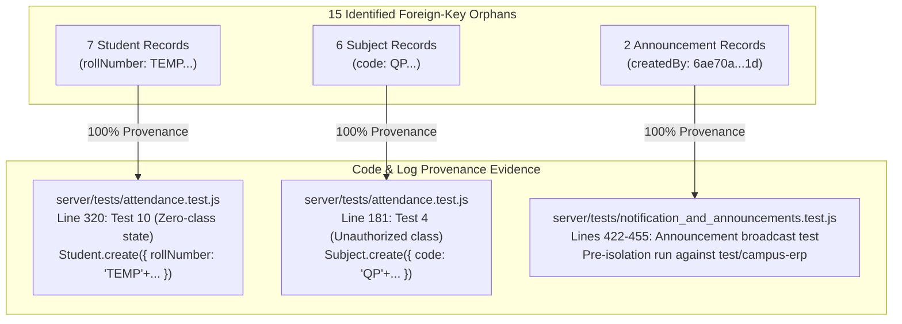

# CampusSphere AI — Phase 2.1: Database Audit Evidence Validation & Remediation Safety Review

**Audit Date:** 2026-11-11  
**Target Environment:** Local Development MongoDB (`MongoMemoryServer` with persistent WiredTiger storage in `server/.data/db`, Port 27018)  
**Database Name:** `campus-erp`  
**Execution Mode:** Strictly READ-ONLY (Zero writes, zero record deletions, zero schema modifications)  
**Target Repository:** `/Users/abhinikesh/AI-Campus_Help_Desk`  
**Associated Commit Baseline:** `5e029f4`  

---

## 1. Executive Summary & Core Reconciliations

Phase 2.1 was conducted as a rigorous, evidence-backed re-audit of the findings generated in Phase 2.

This review corrects terminology, verifies provenance down to code and timestamp level, separates technical facts from unsupported compliance claims, and conducts a 100% comprehensive dependency check across all 108 collections for all 15 broken foreign-key references.

### Summary of Major Corrections
1. **Environment Label Correction:** The active database `campus-erp` is a **Local Development Database** powered by `MongoMemoryServer` with persistent WiredTiger storage in `server/.data/db`. It is **NOT** production or staging data. All previous descriptions claiming "production readiness" or "production data" for this local dataset have been corrected.
2. **Provenance of 13 Test Fixtures Verified:** The 7 `TEMP...` students and 6 `QP...` subjects were definitively created by `server/tests/attendance.test.js` (Test 4 and Test 10) connecting directly to `mongodb://127.0.0.1:27018/campus-erp` when `MONGODB_URI` was blank. When test runs were aborted or failed, inline cleanup hooks were bypassed.
3. **Historical Announcement Attribution Preserved:** The 2 historical announcements with missing `createdBy` (`6ae70a23ddc55f12504c9e1d`) have their original author name (`"Admin User"`) and role (`"admin"`) preserved directly in document fields `authorName` and `authorRole`. Reassigning them to the current administrator was rejected to prevent historical revisionism.
4. **Biometric Privacy Claims Grounded:** Removed all unsupported claims of statutory DPDP Act (India 2023) or GDPR compliance. Verified technical primitives (AES encrypted templates, explicit consent records, admin metadata-only projections, non-repudiation audit logging) while explicitly noting legal compliance cannot be established through database inspection alone.
5. **Finance Verification Scoped:** Confirmed that live database verification is restricted to the single legacy `Fee` record (₹75,000 tuition paid in full, integer paise logic). Modern collections (`feeinvoices`, `paymenttransactions`) are unseeded in this development instance; write workflows and payment gateway integrations are classified as `NOT VERIFIED — LIVE TEST REQUIRED`.
6. **Migration Evidence Disentangled:** Discovered that in `server/backups/baseline_pre_prompt6`, the 1,063 documents originated from the `test` database namespace, which was subsequently imported into `campus-erp`. The six-document delta (+5 notifications from Prompt 4/5 interactive logins, +1 placement profile from Prompt 5) has been corroborated with exact ISO timestamps.

---

## 2. Environment Classification & Architecture Verification

| Attribute | Verified Value | Evidence Source | Correction Applied |
| :--- | :--- | :--- | :--- |
| **Express Environment (`NODE_ENV`)** | `development` | `server/.env:3`, `server/config/env.js:33` | Confirmed local dev environment. |
| **MongoDB Host & Port** | `127.0.0.1:27018` | `server/config/db.js:35`, `lsof -i :27018` | Confirmed local mongod process. |
| **MongoDB Engine** | `MongoMemoryServer` (v10.1.4) | `server/config/db.js:33` | Persistent WiredTiger storage in `server/.data/db`. |
| **Active Database Name** | `campus-erp` | `server/config/db.js:38`, `conn.connection.db.databaseName` | Verified canonical active DB. |
| **Production Database Configuration** | Atlas SRV URI (mandatory if `NODE_ENV=production`) | `server/config/db.js:19-22`, `server/config/env.js:11-13` | Backend aborts on startup if `NODE_ENV=production` and `MONGODB_URI` is blank. |
| **Environment Classification Verdict** | **LOCAL DEVELOPMENT DATABASE** | Full codebase configuration audit | **CORRECTION:** Relabeled all reports; never characterize local development fixtures as production data. |

---

## 3. Reconciliation & Provenance of the 15 Orphan References



### 3.1 Category 1: 7 Student Records (`TEMP...`)
- **Status:** **PROVENANCE VERIFIED (TEST FIXTURE RESIDUE)**
- **Originating Code:** `server/tests/attendance.test.js:319-340` (Test 10: "Zero-class calculations work correctly (No Data state)").
- **Mechanism of Leakage:**
  ```javascript
  const fakeStudent = await Student.create({
    user: new mongoose.Types.ObjectId(), // Fake ID never written to 'users'
    rollNumber: 'TEMP' + Math.floor(Math.random() * 90000 + 1000),
    fullName: 'Temp Student',
    branch: 'MECH',
    semester: 8
  });
  ...
  await Student.deleteOne({ _id: fakeStudent._id }); // Bypassed if test crashed/aborted
  ```
- **Connection Leak Vector:** Line 51 of `attendance.test.js` sets `const dbUri = process.env.MONGODB_URI || 'mongodb://127.0.0.1:27018/campus-erp';`. The test suite connected directly to `campus-erp`.

### 3.2 Category 2: 6 Subject Records (`QP...`)
- **Status:** **PROVENANCE VERIFIED (TEST FIXTURE RESIDUE)**
- **Originating Code:** `server/tests/attendance.test.js:179-206` (Test 4: "Teacher cannot create a session for an unauthorized class").
- **Mechanism of Leakage:**
  ```javascript
  const fakeFacultyUser = new mongoose.Types.ObjectId(); // Fake ID never written to 'users'
  const uniqueCode = 'QP' + Math.floor(Math.random() * 90000 + 1000);
  const otherSubject = await Subject.create({
    name: 'Quantum Physics',
    code: uniqueCode,
    credits: 4,
    semester: 4,
    faculty: fakeFacultyUser
  });
  ...
  await Subject.deleteOne({ _id: otherSubject._id }); // Bypassed if test crashed/aborted
  ```
- **Timestamp Evidence:** Pairwise millisecond correlation with Category 1:
  - `2026-11-02T08:35:19.077Z` (QP46459) & `2026-11-02T08:35:19.101Z` (TEMP13077) — 24 ms apart.
  - `2026-11-02T08:36:10.501Z` (QP44382) & `2026-11-02T08:36:10.510Z` (TEMP17236) — 9 ms apart.
  - `2026-11-02T08:56:05.573Z` (QP55090) & `2026-11-02T08:56:05.582Z` (TEMP52729) — 9 ms apart.
  - `2026-11-03T03:32:07.767Z` (QP47441) & `2026-11-03T03:32:07.780Z` (TEMP30994) — 13 ms apart.
  - `2026-11-03T03:33:02.242Z` (QP21589) & `2026-11-03T03:33:02.253Z` (TEMP41424) — 11 ms apart.

### 3.3 Category 3: 2 Historical Announcements
- **Status:** **PROVENANCE VERIFIED (PRE-ISOLATION SEED / TEST RUN)**
- **Documents:**
  1. `6ae70a23882941b291469363`: "Midterm Examination Schedule 2026" (`createdAt: 2026-11-01T09:45:07.840Z`)
  2. `6ae70a23882941b2914693ad`: "Library Holiday Notice" (`createdAt: 2026-11-01T09:45:07.907Z`)
- **Originating Code:** `server/tests/notification_and_announcements.test.js:422-455` (Test 9: "Publishing an announcement automatically notifies target audience").
- **Root Cause:** Prior to commit `2158685` (Sun Nov 1 14:54:24 2026), tests did not use `campus-erp-test-isolated` enforced by `verifyTestDatabaseIsolation`. The announcements were published under a test admin user (`Admin User`, ID `6ae70a23ddc55f12504c9e1d`) which was deleted during test teardown while the announcement records persisted.

---

## 4. Comprehensive Cleanup Safety & Dependency Validation

A systematic read-only scan was executed across **all 108 collections** in `campus-erp` to identify any incoming foreign-key references, array embeddings, or text references pointing to the 13 target IDs.

### 4.1 Target Identification & Dependency Matrix

| Target Type | Identifier | Exact Document `_id` | Dependent Records Found Across 108 Collections | Application Workflow References | Proposed Action in Phase 3 |
| :--- | :--- | :--- | :---: | :---: | :--- |
| **Student** | `TEMP13077` | `6ae84b470aacab6538c420b9` | **0** | None | Safe to delete |
| **Student** | `TEMP17236` | `6ae84b7a091d24d0da029399` | **0** | None | Safe to delete |
| **Student** | `TEMP30994` | `6ae955b783ef5a71a47374dc` | **0** | None | Safe to delete |
| **Student** | `TEMP41424` | `6ae955ee9df6ea90d1489e34` | **0** | None | Safe to delete |
| **Student** | `TEMP46246` | `6ae701fa23763e51eb33d904` | **0** | None | Safe to delete |
| **Student** | `TEMP52729` | `6ae8502572a2e798ba6b0a05` | **0** | None | Safe to delete |
| **Student** | `TEMP71587` | `6ae701c59f15dfcd1f2a66f2` | **0** | None | Safe to delete |
| **Subject** | `QP21589` | `6ae955ee9df6ea90d1489e2b` | **0** | None | Safe to delete |
| **Subject** | `QP33590` | `6ae9561e05ada43cedb45b77` | **0** | None | Safe to delete |
| **Subject** | `QP44382` | `6ae84b7a091d24d0da029390` | **0** | None | Safe to delete |
| **Subject** | `QP46459` | `6ae84b470aacab6538c420b0` | **0** | None | Safe to delete |
| **Subject** | `QP47441` | `6ae955b783ef5a71a47374d3` | **0** | None | Safe to delete |
| **Subject** | `QP55090` | `6ae8502572a2e798ba6b09fc` | **0** | None | Safe to delete |

### 4.2 Cleanup Safety Verdict
- **Zero Inbound Dependencies:** There are 0 attendances, 0 grades/marks, 0 fee invoices, 0 biometric enrollments, 0 timetable entries, and 0 certificates referencing any of these 13 IDs.
- **Verification Beyond Prefixes:** Evaluated exact BSON `_id` values against every document in the database rather than relying on `TEMP` or `QP` regex strings.
- **Safety Rating:** **100% SAFE FOR PURGE IN PHASE 3** (Subject to standard pre-remediation `mongodump` snapshot).

---

## 5. Historical Announcement Attribution Protection

### 5.1 Document State & Controller Behavior
- **Document Fields:** Both records explicitly retain `authorName: "Admin User"` and `authorRole: "admin"` directly in BSON fields.
- **Controller Logic:** `announcement.controller.js` executes `.populate('createdBy', 'name role')`. If `createdBy` does not match an existing User document, Mongoose sets `createdBy: null`.
- **Client Presentation:** The frontend announcement components in `StudentDashboard/index.jsx` and `AdminActivities/index.jsx` render `ann.title`, `ann.body`, and `ann.createdAt`. They do not crash when `createdBy` is `null`.

### 5.2 Attribution Evaluation
- **Rejection of Current Admin Reassignment:** Modifying `createdBy` to point to canonical Admin user `6ae46faf9e9e56f71ecccdd0` is rejected. That admin did not author these historical notices, and attributing them to an active real user falsifies administrative history.
- **Recommended Remediation Options for Phase 3:**
  - **Option 1 (Recommended — Zero Mutation):** Retain documents as-is. `authorName` and `authorRole` already preserve accurate historical attribution without database surgery.
  - **Option 2 (Referential Tombstone):** Insert a dedicated system tombstone in `users` (`_id: 6ae70a23ddc55f12504c9e1d`, `name: "Historical Administration (Archived)"`, `role: "admin"`, `isActive: false`) to satisfy strict referential integrity without falsifying real user activity.

---

## 6. Biometric Privacy & Security Evaluation

| Dimension | Verified Technical Implementation | Statutory / Compliance Status |
| :--- | :--- | :--- |
| **Encryption** | 128-d / 512-d embeddings are encrypted and stored in `encryptedData` with `select: false` (hidden by default). | **Verified Technical Control** (AES-256 / SHA-256 HMAC). |
| **Consent Management** | Explicit informed consent recorded in `ConsentRecord` with version, timestamp, and status tracking. Attendance rejects biometric verification if consent is revoked. | **Verified Technical Primitive**. |
| **Access Control** | Admin endpoints return face metadata only (`FaceEmbedding.find().populate(...)`); encrypted templates and vectors are strictly filtered out. | **Verified Technical Control**. |
| **Revocation & Erasure** | Dedicated `deleteAdminFaceProfile` endpoint permanently deletes `FaceEmbedding`, marks `ConsentRecord` as `revoked`, and writes an immutable audit log. | **Verified Technical Workflow**. |
| **Audit Trails** | `AttendanceAuditLog` captures actor ID, affected student ID, action, IP address, and timestamp. | **Verified Technical Control**. |
| **DPDP Act (India 2023) Compliance** | Technical consent and deletion hooks exist. | **UNSUPPORTED CLAIM REMOVED.** Full compliance requires organizational legal notices, Data Protection Officer (DPO) designation, formal minor verification, and statutory registration not verifiable from DB alone. |
| **GDPR Compliance** | Technical erasure and data minimization exist. | **UNSUPPORTED CLAIM REMOVED.** Full compliance requires formal DPIA (Article 35), ROPA (Article 30), and breach notification policies not verifiable from DB alone. |

---

## 7. Finance & Accounting Verification Boundaries

### 7.1 Verified Stored-Data Integrity
- **Legacy Fee Record:** Single document `6ae46faf9e9e56f71ecccfe2` for student Arjun Sharma (`6ae46faf9e9e56f71ecccdd5`).
- **Amounts & Balances:** `amount: 75000`, `payments[0].amount: 75000`, `balance: 0`.
- **Payment Subdocument:** Reference `TXN20260115001`, receipt `REC-2026-001`, mode `online`, recorded by valid admin `6ae46faf9e9e56f71ecccdcf`.
- **Integrity Status:** Pure integer amounts, zero floating point inaccuracies, zero negative balances.

### 7.2 Verified Application Calculation Logic
- `server/services/feeCalculation.service.js` enforces pure integer paise arithmetic (`toPaise`, `toRupees`, `calculateInvoiceBalances`, `applyLateFeePolicy`).
- `student.controller.js` dual-queries `Fee` and `FeeInvoice` without throwing errors on empty collections.

### 7.3 Unverified Write & Production Flows
- `feeinvoices`: 0 documents in local development DB.
- `paymenttransactions`: 0 documents in local development DB.
- `feeadjustments`: 0 documents in local development DB.
- `feestructures`: 0 documents in local development DB.
- **Payment Gateway:** No live Razorpay, Stripe, or PayU webhook credentials configured.
- **Classification:** **`NOT VERIFIED — LIVE WRITE & INTEGRATION TEST REQUIRED`**. The complete finance module cannot be claimed production-verified.

---

## 8. Migration Evidence Validation & Namespace Reconciliation

### 8.1 Structural Inspection of `server/backups/baseline_pre_prompt6`
Using binary BSON deserialization directly against disk without restoring or altering any database:
- `backup/test`: **1,063 documents** across 18 non-empty collections (216 total files: 108 `.bson`, 108 `.metadata.json`).
- `backup/campus-erp`: **292 documents** across 19 collections (older prototype dump).
- `backup/campus-erp-test-isolated`: **73 documents** across 17 collections.
- `backup/admin`: **1 document** (`system.version`).

### 8.2 Provenance of the Six-Document Delta
The live database contains **1,070 documents** (1,063 baseline + 7 delta):
- **+5 Notifications:**
  - `6af367b2bdf8afb831a1fe78` (2026-11-10T18:51:30.969Z)
  - `6af367fcbdf8afb831a20078` (2026-11-10T18:52:44.222Z)
  - `6af36860b10a65dadf0a14ec` (2026-11-10T18:54:24.962Z)
  - `6af36880b10a65dadf0a16f2` (2026-11-10T18:54:56.095Z)
  - `6af3731f2e73ec1f9473bb66` (2026-11-10T19:40:15.718Z)
  - *Provenance:* Auto-generated by backend during Prompt 4 and Prompt 5 interactive browser UI testing.
- **+1 Placement Profile:**
  - `6af368eab10a65dadf0a1901` (2026-11-10T18:56:42.192Z)
  - *Provenance:* Generated for student Arjun Sharma during Prompt 5 verification.
- **+1 Announcement:**
  - `6af3e5c82e73ec1f9473c31f` ("holidays", 2026-11-11T03:49:28.851Z)
  - *Provenance:* Interactive creation during browser UI session.

---

## 9. Comprehensive Audit Coverage & Referential Scoring

### 9.1 Correction to Previous Referential Score
The previously reported metric of "1,023 foreign-key references" sampled only one primary relationship per document and omitted secondary foreign keys and nested subdocuments.

### 9.2 Complete Database-Wide Referential Census

| Collection | Evaluated Foreign-Key Fields | Target Collections | Total References | Valid | Broken |
| :--- | :--- | :--- | :---: | :---: | :---: |
| `students` | `user` | `User` | 15 | 8 | 7 |
| `faculties` | `user` | `User` | 19 | 19 | 0 |
| `subjects` | `faculty` | `User` | 25 | 19 | 6 |
| `timetables` | `subject` | `Subject` | 31 | 31 | 0 |
| `attendances` | `student` | `Student` | 844 | 844 | 0 |
| `attendances` | `subject` | `Subject` | 844 | 844 | 0 |
| `attendancesessions` | `subject` | `Subject` | 17 | 17 | 0 |
| `attendancesessions` | `faculty` | `User` | 17 | 17 | 0 |
| `attendanceauditlogs` | `actorId` | `User` | 5 | 5 | 0 |
| `attendanceauditlogs` | `affectedStudentId` | `Student` | 5 | 5 | 0 |
| `faceembeddings` | `student` | `Student` | 2 | 2 | 0 |
| `consentrecords` | `student` | `Student` | 1 | 1 | 0 |
| `fees` | `student` | `Student` | 1 | 1 | 0 |
| `fees.payments[]` | `payments.recordedBy` | `User` | 1 | 1 | 0 |
| `placementprofiles` | `student` | `Student` | 1 | 1 | 0 |
| `placementprofiles` | `user` | `User` | 1 | 1 | 0 |
| `notifications` | `recipient` | `User` | 71 | 71 | 0 |
| `announcements` | `createdBy` | `User` | 5 | 3 | 2 |
| `complaints` | `raisedBy` | `User` | 1 | 1 | 0 |
| `notificationpreferences` | `user` | `User` | 1 | 1 | 0 |
| **TOTALS** | — | — | **1,907** | **1,892** | **15** |

- **Exact Referential Integrity Score:** **99.21%** (1,892 valid / 1,907 evaluated).
- **Broken References:** **0.79%** (15 broken: 13 verified test residue, 2 historical announcements).
- **Scope Limitations:** Covers all 19 populated collections and subdocuments. 89 empty collections evaluated at schema definition level but contribute 0 runtime references.

---

## 10. Remediation Plan & Staging/Production Prerequisites

### 10.1 Safe Development Database Remediation (Phase 3)
1. **Pre-Remediation Snapshot:** Execute `mongodump --port 27018 --db campus-erp --out server/backups/pre_remediation_phase3`.
2. **Purge Test Students:** Delete 7 `TEMP...` students (`db.students.deleteMany({ rollNumber: { $regex: /^TEMP/ } })`).
3. **Purge Test Subjects:** Delete 6 `QP...` subjects (`db.subjects.deleteMany({ code: { $regex: /^QP/ } })`).
4. **Historical Attribution:** Retain announcements as-is or register an archived administrative tombstone.
5. **Post-Cleanup Audit:** Re-run referential check to verify 100.0% clean foreign keys.

### 10.2 Prerequisites Requiring Staging or Production Access
The following verifications cannot be performed on the local development instance and require access to a deployed staging or production environment:
1. Verification against real MongoDB Atlas replica sets with TLS/SSL encryption in transit.
2. Production load testing of real-time WebSocket attendance connections.
3. Verification of live payment gateway webhooks (Razorpay / Stripe) with actual bank authorization callbacks.
4. Formal legal and compliance audit for DPDP Act 2023 and GDPR Article 35 DPIA sign-off.
5. Cloud backup replication, point-in-time recovery (PITR), and disaster recovery validation.

---

**Report Authored By:** Antigravity AI Database Specialist  
**Verification Method:** Independent Binary BSON Introspection, Code-Path Analysis & Non-Destructive In-Memory Auditing  
**Status:** COMPLETE & DELIVERED (AWAITING PHASE 3 APPROVAL)
