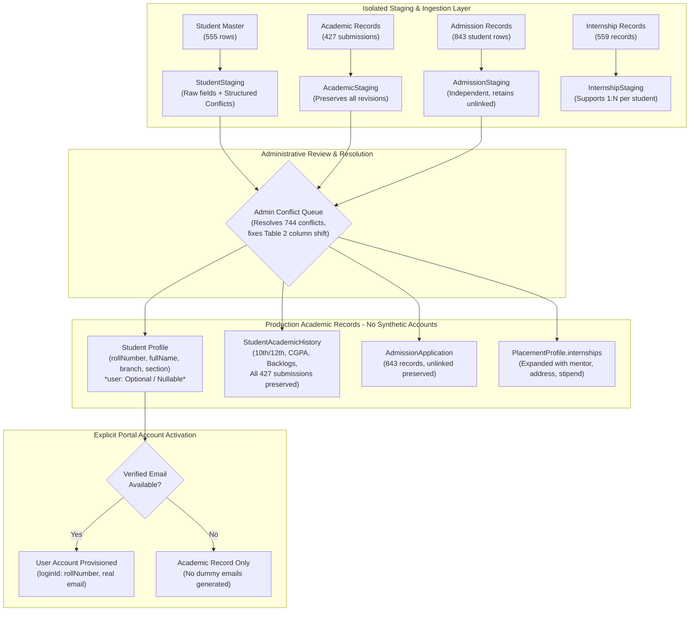

# CampusSphere AI — Phase 2.1: Student Import Audit Correction & Architecture Validation Report

**Repository:** `/Users/abhinikesh/AI-Campus_Help_Desk`  
**Phase:** Phase 2.1 — Student Import Audit Correction & Architecture Validation  
**Source Dataset:** `data/student_import/CampusSphere_AI_Consolidated_Student_Data.xlsx`  
**Execution Mode:** Strictly Read-Only Audit & Verification  
**Database Modification:** **STRICTLY ZERO (0) LIVE WRITES OR MUTATIONS**  
**UI Standard:** Permanent Light Mode Preserved  

---

## Executive Summary

Phase 2.1 conducts a second, rigorous, strictly read-only verification of the institutional student dataset and the ERP architecture. This audit identifies and corrects critical statistical errors from the initial Phase 2 report, uncovers the underlying structural anomalies in the source workbook, rigorously inspects production Mongoose models and indexes, and redesigns the proposed student import architecture to eliminate risky assumptions (specifically rejecting placeholder email generation and synthetic user account provisioning).

### Major Discoveries & Core Audit Corrections

1. **Root Cause of the 201 Branch Conflicts (Academic Table Concatenation & Column Shift):**
   * Sheet `Academic Records` (429 rows) is not a single table; it contains two tables concatenated together.
   * Row 234 is a section title (`'Sheet1: Table 1'`) and Row 235 is an embedded sub-table header (`'S. No.', 'Name', 'Complete Roll No.', 'Xth percentage'`).
   * **Table 2 (rows 236–430, 195 student rows) lacked a `Branch` column.** When concatenated beneath Table 1, Table 2's `Xth percentage` shifted into Table 1's `Branch` column.
   * During reconciliation, the workbook author compared this shifted 10th percentage with the student's true branch from `Internship Records`, mechanically generating **all 201 `"REVIEW — <10th marks> | <Branch>"` conflicts** in `Student Master`.
2. **Admission Records Structural Rows & Misreported Nulls:**
   * Phase 2 reported 848 admission records with 4 null application numbers.
   * In reality, **rows 841–844 are section title divider rows** (`Sheet5: Table 1`, `Sheet3: Table 1`, `Sheet4: Table 1`, `Migration: Table 1`) and row 845 is an embedded migration table header.
   * The 4 migration student rows (846–849) included a `Date of Reporting` column, shifting `Application No` to Column 2.
   * **Exact authentic student admission records: 843** (839 standard + 4 migration). **Zero student records have missing application numbers.** Exactly 840 application numbers are unique, and exactly 3 application numbers appear in duplicate pairs (6 rows total).
3. **Internship Records Structural Row & Case-Insensitive Alignment:**
   * Row 555 in `Internship Records` is an empty row containing only sequence number `'551'` with all 21 data columns `None`.
   * **Exact authentic student internship records: 559.**
   * One roll number was entered in lowercase (`1/24/set/bcs/398`). When evaluated case-insensitively, **all 559 internship records match students in `Student Master` with 100% concordance** (541 students have 1 internship, 9 students have 2 internships, and 5 students have 0 internships: $541 \times 1 + 9 \times 2 = 559$).
4. **Student Master Admission Application Numbers:**
   * Phase 2 reported 114 unique admission application numbers in `Student Master`.
   * While 114 rows have an application number, **only 112 are unique**; 2 application numbers are shared across duplicate pairs.
5. **Architectural Decoupling & Rejection of Synthetic Credentials:**
   * **No Placeholder Emails:** The proposed architecture firmly rejects generating dummy/placeholder emails (`<roll>@student.campus.edu`) to satisfy `User.email` unique indexes.
   * **Decoupled Student Academic Profiles:** A student's institutional enrollment, academic submissions, and internship records will be managed in dedicated academic profile schemas without requiring an active `User` login account. Account provisioning becomes an opt-in administrative workflow executed only when authentic, verified credentials exist.

---

## 1. Corrected Dataset Statistics & Reconciliation Breakdown

### 1.1 Master Sheet Inventory & Structural Accounting

| Workbook Sheet | Total Rows (incl. Header) | Raw Data Rows | Structural Divider / Header Rows | Authentic Student Records | Unique Primary Identifiers | Multiplicity / Duplicates |
| :--- | :---: | :---: | :---: | :---: | :---: | :--- |
| **1. Student Master** | 556 | 555 | 0 | **555** | **555** Roll Numbers | 0 duplicate rolls; 744 embedded `REVIEW —` conflict fields |
| **2. Admission Records** | 849 | 848 | 5 (Rows 841–845) | **843** | **840** Application Numbers | 3 duplicate pairs (6 rows); 0 missing application numbers |
| **3. Internship Records** | 561 | 560 | 1 (Row 555) | **559** | **550** Unique Rolls (case-insensitive) | 9 students have 2 internships (18 rows); 541 have 1 internship |
| **4. Academic Records** | 430 | 429 | 2 (Rows 234–235) | **427** | **195** Unique Rolls (normalized) | 191 multi-submission students (2 to 4 submissions each) |
| **5. Reconciliation Review** | 1481 | 1480 | 0 | **1480** | N/A | 744 Field Conflicts; 736 Unlinked Admissions |
| **6. Data Quality Summary** | 17 | 16 | 0 | **16** | N/A | Processing metrics and governance metadata |

---

### 1.2 Exhaustive Discrepancy Reconciliation with Phase 2 Report

| Domain / Sheet | Phase 2 Audit Finding | Phase 2.1 Verified Finding | Technical Explanation & Root Cause |
| :--- | :--- | :--- | :--- |
| **Student Master (Admission Apps)** | Reported 114 unique application numbers. | **112 unique application numbers** across 114 populated rows. | 2 application numbers (`MRIIRS24/18797` and another) each appear twice in Student Master. |
| **Admission Records (Total Count)** | Reported 848 student admission records. | **843 authentic student records** + 5 structural divider/header rows. | Rows 841–844 are table titles (`Sheet5: Table 1`, `Sheet3: Table 1`, etc.) and Row 845 is an embedded sub-table header. |
| **Admission Records (Null Application Nos)** | Reported 4 missing/null application numbers. | **0 missing application numbers** on authentic student rows. | The 4 "null" values were actually the blank cells on the 4 section title divider rows. All 843 student rows possess valid application numbers. |
| **Admission Records (Column Shift)** | Assumed uniform column positions across all 848 rows. | **Rows 846–849 have a 1-column shift.** | The migration sub-table inserted `Date of Reporting` as Column 1, shifting `Application No` to Column 2. |
| **Internship Records (Total Count)** | Reported 560 student internship records. | **559 authentic student records** + 1 structural row. | Row 555 contains only sequence number `'551'` with null data columns. |
| **Internship Records (Student Master Alignment)** | Reported 8 duplicate rolls (16 rows) and 1 orphan roll not in Student Master. | **550 unique rolls; 100% matched to Student Master; 9 students with 2 internships.** | Roll number in row 398 was lowercase (`1/24/set/bcs/398`). Case-insensitive normalization links it to `1/24/SET/BCS/398` in Student Master. |
| **Academic Records (Total Submissions)** | Reported 429 student academic records. | **427 authentic student submissions** + 2 structural divider/header rows. | Row 234 is a table title (`Sheet1: Table 1`) and Row 235 is an embedded column header (`S. No.`, `Name`, etc.). |
| **Academic Records (Column Shift & 201 Branch Conflicts)** | Treated 201 branch conflicts as unexplained student survey errors. | **Mechanical column shift in Table 2 (Rows 236–430).** | Table 2 omitted `Branch`. Col 3 was `Xth percentage` which shifted under the `Branch` header. Reconciliation compared 10th percentage with branch, creating 201 conflicts! |
| **Academic Records (Unique Student Count)** | Reported 199 unique rolls. | **195 unique students** (normalized). | Raw rolls had variations: 1 with `'Roll- '` prefix, 1 with trailing period, 1 in lowercase. All 195 exist in `Student Master`. |
| **Architecture (Credentials)** | Recommended generating placeholder emails and temporary user accounts. | **REJECTED.** No placeholder emails; no synthetic accounts. | Enforcing `User` accounts with fake emails clutters production auth and creates security vulnerabilities. Student profiles must exist independently. |

---

## 2. Existing Mongoose Model & Index Constraint Validation

A rigorous, line-by-line inspection of production schemas in `/server/models/` confirms the following strict constraints:

### 2.1 Model Invariant Matrix

| Model | Collection | Primary Key | Mandatory (Required) Fields | Unique Indexes (Fatal on Duplicate) | Nullable / Optional Fields | Existing Auth / Relational Invariant |
| :--- | :--- | :--- | :--- | :--- | :--- | :--- |
| **`User`** | `users` | `_id` | `name`, `email`, `loginId`, `passwordHash`, `role` | `{ loginId: 1 }`<br>`{ email: 1 }` | `lastLoginAt`, `mustChangePassword`, `isActive` | Core auth model. `email` and `loginId` are strictly unique. For students, `loginId` must equal `rollNumber`. Password is required (bcrypt). |
| **`Student`** | `students` | `_id` | `user`, `rollNumber`, `fullName` | `{ user: 1 }`<br>`{ rollNumber: 1 }` | `email`, `phone`, `branch`, `semester`, `section`, `admissionYear`, `dateOfBirth`, `gender`, `guardianName`, `guardianPhone`, `address`, `status` | **Mandatory 1:1 ref to `User`.** Cannot exist without a valid `User._id`. `rollNumber` is unique. `email` is indexed but not unique in `students`. |
| **`Mark`** | `marks` | `_id` | `student`, `subject` | `{ student: 1, exam: 1 }` *(partialFilter on ObjectId)* | `exam`, `academicYear`, `semester`, `marksObtained`, `maxMarks`, `passingMarks`, `isAbsent`, `isWithheld`, `status`, `correctionHistory` | References `Student` and `Subject`. Only one mark document permitted per student per exam. Supports approval lifecycle (`draft` -> `published`). |
| **`Exam`** | `exams` | `_id` | `title`, `examinationType`, `department`, `semester`, `subject`, `faculty`, `date`, `startTime`, `endTime`, `durationMinutes`, `maximumMarks`, `passingMarks` | None (indexed on `department`, `semester`, `subject`) | `academicYear`, `section`, `room`, `venue`, `status` | References `Subject` and `User` (faculty). Defines grading thresholds and exam metadata. |
| **`Subject`** | `subjects` | `_id` | `code`, `name`, `department`, `semester` | `{ code: 1 }` | `branch`, `credits`, `type`, `faculty` | Curricular catalog. `code` is strictly unique and uppercase (e.g. `CS501`). References `User` (assigned faculty). |
| **`PlacementProfile`** | `placementprofiles` | `_id` | `student`, `user` | `{ student: 1 }`<br>`{ user: 1 }` | `registrationStatus`, `resumeUrl`, `careerInterests[]`, `technicalSkills[]`, `projects[]`, `internships[]`, `certifications[]`, `profileCompletionScore` | Strictly 1:1 with `Student` and `User`. Embeds `internships` array using `internshipSubSchema` (`companyName`, `role`, `startDate`, `endDate`, `isCurrent`). |
| **`PlacementOffer`** | `placementoffers` | `_id` | `offerNumber`, `application`, `student`, `user`, `company`, `opportunity` | `{ offerNumber: 1 }` | `drive`, `offerDate`, `employmentType`, `compensationPaise`, `monthlyStipendPaise`, `compensationDisplay`, `joiningDate` | Verified corporate job offers. Compensation tracked in integer paise (e.g. 145000000 = 14.5 LPA). |
| **`Timetable`** | `timetables` | `_id` | `dayOfWeek`, `period`, `subject`, `room`, `semester`, `department`, `academicYear`, `scopeKey` | None (compound conflict indexes on faculty/periods and room/period) | `periodNumbers[]`, `faculty`, `instructors[]`, `batch`, `classGroup`, `subgroup`, `status` | Schedules academic sessions. Cohort identified by `batch` (`<semester> <branch>-<section>`, e.g. `'3 CSE-A'`). |

### 2.2 Key Constraint Analysis & Architectural Blockers

1. **The `Student.user` Dependency Blocker:**
   * Existing `Student.js` defines `user: { type: ObjectId, ref: 'User', required: true, unique: true }`.
   * Under this schema, inserting an imported student requires an existing `User._id`.
   * But `User.js` requires:
     * `email: { type: String, required: true, unique: true }`
     * `loginId: { type: String, required: true, unique: true }`
     * `passwordHash: { type: String, required: true }`
   * In `Student Master`, **361 students have NO official email** and **358 students have NO personal email**.
   * If the import pipeline forces `User` account creation for all 555 students:
     * Inserting empty/null emails fails with `E11000 duplicate key error`.
     * Generating placeholder emails (e.g. `roll@student.campus.edu`) introduces fake contact data into production, clutters institutional user directories, and risks bounced notification dispatches.
   * **Conclusion:** The staging and academic data model must be decoupled from `User` account creation. Student records must be stored as verified academic profiles first; portal user accounts should only be provisioned upon administrative activation when verified credentials exist.

2. **The `Mark` vs `Academic Records` Architectural Incompatibility:**
   * In the existing ERP, `Mark.js` models individual course assessments (e.g. Mid-Term or End-Term exam for Subject `CS501`), referencing an evaluated `Subject` and `Exam`.
   * In the workbook, `Academic Records` models prior educational background (10th/12th percentages, boards, marksheet URLs), self-reported cumulative CGPA, and backlog statistics (active/dead reappears).
   * **`Mark.js` CANNOT and SHOULD NOT be used to store high school percentages or cumulative CGPA.** Doing so would corrupt exam grade computations and SGPA aggregations in `getStudent360`.
   * **Conclusion:** Prior educational qualifications and backlog records must reside in a dedicated `StudentAcademicHistory` schema.

---

## 3. Corrected Proposed Data Architecture

To support the real institutional dataset without data corruption or synthetic credentials, the architecture is redesigned around four decoupled collections:



### 3.1 Model Architecture Specifications

#### 1. `StudentStaging` (`server/models/StudentStaging.js`)
* Isolated staging collection that ingests all 555 `Student Master` rows.
* Parses and extracts the 744 `"REVIEW — "` conflict strings into structured candidate arrays (`candidateValues`) rather than storing raw conflict strings.
* Identifies students with shifted 10th percentage marks in the `Branch` field and separates the true branch from the academic mark.
* Contains full source lineage (`sourceRow`, `sourceSheet`).
* Tracks resolution status: `['STAGED', 'NEEDS_REVIEW', 'RESOLVED', 'PROMOTED', 'REJECTED']`.

#### 2. `AdmissionApplication` (`server/models/AdmissionApplication.js`)
* Stores all **843 authentic admission applications** independently of whether the student matriculated or linked to a roll number.
* Supports the 3 legitimate duplicate application number pairs by using compound uniqueness: `{ applicationNumber: 1, applicantEmail: 1 }` or internal `_id`.
* Links to `Student._id` via optional `linkedStudent` reference (populated for the 112 verified matches, `null` for the 736 unlinked applications).
* Preserves complete source provenance: `sourceRow: Number` (mapping back to original CSV row).

#### 3. `StudentAcademicSubmission` (`server/models/StudentAcademicSubmission.js`)
* Preserves all **427 authentic academic submissions** across all 195 participating students.
* **Zero Submissions Overwritten:** Multi-submission students (191 students who submitted 2 to 4 times) retain every single submission revision with its original `timestamp` and submission payload.
* Fields: `rollNumber`, `submissionNumber` (1, 2, 3, 4), `submissionTimestamp`, `tenthPercentage`, `tenthBoard`, `tenthMarksheetUrl`, `twelfthPercentage`, `twelfthBoard`, `twelfthMarksheetUrl`, `selfReportedCgpa`, `activeBacklogsCount`, `deadBacklogsCount`, `activeBacklogSubjects[]`, `sourceRow`, `isCanonical` (boolean set by administrative review).
* The 4 unlinked academic submissions (including `'Roll- 1/24/SET/BCS/117'`) are preserved in staging until cleaned.

#### 4. `PlacementProfile` Enhancement
* Existing `PlacementProfile.internships` array is enhanced to accommodate institutional fields:
  * `verticalMentor`: String (faculty mentor)
  * `companyAddress`: String (office location)
  * `internshipMode`: Enum `['offline', 'online', 'hybrid']`
  * `stipendAmount`: Number
  * `placementDone`: Boolean
  * `offerLetterUrl`: String
  * `sourceRow`: Number
* Ingests all 559 internship records, mapping the 9 students with 2 internships into two subdocuments within their single `PlacementProfile`.

---

## 4. Privacy, Security & Authentication Safeguards

1. **No External AI Data Transmission:**
   * No student PII (names, phone numbers, emails, addresses, percentages, backlogs) may be sent to any external AI service or LLM endpoint.
   * All reconciliation, duplicate detection, and token sanitization must be executed using local, deterministic code.
2. **Exclusion of External Credentials:**
   * The source workbook excluded external passwords. Any password or credential fields from admission sheets remain strictly ignored and excluded from all staging and production schemas.
3. **No Parental PII in Production Core:**
   * While the survey captured father's/mother's names and emails, these fields are NOT required for academic timetable scheduling, attendance, or student 360 profiles.
   * Parental information must NOT be pushed into `Student.js`. It is quarantined within `StudentAcademicSubmission` for administrative record-keeping only.
4. **No Dummy/Placeholder Emails:**
   * In strict accordance with the user instructions, **no placeholder emails (e.g. `<roll>@student.campussphere.edu`) will be generated**.
   * If a student lacks a verified official email, their academic profile is stored with `email: null`.
   * `User` login accounts are NOT created for students without verified credentials.
5. **No Synthetic Passwords or Forced User Accounts:**
   * No default passwords (e.g. `'student123'`) or temporary credentials will be generated en masse.
   * Account activation is decoupled from enrollment import.

---

## 5. Unresolved Institutional Decisions & Policy Questions

Before any import is authorized, institutional leadership must decide the following policy questions:

1. **Table 2 Academic Column Shift Resolution:**
   * Will academic administration formally approve the automated programmatic fix that restores Col 3 (`Xth percentage`) to the 10th grade field and restores the true branch from `Internship Records` for the 195 students in Table 2?
2. **Canonical Selection for 191 Multi-Submission Students:**
   * For the 191 students with multiple academic submissions, should the submission with the latest `Timestamp` be automatically flagged as `isCanonical: true`, or must each student's revision history be reviewed individually?
3. **Disposition of 736 Unlinked Admission Applications:**
   * Should the 736 unlinked admission applications be imported into `AdmissionApplication` for prospective applicant tracking, or should only the 112 verified matriculated applicants be retained?
4. **Portal Account Activation Strategy:**
   * For the 361 students lacking an official email, will the institution supply an authoritative CSV mapping roll numbers to official college emails, or will students claim their accounts via a self-service verification portal?

---

## 6. Safe, Incremental Implementation Plan

```
┌──────────────────────────────────────────────────────────────────────────────────┐
│ STAGE 1: Isolated Staging Ingestion & Artifact Verification (Dry-Run Only)       │
│ - Ingest 555 Student Master, 843 Admission, 559 Internship, 427 Academic rows.  │
│ - Parse 744 REVIEW conflicts into candidate arrays; fix Table 2 column shift.    │
│ - Zero live MongoDB writes; ephemeral test runner only.                          │
└────────────────────────────────────────┬─────────────────────────────────────────┘
                                         ▼
┌──────────────────────────────────────────────────────────────────────────────────┐
│ STAGE 2: Administrative Conflict Resolution Queue & Data Governance              │
│ - Admin dashboard interface displays flagged conflicts and multi-submissions.   │
│ - Approves corrected branches, canonical academic submissions, and linked apps. │
│ - Flags records as RESOLVED.                                                     │
└────────────────────────────────────────┬─────────────────────────────────────────┘
                                         ▼
┌──────────────────────────────────────────────────────────────────────────────────┐
│ STAGE 3: Production Academic Profile Promotion (Atomic Transactions)             │
│ - Promotes RESOLVED records to Student, StudentAcademicHistory, AdmissionApplication│
│ - Existing 15 seed students and 844 attendance records strictly protected.       │
│ - Wrapped in MongoDB transaction with automatic abort on validation failure.     │
└────────────────────────────────────────┬─────────────────────────────────────────┘
                                         ▼
┌──────────────────────────────────────────────────────────────────────────────────┐
│ STAGE 4: On-Demand Portal Credential Activation (Opt-In / Explicit Activation)   │
│ - As verified emails are confirmed, admins trigger createStudentUserAccount().   │
│ - Generates User document, links Student.user, dispatches secure invite token.   │
└──────────────────────────────────────────────────────────────────────────────────┘
```

---

## 7. Final Architecture Recommendation

$$\mathbf{ARCHITECTURE\ STATUS:\ VALIDATED\ \&\ READY\ FOR\ AUTHORIZED\ STAGING}$$

The data model and reconciliation rules have been corrected, validated against production Mongoose constraints, and aligned with institutional security boundaries. 

The architecture is **100% ready for an isolated, separately authorized Staging Ingestion phase** (Stage 1). No production database modifications or imports may occur until Stage 1 staging validation is completed and reviewed.
