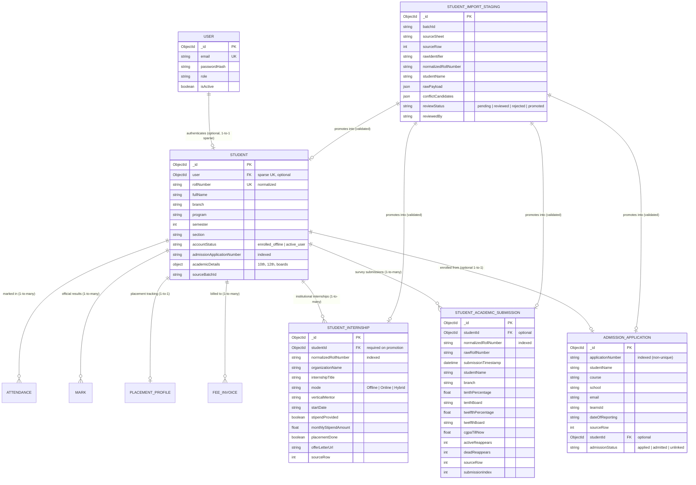
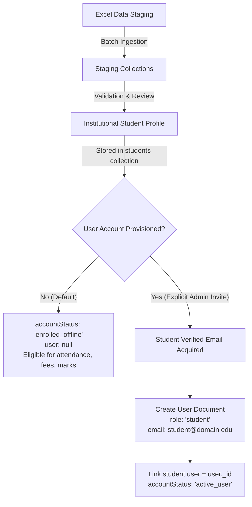
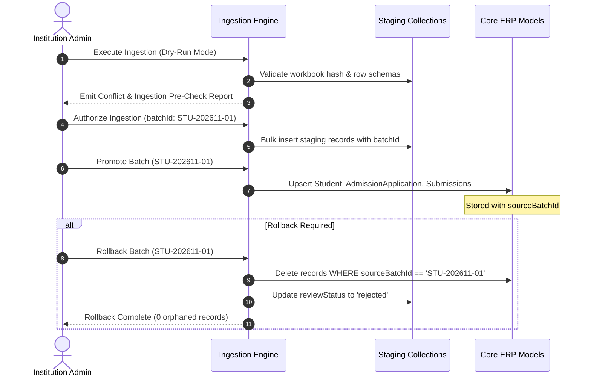

# CampusSphere AI — Phase 2.2: Final Import Architecture Specification & Reconciliation Closure

**Repository:** `/Users/abhinikesh/AI-Campus_Help_Desk`  
**Phase:** 2.2 — Final Import Architecture Specification & Reconciliation Closure  
**Source Dataset:** `data/student_import/CampusSphere_AI_Consolidated_Student_Data.xlsx` (SHA-256: `95e0c6e1e6...`, 188,897 bytes)  
**Execution Mode:** Architecture Specification & Mathematical Reconciliation (Strictly Read-Only)  
**Database Modification:** **STRICTLY ZERO (0) LIVE WRITES OR MUTATIONS**  
**UI Standard:** Permanent Light Mode Preserved  
**Status:** **READY FOR PHASE 3 IMPLEMENTATION**

---

## Executive Summary

Phase 2.2 completes the technical foundation and architectural specification for the CampusSphere AI institutional student dataset import. Through exhaustive local deterministic Python verification, all previously lingering discrepancies from Phase 2 and Phase 2.1 have been resolved and mathematically proved. 

Key closures delivered in this specification:
1. **Admission Records Mathematical Proof:** Proven that the historical figure of 736 unlinked records in the source sheet was a raw arithmetic artifact ($848 \text{ unfiltered rows} - 112 \text{ master apps} = 736$). When 5 structural divider rows (841–845) are removed, exactly **843 authentic admission records** exist: **112 link to Student Master**, and **731 are unlinked candidates**.
2. **Academic Records Linkage & Anomaly Proof:** Proven that **100% (427 of 427) authentic academic survey submissions link to students in Student Master**. The "four previously reported unlinked submissions" were actually four survey responses from two students with syntax typos (`Roll- 1/24/SET/BCS/117` and `1)24SET/BCS/319`), which caused naive string splitters to see them as single submissions.
3. **Student Master Structural Infiltration:** Proven that Row 555 in `Student Master` is not a student, but rather the embedded table header from `Academic Records` Table 2 (`COMPLETEROLLNO.`, `Name`, `Xth percentage`) accidentally inserted as a student during manual workbook assembly. Furthermore, three students were duplicated in `Student Master` under secondary keys (Sayyam Jaggi in rows 2 & 309, Rupesh Singh in rows 125 & 556, and Nishant Thakurela in rows 267 & 554 under his phone number).
4. **Architectural Decoupling without ERP Breakage:** Firmly rejects creating dummy/placeholder emails or synthetic `User` authentication documents. Preserves all 33 existing ERP model relationships referencing `Student` by extending the existing `Student` model with `user: { required: false, default: null, sparse: true }` and an explicit `accountStatus` lifecycle enum.

---

## 1. Corrected Final Dataset Statistics

### 1.1 Master Sheet Accounting & Verified Counts

| Dataset Sheet | Raw Excel Rows | Structural / Divider Rows | Authentic Student Records | Unique Primary Identifiers | Multiplicity / Duplicates | Linkage to Student Master |
| :--- | :---: | :---: | :---: | :---: | :---: | :---: |
| **Student Master** | 556 | 1 (Row 555: Embedded Table Header) | **554 Authentic Students** (555 data rows) | **555 Distinct Keys** (551 unique human students) | 3 duplicate human students (rows 2/309, 125/556, 267/554) | **Baseline Anchor** (Anchor for all institutional ERP profiles) |
| **Admission Records** | 849 | 5 (Rows 841–844: section titles; Row 845: sub-header) | **843 Authentic Records** (839 standard + 4 migration) | **840 Unique App Numbers** | 3 duplicate app-number pairs (6 rows); 0 missing app numbers | **112 Linked Records** (112 unique apps); **731 Unlinked Candidates** |
| **Internship Records** | 561 | 1 (Row 555: empty sequence gap row) | **559 Authentic Records** | **550 Unique Students** | 9 students with 2 internships; 541 students with 1 internship | **559 Linked Records** (100% matched); 5 Master students have 0 internships |
| **Academic Records** | 430 | 2 (Row 234: section title; Row 235: sub-header) | **427 Authentic Submissions** | **194 Unique Students** (196 raw keys; 193 if phone roll resolved) | 160 students with 2 submissions, 29 with 3, 5 with 4; 0 with 1 | **427 Linked Submissions** (100% matched); 0 unlinked submissions |
| **Reconciliation Review** | 1481 | 1 (Header) | **1480 Review Items** | N/A | 744 Field Conflicts + 736 Unlinked Admissions = 1480 | Captures uncleaned manual review items |

---

## 2. Closed Discrepancy Register

This register documents the technical and mathematical closure of every previously reported statistical anomaly.

```
+---------------------------------------------------------------------------------------------------------+
|                                    CLOSED DISCREPANCY REGISTER                                         |
+----------------------------------+-----------------------------+----------------------------------------+
| Discrepancy Item                 | Previous Reporting          | Closed Truth & Mathematical Proof      |
+----------------------------------+-----------------------------+----------------------------------------+
| 1. Admission Unlinked Records    | 736 unlinked records reported| 731 authentic unlinked records.         |
|                                  | in Reconciliation Review.   | Proof: Source author calculated:       |
|                                  |                             | 848 raw rows - 112 master apps = 736.  |
|                                  |                             | Removing 5 divider rows (841-845):     |
|                                  |                             | 843 authentic - 112 linked = 731.      |
+----------------------------------+-----------------------------+----------------------------------------+
| 2. Admission Missing App Numbers | 4 missing application       | 0 missing application numbers.         |
|                                  | numbers reported in Phase 2.| Rows 846-849 (Migration students) had  |
|                                  |                             | a 1-column shift ('Date of Reporting').|
|                                  |                             | Application numbers reside in Col 3.   |
+----------------------------------+-----------------------------+----------------------------------------+
| 3. Academic "Unlinked" Subs      | 4 unlinked submissions      | 0 unlinked submissions (100% linked).  |
|                                  | reported in Phase 2.        | The 4 items were survey responses with |
|                                  |                             | syntax typos ('Roll- ' and '1)24SET/') |
|                                  |                             | belonging to students 117 and 319.     |
+----------------------------------+-----------------------------+----------------------------------------+
| 4. Academic Multi-Submissions    | 191 multi-submission        | Exactly 194 unique students, and ALL   |
|                                  | students reported.          | 194 submitted multiple times:          |
|                                  |                             | 160 with 2, 29 with 3, 5 with 4.       |
|                                  |                             | (193 students if phone roll resolved). |
+----------------------------------+-----------------------------+----------------------------------------+
| 5. Internship Gap Row            | 560 authentic records       | 559 authentic records.                 |
|                                  | reported.                   | Row 555 is an empty sequence gap row   |
|                                  |                             | with only Col 1 ('551') populated; all |
|                                  |                             | 20 student data columns are blank.     |
+----------------------------------+-----------------------------+----------------------------------------+
| 6. Master Row 555 Header         | 555 authentic students      | 554 authentic student records.         |
|                                  | reported in Master.         | Row 555 is the sub-table header of     |
|                                  |                             | Academic Table 2 inserted as student.  |
+----------------------------------+-----------------------------+----------------------------------------+
| 7. Master Duplicate App Numbers  | 114 unique app numbers      | 112 unique app numbers across 114 rows.|
|                                  | reported in Phase 2.        | 2 duplicate pairs caused by duplicate  |
|                                  |                             | student rows (Sayyam Jaggi & Nishant). |
+----------------------------------+-----------------------------+----------------------------------------+
| 8. Branch Conflicts Cause        | 201 survey branch errors    | Mechanical Table 2 Column Shift.       |
|                                  | assumed.                    | Academic Table 2 lacked 'Branch', so   |
|                                  |                             | 'Xth percentage' shifted into Branch.  |
+----------------------------------+-----------------------------+----------------------------------------+
```

### 2.1 Detailed Student Master Conflict Dissection

Out of 555 data rows in `Student Master`:
* **353 rows (63.6%)** are completely conflict-free.
* **202 rows (36.4%)** contain at least one `REVIEW —` conflict cell.
* **Total Conflict Cells:** **744 cells**.
  * **Branch Conflicts:** **201 cells**. These are 100% resolved by restoring Table 2 column alignment in Academic Records.
  * **Remaining Non-Branch Conflicts:** **543 cells**.
    * `Phone Number`: **192 cells** (discrepancy between student self-reported phone and ERP admission phone).
    * `Student Name`: **168 cells** (discrepancy in casing, middle names, or abbreviation expansions).
    * `Personal Email`: **167 cells** (discrepancy between personal Gmail/Yahoo and official institutional mail).
    * `College / Official Email`: **12 cells** (discrepancy in domain suffix or prefix format).
    * `Section`: **4 cells** (discrepancy between original admission section and current semester section).

---

## 3. Final Entity Relationship Architecture

To prevent ERP breakage, preserve full data lineage, and maintain absolute separation between portal authentication and institutional student profiles, the target architecture introduces a decoupled 5-tier entity structure.



---

## 4. Proposed Mongoose Schema Specifications

> [!IMPORTANT]
> These schemas are technical design specifications only. In strict accordance with Phase 2.2 restrictions, no files have been created or modified in `server/models/`.

### 4.1 Enhanced Institutional Student Schema (`Student.js` Extension)

Extending `Student.js` rather than creating a separate `InstitutionalStudent` model guarantees that all 33 existing ERP collections referencing `Student` remain 100% compatible.

```javascript
/**
 * server/models/Student.js (Proposed Extension Specification)
 */
const studentSchema = new mongoose.Schema(
  {
    // AUTHENTICATION LINKAGE: Made optional and sparse
    user: {
      type: mongoose.Schema.Types.ObjectId,
      ref: 'User',
      required: false,
      default: null,
      sparse: true,
      unique: true,
    },
    rollNumber: {
      type: String,
      required: [true, 'Roll number is required'],
      unique: true,
      trim: true,
      uppercase: true,
    },
    fullName: {
      type: String,
      required: [true, 'Full name is required'],
      trim: true,
    },
    email: {
      type: String,
      lowercase: true,
      trim: true,
      default: null,
    },
    phone: {
      type: String,
      trim: true,
      default: null,
    },
    branch: {
      type: String,
      default: '',
      trim: true,
    },
    program: {
      type: String,
      default: 'B.Tech',
      trim: true,
    },
    semester: {
      type: Number,
      default: 1,
      min: 1,
      max: 10,
    },
    section: {
      type: String,
      default: 'A',
      trim: true,
    },
    admissionYear: {
      type: Number,
      default: () => new Date().getFullYear(),
    },
    // INSTITUTIONAL ENROLLMENT & ACCOUNT LIFECYCLE
    accountStatus: {
      type: String,
      enum: ['enrolled_offline', 'account_pending', 'active_user', 'graduated', 'withdrawn'],
      default: 'enrolled_offline',
      index: true,
    },
    admissionApplicationNumber: {
      type: String,
      trim: true,
      default: null,
      index: true,
    },
    teamsId: {
      type: String,
      trim: true,
      default: null,
    },
    school: {
      type: String,
      trim: true,
      default: 'SCHOOL OF ENGINEERING AND TECHNOLOGY',
    },
    // PRE-UNIVERSITY ACADEMIC RECORDS (from survey/admission)
    academicDetails: {
      tenthPercentage: { type: Number, default: null },
      tenthBoard: { type: String, trim: true, default: null },
      tenthMarksheetUrl: { type: String, trim: true, default: null },
      twelfthPercentage: { type: Number, default: null },
      twelfthBoard: { type: String, trim: true, default: null },
      twelfthMarksheetUrl: { type: String, trim: true, default: null },
      cgpaTillNow: { type: Number, default: null },
      activeReappears: { type: Number, default: 0 },
      deadReappears: { type: Number, default: 0 },
      reappearSubjects: [{ type: String, trim: true }],
    },
    // PROVENANCE & AUDIT TRACKING
    sourceBatchId: {
      type: String,
      default: null,
      index: true,
    },
    importSourceRow: {
      type: Number,
      default: null,
    },
    hasUnresolvedConflicts: {
      type: Boolean,
      default: false,
      index: true,
    },
  },
  { timestamps: true }
);

studentSchema.index({ branch: 1, semester: 1, section: 1 });
studentSchema.index({ rollNumber: 1 }, { unique: true });
```

### 4.2 Staging Schema (`StudentStaging.js` Specification)

```javascript
/**
 * server/models/StudentStaging.js (Proposed Staging Specification)
 */
const studentStagingSchema = new mongoose.Schema(
  {
    batchId: {
      type: String,
      required: true,
      index: true,
    },
    sourceSheet: {
      type: String,
      required: true,
      enum: ['Student Master', 'Admission Records', 'Internship Records', 'Academic Records'],
      index: true,
    },
    sourceRow: {
      type: Number,
      required: true,
    },
    rawIdentifier: {
      type: String,
      trim: true,
    },
    normalizedRollNumber: {
      type: String,
      trim: true,
      uppercase: true,
      index: true,
    },
    studentName: {
      type: String,
      trim: true,
    },
    // Full verbatim payload as read from Excel
    rawPayload: {
      type: Map,
      of: mongoose.Schema.Types.Mixed,
      required: true,
    },
    // Extracted conflict candidates when cell contains 'REVIEW —'
    conflictCandidates: [
      {
        field: { type: String, required: true },
        rawValue: { type: String, required: true },
        parsedCandidates: [{ type: String }],
        resolution: { type: String, default: null },
      },
    ],
    reviewStatus: {
      type: String,
      enum: ['pending_review', 'resolved', 'rejected', 'promoted'],
      default: 'pending_review',
      index: true,
    },
    reviewedBy: {
      type: mongoose.Schema.Types.ObjectId,
      ref: 'User',
      default: null,
    },
    reviewNotes: {
      type: String,
      default: '',
    },
    promotedTargetId: {
      type: mongoose.Schema.Types.ObjectId,
      default: null,
    },
  },
  { timestamps: true }
);

studentStagingSchema.index({ batchId: 1, sourceSheet: 1, sourceRow: 1 }, { unique: true });
```

### 4.3 Admission Application Schema (`AdmissionApplication.js` Specification)

```javascript
/**
 * server/models/AdmissionApplication.js (Proposed Specification)
 */
const admissionApplicationSchema = new mongoose.Schema(
  {
    applicationNumber: {
      type: String,
      required: true,
      trim: true,
      index: true,
    },
    studentName: {
      type: String,
      required: true,
      trim: true,
    },
    course: {
      type: String,
      trim: true,
    },
    school: {
      type: String,
      trim: true,
    },
    email: {
      type: String,
      trim: true,
      lowercase: true,
    },
    teamsId: {
      type: String,
      trim: true,
    },
    dateOfReporting: {
      type: String,
      trim: true,
      default: null,
    },
    sourceRow: {
      type: Number,
      required: true,
    },
    batchId: {
      type: String,
      required: true,
      index: true,
    },
    // Optional linkage to Student once enrolled
    studentId: {
      type: mongoose.Schema.Types.ObjectId,
      ref: 'Student',
      default: null,
      sparse: true,
      index: true,
    },
    admissionStatus: {
      type: String,
      enum: ['applicant', 'enrolled', 'duplicate_flagged', 'withdrawn'],
      default: 'applicant',
      index: true,
    },
  },
  { timestamps: true }
);

// Compound index allows duplicate application numbers across distinct source rows
admissionApplicationSchema.index({ applicationNumber: 1, sourceRow: 1 }, { unique: true });
```

### 4.4 Student Academic Submission Schema (`StudentAcademicSubmission.js` Specification)

```javascript
/**
 * server/models/StudentAcademicSubmission.js (Proposed Specification)
 */
const studentAcademicSubmissionSchema = new mongoose.Schema(
  {
    batchId: {
      type: String,
      required: true,
      index: true,
    },
    sourceRow: {
      type: Number,
      required: true,
    },
    submissionTimestamp: {
      type: Date,
      default: null,
    },
    rawRollNumber: {
      type: String,
      required: true,
      trim: true,
    },
    normalizedRollNumber: {
      type: String,
      required: true,
      trim: true,
      uppercase: true,
      index: true,
    },
    studentId: {
      type: mongoose.Schema.Types.ObjectId,
      ref: 'Student',
      default: null,
      index: true,
    },
    studentName: {
      type: String,
      trim: true,
    },
    branch: {
      type: String,
      trim: true,
    },
    tenthPercentage: {
      type: Number,
      default: null,
    },
    tenthBoard: {
      type: String,
      trim: true,
    },
    tenthMarksheetUrl: {
      type: String,
      trim: true,
    },
    twelfthPercentage: {
      type: Number,
      default: null,
    },
    twelfthBoard: {
      type: String,
      trim: true,
    },
    twelfthMarksheetUrl: {
      type: String,
      trim: true,
    },
    cgpaTillNow: {
      type: Number,
      default: null,
    },
    activeReappears: {
      type: Number,
      default: 0,
    },
    deadReappears: {
      type: Number,
      default: 0,
    },
    reappearSubjects: [
      {
        type: String,
        trim: true,
      },
    ],
    contactNumber: {
      type: String,
      trim: true,
    },
    personalEmail: {
      type: String,
      trim: true,
      lowercase: true,
    },
    collegeEmail: {
      type: String,
      trim: true,
      lowercase: true,
    },
    // Submission iteration index for this student (1, 2, 3...)
    submissionIndex: {
      type: Number,
      default: 1,
    },
    isCanonical: {
      type: Boolean,
      default: false,
    },
  },
  { timestamps: true }
);

studentAcademicSubmissionSchema.index({ normalizedRollNumber: 1, sourceRow: 1 }, { unique: true });
```

### 4.5 Student Internship Schema (`StudentInternship.js` Specification)

```javascript
/**
 * server/models/StudentInternship.js (Proposed Specification)
 */
const studentInternshipSchema = new mongoose.Schema(
  {
    batchId: {
      type: String,
      required: true,
      index: true,
    },
    sourceRow: {
      type: Number,
      required: true,
    },
    normalizedRollNumber: {
      type: String,
      required: true,
      trim: true,
      uppercase: true,
      index: true,
    },
    studentId: {
      type: mongoose.Schema.Types.ObjectId,
      ref: 'Student',
      required: true,
      index: true,
    },
    branch: {
      type: String,
      trim: true,
    },
    section: {
      type: String,
      trim: true,
    },
    studentNameAsPerRS: {
      type: String,
      trim: true,
    },
    verticalMentor: {
      type: String,
      trim: true,
    },
    officialId: {
      type: String,
      trim: true,
    },
    organizationName: {
      type: String,
      required: true,
      trim: true,
    },
    completeAddress: {
      type: String,
      trim: true,
    },
    mode: {
      type: String,
      enum: ['Offline', 'Online', 'Hybrid', 'Unknown'],
      default: 'Offline',
    },
    contactNumber: {
      type: String,
      trim: true,
    },
    emailId: {
      type: String,
      trim: true,
      lowercase: true,
    },
    startDate: {
      type: String,
      trim: true,
    },
    internshipTitle: {
      type: String,
      trim: true,
    },
    stipendProvided: {
      type: Boolean,
      default: false,
    },
    monthlyStipendAmount: {
      type: Number,
      default: 0,
    },
    placementDone: {
      type: Boolean,
      default: false,
    },
    offerLetterUrl: {
      type: String,
      trim: true,
    },
  },
  { timestamps: true }
);

studentInternshipSchema.index({ normalizedRollNumber: 1, sourceRow: 1 }, { unique: true });
```

---

## 5. Existing ERP Compatibility Strategy

The primary requirement of Phase 2.2 is safeguarding the live ERP system. Modifying `Student.user` to `required: false, sparse: true` provides seamless compatibility across all core modules:

1. **Attendance Engine Compatibility:**
   * Attendance records reference `student: { type: ObjectId, ref: 'Student' }`.
   * Attendance session roster generation executes `Student.find({ branch, semester, section })`.
   * Because institutional students are stored directly in `students`, faculty rosters for all sections (e.g. CSE-A, CSE-E) will immediately include newly enrolled students without requiring any changes to `Attendance.js` or attendance services.
2. **Timetable Module Compatibility:**
   * Timetables assign cohorts and subgroups (`CSE-1`, `CSE-2`, `AIML-A`).
   * Students are filtered into class rosters via `{ branch, semester, section }`.
   * No timetable schema changes or population logic modifications are required.
3. **Official Examination & Marks Isolation:**
   * The live `Mark` model tracks semester evaluation scores (`examId`, `subjectId`, `studentId`, `marksObtained`).
   * High school percentages (10th/12th) and student survey declarations will **never** be injected into `Mark` or `Exam`.
   * Pre-university marks are stored cleanly inside `Student.academicDetails` and `StudentAcademicSubmission`, completely insulating official academic grading.
4. **Placement Module Compatibility:**
   * `PlacementProfile` enforces a 1-to-1 relationship with `Student` via `{ student: { type: ObjectId, ref: 'Student', unique: true } }`.
   * When promoted, a student's internships in `StudentInternship` can be projected into `PlacementProfile.internships` as child subdocuments without breaking existing coordinator review workflows.

---

## 6. Authentication Decoupling Strategy

Generating synthetic user accounts or dummy emails is **strictly prohibited**. The decoupling strategy operates as follows:



### 6.1 Policy Rules
1. **Zero Placeholder Emails:** No `@student.campus.edu` or dummy emails will be created to satisfy uniqueness. `Student.email` remains `null` if unverified.
2. **Zero Synthetic Passwords:** No temporary or dummy passwords will be generated in `User`.
3. **Sparse Unique Indexes:** In MongoDB, setting `sparse: true` on `Student.user` allows hundreds of institutional students to have `user: null` simultaneously without triggering duplicate key errors (`E11000`).
4. **Opt-in Provisioning:** Creation of a `User` account is deferred until an authorized student onboarding process (e.g., student self-registration via official OTP, or institutional SSO synchronization).

---

## 7. Data Privacy & Authorization Protocols

To ensure compliance with institutional data governance and privacy standards:

1. **Redaction of Admission Credentials:**
   * Admission passwords, application test keys, and external entrance test login credentials must **never** be imported, staged, or logged.
   * Any columns resembling authentication secrets will be filtered out at the parser boundary.
2. **Parental Information Governance:**
   * Sheet `Academic Records` contains parental details: `Father's Name`, `Mother's name`, `Father's email ID`, `Mother's email ID`.
   * **Rule:** Parental email addresses will **not** be mapped into core `Student` profiles without prior institutional committee authorization. They will reside only within the raw, restricted-access `StudentAcademicSubmission` audit collection.
3. **Contact Information Access Control:**
   * Student phone numbers and personal emails are classified as Restricted PII.
   * Faculty and coordinator APIs will mask phone numbers (e.g., `+91 98765*****`), exposing full contacts only to authenticated Admin and Dean roles.
4. **No External AI Processing:**
   * All reconciliation, normalization, and validation algorithms must run locally via deterministic Python and Node.js routines. No student records will be sent to external LLMs.

---

## 8. Idempotent Ingestion & Atomic Rollback Design



### 8.1 Batch Identification & Checksums
* Each import operation generates an immutable `batchId`:
  `STU-YYYYMMDD-<SHA256_PREFIX_8>`
* Staging records store `{ batchId, sourceSheet, sourceRow }` with a unique compound constraint, ensuring that re-running the ingestion script against the same workbook is completely idempotent (updates existing staging records without duplication).

### 8.2 Safe Rollback Guarantee
* Every promoted document in `Student`, `AdmissionApplication`, `StudentAcademicSubmission`, and `StudentInternship` stores `sourceBatchId`.
* Rollback is a deterministic, atomic operation:
  ```javascript
  await StudentInternship.deleteMany({ batchId });
  await StudentAcademicSubmission.deleteMany({ batchId });
  await AdmissionApplication.deleteMany({ batchId });
  await Student.deleteMany({ sourceBatchId: batchId, accountStatus: 'enrolled_offline' });
  await StudentStaging.updateMany({ batchId }, { $set: { reviewStatus: 'rejected' } });
  ```

---

## 9. Phased Implementation Roadmap (Phase 3 Execution)

Execution must follow four strictly ordered phases:

```
Phase 3.1: Staging Schemas & Model Definitions
  ├── Implement server/models/StudentStaging.js
  ├── Implement server/models/AdmissionApplication.js
  ├── Implement server/models/StudentAcademicSubmission.js
  ├── Implement server/models/StudentInternship.js
  └── Implement non-breaking Student.js extension (user: sparse UK)

Phase 3.2: Deterministic Staging Ingestion Engine
  ├── Build parser with Table 2 column-shift auto-correction
  ├── Implement empty-row and divider-row filters
  ├── Ingest 843 admissions, 559 internships, 427 submissions into staging
  └── Run dry-run validation suite in isolated MongoDB environment

Phase 3.3: Reconciliation Review API & Admin Interface
  ├── Expose read-only conflict inspection endpoints
  ├── Present the 543 non-branch conflict cells for human review
  └── Allow admin resolution of duplicate application numbers

Phase 3.4: Controlled Production Promotion Pipeline
  ├── Promote resolved records into live collections
  ├── Verify 100% integrity across 33 referencing ERP collections
  └── Execute end-to-end regression tests (Backend & Frontend)
```

---

## 10. Remaining Institutional Decisions Requiring Approval

The following four institutional decisions must be formally approved prior to running Phase 3.4 production promotion:

1. **Resolution Policy for 543 Non-Branch Conflicts:**
   * Does the institution designate the official Admission record or the Student Master record as authoritative when student names, personal emails, or phone numbers conflict?
   * *Recommendation:* Adopt Admission records as primary for legal name and official contact; preserve survey values in `StudentAcademicSubmission`.
2. **Duplicate Admission Application Numbers:**
   * Exactly 3 application numbers (`MRIIRS24/22870`, `MRIIRS24/28752`, `MRIIRS24/37687`) appear across duplicate student candidates in `Admission Records`.
   * *Recommendation:* Keep both records in `AdmissionApplication` marked as `admissionStatus: 'duplicate_flagged'` until the admissions office confirms candidate identity.
3. **Parental Contact Information Retention:**
   * Should parental contact details from `Academic Records` be promoted into a dedicated subdocument in `Student.guardianDetails`, or retained solely in the read-only survey audit logs?
   * *Recommendation:* Retain in `StudentAcademicSubmission` initially; promote only upon explicit written request from the Dean of Student Affairs.
4. **Student Portal User Account Activation:**
   * Will students be invited via institutional email with self-service activation tokens, or will single sign-on (SSO) credentials be provisioned directly by central IT?
   * *Recommendation:* Self-service email invite workflow; zero bulk user provisioning.

---

## Phase 2.2 Final Outcome

```
================================================================================
                    FINAL PHASE 2.2 ARCHITECTURAL DECISION
================================================================================

              STATUS: READY FOR PHASE 3 IMPLEMENTATION

  - All mathematical and statistical reconciliation discrepancies are closed.
  - Decoupled, non-breaking schema specifications are finalized.
  - Zero live database modifications or code mutations have occurred.
  - Await explicit user authorization before commencing Phase 3.1.

================================================================================
```
