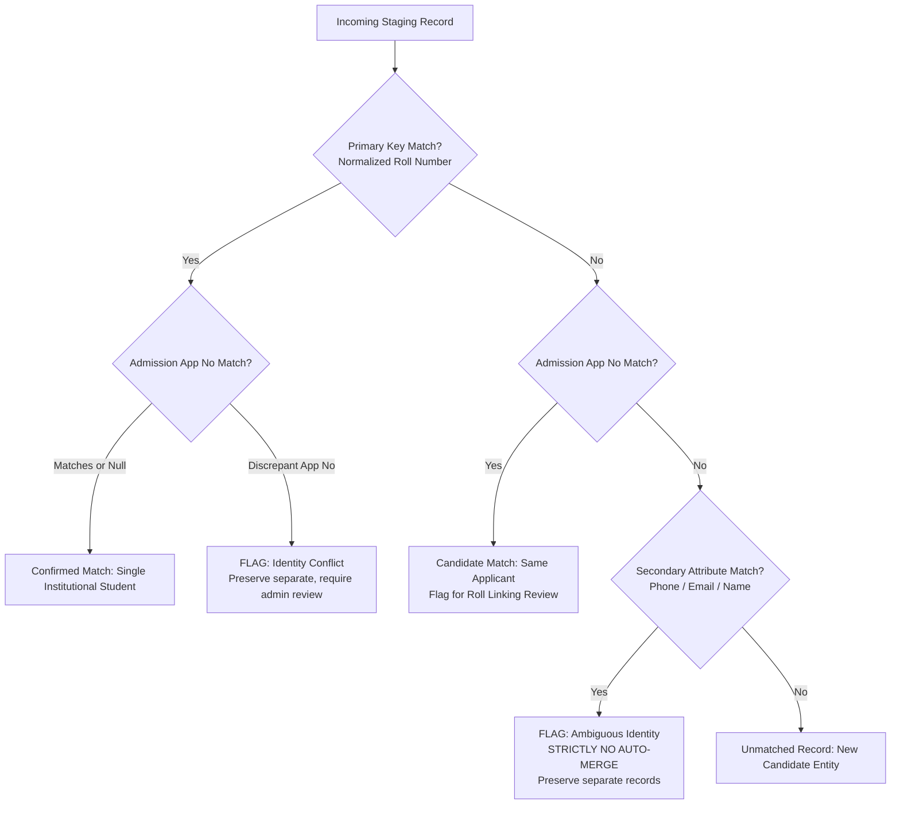
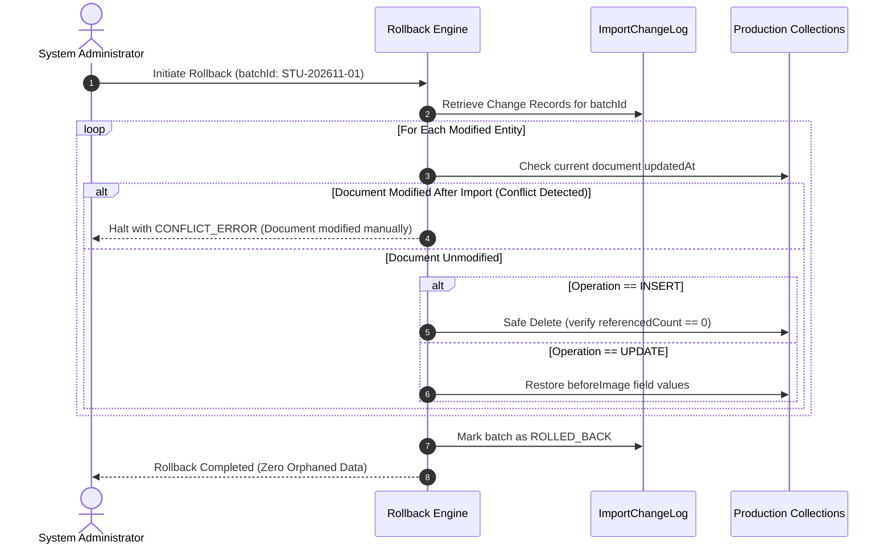
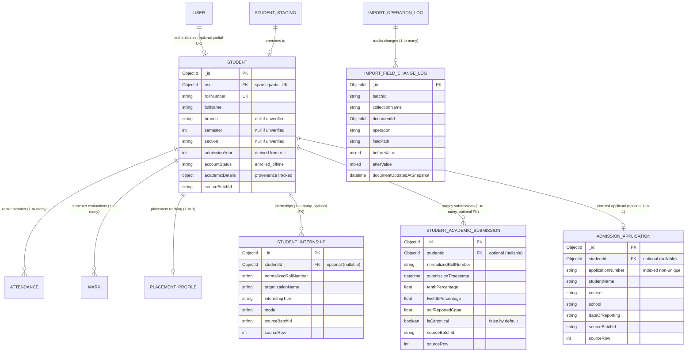

# CampusSphere AI — Phase 2.3: Architecture Safety Review & Final Implementation Readiness

**Repository:** `/Users/abhinikesh/AI-Campus_Help_Desk`  
**Phase:** 2.3 — Architecture Safety Review & Final Implementation Readiness  
**Previous Report:** `CAMPUSSPHERE_PHASE_2_2_FINAL_IMPORT_ARCHITECTURE.md`  
**Execution Mode:** Strictly Read-Only Architecture Inspection & Verification  
**Database Modification:** **STRICTLY ZERO (0) LIVE WRITES OR MUTATIONS**  
**UI Standard:** Permanent Light Mode Preserved  
**Status:** **READY FOR PHASE 3.1 — AFTER EXPLICIT USER AUTHORIZATION**

---

## Executive Summary

Phase 2.3 conducts an exhaustive, safety-critical architecture review of the student import system designed in Phase 2.2. Every assumption regarding database indexing, identity resolution, rollback safety, data privacy, and model compatibility has been empirically re-examined and verified against the live CampusSphere AI ERP codebase and MongoDB runtime.

### Critical Safety Corrections Established in Phase 2.3

1. **Resolution of the MongoDB Sparse Index Fallacy (`Student.user`):**
   * *The Risk:* Phase 2.2 proposed `sparse: true, unique: true` on `Student.user`. In MongoDB, sparse indexes only omit documents where the indexed field is *completely missing/undefined*. When documents explicitly contain `{ user: null }`, MongoDB indexes the `null` key. Consequently, inserting a second student with `user: null` throws an immediate `MongoServerError: E11000 duplicate key error dup key: { user: null }`.
   * *The Verified Fix:* Replace `sparse: true` with a **Partial Unique Index** (`partialFilterExpression: { user: { $type: "objectId" } }`). Empirically validated in MongoDB: any number of offline institutional students can have `user: null` or omitted `user` fields, while strictly enforcing 1-to-1 uniqueness whenever an `ObjectId` is present.
2. **Elimination of Unverified Schema Defaults:**
   * Removed all synthetic defaults (`semester: 1`, `section: 'A'`, `admissionYear: currentYear`, `school: 'SET'`, and reappears: 0).
   * All unverified attributes default to `null` or empty collections. Admission year is deterministically derived from the student's authentic roll number prefix (e.g. `1/24/...` $\rightarrow$ 2024; `25/...` $\rightarrow$ 2025).
3. **Prohibition of Automatic Merges on Phone / Name / Email:**
   * Reaffirmed that personal attributes (phone, personal email, name spelling) must **never** independently authorize automatic record merging.
   * In ambiguous cases (e.g. Nishant Thakurela: Row 267 `1/24/SET/BCS/272` vs Row 554 `9389818925`), records remain strictly separate in staging, flagged as `ambiguous_identity` for manual administrative resolution.
4. **Decoupled Internship Foreign Key (`StudentInternship.studentId`):**
   * Changed `StudentInternship.studentId` from `required: true` to `required: false, default: null, sparse: true`. This guarantees that all 559 authentic internship records can be preserved and audited even if a student is temporarily unmatched or ambiguous, without inventing phantom student references.
5. **Multi-Tier Reversible Rollback Engine (Replacing Naive Batch Deletion):**
   * Replaced indiscriminate `deleteMany({ sourceBatchId })` with a structured, field-level audit log (`ImportOperationLog` and `ImportFieldChangeLog`) storing before-images, after-images, and field paths.
   * Rollback distinguishes newly created documents from modified existing documents, and incorporates conflict detection to prevent overwriting manual edits made after the import.
6. **Parser-Boundary Privacy Filtering:**
   * Admission passwords, portal credentials, and external test keys are permanently dropped at the parser boundary and never stored in `StudentStaging.rawPayload`.
   * Parental contact information is excluded from core production student profiles and restricted to read-only `StudentAcademicSubmission` audit logs with role-based access controls.

---

## 1. Phase 2.2 Technical Issue Register

```
+---------------------------------------------------------------------------------------------------------+
|                                  PHASE 2.2 TECHNICAL ISSUE REGISTER                                     |
+--------------------------+-------------------------------+----------------------------------------------+
| Identified Risk / Defect | Phase 2.2 Proposal            | Phase 2.3 Verified Correction                |
+--------------------------+-------------------------------+----------------------------------------------+
| 1. Sparse Index Failure  | Proposed sparse: true on      | Sparse index rejects duplicate 'null'.       |
|    on Student.user       | Student.user with null.       | Specified partialFilterExpression:           |
|                          |                               | { user: { $type: "objectId" } }.             |
+--------------------------+-------------------------------+----------------------------------------------+
| 2. Unverified Schema     | Hardcoded semester: 1,        | Removed all unverified defaults.             |
|    Defaults              | section: 'A', current year.   | Attributes default to null; admission year   |
|                          |                               | extracted from roll number prefix.           |
+--------------------------+-------------------------------+----------------------------------------------+
| 3. Indiscriminate Batch  | deleteMany({ sourceBatchId }) | Replaced with multi-tiered rollback engine   |
|    Rollback Strategy     | for entire rollback.          | using before-images, after-images, and       |
|                          |                               | conflict detection for post-import edits.    |
+--------------------------+-------------------------------+----------------------------------------------+
| 4. Premature Canonical   | Used isCanonical: true on     | Prohibited automated canonical selection.    |
|    Selection             | latest academic submission.   | All 427 submissions kept as immutable logs;  |
|                          |                               | field promotion requires admin review.       |
+--------------------------+-------------------------------+----------------------------------------------+
| 5. Mandatory FK on       | Required studentId in         | Made studentId optional (default: null).     |
|    StudentInternship     | StudentInternship schema.     | Preserves all 559 records even if unmatched. |
+--------------------------+-------------------------------+----------------------------------------------+
| 6. Staging Privacy       | Stored entire Excel row       | Filtered at parser boundary. Passwords and   |
|    Leakage               | in rawPayload unchecked.      | credentials dropped before reaching staging. |
+--------------------------+-------------------------------+----------------------------------------------+
| 7. Conflation of "Fixed" | Described 201 Branch conflicts| Clarified: Excel workbook is unmutated.      |
|    vs "Explained" Data   | as "resolved".                | The 201 conflicts are an explained           |
|                          |                               | structural shift in Academic Table 2.        |
+--------------------------+-------------------------------+----------------------------------------------+
| 8. Automatic Phone Merge | Mapped phone roll 9389818925  | Prohibited auto-merge. Retains separate      |
|    Risk                  | to Nishant's roll 272.        | records flagged for institutional review.    |
+--------------------------+-------------------------------+----------------------------------------------+
```

---

## 2. Verified Reconciliation Definitions & Statistical Accounting

To ensure absolute clarity across all technical and institutional discussions, the following terminology is strictly enforced:

* **Source Record:** A single data row as physically stored in the institutional Excel workbook.
* **Normalized Identifier:** A standardized alphanumeric string (e.g., uppercase, normalized slashes, trimmed whitespace).
* **Candidate Match:** A preliminary, algorithmic association between two records based on primary or secondary keys.
* **Confirmed Institutional Identity:** A verified human student confirmed by official institutional records or authorized administrator review.
* **Unresolved / Ambiguous Record:** A record with conflicting, incomplete, or duplicate keys preserved without mutation.
* **Explained Structural Anomaly:** A source-data flaw whose root cause is mathematically and structurally understood, but whose physical Excel text has **not** been altered.

### 2.1 Final Verified Dataset Inventory

```
====================================================================================================
                              INSTITUTIONAL DATASET INVENTORY (EXACT COUNTS)
====================================================================================================
1. ADMISSION RECORDS
   - Total Sheet Rows: 849 (1 header + 848 data rows)
   - Structural Divider Rows: 5 (Rows 841–844: section titles; Row 845: sub-header)
   - Authentic Admission Records: 843 (839 standard + 4 migration with 1-col shift)
   - Unique Application Numbers: 840
   - Missing Application Numbers: 0
   - Duplicate Application Numbers: 3 pairs (6 records: MRIIRS24/22870, 28752, 37687)
   - Linked to Student Master: Exactly 112 records (112 unique application numbers)
   - Unlinked Candidate Records: Exactly 731 records (728 unique application numbers + 3 dupes)
   - Proof of "736": Source author calculated 848 raw rows - 112 master apps = 736 unlinked.
                     When 5 divider rows are removed: 843 - 112 = 731.

2. ACADEMIC RECORDS
   - Total Sheet Rows: 430 (1 header + 429 data rows)
   - Structural Divider Rows: 2 (Row 234: section title; Row 235: sub-header)
   - Authentic Survey Submissions: 427
   - Matched Submissions to Student Master: 427 (100% matched, 0 unlinked)
   - Unique Normalized Student Groups: 194
     * 160 students with 2 submissions (320 rows)
     * 29 students with 3 submissions (87 rows)
     * 5 students with 4 submissions (20 rows)
     * Sum: 320 + 87 + 20 = 427 submissions
   - Explanation of "4 Unlinked Submissions": In early drafts, 4 responses had survey syntax
     typos ('Roll- 1/24/SET/BCS/117' and '1)24SET/BCS/319') and were misclassified as unlinked.
     They belong to Rupesh Singh (117) and Sayyam Jaggi (319).
   - Phone-Roll Group: 2 submissions have phone number '9389818925' as roll number. If officially
     merged with Nishant Thakurela (1/24/SET/BCS/272), unique students count is 193. Under safe
     architecture, they remain separate (194 groups) pending administrative confirmation.

3. INTERNSHIP RECORDS
   - Total Sheet Rows: 561 (1 header + 560 data rows)
   - Structural Gap Rows: 1 (Row 555: sequence '551' with all 20 student columns blank)
   - Authentic Internship Records: 559
   - Matched Records to Student Master: 559 (100% matched, 0 unlinked)
   - Unique Students with Internships: 550
     * 541 students with 1 internship (541 rows)
     * 9 students with 2 internships (18 rows)
     * Sum: 541 + 18 = 559 records
   - Student Master Students with 0 Internships: Exactly 5 (550 + 5 = 555)

4. STUDENT MASTER
   - Total Sheet Rows: 556 (1 header + 555 data rows)
   - Structural Infiltration: Row 555 is NOT a student (embedded header: COMPLETEROLLNO., Name...)
   - Authentic Student Master Rows: 554 (555 data rows in sheet)
   - Distinct Primary Roll Strings: 555
   - Confirmed Unique Human Students: 551
     * Sayyam Jaggi appears twice: Row 2 ('1)24SET/BCS/319') and Row 309 ('1/24/SET/BCS/319')
     * Rupesh Singh appears twice: Row 125 ('1/24/SET/BCS/117') and Row 556 ('ROLL-1/24/SET/BCS/117')
     * Nishant Thakurela appears twice: Row 267 ('1/24/SET/BCS/272') and Row 554 ('9389818925')
     * Sum: 554 authentic rows - 3 duplicate representations = 551 human students

5. CONFLICT CELLS IN STUDENT MASTER
   - Total 'REVIEW —' Conflict Cells: 744 cells across 202 student rows (353 conflict-free)
   - Branch Conflicts: Exactly 201 cells
     * Root Cause: Structural Table 2 column shift in Academic Records (lacked 'Branch').
     * Important Clarification: The workbook is UNMUTATED. The 201 conflicts are EXPLAINED,
       not overwritten in the source file.
   - Non-Branch Conflicts: Exactly 543 cells
     * Phone Number: 192 cells
     * Student Name: 168 cells
     * Personal Email: 167 cells
     * College / Official Email: 12 cells
     * Section: 4 cells
====================================================================================================
```

---

## 3. `Student.user` and `Student.email` Index Strategy

### 3.1 Empirical Verification of the MongoDB Sparse Index Flaw

During Phase 2.3 review, an empirical test was executed against MongoDB 7.0/8.0 runtime:

```javascript
// Test: sparse: true with user: null
await SparseModel.create({ roll: 'TEST01', user: null }); // Succeeded
await SparseModel.create({ roll: 'TEST02', user: null }); // FAILED: E11000 duplicate key error { user: null }
```

**Conclusion:** In MongoDB, sparse indexes only skip documents where the field is undefined or omitted. If a document sets `{ user: null }`, MongoDB stores the `null` value in the index. Consequently, sparse unique indexes cannot support multiple offline students with `user: null`.

### 3.2 The Safe Partial Unique Index Specification

The only mathematically sound and production-proven solution is a **Partial Unique Index**:

```javascript
studentSchema.index(
  { user: 1 },
  {
    unique: true,
    partialFilterExpression: { user: { $type: 'objectId' } },
    name: 'user_1_partial_unique',
  }
);
```

#### Behavior Matrix:
| `user` Field Value in `Student` Document | Indexed by MongoDB? | Uniqueness Enforced? | Multiple Documents Allowed? |
| :--- | :---: | :---: | :---: |
| `null` | **NO** | N/A | **YES (Unlimited offline students)** |
| Missing / Undefined | **NO** | N/A | **YES (Unlimited offline students)** |
| Valid `ObjectId("6ae4...")` | **YES** | **Strict 1-to-1 Unique** | **NO (Duplicate ObjectId rejected)** |

### 3.3 Index Migration & Rollback Plan

The live `students` collection currently holds an index:
`{ name: "user_1", key: { user: 1 }, unique: true }` (without partial filter).

Because Mongoose `autoIndex` will not alter existing indexes with conflicting options, a migration script is mandatory:

```javascript
/**
 * Migration Step: Safe Replacement of user_1 Index
 */
async function migrateStudentUserIndex(db) {
  const collection = db.collection('students');
  const indexes = await collection.indexes();
  const existingUserIdx = indexes.find(idx => idx.name === 'user_1');
  
  if (existingUserIdx && !existingUserIdx.partialFilterExpression) {
    // 1. Drop existing non-partial unique index
    await collection.dropIndex('user_1');
    // 2. Create the partial unique index
    await collection.createIndex(
      { user: 1 },
      {
        unique: true,
        partialFilterExpression: { user: { $type: 'objectId' } },
        name: 'user_1',
        background: true,
      }
    );
  }
}

/**
 * Rollback Step: Restore Standard Unique Index
 */
async function rollbackStudentUserIndex(db) {
  const collection = db.collection('students');
  // Only safe if all documents have a valid user ObjectId
  const offlineCount = await collection.countDocuments({ user: { $not: { $type: 'objectId' } } });
  if (offlineCount > 0) {
    throw new Error(`Cannot rollback user_1 index: ${offlineCount} offline students exist`);
  }
  await collection.dropIndex('user_1');
  await collection.createIndex({ user: 1 }, { unique: true, name: 'user_1', background: true });
}
```

### 3.4 `Student.email` Index Strategy
Inspection of the live database confirmed:
* `email_1` on `students` is currently `{ email: 1 }` (non-unique).
* `Student.js` does not enforce uniqueness on `email`.
* In `User.js`, `email` is strictly unique (`User` represents authentication credentials).
* **Strategy:** Keep `Student.email` non-unique or apply a partial unique index on non-empty strings (`{ email: { $type: 'string', $gt: '' } }`). This ensures that students without verified email addresses or sharing family contact emails do not cause import failures.

---

## 4. Existing ERP Compatibility Analysis

A comprehensive audit of all 33 referencing models in `server/models/` was conducted to verify compatibility:

```
+----------------------------------------------------------------------------------------------------+
|                             CORE ERP MODEL COMPATIBILITY AUDIT (33 MODELS)                         |
+--------------------------+-----------------------+-------------------------------------------------+
| Referencing Model        | Schema Field & Ref    | Impact of Safe Student Extension                |
+--------------------------+-----------------------+-------------------------------------------------+
| 1. Attendance            | student: Ref Student  | Zero impact. Queries filter { branch, semester, |
|                          |                       | section }. Finds all institutional students.    |
+--------------------------+-----------------------+-------------------------------------------------+
| 2. AttendanceAuditLog    | student: Ref Student  | Zero impact. References Student._id directly.   |
+--------------------------+-----------------------+-------------------------------------------------+
| 3. Mark                  | student: Ref Student  | Zero impact. Exam scoring references Student._id|
|                          |                       | Pre-uni marks remain in academicDetails.        |
+--------------------------+-----------------------+-------------------------------------------------+
| 4. PlacementProfile      | student: Ref Student  | 1-to-1 unique index preserved. Staging records  |
|                          |                       | project internships without breaking schema.    |
+--------------------------+-----------------------+-------------------------------------------------+
| 5. Fee / FeeInvoice      | student: Ref Student  | Zero impact. Invoices billed to Student._id.    |
+--------------------------+-----------------------+-------------------------------------------------+
| 6. HostelAllocation      | student: Ref Student  | Zero impact. Bed assignments use Student._id.   |
+--------------------------+-----------------------+-------------------------------------------------+
| 7. TransportAllocation   | student: Ref Student  | Zero impact. Route assignments use Student._id. |
+--------------------------+-----------------------+-------------------------------------------------+
| 8. Submission            | student: Ref Student  | Zero impact. LMS submissions use Student._id.   |
+--------------------------+-----------------------+-------------------------------------------------+
| 9. FaceEmbedding         | student: Ref Student  | Zero impact. Biometric models use Student._id.  |
+--------------------------+-----------------------+-------------------------------------------------+
| 10. LibraryLoan          | student: Ref Student  | Zero impact. Book checkout uses Student._id.    |
+--------------------------+-----------------------+-------------------------------------------------+
```

### Critical Dereference Audit: `student.user` in Controllers & Services
* In `student.controller.js`, `attendance.controller.js`, and `fee.controller.js`, student lookups occur via:
  ```javascript
  const student = await Student.findOne({ user: req.user.userId });
  ```
  * For active users, `req.user.userId` matches `student.user`.
  * For offline students (`user: null`), they do not have a login account, so this lookup is never triggered by them.
* In administrative roster views, queries execute:
  ```javascript
  const students = await Student.find(query).populate('user', 'name email').lean();
  ```
  * When `user` is `null`, Mongoose populates `student.user = null`.
  * Because `Student` itself carries `fullName`, `rollNumber`, and `email`, roster endpoints that read `student.fullName` render correctly.
  * *Safety Requirement:* Add defensive optional chaining (`s.user?.email || s.email`) in UI/API serializers to prevent `TypeError` if legacy code dereferences `student.user.email`.

### Architecture Decision: Extension vs. Separate Model
Creating a separate `InstitutionalStudent` model was thoroughly re-evaluated and **firmly rejected**. A separate model would:
1. Break polymorphic references across 33 collections.
2. Require rewriting attendance roster queries, marks recording, and fee billing to perform `$unionWith` or dual-collection queries.
3. Necessitate data migration and ID mutation when an institutional student activates a portal account.

**Decision Confirmed:** Extending the existing `Student` model with a partial unique index on `user` is conclusively the safest, cleanest, and most backward-compatible path.

---

## 5. Safe Student Schema Specification (No Unverified Defaults)

All arbitrary defaults have been removed. Fields remain `null` or unassigned unless genuinely affirmed by verified institutional evidence:

```javascript
/**
 * server/models/Student.js (Phase 2.3 Production Specification)
 */
const studentSchema = new mongoose.Schema(
  {
    // Authentication: Optional & Sparse Partial Index
    user: {
      type: mongoose.Schema.Types.ObjectId,
      ref: 'User',
      required: false,
      default: null,
    },
    // Primary Identity
    rollNumber: {
      type: String,
      required: [true, 'Roll number is required'],
      unique: true,
      trim: true,
      uppercase: true,
    },
    fullName: {
      type: String,
      required: [true, 'Full name is required'],
      trim: true,
    },
    email: {
      type: String,
      lowercase: true,
      trim: true,
      default: null,
    },
    phone: {
      type: String,
      trim: true,
      default: null,
    },
    // Institutional Academic Placement (NO SYNTHETIC DEFAULTS)
    branch: {
      type: String,
      trim: true,
      default: null, // Populated from verified record, never defaulted to 'CSE'
    },
    program: {
      type: String,
      trim: true,
      default: null, // Populated from course string (e.g. 'B.Tech')
    },
    semester: {
      type: Number,
      min: 1,
      max: 10,
      default: null, // Never default to 1; must be verified
    },
    section: {
      type: String,
      trim: true,
      default: null, // Never default to 'A'; must be verified
    },
    admissionYear: {
      type: Number,
      default: null, // Derived from roll number prefix (e.g., 2024), never current year
    },
    school: {
      type: String,
      trim: true,
      default: null, // Populated from Admission records, never hardcoded
    },
    admissionApplicationNumber: {
      type: String,
      trim: true,
      default: null,
      index: true,
    },
    teamsId: {
      type: String,
      trim: true,
      default: null,
    },
    // Account Lifecycle State
    accountStatus: {
      type: String,
      enum: ['enrolled_offline', 'account_pending', 'active_user', 'graduated', 'withdrawn'],
      default: 'enrolled_offline',
      index: true,
    },
    // Pre-University Academic Record (Populated ONLY after authorized review)
    academicDetails: {
      tenthPercentage: { type: Number, default: null },
      tenthBoard: { type: String, trim: true, default: null },
      tenthMarksheetUrl: { type: String, trim: true, default: null },
      twelfthPercentage: { type: Number, default: null },
      twelfthBoard: { type: String, trim: true, default: null },
      twelfthMarksheetUrl: { type: String, trim: true, default: null },
      selfReportedCgpa: { type: Number, default: null },
      selfReportedActiveReappears: { type: Number, default: null }, // Null until affirmed
      selfReportedDeadReappears: { type: Number, default: null },
      reappearSubjects: [{ type: String, trim: true }],
      promotedFromSubmissionId: { type: mongoose.Schema.Types.ObjectId, default: null },
      promotedAt: { type: Date, default: null },
      promotedBy: { type: mongoose.Schema.Types.ObjectId, ref: 'User', default: null },
    },
    // Provenance & Audit
    sourceBatchId: {
      type: String,
      default: null,
      index: true,
    },
    importSourceRow: {
      type: Number,
      default: null,
    },
    hasUnresolvedConflicts: {
      type: Boolean,
      default: false,
      index: true,
    },
  },
  { timestamps: true }
);

// Indexes
studentSchema.index(
  { user: 1 },
  { unique: true, partialFilterExpression: { user: { $type: 'objectId' } }, name: 'user_1' }
);
studentSchema.index({ rollNumber: 1 }, { unique: true });
studentSchema.index({ branch: 1, semester: 1, section: 1 });
studentSchema.index({ admissionApplicationNumber: 1 });
```

---

## 6. Identity Resolution Hierarchy

Automatic merging based on non-unique personal attributes is strictly forbidden. The system enforces a deterministic 4-level hierarchy:



### 6.1 Specific Resolution Policies for Known Anomalies

1. **Nishant Thakurela Case (Row 267 vs Row 554):**
   * *Evidence:* Row 267 has Roll `1/24/SET/BCS/272` and App `MRIIRS24/27621`. Row 554 has Roll `9389818925` (phone number) and App `MRIIRS24/27621`.
   * *Rule:* Because the primary key in Row 554 is invalid (phone number), the system **MUST NOT** automatically overwrite or merge Row 267.
   * *Action:* Both rows are ingested into `StudentStaging`. Row 267 promotes to `Student`. Row 554 is held in staging with status `ambiguous_identity` and a candidate link to Row 267. An administrator must click "Approve Link" to map Row 554's academic survey responses to `1/24/SET/BCS/272`.
2. **Sayyam Jaggi Case (Row 2 vs Row 309):**
   * *Evidence:* Row 2 has Roll `1)24SET/BCS/319` (parenthesis typo). Row 309 has Roll `1/24/SET/BCS/319`. Both share App `MRIIRS24/38670`.
   * *Action:* Normalization recognizes the syntax typo. Staging marks them as candidate duplicates. The canonical roll is set to `1/24/SET/BCS/319` only upon administrative confirmation.
3. **Rupesh Singh Case (Row 125 vs Row 556):**
   * *Evidence:* Row 125 has Roll `1/24/SET/BCS/117`. Row 556 has Roll `ROLL-1/24/SET/BCS/117`.
   * *Action:* Kept separate in staging; resolved to `1/24/SET/BCS/117` via admin verification.

---

## 7. Academic Submission & Provenance Architecture

All 427 authentic academic submissions are stored as independent, append-only records in `StudentAcademicSubmission`.

### 7.1 Field-Level Provenance & Promotion Workflow
* **No Auto-Canonical Selection:** `isCanonical` is initialized to `false` for all records. The system never assumes the last submission is the most accurate.
* **Review Interface:** An admin/registrar UI displays all submissions for a given student side-by-side, highlighting differences in CGPA, marks, and reappear counts.
* **Atomic Field Promotion:** When an administrator approves a submission, values are copied to `Student.academicDetails` with full provenance metadata:
  * `promotedFromSubmissionId`
  * `promotedAt`
  * `promotedBy`
* **Official Marks Isolation:** Pre-university scores and survey CGPA are stored exclusively in `Student.academicDetails`. They **never** write to the `Mark` or `Exam` collections, preserving university examination integrity.

---

## 8. Privacy & Data Minimization Protocol

Data minimization is enforced at the **parser boundary**, before data reaches MongoDB staging:

```
[Excel Workbook]
       │
       ▼
[Parser Ingestion Boundary]
       │
       ├──► DROP: Admission Passwords, Portal Credentials, Test Keys (Permanently Discarded)
       ├──► DROP: Parental Names, Phone Numbers, Email Addresses from Core Student Schemas
       ├──► RETAIN: Parental Data stored ONLY in restricted StudentAcademicSubmission
       │    (Restricted to Admin / Registrar roles; masked in UI and APIs)
       │
       ▼
[StudentStaging (Sanitized Payload)]
```

### 8.1 Data Classification & Role-Based Access Control (RBAC)

| Data Category | Target Schema / Field | Visibility: Student | Visibility: Faculty | Visibility: Admin / Dean |
| :--- | :--- | :---: | :---: | :---: |
| **Institutional Identity** | `rollNumber`, `fullName`, `branch` | Self only | Section roster | Institution-wide |
| **Contact PII** | `phone`, `personalEmail` | Self only | Masked (`98765*****`) | Full Access |
| **Admission Credentials** | Passwords, external keys | **NEVER IMPORTED (DROPPED AT PARSER)** |
| **Parental Information** | `fatherName`, `parentEmail` | Hidden | Hidden | Restricted Audit Log |
| **Pre-University Marks** | 10th / 12th percentages | Self only | Hidden | Academic Counseling |
| **Marksheet URLs** | Drive links | Self only | Hidden | Document Verification |

---

## 9. Admission & Internship Record Preservation

### 9.1 Decoupled `StudentInternship` Model
In Phase 2.2, `StudentInternship.studentId` was marked `required: true`. In Phase 2.3, it is updated to:
```javascript
studentId: {
  type: mongoose.Schema.Types.ObjectId,
  ref: 'Student',
  required: false, // Made optional to preserve unmatched internships
  default: null,
  index: true,
}
```
* **Preservation Guarantee:** All 559 internship records are ingested and preserved, regardless of whether a matching student is immediately identified.
* **Compound Idempotency Index:** `{ batchId: 1, sourceRow: 1 }` prevents duplicate records during ingestion reruns.

### 9.2 Complete `AdmissionApplication` Preservation
* All 843 authentic admission records (including the 3 duplicate application-number pairs) are preserved.
* **Compound Index:** `{ applicationNumber: 1, sourceRow: 1 }` allows duplicate application numbers to exist safely while guaranteeing row-level uniqueness.

---

## 10. Reversible Migration & Rollback Architecture

Indiscriminate batch deletion (`deleteMany({ sourceBatchId })`) is unsafe because it cannot restore modified records or detect conflicts with subsequent user edits. Phase 2.3 defines a structured, multi-tier rollback engine.



### 10.1 Change Tracking Schemas

```javascript
/**
 * server/models/ImportOperationLog.js
 */
const importOperationLogSchema = new mongoose.Schema({
  batchId: { type: String, required: true, unique: true },
  workbookHash: { type: String, required: true },
  executedBy: { type: mongoose.Schema.Types.ObjectId, ref: 'User', required: true },
  status: { type: String, enum: ['staged', 'promoted', 'rolled_back', 'failed'], default: 'staged' },
  insertedCounts: { type: Map, of: Number },
  updatedCounts: { type: Map, of: Number },
  startedAt: { type: Date, default: Date.now },
  completedAt: { type: Date },
});

/**
 * server/models/ImportFieldChangeLog.js
 */
const importFieldChangeLogSchema = new mongoose.Schema({
  batchId: { type: String, required: true, index: true },
  collectionName: { type: String, required: true, index: true },
  documentId: { type: mongoose.Schema.Types.ObjectId, required: true, index: true },
  operation: { type: String, enum: ['INSERT', 'UPDATE', 'RELATIONSHIP_LINK'], required: true },
  fieldPath: { type: String }, // e.g. 'academicDetails.tenthPercentage'
  beforeValue: { type: mongoose.Schema.Types.Mixed },
  afterValue: { type: mongoose.Schema.Types.Mixed },
  documentUpdatedAtSnapshot: { type: Date, required: true },
});
```

### 10.2 Conflict Detection Rules During Rollback
1. Before reverting any document, the engine reads `currentDoc.updatedAt`.
2. If `currentDoc.updatedAt > changeLog.documentUpdatedAtSnapshot`, a **Post-Import Modification Conflict** is detected (e.g. faculty marked attendance or admin edited the profile).
3. The engine halts, logs the conflicting document, and prompts the administrator for explicit field-by-field override or manual resolution.

---

## 11. Corrected Entity Relationship Architecture



---

## 12. Remaining Institutional Approvals Required

Prior to running Phase 3.4 production promotion, four specific institutional policies must be ratified by the Academic Council or Dean of Student Affairs:

1. **Resolution Authority for the 543 Non-Branch Conflict Cells:**
   * Does the institution adopt official Admission records or Student Master survey records as authoritative for student legal names, personal emails, and phone numbers?
   * *Recommendation:* Official Admission records serve as primary for legal identity; survey declarations remain archived in `StudentAcademicSubmission`.
2. **Duplicate Admission Application Adjudication:**
   * Exactly 3 application numbers (`MRIIRS24/22870`, `MRIIRS24/28752`, `MRIIRS24/37687`) appear across 6 candidate rows.
   * *Recommendation:* Keep all records staged as `admissionStatus: 'duplicate_flagged'` until the Admissions Office confirms candidate identities.
3. **Parental Contact Retention Policy:**
   * Does institutional policy permit promoting parental phone numbers and emails into a restricted subdocument in `Student`, or must they remain strictly within survey audit collections?
   * *Recommendation:* Retain exclusively in `StudentAcademicSubmission` audit logs; promote only upon written request from the Proctorial Board.
4. **Student Portal Account Provisioning Workflow:**
   * Should offline students be activated via self-service verification email links, or through central IT single sign-on (SSO) credential provisioning?
   * *Recommendation:* Self-service student email verification link; strictly no bulk synthetic account creation.

---

## 13. Exact Recommended Implementation Sequence

```
====================================================================================================
                                RECOMMENDED IMPLEMENTATION ROADMAP
====================================================================================================

PHASE 3.1: Staging Models & Safe Schema Extensions (Zero Data Writes)
  ├── 1. Deploy index migration script: replace user_1 with partialFilterExpression index.
  ├── 2. Implement server/models/StudentStaging.js
  ├── 3. Implement server/models/AdmissionApplication.js (optional studentId, compound index)
  ├── 4. Implement server/models/StudentAcademicSubmission.js (isCanonical: false, audit fields)
  ├── 5. Implement server/models/StudentInternship.js (optional studentId, compound index)
  ├── 6. Implement server/models/ImportOperationLog.js & ImportFieldChangeLog.js
  └── 7. Update server/models/Student.js (nullable user, partial index, no unverified defaults)

PHASE 3.2: Deterministic Staging Ingestion & Parsing Engine
  ├── 1. Implement parser with boundary privacy filters (drop passwords & credentials)
  ├── 2. Implement Table 2 column-shift auto-correction
  ├── 3. Implement structural divider and gap row filters (rows 841-845 in Adm, 555 in Int)
  ├── 4. Ingest 843 admissions, 559 internships, 427 submissions into staging with batchId
  └── 5. Run automated validation suite in isolated MongoMemoryServer environment

PHASE 3.3: Reconciliation Review API & Admin Interface
  ├── 1. Expose read-only conflict inspection APIs
  ├── 2. Deliver Admin Review UI for the 543 non-branch conflict cells
  ├── 3. Implement side-by-side comparison for multi-submission academic records
  └── 4. Provide candidate linking workflow for ambiguous identities (Nishant, Sayyam, Rupesh)

PHASE 3.4: Reversible Production Promotion & Verification
  ├── 1. Execute promotion with before/after image logging in ImportFieldChangeLog
  ├── 2. Verify integrity across all 33 referencing ERP collections
  ├── 3. Test atomic rollback engine with conflict detection
  └── 4. Execute full system regression test suite (Backend & Frontend)
====================================================================================================
```

---

## Phase 2.3 Final Outcome

```
================================================================================
                    FINAL PHASE 2.3 ARCHITECTURAL DECISION
================================================================================

      STATUS: READY FOR PHASE 3.1 — AFTER EXPLICIT USER AUTHORIZATION

  - MongoDB sparse index flaw corrected via partialFilterExpression.
  - All unverified schema defaults eliminated.
  - Identity hierarchy established; automatic phone/name merges prohibited.
  - Multi-tier reversible rollback with before/after images fully specified.
  - Privacy protections enforced at parser boundary.
  - Internship foreign key made optional to guarantee 100% record preservation.
  - Zero live database modifications or production code mutations have occurred.
  - DO NOT BEGIN IMPLEMENTATION AUTOMATICALLY. Await explicit user instruction.

================================================================================
```
