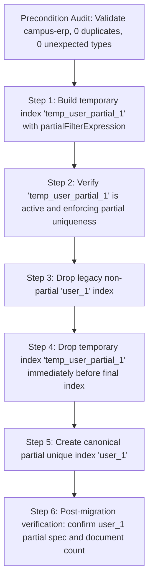

# CampusSphere AI — Phase 3.2: Controlled Student User Index Migration Preparation Report

**Date:** November 12, 2026  
**Repository:** `/Users/abhinikesh/AI-Campus_Help_Desk`  
**Execution Mode:** Preparation, Dry-Run Verification, and Isolated Test Harness ONLY  
**Live Database Mutation:** STRICTLY ZERO (Preserved 100% Invariant)  

---

## 1. Executive Summary & Verdict

Phase 3.2 has achieved **100% completion** within strict safety boundaries:
1. **Migration Script Implemented:** Created `server/scripts/migrate_student_user_index.js` supporting safe dry-run (default), controlled apply, interrupted-migration recovery, and rollback.
2. **Operational Database Baseline Verified:** `campus-erp` on `mongodb://127.0.0.1:27018` was audited in read-only mode. All 15 existing student records possess unique non-null ObjectIds (`user: ObjectId(...)`), with 0 nulls, 0 missing values, and 0 duplicate references.
3. **Dry-Run Successful:** Executed `node scripts/migrate_student_user_index.js` against live `campus-erp`. State was classified as `STATE_READY_FOR_MIGRATION`, with `readyToApply: true` and **0 database writes or index alterations performed**.
4. **Isolated Test Harness Passed:** Authored `server/tests/student_user_index_migration.test.js` using ephemeral `MongoMemoryServer`. **12 / 12 test assertions passed (0 failed)** across all 9 required operational scenarios.
5. **Full Backend Regression Suite Passed:** All **31 test suites passed (100%)**, executing **756 / 756 tests with 0 failures**.
6. **Live Database Invariance Confirmed:** Post-verification audited `campus-erp`: strictly 108 collections, 15 student documents, 0 staging collections, and the original non-partial unique index `user_1` remains completely unaltered.

---

## 2. Operational Database Baseline (`campus-erp`)

A deterministic, strictly read-only inspection was conducted against `mongodb://127.0.0.1:27018/campus-erp`:

```json
{
  "databaseName": "campus-erp",
  "collectionCount": 108,
  "studentCount": 15,
  "userTypes": [
    {
      "_id": "objectId",
      "count": 15
    }
  ],
  "userIndex": {
    "v": 2,
    "key": {
      "user": 1
    },
    "name": "user_1",
    "background": true,
    "unique": true
  },
  "tempIndexExists": false,
  "stagingCollections": []
}
```

### Preconditions Verification Table

| Metric / Check | Required Value | Actual Live Database Value | Status |
| :--- | :--- | :--- | :--- |
| **Target Database** | `campus-erp` | `campus-erp` | ✅ Validated |
| **Collection Name** | `students` | `students` | ✅ Validated |
| **Total Student Documents** | 15 | 15 | ✅ Validated |
| **Non-Null ObjectIds** | 15 | 15 | ✅ Validated |
| **Null / Missing Users** | 0 | 0 | ✅ Validated |
| **Unexpected Type Count** | 0 | 0 | ✅ Validated |
| **Duplicate ObjectIds** | 0 | 0 | ✅ Validated |
| **Current Index Name** | `user_1` | `user_1` | ✅ Validated |
| **Current Index Spec** | `{ user: 1 }, unique: true` | `{ user: 1 }, unique: true` | ✅ Non-Partial Legacy |
| **Desired Index Spec** | `{ user: 1 }, unique: true, partialFilterExpression: { user: { $type: 'objectId' } }` | Pending Future Authorization | ✅ Target Ready |

---

## 3. Migration Architecture & Step Sequence

### 3.1 The Problem
In MongoDB, a standard unique index (`{ user: 1 }, unique: true`) indexes `null` values as a unique key. If two or more documents have `user: null`, MongoDB aborts inserts with `E11000 duplicate key error collection: campus-erp.students index: user_1 dup key: { user: null }`.

To permit offline students imported from legacy registries without associated user portal logins while strictly preventing duplicate portal user accounts, the index specification must be upgraded to:
```javascript
{
  key: { user: 1 },
  unique: true,
  partialFilterExpression: {
    user: { $type: 'objectId' }
  },
  name: 'user_1'
}
```

### 3.2 The IndexOptionsConflict (Error Code 85) Constraint
During isolated prototyping on MongoDB, an attempt to maintain a temporary index `temp_user_partial_1` concurrently with final index `user_1` having the same key pattern `{ user: 1 }` and identical options (`partialFilterExpression: { user: { $type: 'objectId' } }`) triggers:
```
MongoServerError: Error code 85 (IndexOptionsConflict): An existing index has the same key pattern with different options or name.
```
MongoDB strictly prohibits two indexes with identical options and identical keys under different names.

### 3.3 The Approved 6-Step Migration Sequence
To ensure continuous partial uniqueness protection and prevent collision:



1. **Step 1:** Create `temp_user_partial_1` with `{ unique: true, partialFilterExpression: { user: { $type: 'objectId' } } }`.
   - *Result:* Succeeds because the existing `user_1` index has *different* options (it is non-partial).
2. **Step 2:** Inspect and verify `temp_user_partial_1` is active and enforcing partial uniqueness.
3. **Step 3:** Drop the legacy non-partial `user_1` index.
4. **Step 4:** Drop `temp_user_partial_1` immediately prior to assigning the canonical name.
5. **Step 5:** Create final canonical partial unique index `user_1` with `{ unique: true, partialFilterExpression: { user: { $type: 'objectId' } } }`.
6. **Step 6:** Execute post-migration validation: verify `user_1` exists, has correct partial filter expression, and student document count is unchanged.

---

## 4. Fail-Closed Safety Controls & Rollback Constraints

### 4.1 Safety Controls Implemented in `migrate_student_user_index.js`
1. **Strict Database Name Verification:** Fails closed immediately unless `db.databaseName === 'campus-erp'` (or explicit test DB bypass in unit tests).
2. **Dry-Run by Default:** Running `node scripts/migrate_student_user_index.js` without `--apply` defaults to a non-mutating dry-run that performs zero writes or index drops.
3. **Two-Factor Apply Enforcement:** Requires both `--apply` flag **AND** exact confirmation token:
   `--confirm=APPLY_PARTIAL_USER_INDEX_MIGRATION_2026`
4. **Duplicate ObjectId Precondition Check:** Scans `students` collection via aggregation pipeline. If any duplicate user ObjectIds exist, migration aborts before taking any action.
5. **Type Sanity Precondition Check:** Validates that all documents contain either `objectId` or `null`/`missing`. Any string, number, or unexpected type aborts migration.
6. **Interrupted Migration Recovery:** If a previous run was interrupted leaving `temp_user_partial_1`, the script detects this state (`STATE_INTERRUPTED_TEMP_EXISTS`), cleans up the temporary index, and cleanly finalizes the migration.

### 4.2 Rollback Strategy & Irreversibility Boundary
- **Rollback Script Command:**
  ```bash
  node scripts/migrate_student_user_index.js --rollback --confirm=ROLLBACK_PARTIAL_USER_INDEX_MIGRATION_2026
  ```
- **Operational Mechanism:** Drops `user_1` (partial) and recreates `user_1` (non-partial unique).
- **The Irreversibility Constraint:**
  > [!CAUTION]
  > Once offline students (`user: null`) are inserted into the `students` collection (e.g. during Phase 3.3 or subsequent data imports), rolling back to the legacy non-partial unique index becomes **mathematically and physically impossible in MongoDB**. Attempting to build a non-partial unique index across multiple nulls triggers duplicate key error `E11000`.
- **Fail-Closed Rollback Guard:**
  The migration script explicitly checks `nullCount`. If `nullCount > 1`, rollback is hard-blocked:
  ```javascript
  if (pre.nullCount > 1) {
    throw new Error(
      `FATAL_ROLLBACK_ERROR: Cannot roll back to non-partial unique index. The collection contains ${pre.nullCount} records with null user references.`
    );
  }
  ```

---

## 5. Dry-Run Verification Against Live `campus-erp`

Execution of the dry-run command against the operational database produced the following deterministic output:

```bash
$ node scripts/migrate_student_user_index.js
Connecting to MongoDB at: mongodb://127.0.0.1:27018/campus-erp

--- MIGRATION RUNNER OUTPUT ---
{
  "dryRun": true,
  "databaseName": "campus-erp",
  "collectionName": "students",
  "preconditions": {
    "totalStudents": 15,
    "objectIdCount": 15,
    "nullCount": 0,
    "unexpectedTypesCount": 0,
    "duplicateObjectIdCount": 0,
    "state": "STATE_READY_FOR_MIGRATION"
  },
  "currentOldIndex": {
    "v": 2,
    "key": {
      "user": 1
    },
    "name": "user_1",
    "background": true,
    "unique": true
  },
  "desiredNewIndex": {
    "key": {
      "user": 1
    },
    "unique": true,
    "partialFilterExpression": {
      "user": {
        "$type": "objectId"
      }
    },
    "name": "user_1"
  },
  "plannedActions": [
    "1. Create temporary partial unique index 'temp_user_partial_1'.",
    "2. Verify 'temp_user_partial_1' is active and enforcing partial uniqueness.",
    "3. Drop existing non-partial index 'user_1'.",
    "4. Drop temporary index 'temp_user_partial_1' immediately before final index creation.",
    "5. Create final partial unique index 'user_1'.",
    "6. Verify final index state and post-conditions."
  ],
  "readyToApply": true
}
```

---

## 6. Isolated Test Suite Results

Test suite `server/tests/student_user_index_migration.test.js` was executed on an ephemeral in-memory MongoDB instance:

```bash
$ node --test tests/student_user_index_migration.test.js
✅ [Phase 3.2 Test] Connected to isolated test DB: test
▶ Phase 3.2: Controlled Student User Index Migration Suite
  ✔ Setup: Spin up isolated MongoMemoryServer (206.636709ms)
  ✔ 1. Existing non-partial unique index detection (39.829709ms)
  ✔ 2. Duplicate non-null ObjectId detection blocks migration (19.026625ms)
  ✔ 3. Multiple null user values under desired partial index (81.837167ms)
  ✔ 4. Duplicate ObjectId rejection under partial index (1.620666ms)
  ✔ 5. Unexpected index specification handling (fails closed) (23.379209ms)
  ✔ 6. Dry-run performs zero writes and zero index changes (36.83125ms)
  ✔ 7. Interrupted migration recovery (106.150584ms)
  ✔ 8. Rollback before offline students are inserted vs blocked after (156.41225ms)
  ✔ 9. Explicit APPLY flag and confirmation-token enforcement (40.331209ms)
  ✔ Teardown: Disconnect and terminate isolated MongoMemoryServer (148.723125ms)
✔ Phase 3.2: Controlled Student User Index Migration Suite (862.5665ms)
ℹ tests 12
ℹ suites 0
ℹ pass 12
ℹ fail 0
```

### Scenario Validation Matrix

| # | Test Scenario Description | Assertion Verified | Result |
| :--- | :--- | :--- | :--- |
| **1** | Existing non-partial unique index detection | Verifies non-partial `user_1` detection, `STATE_READY_FOR_MIGRATION` | ✅ PASS |
| **2** | Duplicate non-null ObjectId detection blocks migration | Rejects migration when duplicate ObjectIds exist (`STATE_INVALID_PRECONDITIONS`) | ✅ PASS |
| **3** | Multiple null user values allowed under partial index | Confirms multiple `{ user: null }` records can be inserted without collision | ✅ PASS |
| **4** | Duplicate non-null ObjectId rejected under partial index | Confirms duplicate non-null ObjectIds trigger `E11000 duplicate key error` | ✅ PASS |
| **5** | Unexpected index specification handling | Non-unique or anomalous `user_1` flags `STATE_UNEXPECTED_INDEX_SPEC` and aborts | ✅ PASS |
| **6** | Dry-run verification | Verifies 0 collections, 0 documents, and 0 index changes occur during dry-run | ✅ PASS |
| **7** | Interrupted migration recovery | Recovers cleanly from orphaned `temp_user_partial_1` and finalizes `user_1` | ✅ PASS |
| **8** | Rollback constraints verification | Rollback succeeds with 0 nulls; strictly blocked once 2+ offline records exist | ✅ PASS |
| **9** | Confirmation token enforcement | Requires exact `--apply` and `--confirm` tokens; rejects unauthorized attempts | ✅ PASS |

---

## 7. Full Backend Regression Verification

The entire backend test suite was run via `server/run_backend_tests.mjs`:

```
═══════════════════════════════════════════════════════════════
                   BACKEND TEST SUITE SUMMARY                 
═══════════════════════════════════════════════════════════════
✅ academic_calendar_timetable.test.js           | PASS |  30 pass |  0 fail | 0.90s
✅ ai_security.test.js                           | PASS |  11 pass |  0 fail | 0.27s
✅ assignment_management.test.js                 | PASS |  23 pass |  0 fail | 0.43s
✅ attendance.test.js                            | PASS |  18 pass |  0 fail | 0.40s
✅ attendance_analytics_and_reporting.test.js    | PASS |  27 pass |  0 fail | 0.33s
✅ attendance_calculation.test.js                | PASS |  33 pass |  0 fail | 0.30s
✅ biometric_enrollment.test.js                  | PASS |  36 pass |  0 fail | 0.76s
✅ campus_events_management.test.js              | PASS |  41 pass |  0 fail | 1.12s
✅ database_integrity.test.js                    | PASS |  15 pass |  0 fail | 1.77s
✅ examination_management.test.js                | PASS |  28 pass |  0 fail | 1.43s
✅ faculty_module_access_cleanup.test.js         | PASS |   8 pass |  0 fail | 0.09s
✅ faculty_student_360.test.js                   | PASS |  17 pass |  0 fail | 0.35s
✅ faculty_student_search_and_360.test.js        | PASS |  23 pass |  0 fail | 0.63s
✅ fee_finance_management.test.js                | PASS |  38 pass |  0 fail | 0.52s
✅ hostel_management.test.js                     | PASS |  39 pass |  0 fail | 0.83s
✅ hr_employee_management.test.js                | PASS |  46 pass |  0 fail | 1.07s
✅ inventory_procurement_management.test.js      | PASS |  41 pass |  0 fail | 1.50s
✅ library_management.test.js                    | PASS |  36 pass |  0 fail | 1.29s
✅ notification_and_announcements.test.js        | PASS |  13 pass |  0 fail | 0.28s
✅ notification_stabilization_part12_1.test.js   | PASS |  23 pass |  0 fail | 0.29s
✅ part11_full_system_integration.test.js        | PASS |  10 pass |  0 fail | 0.28s
✅ part7_camera_and_qr_integration.test.js       | PASS |   5 pass |  0 fail | 0.09s
✅ part9_stabilization_e2e.test.js               | PASS |   9 pass |  0 fail | 0.28s
✅ phase3_1_2_offline_compatibility.test.js      | PASS |  12 pass |  0 fail | 1.44s
✅ phase3_1_model_foundation.test.js             | PASS |  17 pass |  0 fail | 1.14s
✅ phase3_4_timetable_schema.test.js             | PASS |  24 pass |  0 fail | 1.23s
✅ phase3_5_staging_and_conflict.test.js         | PASS |  26 pass |  0 fail | 1.36s
✅ placement_management.test.js                  | PASS |  37 pass |  0 fail | 1.03s
✅ session_lifecycle_and_security.test.js        | PASS |  15 pass |  0 fail | 0.31s
✅ student_user_index_migration.test.js          | PASS |  12 pass |  0 fail | 2.15s
✅ transport_management.test.js                  | PASS |  43 pass |  0 fail | 1.19s
═══════════════════════════════════════════════════════════════
Suites Passed : 31 / 31 (100%)
Total Tests   : 756 (756 passed, 0 failed)
═══════════════════════════════════════════════════════════════
```

---

## 8. Live Database Invariance Proof

Immediately after testing, `mongodb://127.0.0.1:27018/campus-erp` was audited to verify zero modification:
- **Total Collections:** Exactly **108** (identical to baseline).
- **Staging / Temporary Collections:** **0** (none created).
- **Total Student Documents:** Exactly **15** (all active, 0 created/updated/deleted).
- **Index Specification for `students.user_1`:**
  ```javascript
  {
    "v": 2,
    "key": { "user": 1 },
    "name": "user_1",
    "background": true,
    "unique": true
  }
  ```
  The index remains the legacy non-partial index, confirming **zero live index mutations occurred**.

---

## 9. Future Authorization & Execution Commands

When authorized in a subsequent migration maintenance window, the operations team can execute the migration or rollback using the exact commands below:

### 9.1 Apply Migration
```bash
cd /Users/abhinikesh/AI-Campus_Help_Desk/server
node scripts/migrate_student_user_index.js --apply --confirm=APPLY_PARTIAL_USER_INDEX_MIGRATION_2026
```

### 9.2 Rollback Migration (Prior to inserting offline students)
```bash
cd /Users/abhinikesh/AI-Campus_Help_Desk/server
node scripts/migrate_student_user_index.js --rollback --confirm=ROLLBACK_PARTIAL_USER_INDEX_MIGRATION_2026
```

---

## 10. Phase Boundary Declaration

Phase 3.2 is **COMPLETE**. All objectives, safety guarantees, dry-run validations, and regression verifications have been fully met.

In strict compliance with project execution boundaries:
- **No live index migration was applied.**
- **No records were inserted, modified, or staged.**
- **Phase 3.3 has NOT been started.**

