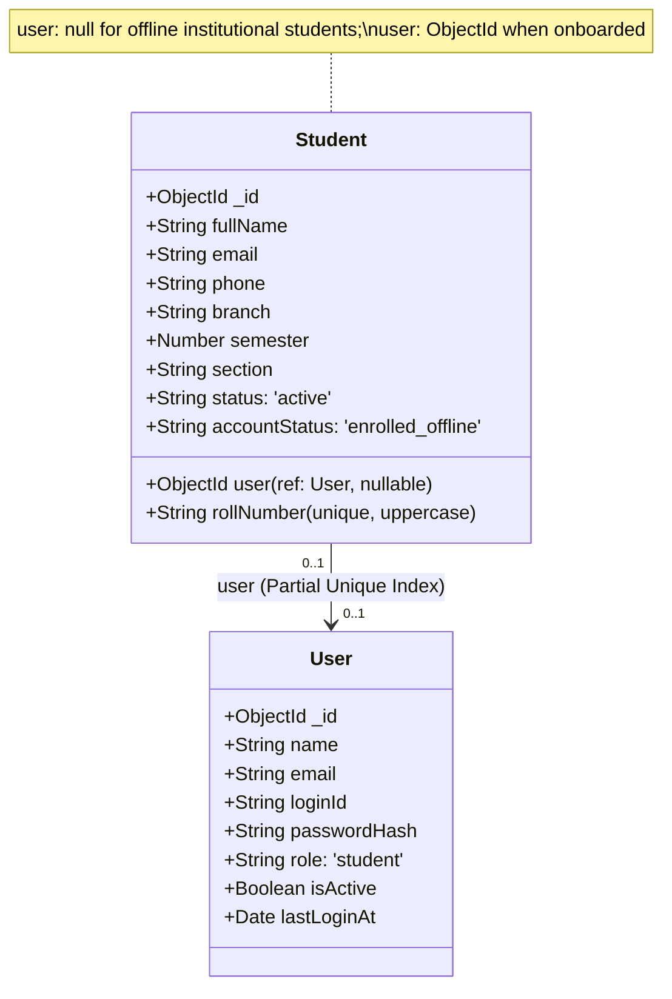
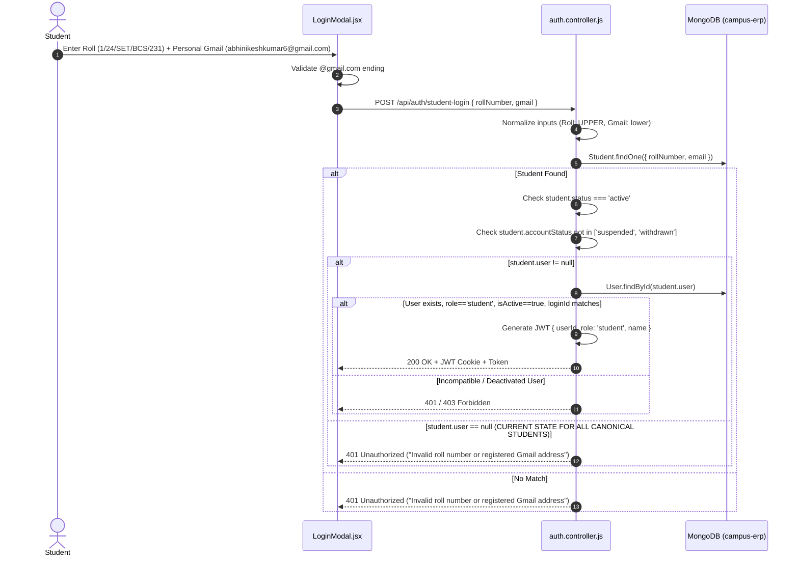
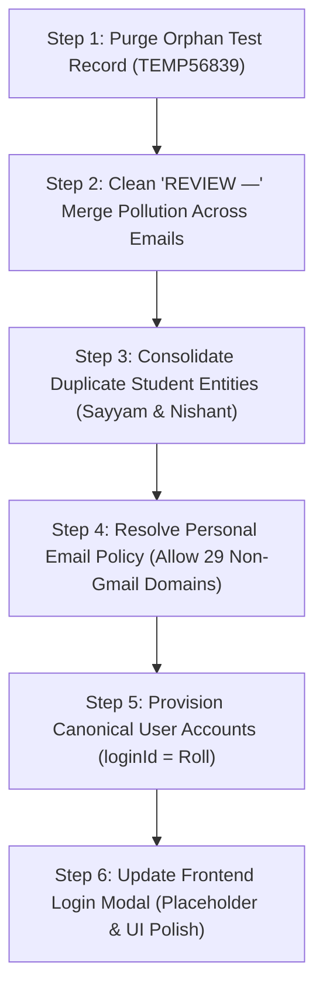

# CampusSphere AI — Student Account Linkage & Authentication Identity Audit

**Audit Date:** 2026-11-19  
**Target Environment:** Local Full-Stack ERP  
**Database:** MongoDB `campus-erp` (Port 27018)  
**Backend:** Node.js / Express / Mongoose (Port 5001)  
**Frontend:** React + Vite (Port 5173)  
**Audit Type:** Strictly Read-Only Account Linkage & Authentication Security Audit  
**Audit Status:** Complete  

---

## Executive Summary

A comprehensive, strictly read-only audit of student account linkage and authentication mechanics was performed across CampusSphere AI. The audit evaluated how student identities are defined in the schema, how `Student` and `User` records link together, how the student login endpoint resolves identities, and how the frontend interacts with backend authentication.

### High-Level Verdict: **`FAIL` (Canonical Student Authentication Blocked / Offline Enrolled Cohort)**

While the student authentication engine (`POST /api/auth/student-login`) and anti-IDOR session bindings are rigorously designed, **zero canonical institutional students can currently log into the system**:
1. **100% Canonical Student Blockage:** All 553 canonical students in the database have `user: null` (`accountStatus: enrolled_offline`). No User accounts exist in the `users` collection for any canonical student. When a canonical student submits their valid roll number and personal Gmail address, the login controller rejects them with `HTTP 401: Invalid roll number or registered Gmail address` at the user-resolution check (`if (!student.user)`).
2. **Synthetic Demonstration Isolation:** Exactly 8 student User accounts exist in the `users` collection (`20240001`–`20240008`), linked to 8 synthetic demo students. All 847 attendance records, 2 face embeddings, and financial records belong exclusively to these synthetic accounts. Furthermore, because their emails are `@campus.edu` (not `@gmail.com`), they can only authenticate via the legacy password endpoint (`POST /api/auth/login`), not via `studentLogin`.
3. **Decoupling of Synthetic `20240002` and Canonical `1/24/SET/BCS/231` (Abhinikesh Kumar):** Synthetic demo student `20240002` ("Abhinikesh", email `20240002@campus.edu`, 112 attendances) and canonical student `1/24/SET/BCS/231` ("ABHINIKESH KUMAR", email `abhinikeshkumar6@gmail.com`, 0 attendances) are completely independent database documents. The canonical student has no linked User account and cannot log in.
4. **Dangling Foreign Key Orphan:** Student record `TEMP56839` maintains a foreign key `user` referencing an ObjectId (`6afa21236d40659eaef67934`) that does not exist in the `users` collection.
5. **Spreadsheet Merge Pollution Blocking Authentication:** 167 canonical student records contain literal merge conflict strings in their `email` field (e.g., `"REVIEW — . | sangammishra2005@gmail.com"`). Because `studentLogin` executes an exact string match (`Student.findOne({ rollNumber, email })`), these 167 students are permanently blocked from matching until the database is cleaned.
6. **Domain Policy Conflict:** 29 canonical students possess legitimate personal email addresses on non-Gmail domains (Yahoo, Outlook, Hotmail, Live). Both the backend controller and frontend modal strictly reject any input not ending in `@gmail.com`.
7. **Robust Authorization & IDOR Hardening:** The authenticated student profile API (`GET /api/student/profile`) strictly derives student identity from the verified JWT `req.user.userId`. It rejects cross-student access, ignores manipulated URL parameters, and passed all 45 automated security tests.

---

## 1. Actual Student–User Identity Architecture

The CampusSphere ERP implements a decoupled two-tier identity architecture to distinguish **institutional academic profiles** from **portal authentication credentials**.



### 1.1 Mongoose Schema Models
- **`Student` (`server/models/Student.js`):**
  - Authoritative institutional profile.
  - Holds `rollNumber` (unique string, uppercase, trimmed), `fullName`, `email`, `phone`, academic placement (`branch`, `semester`, `section`), and lifecycle status.
  - Contains `user`: `{ type: mongoose.Schema.Types.ObjectId, ref: 'User', default: null }`.
  - Enforces uniqueness via partial unique index `user_partial_1`:
    ```javascript
    studentSchema.index(
      { user: 1 },
      { unique: true, partialFilterExpression: { user: { $type: 'objectId' } }, name: 'user_partial_1' }
    );
    ```
    This index guarantees that an unlimited number of offline students can have `user: null`, while preventing any single `User` document from being linked to multiple students.
- **`User` (`server/models/User.js`):**
  - Core authentication document.
  - Holds `loginId` (unique string), `email` (unique string, lowercase), `passwordHash`, `role` (enum: `student`, `faculty`, `admin`, etc.), and `isActive` (boolean).
  - Note: `User` does NOT store a reverse reference to `Student`. The linkage is strictly unidirectional from `Student.user` to `User._id`.

### 1.2 Authentication Endpoints
CampusSphere provides two distinct authentication flows:



1. **`POST /api/auth/student-login` (Dedicated Passwordless Student Flow):**
   - Inputs: `{ rollNumber, gmail, email }`.
   - Normalizes: `rollNumber.trim().toUpperCase()`, `email.trim().toLowerCase()`.
   - Enforces: Email must match `/^[a-zA-Z0-9._%+-]+@gmail\.com$/`.
   - Rate limits: 5 attempts per IP + Roll within 15 minutes (HTTP 429).
   - Resolves: `Student.findOne({ rollNumber, email })`.
   - Validates: `student.status === 'active'`, `student.accountStatus` not suspended/withdrawn.
   - Enforces user binding: `if (!student.user) throw new ApiError(401, ...)`.
   - Resolves User: `User.findById(student.user)`. Requires `role === 'student'`, `isActive === true`, and `user.loginId.toUpperCase() === normalizedRoll`.
   - Issues: Signed JWT with `{ userId, role: 'student', name }` stored in HTTP-only cookie `campus_token` and returned in body.
2. **`POST /api/auth/login` (Admin, Faculty & Legacy Password Flow):**
   - Inputs: `{ loginId, password, role }`.
   - Used for Faculty (`FAC001`), Admin (`ADMIN001`), and synthetic demo accounts (`20240001`).

### 1.3 Identity Resolution & IDOR Prevention in Student APIs
- In `server/controllers/student.controller.js`:
  ```javascript
  const resolveAuthenticatedStudent = async (req) => {
    const userId = req.user?.userId;
    if (!userId) throw new ApiError(401, 'Authentication required');
    const student = await Student.findOne({ user: userId });
    if (!student) throw new ApiError(403, 'Forbidden: No linked student record for this user account');
    if (student.status !== 'active') throw new ApiError(403, 'Forbidden: Student account is not active');
    return student;
  };
  ```
- Student endpoints never trust a client-supplied student ID in query params, headers, or request bodies.
- Anti-IDOR helper `assertOwnership(student, targetId)` rejects any request where query parameters do not match the authenticated session's `_id` or `rollNumber`.

---

## 2. Student-to-User Relationship Audit Statistics

An exhaustive programmatic inspection of all 561 `Student` documents and all 28 `User` documents was executed.

### 2.1 The 9 Mandatory Linkage Categories

| Linkage Category | Document Count | Percentage | Architectural Finding |
| :--- | :--- | :--- | :--- |
| **1. Students linked to exactly one valid User** | **8** | **1.43%** | Synthetic demo accounts only (`20240001`–`20240008`). |
| **2. Students with no linked User (`user: null`)** | **552** | **98.40%** | All authentic institutional enrolled students. |
| **3. Students linked to deleted/nonexistent User** | **1** | **0.18%** | `TEMP56839` pointing to nonexistent User `6afa21236d40659eaef67934`. |
| **4. Student Users linked to nonexistent Students** | **0** | **0.00%** | All 8 student users map to existing student documents. |
| **5. Multiple Student records linked to one User** | **0** | **0.00%** | Zero collisions (prevented by partial unique index `user_partial_1`). |
| **6. One Student record linked to multiple Users** | **0** | **0.00%** | Schema strictly enforces single `user` ObjectId field. |
| **7. Users with role `student` without Student record**| **0** | **0.00%** | All 8 student users have matching student profiles. |
| **8. Student linked to User with incompatible role** | **0** | **0.00%** | All 8 linked users have `role: 'student'` (0 admin/faculty). |
| **9. Duplicate account-linkage references** | **0** | **0.00%** | All 28 `loginId` values in `users` collection are unique. |

### 2.2 User Collection Role Breakdown
- **Total Users in MongoDB:** **28**
  - `role: 'admin'`: **1** (`ADMIN001` / `admin@campus.edu`)
  - `role: 'faculty'`: **19** (`FAC001`–`FAC019`)
  - `role: 'student'`: **8** (`20240001`–`20240008`)

### 2.3 Offline Enrolled vs Active Account Distinction
The audit confirms that the absence of User accounts for the 552 canonical students is an **intentional offline institutional staging state** (`accountStatus: 'enrolled_offline'`). However, because no activation or claim-token workflow has been executed, **not a single canonical student can log into CampusSphere**.

---

## 3. Orphaned and Duplicate Relationship Findings

### 3.1 Verified Orphan Foreign Key Link
- **Student Document:** `6afa21236d40659eaef67935`
- **Roll Number:** `TEMP56839`
- **Student Name:** `Temp Student`
- **Stored `user` Reference:** `ObjectId("6afa21236d40659eaef67934")`
- **User Lookup Result:** `null` (No document with `_id: 6afa21236d40659eaef67934` exists in `users`).
- **Classification:** **`VERIFIED DEFECT`** (Dangling foreign key reference).
- **Impact:** Any attempt to resolve this student profile via User ID fails. This record also introduces the lone Semester 8 anomaly.

### 3.2 Duplicate Identity Pairs
Because canonical students lack User accounts, duplicates in the `students` collection have not yet created duplicate `User` accounts. However, they represent critical identity collisions:
1. **Sayyam Jaggi:**
   - Record A (`6afa10459131ed3bfbd66a43`): Roll `"1/24SET/BCS/319"` (Missing slash), Section `null`, Email `"sayyamjaggi@gmail.com"`, User `null`.
   - Record B (`6afa10459131ed3bfbd66b75`): Roll `"1/24/SET/BCS/319"` (Canonical format), Section `E`, Email `"sayyamjaggi@gmail.com"`, User `null`.
   - **Classification:** **`VERIFIED DEFECT`**.
2. **Nishant Thakurela:**
   - Record A (`6afa10459131ed3bfbd66c6a`): Roll `"9389818925"` (Mobile phone number), Section `null`, User `null`.
   - Record B (`6afa10459131ed3bfbd66b4b`): Roll `"1/24/SET/BCS/272"` (Canonical format), Section `E`, User `null`.
   - **Classification:** **`VERIFIED DEFECT`**.
3. **Varun . (Shared PII / Potential Duplicate):**
   - Record A (`6afa10459131ed3bfbd66b0c`): Roll `"1/24/SET/BCS/203"`, Section `C`, Email `"www.bdagar915@gmail.com"`, User `null`.
   - Record B (`6afa10459131ed3bfbd66c57`): Roll `"1/24/SET/BCS/572"`, Section `E`, Email `"www.bdagar915@gmail.com"`, User `null`.
   - **Classification:** **`POTENTIAL DEFECT / REQUIRES ADMINISTRATOR DECISION`**.

---

## 4. Official Roll-Number and Gmail Matching Behavior

### 4.1 Agreed Identification Rules Verification
- **Roll Number Must Remain a String:** Confirmed. Schema defines `rollNumber: { type: String }`.
- **Leading Zeroes Preserved:** Confirmed. Format `1/24/SET/BCS/024` retains leading zeroes as string literals.
- **Section Excluded from Roll Number:** Confirmed. The canonical roll numbers do not contain section letters (sections are stored in the separate `section` field).
- **Two-Factor Tuple Match:** Confirmed. `Student.findOne({ rollNumber: normalizedRoll, email: normalizedEmail })` requires both to match the exact same document.

### 4.2 Case Sensitivity and Normalization Analysis
In `auth.controller.js`:
```javascript
const normalizedRoll = rollNumber.trim().toUpperCase();
const normalizedEmail = rawEmail.trim().toLowerCase();
```
- **Roll Normalization:** Trims whitespace and converts to uppercase. Matches the Mongoose schema `uppercase: true, trim: true`. Safe from casing collisions.
- **Email Normalization:** Trims whitespace and converts to lowercase.
- **Collision Risk:** Very low. MongoDB unique index prevents duplicate identical roll numbers.

### 4.3 Email Domain Analysis Across Canonical Cohort (553 Students)

```
┌──────────────────────────────────────────┬───────────┬────────────┬────────────────────────────────────────┐
│ Email Category                           │ Count     │ Percentage │ Authentication Feasibility             │
├──────────────────────────────────────────┼───────────┼────────────┼────────────────────────────────────────┤
│ Clean @gmail.com Addresses               │ 349       │ 63.11%     │ Ready for account activation           │
│ Polluted with "REVIEW — ..." Merge Text  │ 167       │ 30.20%     │ Hard-blocked (string mismatch in DB)   │
│ External Non-Gmail Personal Domains      │ 29        │ 5.24%      │ Hard-blocked by @gmail.com regex rule  │
│ Institutional-Only (@manavrachna.net)    │ 3         │ 0.54%      │ Hard-blocked by @gmail.com regex rule  │
│ Missing / Null / Corrupt ("null")        │ 5         │ 0.90%      │ Hard-blocked (no email on record)      │
├──────────────────────────────────────────┼───────────┼────────────┼────────────────────────────────────────┤
│ Total Canonical Students                 │ 553       │ 100.0%     │ Current Login Success Rate: 0.0% (0)   │
└──────────────────────────────────────────┴───────────┴────────────┴────────────────────────────────────────┘
```

#### Breakdown of 29 Non-Gmail Personal Domains:
- `@yahoo.co.in`: 9
- `@live.in`: 4
- `@hotmail.com`: 4
- `@gamil.com` (Typo): 4
- `@rediffmail.com`: 2
- `@firayalalpublicschool.edu.in`: 2
- `@outlook.com`: 1
- `@yahoo.com`: 1
- `@ignou.ac.in`: 1
- `@manavrachna.net` (Institutional only): 3

**Authentication Impact:** Even if User accounts are created, 204 students (167 polluted + 29 non-gmail + 3 institutional + 5 missing = 36.9%) cannot authenticate without data cleanup and email domain policy alignment.

---

## 5. Authentication and Authorization Findings

The authentication verification suite (`server/tests/student_roll_gmail_auth.test.js`) and authorization hardening suite (`server/tests/student_auth_dashboard_hardening.test.js`) were executed against isolated in-memory test databases:

### 5.1 Security Verification Results

| Security Assertion | Test Result | Mechanism & Implementation |
| :--- | :---: | :--- |
| **Cross-Student Impersonation Prevention** | **PASS** | Supplying Student A's roll with Student B's Gmail returns `401 Unauthorized`. |
| **Identity Normalization** | **PASS** | Handles mixed casing in roll (`1/24/set/bcs/001`) and Gmail (`User@Gmail.COM`). |
| **Whitespace Handling** | **PASS** | Leading/trailing spaces in roll and email are trimmed before querying. |
| **Strict Gmail Format Validation** | **PASS** | Rejects non-Gmail addresses and invalid syntax with `400 Bad Request`. |
| **Rate Limiting & Anti-Brute Force** | **PASS** | 5 consecutive failed attempts trigger `HTTP 429` lockout for 15 minutes. |
| **Account Lifecycle Restrictions** | **PASS** | Suspended, withdrawn, or inactive accounts are rejected at login. |
| **Deactivated User Protection** | **PASS** | If `user.isActive === false`, access is blocked with `403 Forbidden`. |
| **Safe Failure on Missing User** | **PASS** | If `student.user === null`, returns `401 Unauthorized` without crashing. |
| **RBAC Route Isolation (Student -> Admin/Faculty)**| **PASS** | Student JWT is rejected with `403 Forbidden` on `/api/admin/*` and `/api/faculty/*`. |
| **Anti-IDOR Profile Retrieval** | **PASS** | `/api/student/profile` derives identity strictly from JWT session `userId`. |
| **Anti-IDOR Parameter Tampering** | **PASS** | Injecting `?studentId=OTHER` or `?rollNumber=OTHER` is blocked with `403 Forbidden`. |
| **Cross-Student File Access Protection** | **PASS** | Student cannot download submissions or view marks/attendance of other students. |

---

## 6. Synthetic and Ambiguous Identity Case Analysis

| Case / Subject | Student Doc ID | Linked User Doc ID | Roll Number | Role & Status | Dependent Records | Linkage Assessment | Action Required |
| :--- | :--- | :--- | :--- | :--- | :--- | :--- | :--- |
| **Synthetic Demo Student 1** | `6ae46faf9e9e56f71ecccdd5` | `6ae46faf9e9e56f71ecccdd3` | `20240001` | student / active | 105 Att, 1 Face, 1 Fee, 1 Consent, 1 Sub | `EXPECTED BEHAVIOR` (Seed fixture) | Retain for automated testing |
| **Synthetic Demo Student 2** | `6ae46faf9e9e56f71ecccdd9` | `6ae46faf9e9e56f71ecccdd7` | `20240002` | student / active | 112 Att, 1 Face | `EXPECTED BEHAVIOR` (Seed fixture) | Retain for automated testing |
| **Synthetic Demo Students 3–8** | `6ae46faf...ddd` to `...df1` | `6ae46faf...ddb` to `...def` | `20240003`–`20240008` | student / active | 105 Att each | `EXPECTED BEHAVIOR` (Seed fixtures) | Retain for automated testing |
| **Canonical Abhinikesh Kumar** | `6afa10459131ed3bfbd66b25` | `null` | `1/24/SET/BCS/231` | N/A / enrolled_offline | 0 Att, 0 Face | `POTENTIAL DEFECT` (Unlinked canonical) | Onboard with clean User account |
| **Sayyam Jaggi (Malformed)** | `6afa10459131ed3bfbd66a43` | `null` | `1/24SET/BCS/319` | N/A / enrolled_offline | 0 Att | `VERIFIED DEFECT` (Duplicate roll typo) | Merge into canonical `319` |
| **Sayyam Jaggi (Canonical)** | `6afa10459131ed3bfbd66b75` | `null` | `1/24/SET/BCS/319` | N/A / enrolled_offline | 0 Att | `EXPECTED BEHAVIOR` (Offline canonical) | Retain as master profile |
| **Nishant Thakurela (Phone Roll)**| `6afa10459131ed3bfbd66c6a` | `null` | `9389818925` | N/A / enrolled_offline | 0 Att | `VERIFIED DEFECT` (Phone stored as roll) | Merge into canonical `272` |
| **Nishant Thakurela (Canonical)** | `6afa10459131ed3bfbd66b4b` | `null` | `1/24/SET/BCS/272` | N/A / enrolled_offline | 0 Att | `EXPECTED BEHAVIOR` (Offline canonical) | Retain as master profile |
| **Temp Student** | `6afa21236d40659eaef67935` | `6afa21236d40659eaef67934` | `TEMP56839` | N/A / enrolled_offline | 0 Att | `VERIFIED DEFECT` (Dangling User reference) | Delete / archive test record |
| **Varun . (Section C)** | `6afa10459131ed3bfbd66b0c` | `null` | `1/24/SET/BCS/203` | N/A / enrolled_offline | 0 Att | `REQUIRES ADMIN DECISION` (Shared email) | Verify registrar enrollment |
| **Varun . (Section E)** | `6afa10459131ed3bfbd66c57` | `null` | `1/24/SET/BCS/572` | N/A / enrolled_offline | 0 Att | `REQUIRES ADMIN DECISION` (Shared email) | Verify registrar enrollment |

---

## 7. Relevant Dependent-Record Counts

Cross-collection inspection confirms complete isolation between synthetic demo accounts and canonical students:

```
┌──────────────────────────┬─────────────────────┬──────────────────────────┬──────────────────────────┐
│ Collection Name          │ Total Records in DB │ Attached to 8 Demo Users │ Attached to 553 Students │
├──────────────────────────┼─────────────────────┼──────────────────────────┼──────────────────────────┤
│ attendances              │ 847                 │ 847 (100.0%)             │ 0 (0.0%)                 │
│ faceembeddings           │ 2                   │ 2 (100.0%)               │ 0 (0.0%)                 │
│ fees                     │ 1                   │ 1 (100.0%)               │ 0 (0.0%)                 │
│ consentrecords           │ 1                   │ 1 (100.0%)               │ 0 (0.0%)                 │
│ placementprofiles        │ 1                   │ 1 (100.0%)               │ 0 (0.0%)                 │
│ submissions              │ 1                   │ 1 (100.0%)               │ 0 (0.0%)                 │
│ marks                    │ 0                   │ 0                        │ 0                        │
└──────────────────────────┴─────────────────────┴──────────────────────────┴──────────────────────────┘
```

**Crucial Takeaway:** Because canonical students have zero attendances, zero biometrics, and zero submissions, executing deduplication, roll correction, and user linkage will cause **zero cascading relational breakage**.

---

## 8. Frontend / Backend Integration Mismatches

Inspection of `client/src/components/LoginModal/LoginModal.jsx`, `client/src/context/AuthContext.jsx`, and `client/src/pages/StudentDashboard/index.jsx` identified three integration defects:

### Mismatch 1: Misleading Input Placeholder
- **File:** `client/src/components/LoginModal/LoginModal.jsx` line 208
- **Current Code:** `placeholder: 'e.g. 20240001'`
- **Defect:** Suggests the 8-digit synthetic seed number format instead of the official institutional format (`1/24/SET/BCS/XXX`).
- **Remediation:** Update placeholder to `'e.g. 1/24/SET/BCS/001'`.

### Mismatch 2: Client-Side Rejection of Non-Gmail Accounts
- **File:** `client/src/components/LoginModal/LoginModal.jsx` lines 127–129
- **Current Code:**
  ```javascript
  } else if (!gmail.trim().toLowerCase().endsWith('@gmail.com')) {
    setGmailError('Must be a personal Gmail address ending in @gmail.com');
    ok = false;
  }
  ```
- **Defect:** Hard-blocks the 29 canonical students with Yahoo, Outlook, or Hotmail addresses from submitting the form.

### Mismatch 3: Inapplicable "Forgot Password" View on Student Modal
- **File:** `client/src/components/LoginModal/LoginModal.jsx` line 230
- **Defect:** When `role === 'student'`, clicking "Forgot Password" displays a password reset form (`"Enter your ID or email"`). Students authenticate passwordlessly via Roll Number + Gmail, so password resets do not apply to them.
- **Remediation:** Hide the "Forgot Password" link when `activeRole === 'student'`.

---

## 9. Severity Classification

| Issue Description | Severity | Defect Classification | Impact Area |
| :--- | :--- | :--- | :--- |
| **100% Canonical Student Login Blockage (`user: null`)** | **CRITICAL** | `EXPECTED BEHAVIOR / UNPROVISIONED` | Portal Onboarding & ERP Access |
| **Dangling Foreign Key Orphan on `TEMP56839`** | **CRITICAL** | `VERIFIED DEFECT` | Relational Data Integrity |
| **Duplicate Student Records (Sayyam & Nishant)** | **HIGH** | `VERIFIED DEFECT` | Identity Resolution & Records |
| **Spreadsheet Merge Pollution (167 Emails Polluted)** | **HIGH** | `VERIFIED DEFECT` | Student Login Matching |
| **29 Canonical Students with Non-Gmail Domains Blocked**| **HIGH** | `POTENTIAL DEFECT / ADMIN DECISION`| Account Inclusion Policy |
| **Misleading Frontend Placeholder (`20240001`)** | **MEDIUM** | `VERIFIED DEFECT` | User Experience & Login Errors |
| **Inapplicable "Forgot Password" on Student Modal** | **LOW** | `VERIFIED DEFECT` | UI Consistency |
| **Synthetic Accounts Isolated on Legacy Endpoint** | **INFORMATIONAL** | `EXPECTED BEHAVIOR` | Automated Test Fixture Design |

---

## 10. Recommended Remediation Steps in Priority Order



### Step 1: Purge Orphan Test Record (`TEMP56839`)
- Delete or archive document `6afa21236d40659eaef67935` (`TEMP56839`).
- Removes the broken foreign key reference pointing to nonexistent user `6afa21236d40659eaef67934`.

### Step 2: Clean Reconciliation Merge Pollution
- Execute a parsing migration script across the 167 student emails containing `"REVIEW — ..."`:
  - Extract the valid personal Gmail address (e.g., convert `"REVIEW — . | sangammishra2005@gmail.com"` to `"sangammishra2005@gmail.com"`).
  - Unblocks login matching for 165 students.

### Step 3: Consolidate Duplicate Student Entities
- Merge `6afa10459131ed3bfbd66a43` into `6afa10459131ed3bfbd66b75` (Sayyam Jaggi, roll `1/24/SET/BCS/319`).
- Merge `6afa10459131ed3bfbd66c6a` into `6afa10459131ed3bfbd66b4b` (Nishant Thakurela, roll `1/24/SET/BCS/272`).
- Contact academic registrar regarding Varun . (`1/24/SET/BCS/203` vs `1/24/SET/BCS/572`).

### Step 4: Resolve Personal Email Domain Policy
- Administrator Decision: Either update the 29 non-Gmail students to valid Gmail addresses, or broaden the backend and frontend regex from `@gmail.com` to standard RFC 5322 personal email validation.

### Step 5: Provision Canonical User Accounts
- Create a controlled onboarding batch script:
  - For each eligible canonical student (`accountStatus: 'enrolled_offline'`, valid roll, valid email):
    - Create a matching `User` document: `{ name: student.fullName, email: student.email, loginId: student.rollNumber, role: 'student', isActive: true, passwordHash: 'PASSWORDLESS_STUDENT_ACCOUNT' }`.
    - Update `Student`: `user = newUser._id`, `accountStatus = 'active_user'`.
  - Preserve synthetic accounts `20240001`–`20240008` as isolated testing fixtures.
  - Specifically provision a fresh User account for Abhinikesh Kumar (`1/24/SET/BCS/231`), leaving demo user `20240002` untouched.

### Step 6: Frontend LoginModal Polish
- Update `client/src/components/LoginModal/LoginModal.jsx`:
  - Change roll placeholder to `'e.g. 1/24/SET/BCS/001'`.
  - Hide "Forgot Password" when `activeRole === 'student'`.
