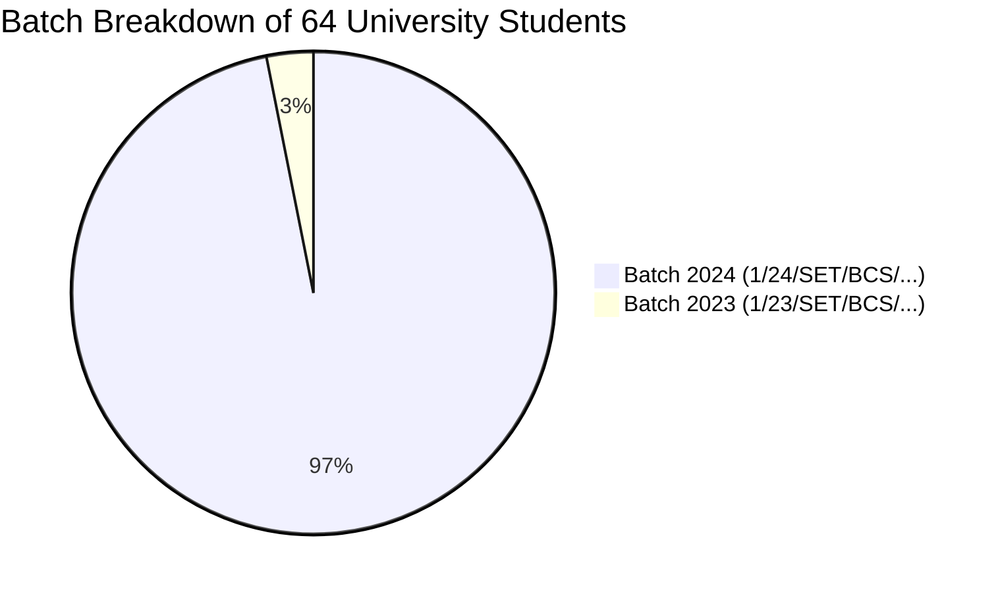
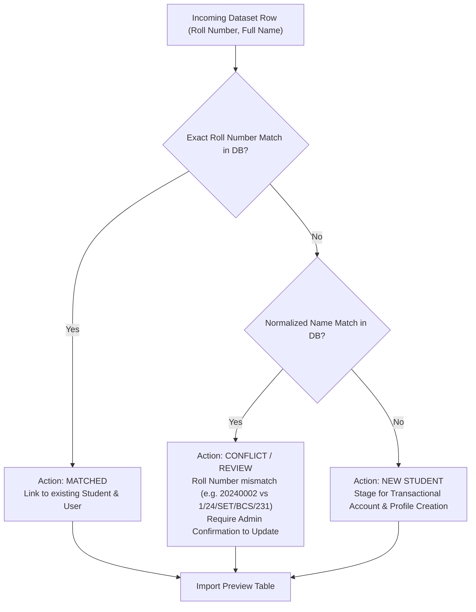

# CampusSphere AI — Student Dataset Ingestion & Matching Architecture Audit

**Audit Date:** 2026-11-11  
**Source Dataset:** `erp Datasets 1.numbers` (Sheet: `LINKEDIN certificate`, Table: `Table 1`)  
**Target Collection:** `students`, `users` in MongoDB `campus-erp`  
**Execution Mode:** Strictly READ-ONLY Planning & Audit (Zero Records Written or Mutated)  
**Target Repository:** `/Users/abhinikesh/AI-Campus_Help_Desk`  

---

## 1. Executive Summary

A programmatic inspection of the user-supplied spreadsheet `erp Datasets 1.numbers` was conducted using `numbers-parser` in the Python AI service environment.

The file contains authentic university student enrollment records from the School of Engineering & Technology (SET) for Bachelor of Computer Science (BCS) students.

### Dataset Overview
| Metric | Value | Observations |
| :--- | :---: | :--- |
| **Total Rows in Sheet** | **65 rows** | Row 0 is an empty header; Rows 1 to 64 contain student data |
| **Total Student Records** | **64 students** | 100% complete roll number and full name pairs |
| **Total Columns** | **2 columns** | Column 0: University Roll Number, Column 1: Full Name |
| **Duplicate Roll Numbers** | **0 duplicates** | All 64 roll numbers are unique |
| **Admission Batches** | **2 batches** | 2 students from Batch 2023 (`1/23/...`), 62 students from Batch 2024 (`1/24/...`) |
| **Department / Program** | **SET / BCS** | School of Engineering & Technology, Computer Science |

---

## 2. Complete Inventory of the 64 Ingestion Records



### Full Student Roster Extracted from `Table 1`

| Index | University Roll Number | Student Full Name | Detected Batch | Detected Program |
| :---: | :--- | :--- | :---: | :---: |
| 1 | `1/23/SET/BCS/095` | Kunal Bhargava | 2023 | B.Tech CSE (BCS) |
| 2 | `1/23/SET/BCS/243` | MAYANK SOAM | 2023 | B.Tech CSE (BCS) |
| 3 | `1/24/SET/BCS/212` | Aditya Raj | 2024 | B.Tech CSE (BCS) |
| 4 | `1/24/SET/BCS/213` | SARTHAK SHRIVASTAVA | 2024 | B.Tech CSE (BCS) |
| 5 | `1/24/SET/BCS/214` | Mrinal Chowdhary | 2024 | B.Tech CSE (BCS) |
| 6 | `1/24/SET/BCS/215` | Divyanjali Dinkar | 2024 | B.Tech CSE (BCS) |
| 7 | `1/24/SET/BCS/216` | PREETI SHARMA | 2024 | B.Tech CSE (BCS) |
| 8 | `1/24/SET/BCS/217` | YERRAGOLLA NARENDRA | 2024 | B.Tech CSE (BCS) |
| 9 | `1/24/SET/BCS/219` | Raj Sah | 2024 | B.Tech CSE (BCS) |
| 10 | `1/24/SET/BCS/220` | OMKESH CHATURBEDI | 2024 | B.Tech CSE (BCS) |
| 11 | `1/24/SET/BCS/221` | Anshika Aggarwal | 2024 | B.Tech CSE (BCS) |
| 12 | `1/24/SET/BCS/222` | Shivam Mishra | 2024 | B.Tech CSE (BCS) |
| 13 | `1/24/SET/BCS/223` | Anish Kumar | 2024 | B.Tech CSE (BCS) |
| 14 | `1/24/SET/BCS/224` | Ansh Yadav | 2024 | B.Tech CSE (BCS) |
| 15 | `1/24/SET/BCS/225` | Priyanshu Kumar | 2024 | B.Tech CSE (BCS) |
| 16 | `1/24/SET/BCS/226` | ADITYA SHARMA | 2024 | B.Tech CSE (BCS) |
| 17 | `1/24/SET/BCS/227` | CHANCHAL | 2024 | B.Tech CSE (BCS) |
| 18 | `1/24/SET/BCS/228` | Jatin Arora | 2024 | B.Tech CSE (BCS) |
| 19 | `1/24/SET/BCS/229` | Lakshey | 2024 | B.Tech CSE (BCS) |
| 20 | `1/24/SET/BCS/230` | Shivang Gupta | 2024 | B.Tech CSE (BCS) |
| 21 | `1/24/SET/BCS/231` | **Abhinikesh Kumar** | 2024 | B.Tech CSE (BCS) |
| 22 | `1/24/SET/BCS/232` | Kasvi Sharma | 2024 | B.Tech CSE (BCS) |
| 23 | `1/24/SET/BCS/233` | Ayush Parasher | 2024 | B.Tech CSE (BCS) |
| 24 | `1/24/SET/BCS/234` | Harsh Singh | 2024 | B.Tech CSE (BCS) |
| 25 | `1/24/SET/BCS/235` | ABHINAV KUMAR | 2024 | B.Tech CSE (BCS) |
| 26 | `1/24/SET/BCS/236` | Himanshu Garg | 2024 | B.Tech CSE (BCS) |
| 27 | `1/24/SET/BCS/237` | Ayush Thakur | 2024 | B.Tech CSE (BCS) |
| 28 | `1/24/SET/BCS/238` | Sobit Parashar | 2024 | B.Tech CSE (BCS) |
| 29 | `1/24/SET/BCS/239` | Onkar Shukla | 2024 | B.Tech CSE (BCS) |
| 30 | `1/24/SET/BCS/240` | Pragam Dubey | 2024 | B.Tech CSE (BCS) |
| 31 | `1/24/SET/BCS/241` | VIDIT DUBEY | 2024 | B.Tech CSE (BCS) |
| 32 | `1/24/SET/BCS/242` | PASAM REDDY | 2024 | B.Tech CSE (BCS) |
| 33 | `1/24/SET/BCS/243` | Priyanshu . | 2024 | B.Tech CSE (BCS) |
| 34 | `1/24/SET/BCS/244` | RAYAPU CHARAN SIMHA REDDY | 2024 | B.Tech CSE (BCS) |
| 35 | `1/24/SET/BCS/245` | Prarthna Singh | 2024 | B.Tech CSE (BCS) |
| 36 | `1/24/SET/BCS/246` | Mishra Ritesh Kumar Kumar | 2024 | B.Tech CSE (BCS) |
| 37 | `1/24/SET/BCS/247` | GRANTH CHUGH | 2024 | B.Tech CSE (BCS) |
| 38 | `1/24/SET/BCS/248` | MOHD SADAF | 2024 | B.Tech CSE (BCS) |
| 39 | `1/24/SET/BCS/249` | Teena . | 2024 | B.Tech CSE (BCS) |
| 40 | `1/24/SET/BCS/250` | Shreya Doha | 2024 | B.Tech CSE (BCS) |
| 41 | `1/24/SET/BCS/251` | RAMIREDDY SUDARSHAN RDDY | 2024 | B.Tech CSE (BCS) |
| 42 | `1/24/SET/BCS/252` | SHOBHIT MISHRA | 2024 | B.Tech CSE (BCS) |
| 43 | `1/24/SET/BCS/253` | MD SAHIL | 2024 | B.Tech CSE (BCS) |
| 44 | `1/24/SET/BCS/254` | Ishika Goyal | 2024 | B.Tech CSE (BCS) |
| 45 | `1/24/SET/BCS/257` | Tanishk Sharma | 2024 | B.Tech CSE (BCS) |
| 46 | `1/24/SET/BCS/259` | Lucky | 2024 | B.Tech CSE (BCS) |
| 47 | `1/24/SET/BCS/260` | Puneet Dalal | 2024 | B.Tech CSE (BCS) |
| 48 | `1/24/SET/BCS/261` | Shimesh Gupta | 2024 | B.Tech CSE (BCS) |
| 49 | `1/24/SET/BCS/262` | Kritika Sah | 2024 | B.Tech CSE (BCS) |
| 50 | `1/24/SET/BCS/263` | SHARVAN CHAUDHARY | 2024 | B.Tech CSE (BCS) |
| 51 | `1/24/SET/BCS/264` | Aditya Chaurasia | 2024 | B.Tech CSE (BCS) |
| 52 | `1/24/SET/BCS/265` | Mohit Mamgain | 2024 | B.Tech CSE (BCS) |
| 53 | `1/24/SET/BCS/266` | Akram Khan | 2024 | B.Tech CSE (BCS) |
| 54 | `1/24/SET/BCS/267` | Hamza Baksh | 2024 | B.Tech CSE (BCS) |
| 55 | `1/24/SET/BCS/268` | Ankit Tiwari | 2024 | B.Tech CSE (BCS) |
| 56 | `1/24/SET/BCS/269` | Vanshika | 2024 | B.Tech CSE (BCS) |
| 57 | `1/24/SET/BCS/270` | Vanshika Gupta | 2024 | B.Tech CSE (BCS) |
| 58 | `1/24/SET/BCS/271` | Devender Kashyap | 2024 | B.Tech CSE (BCS) |
| 59 | `1/24/SET/BCS/274` | KARAN SINGH | 2024 | B.Tech CSE (BCS) |
| 60 | `1/24/SET/BCS/275` | PRANJAL NAGAR | 2024 | B.Tech CSE (BCS) |
| 61 | `1/24/SET/BCS/277` | PRABAL JOSHI | 2024 | B.Tech CSE (BCS) |
| 62 | `1/24/SET/BCS/278` | Khalid Sarfraz | 2024 | B.Tech CSE (BCS) |
| 63 | `1/24/SET/BCS/279` | Shreyash Maurya | 2024 | B.Tech CSE (BCS) |
| 64 | `1/24/SET/BCS/588` | Aman Kumar | 2024 | B.Tech CSE (BCS) |

---

## 3. Discrepancy Analysis: Database vs Actual University Roll Numbers

### 3.1 Existing Database Representation
In `campus-erp`, student records were generated during early development using synthetic 8-digit numeric strings:
- `20240001` — Arjun Sharma
- `20240002` — Abhinikesh
- `20240003` — Rohan Verma
- `20240004` — Sneha Patel
- `20240005` — Ananya Rao
- `20240006` — Aditya Nair
- `20240007` — Meera Iyer
- `20240008` — Kabir Singh

### 3.2 Authentic University Roll Number Pattern
The uploaded dataset establishes the authoritative institutional roll number syntax:
$$\text{Shift/Batch} \;/\; \text{Year} \;/\; \text{School} \;/\; \text{Programme} \;/\; \text{Sequence Number}$$
$$\text{Example: } 1 \;/\; 24 \;/\; \text{SET} \;/\; \text{BCS} \;/\; 231$$

- `1`: Shift 1 / Regular Batch
- `24`: Admission Year 2024
- `SET`: School of Engineering & Technology
- `BCS`: Bachelor of Computer Science (B.Tech CSE)
- `231`: Serial Student Identifier

### 3.3 Student Reconciliation (e.g. Abhinikesh)
In the local development database, the user account `Abhinikesh` (`6ae46faf9e9e56f71ecccdd8`) was assigned synthetic roll number `20240002`. The real dataset establishes the true university enrollment:
- **Authoritative Roll Number:** `1/24/SET/BCS/231`
- **Authoritative Full Name:** `Abhinikesh Kumar`
- **Admission Year:** 2024 (Semester 5 in Odd Sem 2026–2027)

---

## 4. Matching Algorithm & Collision Handling



### 4.1 Matching Rules
1. **Tier 1 — Exact Roll Number:** If `Student.rollNumber === row.rollNumber`, mark as `MATCHED`. Zero duplicate creation.
2. **Tier 2 — Name Match with Roll Number Divergence:** If normalized `fullName` matches an existing student (e.g., `"Abhinikesh"` vs `"Abhinikesh Kumar"`), flag as `NAME_MATCH_ROLL_DIFF`. Present a side-by-side reconciliation preview:
   - Existing DB: `Roll: 20240002`, `Name: Abhinikesh`
   - Ingested File: `Roll: 1/24/SET/BCS/231`, `Name: Abhinikesh Kumar`
   - Recommended Action: Update synthetic roll number to university roll number upon explicit administrator confirmation.
3. **Tier 3 — Unmatched Records:** Flag as `NEW_STUDENT`. Prepare staging documents for transaction-safe insertion.

---

## 5. Reusable Dataset Ingestion Architecture

To accommodate future datasets (admissions, faculty lists, semester marks, timetables), a generic, modular dataset ingestion engine is established.

```mermaid
flowchart LR
    Upload["Upload File<br/>(CSV / XLSX / Numbers / PDF)"]
    Val["1. File Validation & Size Limits"]
    Parse["2. Format Parser Engine<br/>(Python / Node.js)"]
    Map["3. Schema Column Mapping"]
    Norm["4. Normalization & Deduplication"]
    Ref["5. Referential Integrity Check"]
    Prev["6. Interactive Import Preview"]
    Auth["7. Authorized Admin Approval"]
    Tx["8. Transaction-Safe Write (MongoDB)"]
    Audit["9. Import History & Audit Log"]

    Upload --> Val --> Parse --> Map --> Norm --> Ref --> Prev --> Auth --> Tx --> Audit
```



### 5.1 Storage & Privacy Isolation
- **Directory Location:** `server/data/imports/`
  - Subdirectories: `students/`, `timetables/`, `marks/`, `processed/`, `quarantine/`.
- **Git Protection:**
  ```gitignore
  # In server/.gitignore
  /data/imports/*
  !/data/imports/.gitkeep
  !/data/imports/README.md
  ```
  **Under no circumstances will student personally identifiable information (PII) or uploaded university documents be committed to Git.**

### 5.2 The 12-Step Ingestion Pipeline
1. **File Validation:** Enforce maximum file size (25 MB) and MIME-type validation (`application/vnd.apple.numbers`, `application/vnd.openxmlformats-officedocument.spreadsheetml.sheet`, `text/csv`, `application/pdf`).
2. **Format Parser Selection:**
   - `.numbers` -> Python `numbers-parser` microservice in `ai-service`.
   - `.xlsx` / `.csv` -> Node.js `exceljs` / `csv-parse`.
   - `.pdf` -> Python `pdfplumber` / OCR layout analysis.
3. **Schema Column Mapping:** Automatically detect column synonyms (`"Roll No"`, `"RollNumber"`, `"University Roll"`, `"Candidate Name"`, `"Student Name"`) with interactive override.
4. **Data Normalization:** Trim whitespace, standardize casing, format roll numbers, and validate phone/email strings.
5. **Deduplication:** Check within-file duplicate rows (detected 0 duplicates in current file) and database collisions.
6. **Referential Integrity:** Ensure referenced classes, semesters, and branches match canonical institutional academic structures.
7. **Interactive Preview:** Present four categories to the administrator:
   - `[Green] New Records to Insert`
   - `[Blue] Existing Records Matched`
   - `[Yellow] Potential Reconciliations / Conflicts`
   - `[Red] Invalid Rows (Malformed)`
8. **Explicit Confirmation:** Require explicit administrative authorization (`POST /api/admin/datasets/confirm`).
9. **Transaction-Safe Database Write:**
   ```javascript
   const session = await mongoose.startSession();
   await session.withTransaction(async () => {
     // Create User account with hashed temporary credentials
     // Create Student profile linked to User
   });
   ```
10. **Audit Trail & History:** Store metadata in `DatasetImportHistory` (filename, record counts, actor, timestamp, hash).
11. **Quarantine & Error Reporting:** Any rejected or malformed row is exported to an error summary CSV.
12. **Rollback Strategy:** Each import batch carries a unique `importBatchId` allowing a one-click rollback if needed prior to term activation.

---

**Report Authored By:** Antigravity AI Engineering Specialist  
**Deliverable Status:** COMPLETE & READY FOR PHASE 1 IMPLEMENTATION
