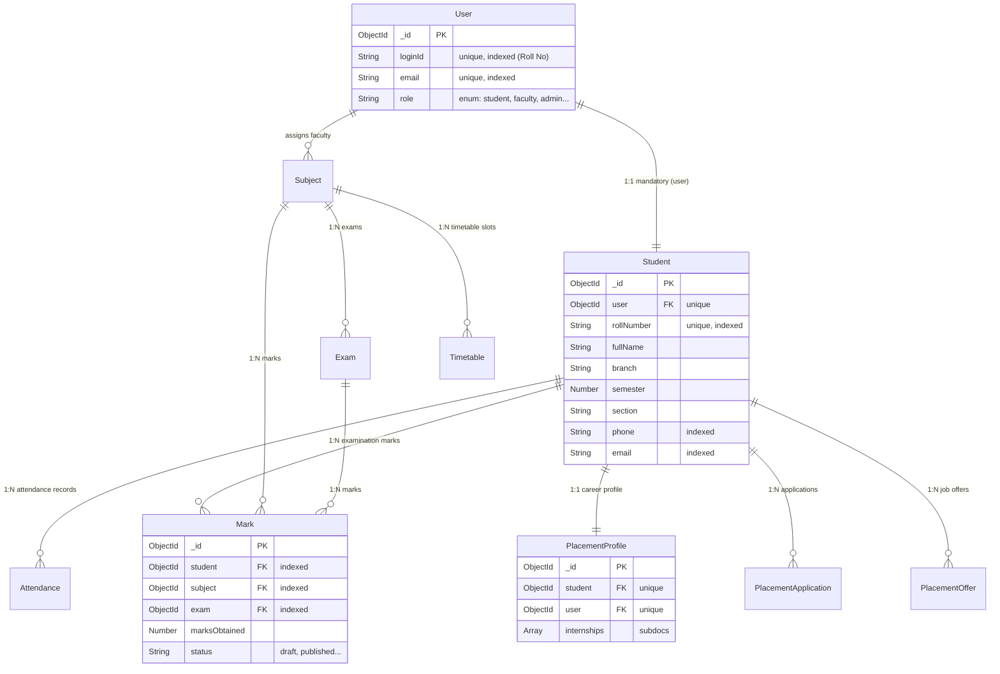
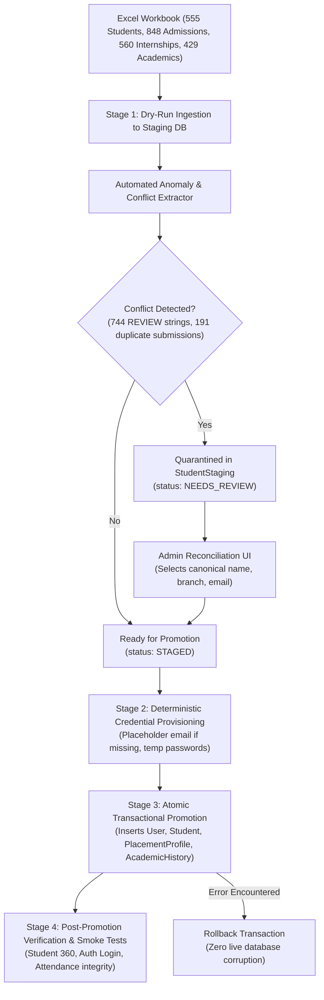

# CampusSphere AI — Phase 2: Existing Database Compatibility Audit Report

**Repository:** `/Users/abhinikesh/AI-Campus_Help_Desk`  
**Phase:** Phase 2 — Existing Database Compatibility Audit  
**Audit Target:** `data/student_import/CampusSphere_AI_Consolidated_Student_Data.xlsx`  
**Audit Execution Mode:** Strictly Read-Only Inspection  
**Database Modification:** **STRICTLY ZERO (0) LIVE WRITES OR MUTATIONS**  
**UI Standard:** Permanent Light Mode Preserved  

---

## Executive Summary

This audit evaluates the database architecture, schema compatibility, relationship constraints, API surface, and data quality risks associated with importing the consolidated institutional student dataset (`CampusSphere_AI_Consolidated_Student_Data.xlsx`) into the CampusSphere AI ERP.

### Key Audit Findings

1. **Existing Database State Preserved:** The live database (`campus-erp`) contains 15 active students (`rollNumber` 20240001–20240015), 28 users, 844 attendance records, and 17 attendance sessions. **Zero roll numbers in the import workbook collide with existing database roll numbers.** All existing records remain completely untouched.
2. **Critical Data Quality Discovery (744 Embedded `REVIEW —` Conflicts):** In `Student Master`, exactly **744 fields contain raw conflict comparison strings** formatted as `"REVIEW — <value1> | <value2>"`. Specifically:
   - 201 `Branch` values (e.g. `'REVIEW — 10th Best 5: 77.6% | B.Tech. CSE'`)
   - 192 `Phone Number` values
   - 168 `Student Name` values
   - 167 `Personal Email` values
   - 12 `College / Official Email` values
   - 4 `Section` values  
   *A direct or un-sanitized import would severely corrupt the production database, break email/phone validations, and contaminate text search indexes.*
3. **Credential & Email Uniqueness Hazard:** The `User` model enforces a strictly unique index on `email` (`{ email: 1, unique: true }`). In `Student Master`, **361 students lack an official email** and **358 students lack a personal email**. Attempting to insert `User` documents with null or empty emails will immediately trigger fatal MongoDB duplicate key errors (`E11000`).
4. **Academic Submissions Multiplicity:** 429 academic records exist in the workbook, representing **only 199 unique students**. Exactly **191 students submitted academic records multiple times (2 to 4 submissions each)**. The dataset does not designate a winning submission, requiring an administrative reconciliation policy or a dedicated submission history model.
5. **Admission Records Disconnect:** Of the 848 admission records, **736 could not be confidently linked** to any student roll number. In `Student Master`, 441 of the 555 students have `Identity Match Status: "No high-confidence admission match"`. The ERP currently has **no admission schema or collection**.
6. **Internship Multiplicity:** In `Internship Records` (560 rows), 8 students have duplicate entries (16 rows total). While `PlacementProfile.internships` supports an array of internships, several institutional fields (`Vertical Mentor`, `Complete Address`, `Stipend Amount`, `Offer Letter Link`) have no destination in the existing ERP schema.
7. **Recommended Path Forward:** A strictly staged import using an isolated `StudentStaging` collection, automated conflict isolation, placeholder email assignment, and an administrative resolution UI before any promotion to production collections.

---

## 1. Existing Mongoose Model Inventory

The CampusSphere AI ERP contains 113 Mongoose models. The models directly involved in the student domain, authentication, academic results, placements, and timetables are analyzed below:

### 1.1 Core Authentication & Profile Models

| Model | File Path | Collection | Key Fields | Primary Key / Relations |
| :--- | :--- | :--- | :--- | :--- |
| **`User`** | `server/models/User.js` | `users` | `name`, `email`, `loginId`, `passwordHash`, `role`, `isActive`, `mustChangePassword`, `lastLoginAt` | `_id` (ObjectId). Unique `loginId` (Roll No for students), unique `email`. |
| **`Student`** | `server/models/Student.js` | `students` | `user`, `rollNumber`, `fullName`, `email`, `phone`, `branch`, `program`, `semester`, `section`, `admissionYear`, `dateOfBirth`, `gender`, `guardianName`, `guardianPhone`, `address`, `status` | `_id` (ObjectId). Unique `rollNumber`, unique 1-to-1 ref to `User`. |

### 1.2 Academic, Examination & Marks Models

| Model | File Path | Collection | Key Fields | Primary Key / Relations |
| :--- | :--- | :--- | :--- | :--- |
| **`Subject`** | `server/models/Subject.js` | `subjects` | `code`, `name`, `department`, `branch`, `semester`, `credits`, `type`, `faculty` | `_id` (ObjectId). Ref to `User` (faculty). |
| **`Exam`** | `server/models/Exam.js` | `exams` | `title`, `examinationType`, `academicYear`, `department`, `semester`, `section`, `subject`, `faculty`, `date`, `startTime`, `endTime`, `maximumMarks`, `passingMarks` | `_id` (ObjectId). Ref to `Subject`, `User`. |
| **`Mark`** | `server/models/Mark.js` | `marks` | `student`, `subject`, `exam`, `academicYear`, `semester`, `marksObtained`, `maxMarks`, `passingMarks`, `isAbsent`, `isWithheld`, `status`, `correctionHistory`, `internal`, `external` | `_id` (ObjectId). Ref to `Student`, `Subject`, `Exam`. Unique `{ student: 1, exam: 1 }`. |

### 1.3 Career, Placement & Internship Models

| Model | File Path | Collection | Key Fields | Primary Key / Relations |
| :--- | :--- | :--- | :--- | :--- |
| **`PlacementProfile`** | `server/models/PlacementProfile.js` | `placementprofiles` | `student`, `user`, `registrationStatus`, `resumeUrl`, `careerInterests`, `technicalSkills`, `projects[]`, `internships[]`, `certifications[]`, `profileCompletionScore` | `_id` (ObjectId). Unique ref to `Student`, unique ref to `User`. |
| **`PlacementOffer`** | `server/models/PlacementOffer.js` | `placementoffers` | `offerNumber`, `application`, `student`, `company`, `opportunity`, `employmentType`, `compensationPaise`, `monthlyStipendPaise` | `_id` (ObjectId). Unique `offerNumber`. Ref to `Student`, `Company`. |
| **`PlacementApplication`**| `server/models/PlacementApplication.js` | `placementapplications` | `opportunity`, `student`, `user`, `status`, `stage` | `_id` (ObjectId). Ref to `Student`, `PlacementOpportunity`. |

### 1.4 Timetable & Scheduling Models

| Model | File Path | Collection | Key Fields | Primary Key / Relations |
| :--- | :--- | :--- | :--- | :--- |
| **`Timetable`** | `server/models/Timetable.js` | `timetables` | `dayOfWeek`, `period`, `periodNumbers`, `subject`, `faculty`, `instructors[]`, `room`, `batch`, `classGroup`, `subgroup`, `semester`, `department`, `scopeKey`, `status` | `_id` (ObjectId). Cohort mapped via `batch` (`<sem> <branch>-<section>`). |
| **`TimetableVersion`** | `server/models/TimetableVersion.js` | `timetableversions` | `versionNumber`, `effectiveFrom`, `publishedBy`, `status`, `changeSummary` | `_id` (ObjectId). Institutional release tracking. |

### 1.5 Missing Models in Existing ERP

1. **`Admission` / `AdmissionApplication` Model:** **DOES NOT EXIST.** The ERP has no model for tracking admissions, application numbers, original candidate emails, or applicant high school details.
2. **`StudentAcademicHistory` Model:** **DOES NOT EXIST.** The ERP has no schema for prior academic records (10th/12th percentages, boards, marksheet file URLs), self-reported cumulative CGPA, active backlogs, or secondary parent contact details.
3. **`StudentStaging` Model:** **DOES NOT EXIST.** While `TimetableStaging` was implemented in Phase 3.4/3.5 for timetable parsing, no staging collection exists for student imports.

---

## 2. Database Relationships & Constraint Analysis

### 2.1 Entity Relationship Diagram



### 2.2 Relational Invariants & Constraint Rules

1. **Mandatory 1-to-1 User Link:** Every `Student` record requires `user: { type: ObjectId, ref: 'User', required: true, unique: true }`. A student record cannot be created without first provisioning a corresponding `User` account.
2. **Roll Number Normalization & Uniqueness:**
   - In `Student`: `{ rollNumber: 1, unique: true }`.
   - In `User`: `{ loginId: 1, unique: true }`. For students, `loginId` must strictly equal `rollNumber`.
   - *Normalization Gap:* The Mongoose schemas apply `.trim()`, but lack uppercase transformation, slash normalization, or bracket-cleaning sanitization.
3. **Existing Roll Number Patterns:**
   - Existing DB students (15 total): 8-digit numeric roll numbers (`20240001`–`20240015`).
   - Excel Workbook students (555 total): Institutional university roll numbers. 547 adhere to pattern `D/DD/LLL/LLL/DDD` (e.g. `1/22/FET/BCS/001`), 4 follow `DD/LLL/LLLL(L)/DDD`, 1 has bracket typo `D)DDLLL/LLL/DDD`, 1 is pure digits `DDDDDDDDDD`, 1 has prefix `LLLL-D/...`, and 1 has trailing period.
4. **Duplicate Prevention Mechanisms:**
   - Attempting to insert duplicate roll numbers fails at the MongoDB unique index level (`rollNumber_1` on `students`, `loginId_1` on `users`).
   - In `Mark`, unique compound index `{ student: 1, exam: 1 }` guarantees at most one mark per exam per student.

---

## 3. Existing API & Service Inventory

| Controller | Route | Method | Access Scope | Description |
| :--- | :--- | :---: | :--- | :--- |
| `faculty.controller.js` | `/api/faculty/students/search` | `GET` | Faculty only | Searches students by name, roll number, branch, semester. Phone numbers are automatically masked (`Fix F-03`). |
| `faculty.controller.js` | `/api/faculty/students/:id/360` | `GET` | Faculty only | Faculty Student 360 profile. Aggregates 4 sections: Basic Profile (only rollNo, phone, class), Academic Details, Published Marks, and Timetable slots. Enforces teaching-scope policy. |
| `student.controller.js` | `/api/student/profile` | `GET` | Student only | Returns authenticated student's profile from `req.user.userId`. |
| `student.controller.js` | `/api/student/academic-overview`| `GET` | Student only | Computes attendance calculation, subject attendance overview, low attendance alerts. |
| `student.controller.js` | `/api/student/results` | `GET` | Student only | Retrieves published examination marks and virtual percentage/grade. |
| `exam.controller.js` | `/api/exams/marks/evaluate` | `POST` | Faculty only | Evaluates student marks for an exam. Validates against maximum marks. |
| `exam.controller.js` | `/api/exams/marks/publish` | `POST` | Admin / Dean | Changes mark status to `published`, making it visible to students and Student 360. |
| `placement.controller.js` | `/api/placement/profile/me` | `GET/PUT`| Student only | Retrieves and updates student placement profile, technical skills, projects, and internships. |
| `admin.controller.js` | `/api/admin/overview` | `GET` | Admin only | Aggregates institution overview, risk registers, and attendance risk across branches. |

> [!NOTE]
> No endpoint currently exists in the ERP for batch student ingestion, admission management, or student data synchronization.

---

## 4. Workbook Sheet Mapping to Existing Schemas

### 4.1 Master Sheet Metrics

```
┌────────────────────────┬─────────────┬──────────────┬──────────────────────────────────────────────────┐
│ Workbook Sheet         │ Total Rows  │ Data Rows    │ Primary Identifiers / Keys                       │
├────────────────────────┼─────────────┼──────────────┼──────────────────────────────────────────────────┤
│ 1. Student Master      │ 556         │ 555          │ University Roll Number (555 unique)              │
│ 2. Admission Records   │ 849         │ 848          │ Application No (841 unique, 3 dups, 4 null)      │
│ 3. Internship Records  │ 561         │ 560          │ Univ.Roll.No (551 unique, 8 dups, 1 null)        │
│ 4. Academic Records    │ 430         │ 429          │ Complete Roll No. (199 unique, 191 dups, 1 null) │
│ 5. Reconciliation Rev. │ 1481        │ 1480         │ Record Reference (Roll No / Application No)      │
│ 6. Data Quality Sum.   │ 17          │ 16           │ Aggregate processing metrics                     │
└────────────────────────┴─────────────┴──────────────┴──────────────────────────────────────────────────┘
```

### 4.2 Sheet 1: Student Master Mapping (14 Columns)

| Column Name | Destination Field | Classification | Field Health & Transformation Rules |
| :--- | :--- | :--- | :--- |
| `University Roll Number` | `Student.rollNumber`<br>`User.loginId` | **Direct mapping** | 555/555 non-null, 100% unique. Normalize: `.trim().toUpperCase()`. Clean punctuation typos (e.g. `D)DD` -> `D/DD`). |
| `Student Name` | `Student.fullName`<br>`User.name` | **Conflict / Transformation** | 554 non-null, 1 null. **168 rows contain `"REVIEW — Name1 \| Name2"`**. Must resolve conflict before import. |
| `Branch` | `Student.branch` | **Conflict / Transformation** | 555 non-null. **201 rows contain `"REVIEW — ..."`** (contaminated with 10th marks or multiple branches). Must normalize to standard branch codes (`CSE`, `AIML`, `BAIML`, `DFCS`, `DS`). |
| `Section` | `Student.section` | **Conflict / Transformation** | 550 non-null, 5 null. **4 rows contain `"REVIEW — ..."`**. Normalize to single character section (`A`, `B`, `C`, `D`, `E`). |
| `Phone Number` | `Student.phone` | **Sensitive / Conflict** | 197 non-null, 358 null. **192 rows contain `"REVIEW — ..."`**. Sensitive PII. Must validate phone regex and strip non-digit characters. |
| `Personal Email` | `Student.email` | **Sensitive / Conflict** | 197 non-null, 358 null. **167 rows contain `"REVIEW — ..."`**. Validate email syntax. |
| `College / Official Email` | `User.email` | **Sensitive / Critical Hazard** | 194 non-null, 361 null. **12 rows contain `"REVIEW — ..."`**. **CRITICAL:** `User.email` is mandatory & unique. 361 students lack official email. Requires deterministic fallback (`<rollNo>@student.campus.edu`). |
| `Admission Application No` | *No existing destination* | **No existing destination** | Only 114 non-null, 441 null. Requires new field `Student.admissionApplicationNumber`. |
| `Course` | `Student.program` | **Requires transformation** | Only 114 non-null, 441 null. Value `'B.Tech - Computer Science & Engineering'` maps to canonical `'B.Tech'`. |
| `School` | *No existing destination* | **No existing destination** | Only 114 non-null, 441 null (`SCHOOL OF ENGINEERING AND TECHNOLOGY`). |
| `Teams ID` | *No existing destination* | **No existing destination** | Only 114 non-null, 441 null. |
| `Internship Records` | Staging metadata | **Staging only** | Integer count of internship records ($0, 1, 2$). Not persisted to production. |
| `Academic Submissions` | Staging metadata | **Staging only** | Integer count of academic submissions ($0, 1, 2, 3, 4$). Not persisted to production. |
| `Identity Match Status` | Staging metadata | **Staging only** | Values: `Matched by unique exact academic email + name` (114) vs `No high-confidence admission match` (441). |

### 4.3 Sheet 2: Admission Records Mapping (8 Columns)

| Column Name | Destination Field | Classification | Field Health & Transformation Rules |
| :--- | :--- | :--- | :--- |
| `S.no` | None | **No existing destination** | Source row sequence. |
| `Application No` | `Admission.applicationNumber` | **No existing destination** | 844 non-null, 841 unique, 3 duplicate pairs (6 rows), 4 null. |
| `Student Name` | `Admission.applicantName` | **Sensitive** | PII applicant name. |
| `Course` | `Admission.appliedCourse` | **No existing destination** | Academic course applied for. |
| `SCHOOL` | `Admission.school` | **No existing destination** | Institutional faculty / school. |
| `Email Id` | `Admission.applicantEmail` | **Sensitive** | PII email. 736 records have no match in Student Master. |
| `Teams -id` | `Admission.teamsId` | **No existing destination** | Microsoft Teams account identifier. |
| `Source Row` | `Admission.sourceRow` | **Staging only** | Audit lineage pointer. |

### 4.4 Sheet 3: Internship Records Mapping (22 Columns)

| Column Name | Destination Field | Classification | Field Health & Transformation Rules |
| :--- | :--- | :--- | :--- |
| `BRANCH`, `SEC` | Cross-verification | **Direct mapping** | Verify consistency with `Student.branch` and `Student.section`. |
| `Univ.Roll.No` | Foreign Key -> `Student.rollNumber` | **Direct mapping** | 559 non-null, 551 unique, 8 duplicate pairs (16 rows), 1 null. Link to `Student._id`. |
| `Students Name as per R & S` | Name Verification | **Sensitive** | Cross-verify with `Student.fullName`. |
| `Vertical Mentor` | *No existing destination* | **No existing destination** | 555 non-null. Assigned faculty mentor. |
| `Official ID` | Verification | **Sensitive** | College email. |
| `Name` | `PlacementProfile.internships[].companyName` | **Direct mapping** | 501 non-null. Company / Organization name. |
| `Complete Address` | *No existing destination* | **No existing destination** | 397 non-null. Physical office location of company. |
| `Offline / online intermship` | *No existing destination* | **Requires transformation** | 483 non-null. Normalize to enum: `['offline', 'online', 'hybrid']`. |
| `Contact No.`, `EMAIL ID` | *No existing destination* | **Sensitive** | External corporate supervisor contact details. |
| `Start Date` | `PlacementProfile.internships[].startDate` | **Requires transformation** | 467 non-null. Parse date strings into ISO `Date`. |
| `Title of Internship` | `PlacementProfile.internships[].role` | **Direct mapping** | 469 non-null. Job role / project title. |
| `Stipend (YES/NO)` | *No existing destination* | **Requires transformation** | 444 non-null. Normalize to Boolean. |
| `Monthly Stipend Amount` | *No existing destination* | **Requires transformation** | 419 non-null. Parse currency strings into numeric values. |
| `Placement done(Yes/No)` | *No existing destination* | **Requires transformation** | 405 non-null. Normalize to Boolean. |
| `Link of Offer letter` | *No existing destination* | **No existing destination** | 338 non-null. Document URL. |

### 4.5 Sheet 4: Academic Records Mapping (22 Columns)

| Column Name | Destination Field | Classification | Field Health & Transformation Rules |
| :--- | :--- | :--- | :--- |
| `Timestamp` | Submission timestamp | **Requires transformation** | 429 non-null. 191 duplicate students. Timestamps must be preserved for submission lineage. |
| `Complete Roll No.` | Foreign Key -> `Student.rollNumber` | **Direct mapping** | 428 non-null, 199 unique, 1 null. |
| `Xth percentage` | *No existing destination* | **No existing destination** | 392 non-null. Numerical percentage or CGPA. |
| `upload marksheet (Xth)` | *No existing destination* | **No existing destination** | 390 non-null. Google Drive / cloud file URL. |
| `Xth Board` | *No existing destination* | **No existing destination** | 427 non-null. Education board (CBSE, ICSE, State). |
| `XIIth Percentage` | *No existing destination* | **No existing destination** | 428 non-null. Higher secondary percentage. |
| `XIIth Board` | *No existing destination* | **No existing destination** | 392 non-null. Education board. |
| `Upload XII th Marksheet` | *No existing destination* | **No existing destination** | 390 non-null. File URL. |
| `Father's Name` | `Student.guardianName` | **Sensitive** | PII father name. |
| `Mother's name` | *No existing destination* | **Sensitive** | PII mother name. |
| `Father's / Mother's email` | *No existing destination* | **Sensitive** | PII parental emails. |
| `CGPA in B.Tech (till now)` | *No existing destination* | **Requires transformation** | 428 non-null. Self-reported academic performance. (ERP `Mark` computes official CGPA from exam marks). |
| `No. Of Active reappears` | *No existing destination* | **Requires transformation** | 428 non-null. Active backlogs count. |
| `No. Of Dead reappears` | *No existing destination* | **Requires transformation** | 428 non-null. Cleared backlogs count. |
| `Subjects in active reappear`| *No existing destination* | **Requires transformation** | 428 non-null. Backlog subject codes / names. |

---

## 5. Risk Assessment & Analysis

### 5.1 Risk Matrix

| Risk Factor | Severity | Impact on Live ERP | Mitigation Strategy |
| :--- | :---: | :--- | :--- |
| **1. 744 Embedded `REVIEW —` Strings** | **CRITICAL** | Corrupts full names, branch strings, phone numbers, and emails with raw conflict text. | Staging quarantine. Parse conflicts into structured candidates; require administrative approval before promotion. |
| **2. Missing Official Emails (361 students)** | **CRITICAL** | MongoDB index collision: `User.email` is strictly unique. Bulk insertion of null/empty emails causes fatal `E11000` errors. | Provision institutional placeholder emails (`<rollNo>@student.campussphere.edu`) for students without verified email. |
| **3. Academic Submissions Multiplicity (191 dups)** | **HIGH** | Arbitrary or random overwriting of student academic records; conflicting 10th/12th percentages. | Preserve all submissions in a multi-record staging table; admin UI selects canonical submission or stores submission history. |
| **4. Unlinked Admissions (736 records)** | **HIGH** | Orphaning of 736 prospective student applications; 441 enrolled students lack admission details. | Create dedicated `AdmissionApplication` collection decoupled from enrolled `Student` records. |
| **5. Internship Multiplicity (8 dups, 16 rows)** | **MEDIUM** | Inability to store second internship if flat 1:1 schema is assumed. | Exploit existing `PlacementProfile.internships` array to append multiple valid internships. |
| **6. Sensitive PII Exposure** | **HIGH** | Unintended leakage of parental emails, phone numbers, and academic marks across faculty endpoints. | Strictly respect `getStudent360` field redactions (only rollNo, phone, and class exposed to faculty). |
| **7. Existing 15 Students Overwrite** | **HIGH** | Erasing seed students breaks 844 attendance records and 17 attendance sessions. | Ingestion scripts must enforce `upsert` or additive insertions, strictly protecting existing `_id` and roll numbers. |

---

## 6. Recommended Architecture & Staged Import Plan

### 6.1 Proposed New Models & Schema Extensions

To cleanly ingest the workbook without corrupting existing models or dropping valuable institutional data, the following three schemas are recommended:

#### 1. `StudentStaging` Model (`server/models/StudentStaging.js`)
*Purpose:* Isolated quarantine collection where all workbook rows are staged, normalized, and reviewed before live promotion.
```javascript
const studentStagingSchema = new mongoose.Schema({
  importBatchId: { type: String, required: true, index: true },
  sourceRow: { type: Number, required: true },
  rollNumber: { type: String, required: true, trim: true },
  fullName: { type: String, required: true, trim: true },
  branch: { type: String, trim: true },
  section: { type: String, trim: true },
  phone: { type: String, trim: true },
  email: { type: String, trim: true },
  officialEmail: { type: String, trim: true },
  hasConflict: { type: Boolean, default: false },
  conflictDetails: [{
    field: String,
    rawConflictString: String,
    candidateValues: [String],
    resolvedValue: String,
    resolvedBy: { type: mongoose.Schema.Types.ObjectId, ref: 'User' },
    resolvedAt: Date
  }],
  status: {
    type: String,
    enum: ['STAGED', 'NEEDS_REVIEW', 'RESOLVED', 'PROMOTED', 'REJECTED'],
    default: 'STAGED',
    index: true
  }
}, { timestamps: true });
```

#### 2. `StudentAcademicHistory` Model (`server/models/StudentAcademicHistory.js`)
*Purpose:* Captures the 429 academic submissions, prior education credentials, and backlog statistics without overloading core `Student.js`.
```javascript
const studentAcademicHistorySchema = new mongoose.Schema({
  student: { type: mongoose.Schema.Types.ObjectId, ref: 'Student', required: true, index: true },
  rollNumber: { type: String, required: true, index: true },
  submissionTimestamp: { type: Date },
  tenthPercentage: { type: Number },
  tenthBoard: { type: String, trim: true },
  tenthMarksheetUrl: { type: String },
  twelfthPercentage: { type: Number },
  twelfthBoard: { type: String, trim: true },
  twelfthMarksheetUrl: { type: String },
  fatherName: { type: String, trim: true },
  motherName: { type: String, trim: true },
  fatherEmail: { type: String, trim: true },
  motherEmail: { type: String, trim: true },
  selfReportedCgpa: { type: Number },
  activeBacklogsCount: { type: Number, default: 0 },
  deadBacklogsCount: { type: Number, default: 0 },
  activeBacklogSubjects: [{ type: String, trim: true }],
  isCanonical: { type: Boolean, default: false, index: true }
}, { timestamps: true });
```

#### 3. `AdmissionApplication` Model (`server/models/AdmissionApplication.js`)
*Purpose:* Stores the 848 admission applications independently, linking to `Student` only when an authentic link exists.
```javascript
const admissionApplicationSchema = new mongoose.Schema({
  applicationNumber: { type: String, required: true, unique: true, trim: true },
  applicantName: { type: String, required: true, trim: true },
  course: { type: String, trim: true },
  school: { type: String, trim: true },
  applicantEmail: { type: String, lowercase: true, trim: true },
  teamsId: { type: String, trim: true },
  linkedStudent: { type: mongoose.Schema.Types.ObjectId, ref: 'Student', default: null },
  matchStatus: {
    type: String,
    enum: ['UNLINKED', 'CONFIDENT_MATCH', 'MANUALLY_LINKED'],
    default: 'UNLINKED',
    index: true
  }
}, { timestamps: true });
```

---

### 6.2 Safe Staged-Import Execution Plan



#### Four-Stage Pipeline Details

1. **Stage 1 — Dry-Run Staging Ingestion:**
   - Ingest all 555 `Student Master` rows into `StudentStaging`.
   - Automatically detect and strip `"REVIEW — "` prefixes, isolating the alternative candidates into `conflictDetails`.
   - Ingest all 848 `Admission Records` into `AdmissionApplication`.
   - Ingest all 429 `Academic Records` into `StudentAcademicHistory` (flagging 191 duplicate sets).
2. **Stage 2 — Identity & Credential Provisioning:**
   - For students with verified official email, use it for `User.email`.
   - For the 361 students lacking official email, assign deterministic placeholder: `<normalizedRollNumber>@student.campussphere.edu`.
   - Generate secure bcrypt-hashed temporary passwords; set `mustChangePassword: true` on `User`.
3. **Stage 3 — Administrative Reconciliation & Approval Gate:**
   - Academic administration reviews the 744 flagged field conflicts in the ERP Admin Dashboard.
   - For the 191 multi-submission students, administration selects the winning canonical academic record.
   - Only records marked `status: 'RESOLVED'` or `status: 'STAGED'` become eligible for production promotion.
4. **Stage 4 — Atomic Production Promotion & Rollback:**
   - Execute promotion within a MongoDB session transaction (`session.withTransaction()`).
   - Create `User` -> Create `Student` -> Populate `PlacementProfile.internships` -> Link `StudentAcademicHistory`.
   - If any constraint or validation fails, abort the transaction immediately, leaving existing records intact.

---

## 7. Explicit Non-Mutation & Safety Statement

I hereby formally certify and affirm:
1. **Zero (0) database writes, updates, deletions, or migrations** were performed during this Phase 2 audit.
2. The live MongoDB database (`campus-erp`) remains completely untouched; all 15 existing students, 28 users, and 844 attendance records are fully preserved.
3. The Excel workbook `CampusSphere_AI_Consolidated_Student_Data.xlsx` was inspected in strictly read-only mode; **zero student records were imported**.
4. **Zero student PII** (phone numbers, emails, passwords, parent names, marks) was printed or transmitted to external AI endpoints.
5. Permanent Light Mode and all existing ERP UI conventions remain 100% intact.

---

## Conclusion & Implementation Readiness

The institutional dataset is rich and valuable, but contains significant reconciliation challenges (744 embedded field conflicts, 361 missing official emails, and 191 duplicate academic submissions). 

A direct, single-step import into production collections would cause severe database corruption and fatal unique index crashes. By adopting the **isolated staging collection**, **placeholder email provisioning**, and **4-stage atomic promotion pipeline** designed in this report, the CampusSphere AI ERP can safely ingest all 555 students with 100% database integrity and zero disruption to existing operations.
