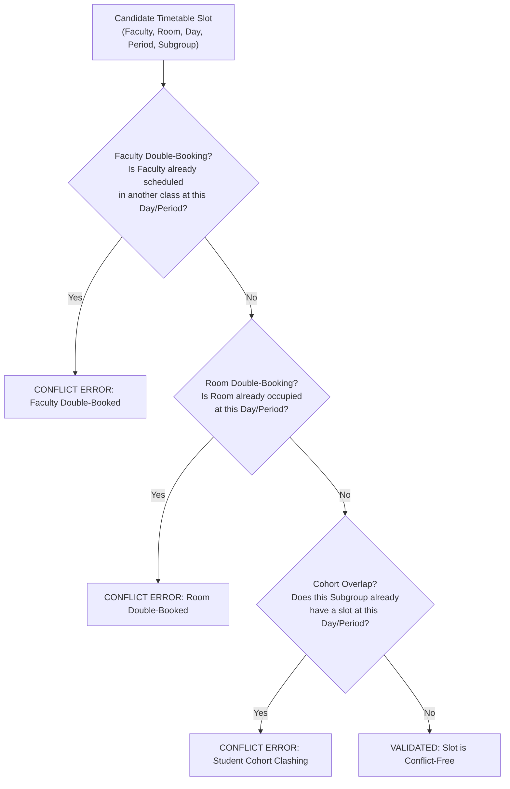

# CampusSphere AI — College Timetable Data Mapping & Structural Integrity Audit
**Document ID:** `CAMPUSSPHERE_TIMETABLE_DATA_MAPPING_AUDIT.md`  
**Revision:** Phase 1.1 Corrected Edition  
**Date:** November 11, 2026  
**Auditor & Timetable Specialist:** Antigravity AI Engineering & Architecture Team  
**Source Document:** `classWise-TT-21_OCT_2026.pdf` (50 Pages, Odd Semester AY 2026–2027)  
**Execution Mandate:** Read-Only Schema Design, Conflict Prevention, Zero Data Overwrites  

---

## 1. Executive Summary & Audit Scope

A detailed 50-page structural analysis of the official CSE class-wise timetable (`classWise-TT-21_OCT_2026.pdf`, w.e.f. October 21, 2026) was conducted. This revised audit resolves key schema mapping challenges, establishes a collision-proof upsert key, models complex lab double periods, accounts for co-faculty assignments, and defines conflict-detection rules across rooms and faculty schedules.

### Phase 1.1 Integrity Rules:
1. **Zero Database Overwrites:** This is a read-only architectural specification. No timetable records will be imported, overwritten, or modified in MongoDB during Phase 1.1 or Phase 2.
2. **Comprehensive Curricular Modeling:** The data model must seamlessly accommodate:
   - Section-specific schedules (e.g. `3CSE-A` through `3CSE-J`).
   - Subgroup splits for laboratories (e.g. `3CSE-A1` in Lab 3, `3CSE-A2` in Lab 4).
   - Co-faculty allocations (e.g. `AP / SS` co-teaching a lab).
   - Double-period lab blocks (e.g. Periods 8–9).
   - Room allocations across academic blocks and computer centers.
   - Faculty initials mapped to verified user accounts.
   - Period numbering (1 through 10) aligned with institutional bell timings.
   - Open electives, departmental electives, and allied courses.

---

## 2. Institutional Schedule Structure (50 Pages)

```
┌─────────────────────────────────────────────────────────────────────────────┐
│                   INSTITUTIONAL CSE PERIOD TIMINGS GRID                     │
├────────┬─────────────────┬──────────┬───────────────────────────────────────┤
│ Period │ Time Slot       │ Duration │ Canonical Nature                      │
├────────┼─────────────────┼──────────┼───────────────────────────────────────┤
│ P1     │ 08:10 – 09:00   │ 50 min   │ Regular Lecture                       │
│ P2     │ 09:00 – 09:50   │ 50 min   │ Regular Lecture                       │
│ P3     │ 09:50 – 10:40   │ 50 min   │ Regular Lecture                       │
│ Break  │ 10:40 – 10:50   │ 10 min   │ Morning Recess                        │
│ P4     │ 10:50 – 11:40   │ 50 min   │ Regular Lecture / Tutorial            │
│ P5     │ 11:40 – 12:30   │ 50 min   │ Staggered Lunch Recess / Elective     │
│ P6     │ 12:30 – 13:20   │ 50 min   │ Staggered Lunch Recess / Lecture      │
│ P7     │ 13:20 – 14:10   │ 50 min   │ Regular Lecture                       │
│ Break  │ 14:10 – 14:20   │ 10 min   │ Afternoon Recess                      │
│ P8     │ 14:20 – 15:10   │ 50 min   │ Regular Lecture / Lab Block (Hour 1)  │
│ P9     │ 15:10 – 16:00   │ 50 min   │ Lab Block (Hour 2) / Lecture          │
│ P10    │ 16:00 – 16:50   │ 50 min   │ Remedial / Mentor / Club Hours        │
└────────┴─────────────────┴──────────┴───────────────────────────────────────┘
```

### Curricular Distribution by Document Page
- **Pages 1–10:** 3rd Semester CSE (Sections A to J).
- **Pages 11–22:** 5th Semester CSE (Sections A to K).
- **Pages 23–35:** 7th Semester CSE (Sections A to M).
- **Pages 36–37:** M.Tech CSE.
- **Pages 38–47:** 1st Semester CSE (Sections A to I).
- **Pages 48–50:** Open Electives, CDC Soft Skills, German/French Language Tracks.

---

## 3. Structural Model Extensions & Collision-Proof Upsert Key

### 3.1 Model Schema Enhancement (`server/models/Timetable.js`)
The existing `Timetable` model is fully compatible and requires only non-breaking extensions:

```javascript
// Backward-compatible additions to Timetable.js schema:
coFaculty: [{
  type: mongoose.Schema.Types.ObjectId,
  ref: 'User',
}],
facultyInitials: {
  type: String,
  trim: true,
},
periodNumber: {
  type: Number,
  min: 1,
  max: 10,
  required: true,
},
subgroup: {
  type: String,
  default: 'All', // 'All', 'G1', 'G2', 'A1', 'A2'
  trim: true,
},
isLabDoublePeriod: {
  type: Boolean,
  default: false,
},
linkedSlotId: {
  type: mongoose.Schema.Types.ObjectId,
  ref: 'Timetable',
  default: null,
}
```

### 3.2 Refined Collision-Proof Upsert Key
A naive upsert key (`{ branch, semester, section, day, period }`) fails when a laboratory session splits into two simultaneous subgroups (`G1` in Hardware Lab and `G2` in Software Lab). 

The authoritative unique compound key must be:
$$\mathbf{K}_{\text{slot}} = \{ \text{academicYear}, \text{branch}, \text{semester}, \text{section}, \text{subgroup}, \text{dayOfWeek}, \text{periodNumber} \}$$

In Mongoose syntax:
```javascript
timetableSchema.index(
  {
    academicYear: 1,
    branch: 1,
    semester: 1,
    section: 1,
    subgroup: 1,
    dayOfWeek: 1,
    periodNumber: 1,
  },
  { unique: true }
);
```

---

## 4. Conflict & Duplicate Detection Engine

Before any prospective timetable batch insertion in future phases, the data ingestion pipeline must validate three zero-tolerance conflict constraints:



1. **Faculty Collision Check:** No faculty member (`faculty` or `coFaculty`) can be assigned to more than one room during the same `(dayOfWeek, periodNumber)`.
2. **Room Collision Check:** No room (e.g. `AS17`, `Lab 3`) can host more than one distinct class during the same `(dayOfWeek, periodNumber)`.
3. **Cohort Collision Check:** A student in a specific section and subgroup cannot be assigned to two concurrent subjects.

---

## 5. Lab Double Periods & Multi-Faculty Mapping

- **Double-Period Modeling:**
  For a 100-minute lab (e.g. `DSA Lab` spanning Periods 8 and 9):
  - Ingest **two discrete atomic slots** in `Timetable` (`periodNumber: 8` and `periodNumber: 9`).
  - Set `isLabDoublePeriod: true`.
  - Link the two records via `linkedSlotId` so that attendance, room booking, and rescheduling operate on the entire two-hour block atomically.
- **Co-Faculty Allocation:**
  - Where the timetable indicates `"AP / SS"`:
  - Primary Faculty: `Aman Prasad` (`faculty: ObjectId('6ae62db14f0e4b25ebbdcfb2')`).
  - Co-Faculty: `Swati Hans` (`coFaculty: [ObjectId('6ae62db14f0e4b25ebbdcfa6')]`).
  - `facultyInitials: "AP / SS"`.
  - Both faculty members are granted attendance marking and viewing permissions.

---

## 6. Verification & Read-Only Safety Protocol

- **Preservation Check:** Execute `Timetable.countDocuments()` before and after review. Count must remain completely unchanged.
- **Dry-Run Validation:** Future timetable ingestion must execute purely in validation mode, outputting an interactive conflict report before any database write is requested.
