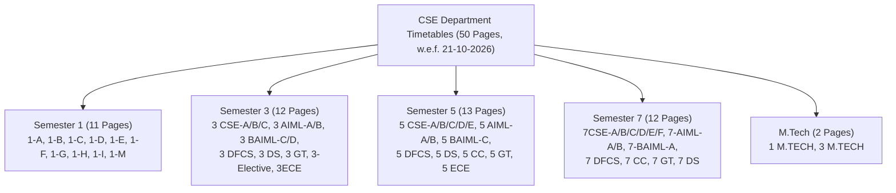
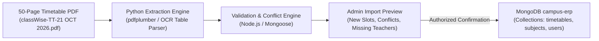

# CampusSphere AI — College Timetable Data Mapping & Ingestion Audit

**Audit Date:** 2026-11-11  
**Source Document:** `classWise-TT-21 OCT 2026.pdf` (50 Pages)  
**Institution / Department:** Manav Rachna — Department of Computer Science & Engineering  
**Academic Term:** Odd Semester | Academic Year 2026–2027  
**Effective Date:** 21-10-2026 (w.e.f. 21 October 2026)  
**Target Model:** `server/models/Timetable.js`, `server/models/Subject.js`, `server/models/Faculty.js`  
**Status:** Strictly READ-ONLY Planning & Mapping Audit  

---

## 1. Executive Summary

A comprehensive structural audit of the supplied 50-page college timetable document (`classWise-TT-21 OCT 2026.pdf`) was performed to establish an automated, conflict-free mapping into CampusSphere AI ERP.

The PDF contains class-wise weekly schedules for the entire Department of Computer Science & Engineering across B.Tech (Semesters 1, 3, 5, 7), Specialized Honours programmes (AI/ML, Cyber Security/DFCS, Data Science, Gaming Technology, Cloud Computing), M.Tech (Semesters 1, 3), and departmental electives.

### Key Timetable Dataset Metrics
| Metric | Value | Details |
| :--- | :---: | :--- |
| **Total Timetable Pages** | **50** | Exactly 1 class/section schedule per page |
| **Academic Term Scope** | **Odd Semester 2026–2027** | Effective from 21 October 2026 |
| **Weekly Operating Days** | **5 Days** | Monday (`Mo`), Tuesday (`Tu`), Wednesday (`We`), Thursday (`Th`), Friday (`Fr`) |
| **Periods per Day** | **10 Periods** | 50-minute teaching intervals from 08:10 AM to 16:30 PM |
| **Total Potential Time Slots** | **2,500 slots** | 50 classes × 5 days × 10 periods |
| **Mapped Academic Program / Sections** | **50 Sections** | B.Tech CSE, AIML, DFCS, DS, GT, CC, ECE, M.Tech |
| **Target Database Engine** | MongoDB `Timetable` | Integrated with `Subject` and `User` (Faculty) |

---

## 2. Comprehensive Inventory of the 50 Timetable Pages



### Detailed Class Breakdown
1. **Semester 1 (Pages 38–47):**
   - Classes: `1-A`, `1-B`, `1-C`, `1-D`, `1-E`, `1-F`, `1-G`, `1-H`, `1-I`, `1-M` (Foundational Programming: Code, Logic & Problem Solving `PF` and `PF LAB`).
2. **Semester 3 (Pages 1–10, 48–49):**
   - Core CSE: `3 CSE-A`, `3 CSE-B`, `3 CSE-C`
   - AI/ML Specialization: `3 AIML-A`, `3 AIML-B`, `3 BAIML-C`, `3 BAIML-D`
   - Cyber Security: `3 DFCS`
   - Data Science: `3 DS`
   - Gaming Technology: `3 GT`
   - Elective / Allied: `3-Elective`, `3ECE`
3. **Semester 5 (Pages 11–22, 50):**
   - Core CSE: `5 CSE-A`, `5 CSE-B`, `5 CSE-C`, `5 CSE-D`, `5 CSE-E`
   - AI/ML: `5 AIML-A`, `5 AIML-B`, `5 BAIML-C`
   - Cyber Security: `5 DFCS`
   - Data Science: `5 DS`
   - Cloud Computing: `5 CC`
   - Gaming Technology: `5 GT`
   - Allied: `5 ECE`
4. **Semester 7 (Pages 23–35):**
   - Core CSE: `7CSE-A`, `7CSE-B`, `7CSE-C`, `7CSE-D`, `7CSE-E`, `7CSE-F`
   - Specializations: `7-AIML-A`, `7-AIML-B`, `7-BAIML-A`, `7 DFCS`, `7 CC`, `7 GT`, `7 DS`
5. **Postgraduate M.Tech (Pages 36–37):**
   - `1 M.TECH` (Advanced Data Structures, Data Science, Math Foundation)
   - `3 M.TECH` (Deep Learning, Generative AI with LLM Models `GAI-LLM`, Operations Research)

---

## 3. Daily Period Grid & Timing Standards

The institution operates a standardized 10-period bell schedule:

| Period # | Start Time | End Time | Duration | Typical Usage |
| :---: | :---: | :---: | :---: | :--- |
| **Period 1** | 08:10 AM | 09:00 AM | 50 min | Theory Lecture |
| **Period 2** | 09:00 AM | 09:50 AM | 50 min | Theory Lecture |
| **Period 3** | 09:50 AM | 10:40 AM | 50 min | Theory Lecture |
| **Period 4** | 10:40 AM | 11:30 AM | 50 min | Theory / Subgroup Lab Slot 1 |
| **Period 5** | 11:30 AM | 12:20 PM | 50 min | Theory / Subgroup Lab Slot 2 |
| **Period 6** | 12:20 PM | 13:10 PM | 50 min | Theory Lecture / Lunch Transition |
| **Period 7** | 13:10 PM | 14:00 PM | 50 min | Theory Lecture |
| **Period 8** | 14:00 PM | 14:50 PM | 50 min | Theory / Practical Lab Block |
| **Period 9** | 14:50 PM | 15:40 PM | 50 min | Theory / Practical Lab Block |
| **Period 10** | 15:40 PM | 16:30 PM | 50 min | Sports, Yoga (`SY`), Remedial / Electives |

---

## 4. Timetable Cell Anatomy & Schema Mapping

Each cell in the timetable grid contains four vital pieces of metadata:

```
┌──────────────────────────────────────┐
│            [SUBGROUP]                │  <-- e.g. "3CSE-A1" or "Group 1"
│            SUBJECT                   │  <-- e.g. "OOP Lab" or "DSA"
│  ROOM                    TEACHER(S)  │  <-- e.g. "CF09" and "KAS / AM"
└──────────────────────────────────────┘
```

### 4.1 Field-by-Field Mapping Matrix

| PDF Element | PDF Example | CampusSphere `Timetable` Model Field | Target Type | Mapping / Transformation Rule |
| :--- | :--- | :--- | :--- | :--- |
| **Class Title** | `3 CSE-A` | `semester: 3`, `branch: 'CSE'`, `section: 'A'` | Numbers / String | Parse semester digit, branch code, and section letter. |
| **Department** | `Dept of CSE` | `department: 'CSE'` | String | Standardized uppercase department identifier. |
| **Academic Term** | `Odd Semester \| AY 2026-2027` | `academicYear: '2026-2027'` | String | Standard academic session format. |
| **Effective Date** | `w.e.f.: 21-10-2026` | `effectiveStartDate: ISODate('2026-10-21')` | Date | Effective operational start date. |
| **Weekday** | `Mo`, `Tu`, `We`, `Th`, `Fr` | `dayOfWeek: 1..5`, `dayName: 'Monday'..` | Number / String | 1 = Monday, 2 = Tuesday, 3 = Wednesday, 4 = Thursday, 5 = Friday. |
| **Period Header** | `1 (8:10 - 9:00)` | `period: 1`, `startTime: '08:10 AM'`, `endTime: '09:00 AM'` | Number / String | Store period index and 12-hour formatted time strings. |
| **Subject Title** | `DSA`, `OOP Lab`, `DTI-I` | `subject: ObjectId(Subject._id)` | ObjectId Ref | Resolved via Subject Legend at bottom of page. |
| **Room / Hall** | `AF13`, `CF09`, `AS11` | `room: 'AF13'` | String | Room or lab hall code (`'Not Fixed'` handled cleanly). |
| **Session Type** | Theory vs Lab | `sessionType: 'Lab'` or `'Lecture'` | Enum | If subject code ends with `Lab` or `lab`, mark `'Lab'`; else `'Lecture'`. |
| **Subgroup Split** | `3CSE-A1`, `3CSE-A2` | `batch: '3CSE-A1'` | String | For whole class, `batch: 'All'`. For group splits, store subgroup code. |
| **Faculty Lead** | `AP`, `KAS`, `NAM` | `faculty: ObjectId(User._id)` | ObjectId Ref | Primary faculty resolved via Teacher Legend. |
| **Co-Faculty** | `AP / SS`, `KAS / AM` | `coFaculty: [ObjectId]`, `facultyInitials: 'AP / SS'` | Array / String | Schema extension to support multiple instructors in labs. |

---

## 5. Handling Complex Real-World Timetable Patterns

### 5.1 Multiple Faculty Allocations (Labs & Practical Sessions)
- **Observation:** In laboratory sessions (e.g. Page 1: Friday Period 8–9 `DSA Lab` in `AF-10`), two instructors are assigned: `AP / SS` (AMAN PRASAD and SHEFALI SINGHAL).
- **Current Model Limitation:** `server/models/Timetable.js:47` defines a single `faculty: ObjectId` reference to `User`.
- **Recommended Schema Enhancement (Backward Compatible):**
  ```javascript
  // Recommended backward-compatible addition to server/models/Timetable.js
  coFaculty: [{
    type: mongoose.Schema.Types.ObjectId,
    ref: 'User',
    default: [],
  }],
  facultyInitials: {
    type: String,
    trim: true,
    default: '',
  },
  ```
  This preserves the existing `faculty` field for primary queries while allowing complete co-teaching and lab assistant attribution.

### 5.2 Subgroup Splitting within a Class
- **Observation:** In Page 1, Period 4, class `3 CSE-A` splits into two concurrent lab/studio sessions:
  - `3CSE-A1`: Subject `DTI-I`, Room `AF13`, Teacher `AG` (ARUSHI GUPTA)
  - `3CSE-A2`: Subject `DTI-I`, Room `AF23`, Teacher `ANM` (ANISHA MAHTO)
  - Similarly in Period 9: Group 1 attends `WPPH` in `AF15`, while Group 2 attends `IQC` in `AF13`.
- **Data Modeling Resolution:**
  - When the entire class attends together: create 1 document with `batch: 'All'`.
  - When the class splits: create 2 separate documents for the same `(dayOfWeek, period, semester, section)` with `batch: '3CSE-A1'` and `batch: '3CSE-A2'`.
  - The student portal filters timetable entries where `batch === 'All' || batch === student.assignedBatch`.

### 5.3 Double Period Practical Blocks
- **Observation:** Labs frequently occupy two consecutive periods (e.g. Periods 8 and 9, 14:00 to 15:40).
- **Data Modeling Resolution:**
  - Create two consecutive period entries (`period: 8` and `period: 9`) with `periodCount: 2`.
  - This ensures that period-based attendance marking and timetable slot lookups resolve correctly regardless of whether the faculty marks Period 8 or Period 9.

---

## 6. Faculty and Subject Resolution Strategy

### 6.1 Teacher Legend Resolution
Each page provides an authoritative teacher abbreviation table. For example, Page 1 maps:
- `AG` -> ARUSHI GUPTA
- `AM` -> ASHOK MADAAN
- `ANM` -> ANISHA MAHTO
- `AP` -> AMAN PRASAD
- `KAS` -> KAMLESH SHARMA
- `NAM` -> NAMITA KATHPAL
- `NID` -> NIDHI
- `RAM` -> RASHIMA MAHAJAN
- `SM` -> SUDHANSHU MAURYA

**Resolution Pipeline:**
1. Look up existing `Faculty` / `User` records in `campus-erp` by matching normalized name (e.g. `User.find({ name: { $regex: new RegExp(fullName, 'i') } })`).
2. If match is found: bind `faculty` to `user._id`.
3. If no match is found: create a placeholder faculty account with generated login ID (e.g. `FAC_NAM`) and role `faculty`, flagged for administrative review.

### 6.2 Subject Legend Resolution
Each page provides an authoritative subject code and title mapping. For example, Page 1 maps:
- `3QA-APT` -> QA-Aptitude
- `CLE` -> Cyber Law Ethics
- `COI` -> Constitution of India
- `CT Lab` -> Computational Techniques Laboratory
- `CT` -> Computational Techniques Theory
- `DEC lab` -> Digital Electronics and Circuits Lab
- `DEC` -> Digital Electronics and Circuits
- `DSA Lab` -> Data Structures Algorithms Lab
- `DSA` -> Data Structures Algorithms
- `DTI-I` -> Design Thinking Innovation-I
- `OOP Lab` -> Object Oriented Programming Lab
- `OOP` -> Object Oriented Programming
- `PY Lab` -> Python lab
- `PY` -> Python
- `WPPH Lab` -> Web programming through PHP HTML lab
- `WPPH` -> Web Programming through PHP HTML

**Resolution Pipeline:**
1. Look up existing `Subject` records in `campus-erp` by matching `code` or `name`.
2. Differentiate Theory vs Lab: Create separate subject records for `DSA` (Theory, 4 credits) vs `DSA Lab` (Practical, 1 credit).
3. Associate each subject with its curriculum `semester` and `branch`.

---

## 7. Timetable Validation & Conflict Detection Rules

Before writing any parsed timetable records into MongoDB, the ingestion engine must execute five validation checks:

1. **Room Collision Check:**
   - No room can host two different classes during the same `(dayOfWeek, period)` unless both are designated sub-batches of the same scheduled session.
   - Query: `Timetable.find({ room: slot.room, dayOfWeek: slot.dayOfWeek, period: slot.period, _id: { $ne: slot._id } })`.
2. **Faculty Collision Check:**
   - No instructor can be scheduled to teach two different classes during the same `(dayOfWeek, period)`.
   - Query: `Timetable.find({ faculty: slot.faculty, dayOfWeek: slot.dayOfWeek, period: slot.period, _id: { $ne: slot._id } })`.
3. **Student Class Collision Check:**
   - A section cannot have overlapping whole-class lectures (`batch: 'All'`) in the same period.
4. **Time Range Validity Check:**
   - `startTime < endTime` and period index matches institutional bell schedule.
5. **Effective Term Check:**
   - Valid `academicYear: '2026-2027'` and `effectiveStartDate: 2026-10-21`.

---

## 8. Ingestion Pipeline Architecture



1. **Storage Location:** Source PDF stored in `server/data/imports/timetables/classWise-TT-21 OCT 2026.pdf` (git-ignored).
2. **Python Extraction Service:** Use Python (`pdfplumber` + OpenCV layout analysis) in `ai-service/` to extract table boundaries, period cells, and bottom legend dictionaries into structured JSON.
3. **Admin Review Interface:** Present an import preview modal showing parsed classes, mapped subjects, resolved faculty, and flagged OCR ambiguities for human confirmation.
4. **Transaction-Safe Persistence:** Execute database insertion inside a Mongoose transaction (`session.withTransaction()`) ensuring all 50 class timetables succeed or cleanly roll back.

---

**Report Authored By:** Antigravity AI Engineering Specialist  
**Deliverable Status:** COMPLETE & READY FOR PHASE 1 IMPLEMENTATION
