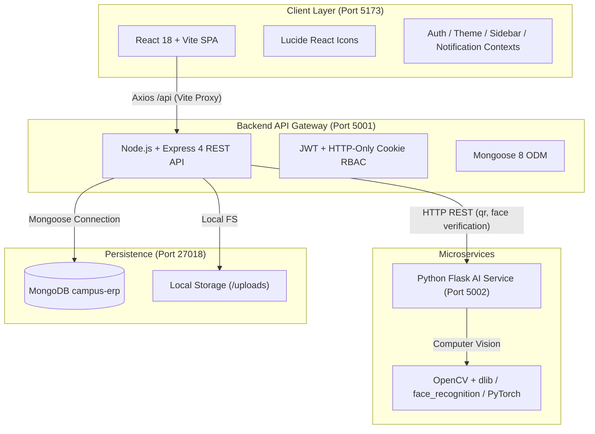
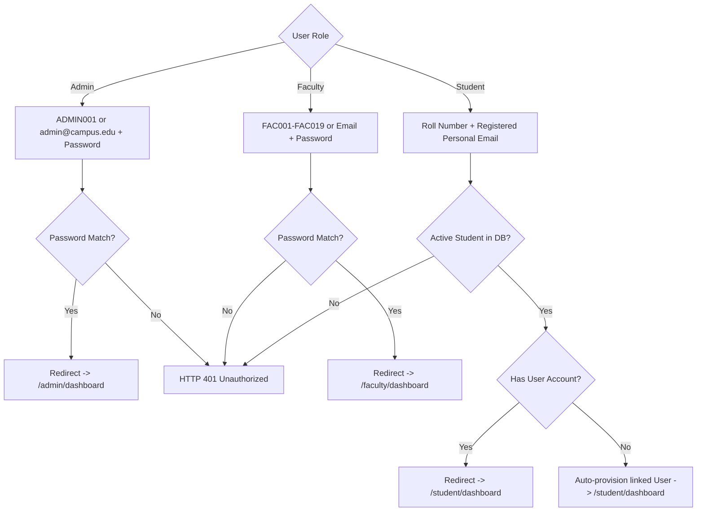

# CampusSphere AI — Project Handover & Developer Guide

**Document Version:** 1.0.0  
**Last Updated:** November 2026  
**Repository:** `AI-Campus_Help_Desk`  
**Target Environment:** Local Full-Stack ERP  

---

## 1. Architecture & Technology Stack

CampusSphere AI is an integrated, role-based Higher Education Campus ERP and Smart Help Desk platform powered by a microservices-aligned architecture:



### Core Technologies
- **Frontend (`/client`):** React 18, Vite, React Router v6, Axios, Lucide React, HTML5 Camera API, Light Mode only.
- **Backend (`/server`):** Node.js (v20+), Express 4, Mongoose 8, JSON Web Tokens (`jsonwebtoken`), `bcryptjs`, `cookie-parser`, `helmet`, `express-rate-limit`, `multer`.
- **AI Service (`/ai-service`):** Python 3.10+, Flask, OpenCV (`cv2`), `face_recognition`, `dlib`, `numpy`, PyTorch / ONNX runtime.
- **Database:** MongoDB (v6+), Database Name: `campus-erp`, Port: `27018`. Persistent storage stored at `server/.data/db`.

---

## 2. Service Startup & Local Development

All three application services must run concurrently for full functionality.

| Service | Technology | Port | Startup Command | Health Check |
| :--- | :--- | :--- | :--- | :--- |
| **MongoDB** | MongoDB Engine | `27018` | Starts automatically with backend or via local daemon | `mongodb://127.0.0.1:27018/campus-erp` |
| **Backend API** | Node.js / Express | `5001` | `cd server && node server.js` | `GET http://localhost:5001/api/health` |
| **Frontend Client**| React / Vite | `5173` | `cd client && npm run dev` | `http://localhost:5173` |
| **Python AI Service**| Python / Flask | `5002` | `cd ai-service && .venv/bin/python app.py` | `GET http://localhost:5002/health` |

### Convenience Root Scripts
```bash
# Terminal 1: Client
cd ~/AI-Campus_Help_Desk/client && npx vite --port 5173

# Terminal 2: Backend
cd ~/AI-Campus_Help_Desk/server && node server.js

# Terminal 3: AI Service
cd ~/AI-Campus_Help_Desk/ai-service && .venv/bin/python app.py
```

---

## 3. Core Application Modules

1. **Authentication & RBAC:** Multi-role access control supporting Admin, Faculty, Student, and specialized administrative roles.
2. **Student Portal:**
   - **Academic Details:** Profile view, semester registration, and CGPA history.
   - **Smart Attendance:** Check-in dashboard, real-time percentage indicators, and attendance logs.
   - **Timetable & Coursework:** Weekly schedule, subject assignments, deadlines, and submissions.
   - **Student Services:** Finance & fee receipts, hostel room allocation, campus placement drives, and grievance ticketing.
3. **Faculty Portal:**
   - **Smart Attendance Management:** Live attendance sessions with dynamic QR rotation (5s refresh), manual check-in override, student attendance percentage tracking, and report generation.
   - **Student 360° & Search:** Filterable student database by branch, semester, section, and student ID.
   - **Academics:** Timetable views, assignment creation, student submission grading, and marks entry.
4. **Admin Portal:**
   - **Student Management:** Comprehensive student roster search, batch filtering, pagination, student record addition, editing, and status deactivation.
   - **Attendance Hub:** Campus-wide attendance analytics, section audits, and faculty session monitoring.
   - **Campus Governance:** Financial fee structures, HR employee and leave policy management, hostel and transport allocation, and complaint resolution.
5. **AI Help Desk:** Multi-agent campus inquiry resolution for academic, facilities, navigation, and fee queries.

---

## 4. Authentication & Identity Rules



### Role-Specific Authentication Details
- **Admin Authentication:**
  - Login via `loginId` (`ADMIN001`) or email (`admin@campus.edu`) and password.
  - Initial/emergency password bootstrap: `node server/scripts/bootstrap_admin.js`.
- **Faculty Authentication:**
  - Login via Employee ID (`FAC001`–`FAC019`) or registered email (`priya.mehta@campus.edu`) and password.
  - Credential reset: CLI script `node server/scripts/migrate_faculty_credentials.js [FAC_ID]` or Admin API `POST /api/admin/users/:id/reset-password`.
- **Student Authentication (Passwordless):**
  - Authenticates using two inputs: **College Roll Number** (e.g. `1/24/SET/BCS/231`) and **Registered Personal Email**.
  - Supports Gmail and legitimate non-Gmail personal domains (`@yahoo.com`, `@outlook.com`, `@hotmail.com`, `@live.in`).
  - **Canonical Onboarding:** Institutional students enrolled offline (`accountStatus: 'enrolled_offline'`, `user: null`) are automatically provisioned a linked `User` document on first valid login, transitioning to `'active_user'`.
  - **Synthetic & Duplicate Guards:** Synthetic test records (`ROLL...`, `TEMP56839`, phone-number roll `9389818925`, missing-slash duplicate `1/24SET/BCS/319`) are strictly barred from user provisioning.

---

## 5. Security & Data Protection Policies

1. **Zero-Trust Identity Binding (Anti-IDOR):**
   - Authenticated student endpoints (`/api/student/*`) strictly resolve identity from verified JWT `req.user.userId`.
   - Manipulation of URL parameters or query parameters (`?studentId=...`, `?rollNumber=...`) triggers HTTP 403 Forbidden.
2. **Phone Number Privacy:**
   - Student contact numbers are restricted to Administrative roles and self-access.
   - Faculty queries strip phone numbers to prevent unauthorized contact harvesting.
3. **Smart Attendance Anti-Spoofing:**
   - Dynamic QR codes carry an HMAC-signed timestamp with a strict 15-second TTL.
   - Camera snapshots are processed by the Python AI service using facial landmark analysis (rejecting static photos and duplicates).
4. **Session Management:**
   - Standard 7-day JWT tokens stored in HTTP-only `campus_token` cookies and resilient `localStorage` Bearer tokens.
   - Centralized Axios request interceptor attaches tokens; declarative `ProtectedRoute` handles session redirects without reload loops.
5. **Rate Limiting:**
   - In-memory IP/Roll throttling (5 failed attempts per 15 minutes) with HTTP 429.

---

## 6. Implementation Constraints

- **Light Mode Only:** The application interface is strictly light-mode. Dark-mode styles and toggles are disallowed.
- **Real Database Integration:** UI components must fetch data through live Mongoose models and Express APIs. Mocked in-memory arrays or synthetic seed overrides are prohibited.
- **Relational Integrity:**
  - `Student.user` is a unidirectional partial-unique reference to `User._id`.
  - Attendance records and grades reference canonical student ObjectIds.
- **Faculty Ownership:** Attendance sessions and grade assignments enforce strict faculty subject allocation checks.

---

## 7. Current Project Status & Priorities

1. **Authentication System (COMPLETED & VERIFIED):**
   - Admin, Faculty, and Canonical Student login flows are 100% operational.
   - Live browser automation confirmed login, dashboard rendering, role isolation, page reload session persistence, and logout across all three roles.
2. **Student Management Module (OPERATIONAL):**
   - Connected to MongoDB `campus-erp`.
   - Admin can view real student records, search by name/roll, filter by branch/semester/section, paginate, edit student details, and toggle active/inactive status.
3. **Smart Attendance System (OPERATIONAL & STABILIZED):**
   - End-to-end QR rotation, camera check-in, pause/resume, faculty manual mark, and cohort attendance calculation are functional.
   - Python AI service passes 85/85 pytest suites.

---

## 8. Known Backlog & Open Items

1. **Database Email Normalization:** Approximately 164 unlinked canonical students still have spreadsheet merge conflict strings in their raw `email` fields (e.g., `REVIEW — . | ...@gmail.com`). While the login controller successfully parses and cleans these on individual student login, running a global non-destructive regex cleanup script before the Semester 5 migration is recommended.
2. **Biometric Face Template Enrollment:** The canonical student cohort currently lacks stored biometric face embeddings (only demo records exist in `faceembeddings`). A structured student biometric onboarding workflow should be initiated prior to mandatory facial recognition attendance.
3. **Upcoming Cohort Transition:** Preparation for the 2024 BCS cohort transition to Semester 5 using official University rosters.
