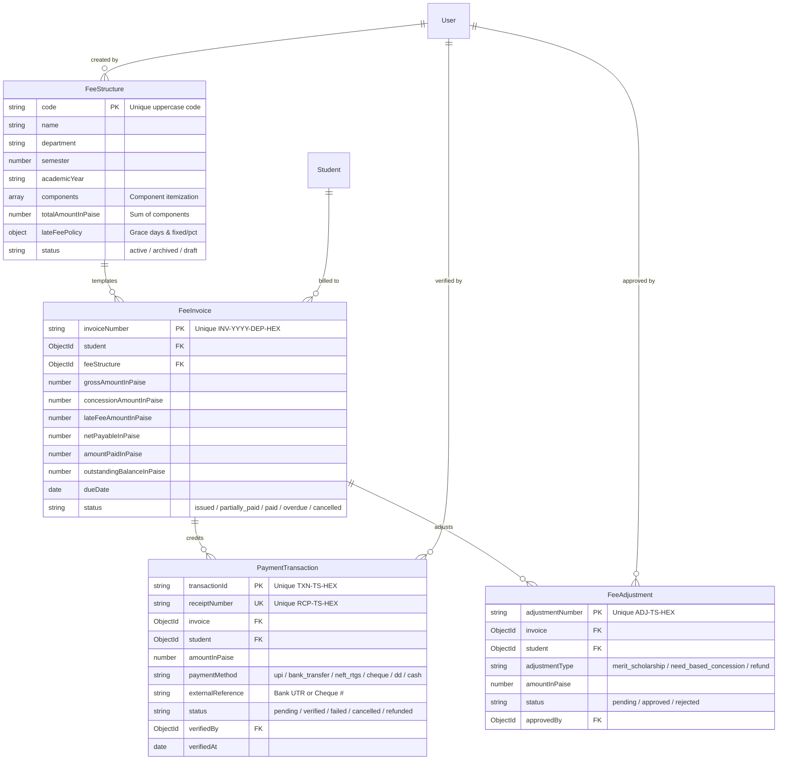

# CAMPUSSPHERE AI — PART 16/24
# DATABASE SCHEMA SPECIFICATION & FINANCIAL MODELS

## 1. Entity Relationship Overview

---

## 2. Model Schemas & Key Constraints

### 2.1 FeeStructure (`server/models/FeeStructure.js`)
- **Code:** Unique string in uppercase (`BTECH-CSE-S5-2026`).
- **Components:** Subdocuments containing `{ name, amountInPaise, isMandatory, description }`.
- **LateFeePolicy:** Embedded `{ policyType, graceDays, fixedAmountInPaise, percentageRate }`.
- **Index:** `{ academicYear: 1, department: 1, semester: 1, status: 1 }`.

### 2.2 FeeInvoice (`server/models/FeeInvoice.js`)
- **Invoice Number:** Unique string in uppercase (`INV-2026-CSE-8FA91B`).
- **Compound Unique Index:** `{ student: 1, feeStructure: 1, academicYear: 1, semester: 1 }` prevents double-billing for the same term.
- **Lookup Indexes:** `{ student: 1, status: 1 }`, `{ academicYear: 1, department: 1, semester: 1 }`.
- **Virtual Getters:** `grossAmount`, `concessionAmount`, `lateFeeAmount`, `netPayable`, `amountPaid`, `outstandingBalance` converting paise to rupees.

### 2.3 PaymentTransaction (`server/models/PaymentTransaction.js`)
- **Transaction ID:** Unique string (`TXN-1793471000-A1B2C3`).
- **Receipt Number:** Unique string (`RCP-1793471000-A1B2C3`).
- **Idempotency Key:** Optional sparse unique string to prevent duplicate HTTP POST submissions.
- **Status Enum:** `['pending', 'verified', 'failed', 'cancelled', 'refunded']`.

### 2.4 FeeAdjustment (`server/models/FeeAdjustment.js`)
- **Adjustment Number:** Unique string (`ADJ-1793471000-D4E5F6`).
- **Adjustment Types:** `['merit_scholarship', 'need_based_concession', 'government_scholarship', 'institutional_waiver', 'refund', 'other']`.
- **Status Enum:** `['pending', 'approved', 'rejected']`.

### 2.5 Legacy Model Preservation (`server/models/Fee.js`)
- Maintained without schema modifications to preserve backwards compatibility for historical seed scripts and legacy unit tests.

