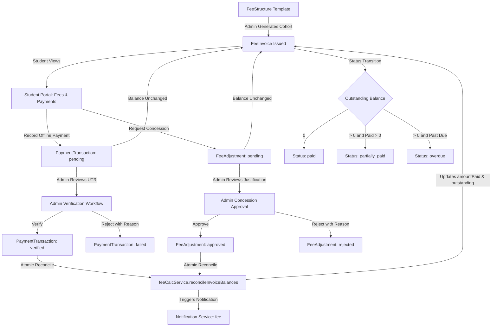

# CAMPUSSPHERE AI — PART 16/24
# FINANCIAL ARCHITECTURE & BILLING LIFECYCLE

## 1. Executive Summary

The CampusSphere AI Student Fee and Finance Management System establishes a centralized, double-entry style financial billing and verification ledger for academic institutions.

The architecture eliminates floating-point rounding errors by enforcing **exact integer paise representation** ($1\text{ INR} = 100\text{ paise}$) across all storage, validation, calculation, and ledger operations.

Because live third-party payment gateway credentials (Razorpay / Stripe) are not provisioned in the local environment, the architecture implements a **verified offline payment workflow** (Bank Transfer, NEFT/RTGS, UPI, Cheque, Demand Draft, Cash). Students submit external transaction references (UTR / Cheque numbers) which are immutably logged in `pending` status. A pending transaction **never reduces invoice balances** until an authorized Finance Officer verifies and credits it against institutional bank statements.

---

## 2. Architecture & Data Flow

---

## 3. Financial Invariants

1. **Balance Equation:**
   $$\text{Net Payable} = \text{Gross Amount} - \text{Approved Concessions} + \text{Late Fee}$$
   $$\text{Amount Paid} = \sum \text{Verified Payments} - \sum \text{Approved Refunds}$$
   $$\text{Outstanding Balance} = \max(0, \text{Net Payable} - \text{Amount Paid})$$

2. **Pending Isolation Invariant:**
   A transaction in `pending` status does not reduce `outstandingBalanceInPaise` or increment `amountPaidInPaise`.

3. **Overpayment Prevention Invariant:**
   A payment submission whose amount exceeds the current `outstandingBalanceInPaise` is strictly rejected with HTTP 400.

4. **Non-destructive Refund Invariant:**
   Refunds are never processed by mutating or deleting previous transactions. They are recorded as approved `FeeAdjustment` records of type `refund`, maintaining full forensic audit compliance.

5. **Compound Idempotency Invariant:**
   Students are billed exactly once per fee structure per term via the compound unique index:
   $$\{ \text{student}: 1, \text{feeStructure}: 1, \text{academicYear}: 1, \text{semester}: 1 \}$$

