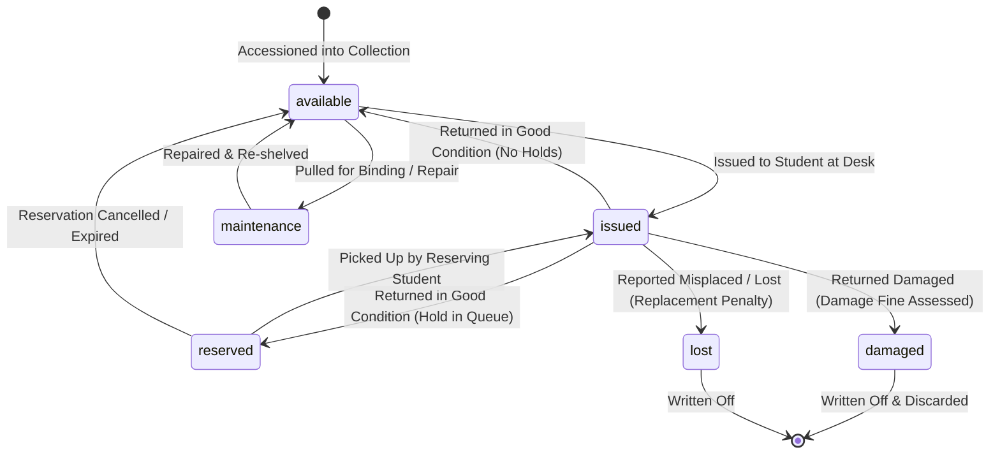

# CAMPUSSPHERE AI — PART 17/24
# PHYSICAL BOOK INVENTORY MANAGEMENT & ACCESSIONING

**Phase:** Part 17 of 24  
**Module:** Physical Library Management System  
**Status:** Completed & Stabilized  

---

## 1. Inventory Model Principles

CampusSphere AI operates on a multi-copy physical inventory paradigm. A single title (`Book`) can have zero or more physical copies (`BookCopy`) distributed across library shelves and reading rooms.

### Key Rules:
1. **Bibliographic Uniqueness:** ISBN is optional (for ancient/rare collections), but when present, must be unique across all active catalog entries.
2. **Accession Numbers:** Every physical copy must have a globally unique `accessionNumber` (e.g. `ACC-CSE-2026-0042`) physically affixed as a barcode label.
3. **Automated Copy Count Synchronization:** Whenever a copy is added, deleted, issued, returned, damaged, or lost, `libraryService.syncBookCounts(bookId)` executes atomically to update `totalCopies`, `availableCopies`, and `issuedCopies` on the parent `Book` document.

---

## 2. Copy Life Cycle & State Machine

---

## 3. Physical Coordinates & Shelf Navigation

To assist students in finding physical books without staff intervention, the catalog records detailed physical location attributes:
- `shelfNumber`: e.g. `CS-04`
- `rackNumber`: e.g. `RACK-B`
- `location`: e.g. `Central Library, 2nd Floor, Technical Section`

The student portal renders these coordinates clearly on every book card alongside an immediate availability pill:
- `Available: X copies` (Green badge)
- `Currently Issued (Join Queue)` (Amber badge)
- `Reserved for Pickup` (Blue badge)

---

## 4. Bulk CSV Export & CWE-1236 Defense

Librarians can export physical inventory records at `/api/library/reports/export?reportType=inventory`.
- Generates RFC-4180 standard CSV.
- Protects spreadsheet software against Formula Injection attacks by inspecting each cell value: if it starts with `=`, `+`, `-`, `@`, `\t`, or `\r`, a leading apostrophe (`'`) is prepended.

