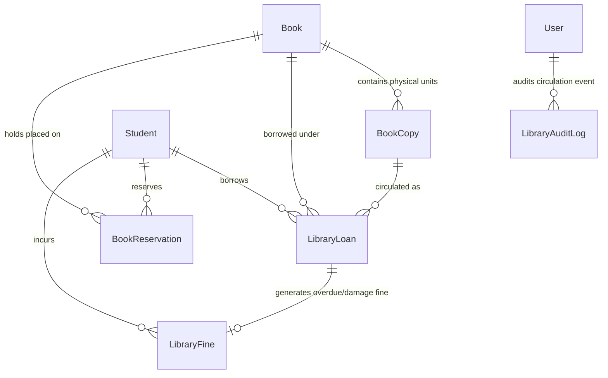

# CAMPUSSPHERE AI — PART 17/24
# DATABASE DESIGN & SCHEMA SPECIFICATION

**Phase:** Part 17 of 24  
**Module:** Physical Library Management System  
**Status:** Completed & Stabilized  

---

## 1. Entity-Relationship Model Overview



---

## 2. Schema Specifications

### 2.1 `Book` (`server/models/Book.js`)
Bibliographic book catalog title.

```javascript
{
  title: { type: String, required: true, trim: true, index: true },
  subtitle: { type: String, default: '', trim: true },
  isbn: { type: String, default: '', trim: true, uppercase: true },
  authors: [{ type: String, required: true, trim: true }],
  publisher: { type: String, default: '', trim: true },
  edition: { type: String, default: '', trim: true },
  publicationYear: { type: Number, default: null },
  language: { type: String, default: 'English', trim: true },
  category: { type: String, required: true, trim: true, index: true },
  subject: { type: String, default: '', trim: true, index: true },
  description: { type: String, default: '', trim: true },
  coverImage: { type: String, default: '' },
  shelfNumber: { type: String, default: '', trim: true },
  rackNumber: { type: String, default: '', trim: true },
  location: { type: String, default: 'Central Library', trim: true },
  totalCopies: { type: Number, default: 0, min: 0 },
  availableCopies: { type: Number, default: 0, min: 0 },
  issuedCopies: { type: Number, default: 0, min: 0 },
  status: { type: String, enum: ['active', 'archived', 'discontinued'], default: 'active', index: true },
  createdBy: { type: ObjectId, ref: 'User', required: true }
}
```
**Indexes:**
- Text index: `{ title: 'text', subtitle: 'text', authors: 'text', isbn: 'text', category: 'text', subject: 'text' }`
- Compound Index: `{ category: 1, status: 1 }`

---

### 2.2 `BookCopy` (`server/models/BookCopy.js`)
Specific tangible copy of a book title.

```javascript
{
  copyId: { type: String, required: true, unique: true, uppercase: true },
  book: { type: ObjectId, ref: 'Book', required: true, index: true },
  accessionNumber: { type: String, required: true, unique: true, uppercase: true },
  barcode: { type: String, required: true, trim: true, uppercase: true },
  shelfLocation: { type: String, default: '', trim: true },
  condition: { type: String, enum: ['new', 'good', 'fair', 'damaged', 'lost'], default: 'good' },
  status: { type: String, enum: ['available', 'issued', 'reserved', 'maintenance', 'lost', 'damaged'], default: 'available', index: true },
  priceInPaise: { type: Number, default: 0, min: 0 },
  acquisitionSource: { type: String, default: 'institutional_procurement', trim: true },
  currentLoan: { type: ObjectId, ref: 'LibraryLoan', default: null },
  currentReservation: { type: ObjectId, ref: 'BookReservation', default: null },
  statusHistory: [{
    status: { type: String, required: true },
    condition: { type: String, default: 'good' },
    changedBy: { type: ObjectId, ref: 'User', default: null },
    reason: { type: String, default: '' },
    timestamp: { type: Date, default: Date.now }
  }]
}
```
**Indexes:**
- Compound: `{ book: 1, status: 1 }`
- Unique: `accessionNumber` (unique), `copyId` (unique)

---

### 2.3 `LibraryLoan` (`server/models/LibraryLoan.js`)
Active and completed circulation loan records.

```javascript
{
  issueId: { type: String, required: true, unique: true, uppercase: true },
  loanNumber: { type: String, required: true, unique: true, uppercase: true },
  book: { type: ObjectId, ref: 'Book', required: true, index: true },
  copy: { type: ObjectId, ref: 'BookCopy', required: true, index: true },
  student: { type: ObjectId, ref: 'Student', required: true, index: true },
  issuedBy: { type: ObjectId, ref: 'User', required: true },
  returnedTo: { type: ObjectId, ref: 'User', default: null },
  issueDate: { type: Date, default: Date.now, required: true },
  dueDate: { type: Date, required: true, index: true },
  actualReturnDate: { type: Date, default: null },
  status: { type: String, enum: ['active', 'returned', 'overdue', 'lost', 'claimed_returned'], default: 'active', index: true },
  renewalCount: { type: Number, default: 0, min: 0 },
  renewalHistory: [{
    previousDueDate: { type: Date, required: true },
    newDueDate: { type: Date, required: true },
    renewedAt: { type: Date, default: Date.now },
    renewedBy: { type: ObjectId, ref: 'User' },
    reason: { type: String, default: 'User renewal request' }
  }],
  returnCondition: { type: String, enum: ['new', 'good', 'fair', 'damaged', 'lost', 'pending'], default: 'pending' },
  policySnapshot: {
    loanDurationDays: { type: Number, default: 14 },
    maxRenewals: { type: Number, default: 2 },
    renewalDurationDays: { type: Number, default: 14 },
    allowRenewIfOverdue: { type: Boolean, default: false },
    allowRenewIfReserved: { type: Boolean, default: false },
    finePerOverdueDayInPaise: { type: Number, default: 500 },
    gracePeriodDays: { type: Number, default: 1 },
    maxFinePerBookInPaise: { type: Number, default: 100000 }
  },
  fine: { type: ObjectId, ref: 'LibraryFine', default: null },
  notes: { type: String, default: '', trim: true }
}
```
**Indexes:**
- Compound: `{ student: 1, status: 1 }`
- Compound: `{ copy: 1, status: 1 }`
- Index: `dueDate` (for overdue background sweeps)

---

### 2.4 `BookReservation` (`server/models/BookReservation.js`)
Fair FIFO hold queue for titles with 0 available shelf copies.

```javascript
{
  reservationNumber: { type: String, required: true, unique: true, uppercase: true },
  student: { type: ObjectId, ref: 'Student', required: true, index: true },
  book: { type: ObjectId, ref: 'Book', required: true, index: true },
  reservedCopy: { type: ObjectId, ref: 'BookCopy', default: null },
  requestDate: { type: Date, default: Date.now, required: true },
  notifiedAt: { type: Date, default: null },
  pickupDeadline: { type: Date, default: null },
  status: { type: String, enum: ['pending', 'available_for_pickup', 'fulfilled', 'cancelled', 'expired'], default: 'pending', index: true },
  cancellationReason: { type: String, default: '', trim: true }
}
```
**Indexes:**
- Compound: `{ student: 1, book: 1, status: 1 }` (Prevents duplicate active holds)
- Compound: `{ book: 1, status: 1, requestDate: 1 }` (Fair FIFO queue ordering)

---

### 2.5 `LibraryFine` (`server/models/LibraryFine.js`)
Itemized fine ledger in safe integer paise.

```javascript
{
  fineNumber: { type: String, required: true, unique: true, uppercase: true },
  student: { type: ObjectId, ref: 'Student', required: true, index: true },
  loan: { type: ObjectId, ref: 'LibraryLoan', default: null, index: true },
  book: { type: ObjectId, ref: 'Book', default: null },
  copy: { type: ObjectId, ref: 'BookCopy', default: null },
  fineType: { type: String, enum: ['overdue', 'lost', 'lost_book', 'damaged', 'damaged_book', 'other_penalty'], required: true, index: true },
  amountInPaise: { type: Number, required: true, min: 1 },
  reason: { type: String, required: true, trim: true },
  calculationDetails: {
    overdueDays: { type: Number, default: 0 },
    graceDays: { type: Number, default: 0 },
    ratePerDayInPaise: { type: Number, default: 0 }
  },
  status: { type: String, enum: ['pending', 'paid', 'waived', 'cancelled'], default: 'pending', index: true },
  paymentReference: { type: String, default: '', trim: true },
  paymentDate: { type: Date, default: null },
  paymentMode: { type: String, enum: ['cash', 'online', 'waived', 'other'], default: 'cash' },
  paidAt: { type: Date, default: null },
  recordedBy: { type: ObjectId, ref: 'User', required: true },
  waivedBy: { type: ObjectId, ref: 'User', default: null },
  waivedAt: { type: Date, default: null },
  waiverReason: { type: String, default: '', trim: true }
}
```
**Indexes:**
- Compound: `{ student: 1, status: 1 }`
- Compound: `{ loan: 1, status: 1 }`

---

### 2.6 `LibraryPolicy` (`server/models/LibraryPolicy.js`)
Configurable institutional rules for circulation.

```javascript
{
  maxBooksPerStudent: { type: Number, default: 3, min: 1, max: 20 },
  loanDurationDays: { type: Number, default: 14, min: 1, max: 180 },
  maxRenewals: { type: Number, default: 2, min: 0, max: 10 },
  renewalDurationDays: { type: Number, default: 14, min: 1, max: 90 },
  allowRenewIfOverdue: { type: Boolean, default: false },
  allowRenewIfReserved: { type: Boolean, default: false },
  finePerOverdueDayInPaise: { type: Number, default: 500, min: 0 }, // ₹5.00/day
  gracePeriodDays: { type: Number, default: 1, min: 0 },
  maxFinePerBookInPaise: { type: Number, default: 100000, min: 0 }, // ₹1,000 max
  reservationExpiryDays: { type: Number, default: 3, min: 1, max: 14 },
  defaultLostPenaltyMultiplier: { type: Number, default: 1.5, min: 1.0 },
  isActive: { type: Boolean, default: true },
  updatedBy: { type: ObjectId, ref: 'User', default: null }
}
```

