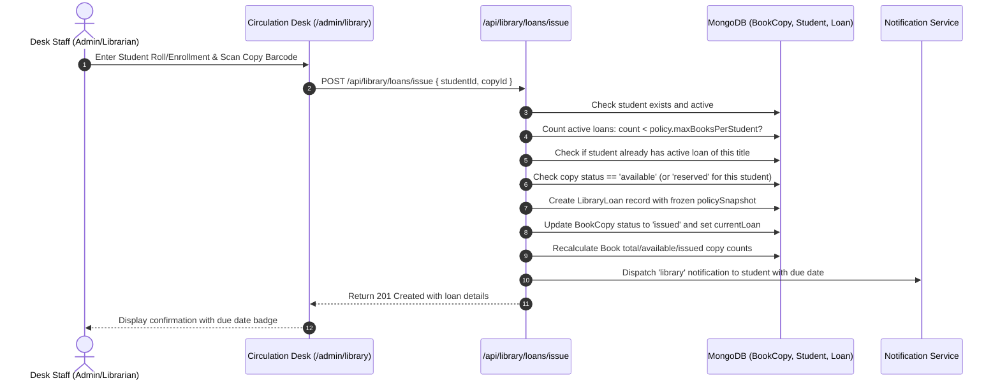
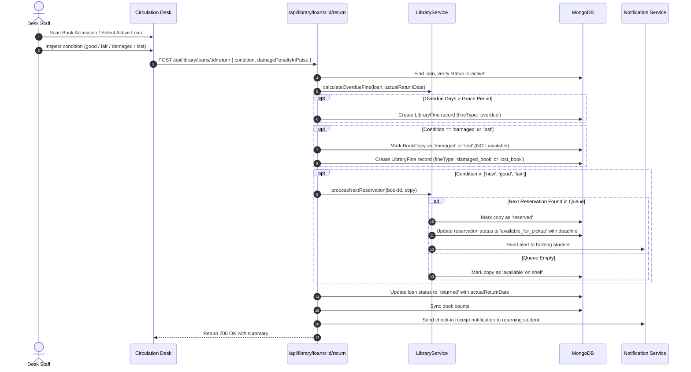

# CAMPUSSPHERE AI — PART 17/24
# CIRCULATION DESK: ISSUE & RETURN WORKFLOW

**Phase:** Part 17 of 24  
**Module:** Physical Library Management System  
**Status:** Completed & Stabilized  

---

## 1. Issue Workflow (Check-Out)

When an authorized student presents their physical college ID card and a book at the circulation counter, the desk staff follows this workflow:

### Pre-Condition Checks:
1. **Loan Quota Limits:** Rejects issue with HTTP 400 if active loans equal or exceed `policy.maxBooksPerStudent` (default 3).
2. **Duplicate Title Restriction:** Rejects issue with HTTP 400 if student already possesses an unreturned copy of the same title.
3. **Availability State:** Rejects issue with HTTP 400 if physical copy is not `'available'` or `'reserved'` for this student.
4. **Policy Freeze:** A complete snapshot of circulation policy rules (`loanDurationDays`, `finePerOverdueDayInPaise`, `gracePeriodDays`, `maxFinePerBookInPaise`) is attached to `loan.policySnapshot`.

---

## 2. Return Workflow (Check-In)

When a book is brought back to the circulation desk:

### Return Condition Rules:
- **Good / Fair:** Returns to general shelf stock or fulfills the next queued reservation.
- **Damaged:** Copy is immediately isolated from circulation (`status: 'damaged'`). An administrative assessment fine (`fineType: 'damaged_book'`) is created in the fine ledger.
- **Lost:** Copy is marked `status: 'lost'`. A replacement cost penalty (`fineType: 'lost_book'`), computed using `policy.defaultLostPenaltyMultiplier` (default $1.5\times$), is assessed.

