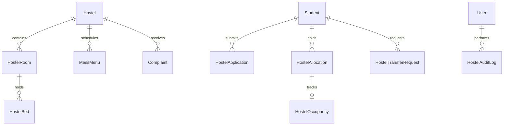

# CampusSphere AI — Part 18: Database Design & Schema Architecture

## 1. Overview

Part 18 introduces a normalized residential data architecture in MongoDB consisting of 10 collections designed for high query performance, data integrity, auditability, and zero race conditions.



---

## 2. Collections & Schemas

### 2.1 `Hostel` (`server/models/Hostel.js`)
Residential building master records.
```javascript
{
  name: { type: String, required: true, trim: true },
  code: { type: String, required: true, unique: true, uppercase: true, index: true },
  type: { type: String, enum: ['boys', 'girls', 'co-ed', 'faculty_staff'], required: true },
  genderEligibility: { type: String, enum: ['male', 'female', 'co-ed', 'any'], default: 'any' },
  building: { type: String, default: '' },
  campusLocation: { type: String, default: 'Main Campus' },
  description: { type: String, default: '' },
  wardens: [{ type: mongoose.Schema.Types.ObjectId, ref: 'User' }],
  contactNumber: { type: String, default: '' },
  contactEmail: { type: String, default: '' },
  totalRooms: { type: Number, default: 0 },
  totalBeds: { type: Number, default: 0 },
  occupiedBeds: { type: Number, default: 0 },
  availableBeds: { type: Number, default: 0 },
  applicablePrograms: [{ type: String }],
  applicableBatches: [{ type: String }],
  status: { type: String, enum: ['active', 'maintenance', 'inactive'], default: 'active' },
  createdBy: { type: mongoose.Schema.Types.ObjectId, ref: 'User' }
}
```

### 2.2 `HostelRoom` (`server/models/HostelRoom.js`)
Individual residential rooms within a hostel.
- Compound unique index: `{ hostel: 1, roomNumber: 1 }`
```javascript
{
  hostel: { type: mongoose.Schema.Types.ObjectId, ref: 'Hostel', required: true, index: true },
  roomNumber: { type: String, required: true, uppercase: true, trim: true },
  floor: { type: Number, required: true, min: 0 },
  block: { type: String, default: '' },
  capacity: { type: Number, required: true, min: 1, max: 20 },
  roomType: { type: String, enum: ['single', 'double', 'triple', 'quad', 'dormitory'], default: 'double' },
  facilities: [{ type: String }],
  totalBeds: { type: Number, default: 0 },
  occupiedBeds: { type: Number, default: 0 },
  availableBeds: { type: Number, default: 0 },
  status: { type: String, enum: ['available', 'full', 'maintenance', 'inactive'], default: 'available' }
}
```

### 2.3 `HostelBed` (`server/models/HostelBed.js`)
Physical bed inventory with state locks.
- Unique index: `{ bedId: 1 }`
- Compound unique index: `{ room: 1, bedNumber: 1 }`
```javascript
{
  bedId: { type: String, required: true, unique: true, uppercase: true, index: true },
  hostel: { type: mongoose.Schema.Types.ObjectId, ref: 'Hostel', required: true, index: true },
  room: { type: mongoose.Schema.Types.ObjectId, ref: 'HostelRoom', required: true, index: true },
  bedNumber: { type: String, required: true, uppercase: true, trim: true },
  status: { type: String, enum: ['available', 'allocated', 'occupied', 'maintenance', 'inactive'], default: 'available' },
  currentStudent: { type: mongoose.Schema.Types.ObjectId, ref: 'Student', default: null },
  currentAllocation: { type: mongoose.Schema.Types.ObjectId, ref: 'HostelAllocation', default: null }
}
```

### 2.4 `HostelApplication` (`server/models/HostelApplication.js`)
Student accommodation requests.
- Compound partial index preventing duplicate active applications: `{ student: 1, academicYear: 1 }`
```javascript
{
  applicationNumber: { type: String, required: true, unique: true, uppercase: true, index: true },
  student: { type: mongoose.Schema.Types.ObjectId, ref: 'Student', required: true, index: true },
  academicYear: { type: String, required: true, trim: true },
  semester: { type: Number, default: 1 },
  preferredHostels: [{ type: mongoose.Schema.Types.ObjectId, ref: 'Hostel' }],
  requestedRoomType: { type: String, enum: ['single', 'double', 'triple', 'quad', 'dormitory', 'any'], default: 'any' },
  distanceFromCollegeKm: { type: Number, default: 0 },
  medicalConditions: { type: String, default: '' },
  emergencyContact: { name: String, relation: String, phone: String },
  status: { type: String, enum: ['draft', 'submitted', 'pending', 'under_review', 'approved', 'rejected', 'waitlisted', 'allocated', 'cancelled'], default: 'submitted' },
  reviewDetails: {
    reviewedBy: { type: mongoose.Schema.Types.ObjectId, ref: 'User' },
    reviewedAt: Date,
    comments: String,
    rejectionReason: String,
    waitlistNumber: Number
  }
}
```

### 2.5 `HostelAllocation` (`server/models/HostelAllocation.js`)
Approved room assignments linking student to residential inventory.
- Unique index: `{ allocationNumber: 1 }`
- Compound active allocation index: `{ student: 1, status: 1 }`
```javascript
{
  allocationNumber: { type: String, required: true, unique: true, uppercase: true, index: true },
  student: { type: mongoose.Schema.Types.ObjectId, ref: 'Student', required: true, index: true },
  application: { type: mongoose.Schema.Types.ObjectId, ref: 'HostelApplication', default: null },
  hostel: { type: mongoose.Schema.Types.ObjectId, ref: 'Hostel', required: true, index: true },
  room: { type: mongoose.Schema.Types.ObjectId, ref: 'HostelRoom', required: true },
  bed: { type: mongoose.Schema.Types.ObjectId, ref: 'HostelBed', required: true },
  academicYear: { type: String, required: true },
  startDate: { type: Date, required: true },
  expectedEndDate: { type: Date, required: true },
  actualEndDate: { type: Date, default: null },
  allocatedBy: { type: mongoose.Schema.Types.ObjectId, ref: 'User', required: true },
  status: { type: String, enum: ['allocated', 'active', 'transferred', 'checked_out', 'cancelled'], default: 'allocated' },
  remarks: { type: String, default: '' }
}
```

### 2.6 `HostelOccupancy` (`server/models/HostelOccupancy.js`)
Operational desk check-in / check-out circulation records.
- Unique index: `{ allocation: 1 }`
```javascript
{
  allocation: { type: mongoose.Schema.Types.ObjectId, ref: 'HostelAllocation', required: true, unique: true },
  student: { type: mongoose.Schema.Types.ObjectId, ref: 'Student', required: true, index: true },
  hostel: { type: mongoose.Schema.Types.ObjectId, ref: 'Hostel', required: true },
  room: { type: mongoose.Schema.Types.ObjectId, ref: 'HostelRoom', required: true },
  bed: { type: mongoose.Schema.Types.ObjectId, ref: 'HostelBed', required: true },
  checkIn: {
    date: { type: Date, default: Date.now },
    staff: { type: mongoose.Schema.Types.ObjectId, ref: 'User', required: true },
    inventoryCondition: { type: String, default: 'Good condition' },
    keysIssued: { type: Number, default: 1 },
    notes: { type: String, default: '' }
  },
  checkOut: {
    date: Date,
    staff: { type: mongoose.Schema.Types.ObjectId, ref: 'User' },
    roomCondition: String,
    keysReturned: { type: Boolean, default: true },
    damageAssessmentInPaise: { type: Number, default: 0 },
    outstandingDuesInPaise: { type: Number, default: 0 },
    clearanceStatus: { type: String, enum: ['cleared', 'conditional', 'withheld'], default: 'cleared' },
    clearanceNotes: String
  },
  status: { type: String, enum: ['checked_in', 'checked_out'], default: 'checked_in' }
}
```

### 2.7 `HostelTransferRequest` (`server/models/HostelTransferRequest.js`)
Room transfer requests submitted by resident students.
- Unique index: `{ requestNumber: 1 }`
```javascript
{
  requestNumber: { type: String, required: true, unique: true, uppercase: true },
  student: { type: mongoose.Schema.Types.ObjectId, ref: 'Student', required: true, index: true },
  currentAllocation: { type: mongoose.Schema.Types.ObjectId, ref: 'HostelAllocation', required: true },
  currentHostel: { type: mongoose.Schema.Types.ObjectId, ref: 'Hostel', required: true },
  currentRoom: { type: mongoose.Schema.Types.ObjectId, ref: 'HostelRoom', required: true },
  currentBed: { type: mongoose.Schema.Types.ObjectId, ref: 'HostelBed', required: true },
  requestedHostel: { type: mongoose.Schema.Types.ObjectId, ref: 'Hostel' },
  requestedRoomType: { type: String, enum: ['single', 'double', 'triple', 'quad', 'dormitory', 'any'], default: 'any' },
  reason: { type: String, required: true, trim: true },
  status: { type: String, enum: ['pending', 'approved', 'rejected', 'cancelled'], default: 'pending' },
  review: {
    reviewedBy: { type: mongoose.Schema.Types.ObjectId, ref: 'User' },
    reviewedAt: Date,
    comments: String,
    newAllocation: { type: mongoose.Schema.Types.ObjectId, ref: 'HostelAllocation' }
  }
}
```

### 2.8 `HostelPolicy` (`server/models/HostelPolicy.js`)
Institutional policy parameters and fee defaults (integer paise).
```javascript
{
  applicationWindowOpen: { type: Boolean, default: true },
  maxActiveApplicationsPerStudent: { type: Number, default: 1 },
  maxAllocationDurationMonths: { type: Number, default: 12 },
  allowCrossGenderAllocation: { type: Boolean, default: false },
  requireGuardianConsent: { type: Boolean, default: false },
  defaultHostelFeeInPaise: { type: Number, default: 4500000 },
  defaultSecurityDepositInPaise: { type: Number, default: 1000000 },
  defaultMessFeeInPaise: { type: Number, default: 2500000 },
  isActive: { type: Boolean, default: true }
}
```

### 2.9 `MessMenu` (`server/models/MessMenu.js`)
Weekly dining schedule for student nutrition management.
- Unique index: `{ hostel: 1 }`
```javascript
{
  hostel: { type: mongoose.Schema.Types.ObjectId, ref: 'Hostel', required: true, unique: true },
  days: [{
    day: { type: String, enum: ['Monday', 'Tuesday', 'Wednesday', 'Thursday', 'Friday', 'Saturday', 'Sunday'], required: true },
    breakfast: { type: String, default: '' },
    lunch: { type: String, default: '' },
    snacks: { type: String, default: '' },
    dinner: { type: String, default: '' },
    specialDiet: { type: String, default: '' }
  }],
  lastUpdatedBy: { type: mongoose.Schema.Types.ObjectId, ref: 'User' },
  updatedAt: { type: Date, default: Date.now }
}
```

### 2.10 `HostelAuditLog` (`server/models/HostelAuditLog.js`)
Immutable audit trail for regulatory and compliance oversight.
```javascript
{
  action: { type: String, required: true, index: true },
  entityType: { type: String, enum: ['hostel', 'room', 'bed', 'application', 'allocation', 'occupancy', 'transfer', 'complaint', 'mess', 'policy'], required: true },
  entityId: { type: mongoose.Schema.Types.ObjectId, required: true, index: true },
  performedBy: { type: mongoose.Schema.Types.ObjectId, ref: 'User', required: true, index: true },
  details: { type: mongoose.Schema.Types.Mixed, default: {} },
  timestamp: { type: Date, default: Date.now, index: true }
}
```

