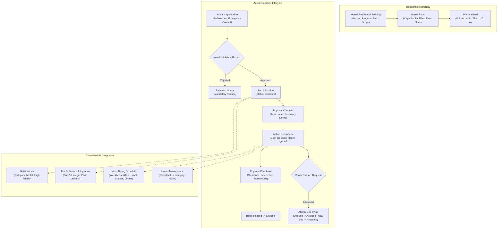

# CampusSphere AI — Part 18: Hostel Management Architecture

## 1. Executive Summary

The CampusSphere AI Hostel Management System delivers an end-to-end residential accommodation platform for higher-education institutions. It models real campus residential dynamics across buildings, multi-floor rooms, individual physical beds, dining messes, and maintenance facilities while enforcing atomic concurrency safety, strict warden authorization boundaries, and seamless financial ledger integration with Part 16 fee management.

---

## 2. Core Architectural Principles

### 2.1 Multi-Tier Residential Inventory Isolation
- **Hostel Level (`Hostel.js`):** Defines gender eligibility (`male`, `female`, `co-ed`, `any`), applicable degree programs, batches, institutional contact information, and assigned wardens.
- **Room Level (`HostelRoom.js`):** Enforces physical capacity limits (single, double, triple, quad, dormitory) and facility tracking. Prevents bed over-allocation by rejecting bed creations that exceed configured room capacity.
- **Bed Level (`HostelBed.js`):** The definitive physical atom of student residence. Uniquely identified by `bedId` (`<HOSTEL_CODE>-<ROOM_NO>-<BED_NO>`). Prevents double-booking via atomic database state locks.

### 2.2 Atomic Concurrency & Zero Double-Booking
To prevent race conditions where concurrent wardens or administrators attempt to allocate the same bed simultaneously:
- Bed allocation employs atomic `findOneAndUpdate` queries targeting `{ _id: bedId, status: 'available' }`.
- Duplicate active accommodations for the same student are blocked by validating existing active allocations (`allocated`, `active`) prior to allocation execution.

### 2.3 Scoped Warden Administration
- Wardens have strict administrative jurisdiction limited to hostels where their `userId` is registered in `hostel.wardens`.
- Attempts by a warden to review applications, allocate beds, inspect check-ins, or manage complaints for unassigned hostels are intercepted and rejected with `403 Forbidden`.
- System administrators retain institutional campus-wide authority across all residences.

### 2.4 Complete Physical Circulation Desk Lifecycle
The system strictly separates **academic bed allocation** from **physical arrival and departure**:
1. **Allocation:** Bed is reserved for the student; status transitions to `'allocated'`.
2. **Check-in:** Staff records key issuance, room condition inventory notes; creates a `HostelOccupancy` document and updates bed to `'occupied'`.
3. **Active Stay:** Student accesses hostel facilities, mess menus, and files hostel-specific maintenance complaints.
4. **Transfer (Optional):** Atomic transition releasing current bed back to `'available'` while claiming the target bed.
5. **Check-out:** Room inspection, key return verification, clearance grant; bed is released back to `'available'`.

