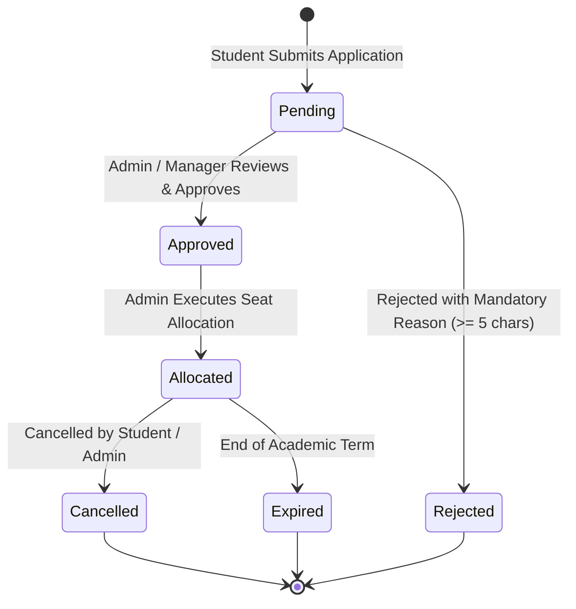

# CampusSphere AI — Part 19: Application & Allocation Lifecycle

## 1. Student Transport Application Lifecycle

Higher education institutions require structured registration for campus transit services. Students apply by selecting their desired route and nearest boarding stop, providing emergency contact information, and recording any medical notes.



### 1.1 Application Validation Rules
- **One Active Application Invariant:** A student cannot hold multiple concurrent `pending` or `approved` applications for the same academic year. Re-applying is blocked with `HTTP 409 Conflict`.
- **Route & Stop Consistency:** The requested `boardingStop` must belong to the selected `preferredRoute`.
- **Emergency Contact:** Valid emergency contact name and phone number are strictly required.

### 1.2 Anti-IDOR Enforcement
- Ordinary students can only view and manage their own transit applications (`req.user._id === application.student`).
- Attempting to view or alter another student's transport application triggers an immediate `HTTP 403 Forbidden` response.

---

## 2. Administrative Review & Approval

Transport managers and administrators review applications through the Transport Administration desk:
- **Approval:** Transitions application status to `approved`.
- **Rejection:** Requires a mandatory rejection reason of at least 5 characters (e.g. "Requested route is at capacity; please select Alternate Corridor 2"). Rejections without sufficient explanation are blocked with `HTTP 400 Bad Request`.
- Dispatches a real-time notification to the student under category `transport`.

---

## 3. Concurrency-Safe Atomic Seat Allocation

When allocating a student to a route, race conditions could cause accidental over-allocation if multiple administrators allocate seats simultaneously.

### 3.1 Atomic Reservation Algorithm
The system utilizes MongoDB atomic queries with capacity bounds:
```javascript
// Step 1: Verify student does not already hold an active allocation
const existingActive = await TransportAllocation.findOne({
  student: studentId,
  academicYear,
  status: { $in: ['active', 'allocated'] }
});
if (existingActive) {
  throw new AppError('Student already holds an active transport pass', 409);
}

// Step 2: Atomically reserve seat on route
const route = await TransportRoute.findOneAndUpdate(
  {
    _id: routeId,
    status: 'active',
    $expr: { $lt: ['$allocatedStudentsCount', '$maxCapacity'] }
  },
  { $inc: { allocatedStudentsCount: 1 } },
  { new: true }
);

if (!route) {
  throw new AppError('Route is at full capacity or inactive', 409);
}

// Step 3: Create TransportAllocation record with unique passNumber
const passNumber = `TP-${academicYear.replace(/[^0-9]/g, '')}-${Date.now().toString().slice(-6)}`;
const allocation = await TransportAllocation.create({
  passNumber,
  student: studentId,
  application: applicationId,
  route: routeId,
  stop: stopId,
  academicYear,
  feeAmount: feeAmountPaise,
  validFrom,
  validUntil,
  status: 'active',
  allocatedBy: req.user._id
});
```

### 3.2 Single Active Pass Invariant
A student can only hold a single `active` or `allocated` transport pass at any given time. Attempting to create a second concurrent allocation is rejected with `HTTP 409 Conflict`.

---

## 4. Allocation Cancellation & Capacity Release

When a student cancels transport services or leaves the institution:
1. The allocation status transitions to `cancelled`.
2. A mandatory cancellation reason is recorded.
3. The assigned route's `allocatedStudentsCount` is atomically decremented:
   ```javascript
   await TransportRoute.findByIdAndUpdate(allocation.route, {
     $inc: { allocatedStudentsCount: -1 }
   });
   ```
4. Historical allocation records are strictly preserved for audit and billing reconciliation purposes; records are never deleted from the database.

