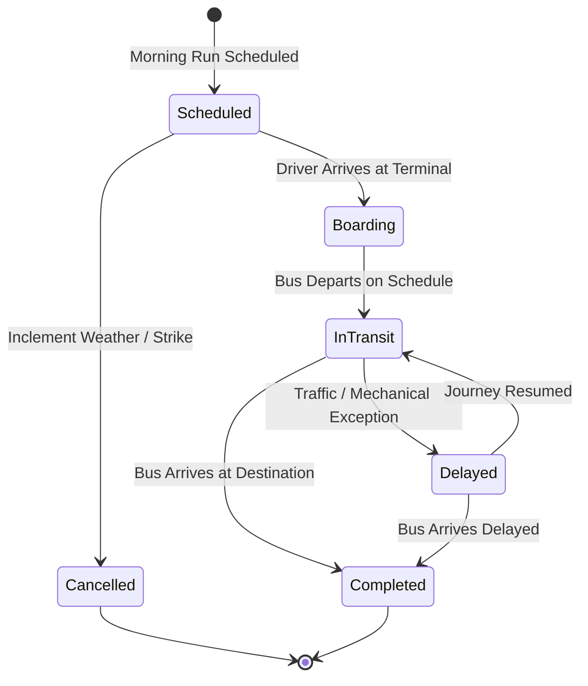

# CampusSphere AI — Part 19: Daily Operations & Trip Management

## 1. Daily Route Trip Lifecycle

Campus transport operates on precise daily schedules. The `TransportTrip` model coordinates daily morning pickups and evening drop-offs for every active route in the fleet.

### 1.1 Operational Trip Dispatches
- **Trip Types:** `morning_pickup`, `evening_drop`, `special_trip`.
- **Scheduled Timings:** Mirrored from `TransportRoute.morningDepartureTime` and `TransportRoute.eveningDepartureTime`.
- **Compound Uniqueness:** `{ tripDate: 1, route: 1, tripType: 1 }` prevents duplicate runs for the same route and trip type on a given day.

---

## 2. Real-Time Operational Updates & Delay Exceptions

When delays occur due to road construction, severe weather, or heavy morning traffic, drivers or transport administrators report delay details:
- **Delay Attributes:**
  - `delayMinutes`: Number of minutes past scheduled timetable.
  - `delayReason`: Structured operational justification (e.g. "Highway waterlogging near Sector 14 flyover").
- **Student Alerting:** Automatically sends a high-priority alert to all students allocated to that route, informing them of the delay and updated estimated pickup time.

---

## 3. Incident Logging & Emergency Response

Unforeseen transit events require formal documentation and prompt operational resolution.

### 3.1 Incident Classifications
The `TransportIncident` model categorizes critical road occurrences:
- `breakdown`: Mechanical or electrical failure requiring roadside assistance or replacement bus.
- `accident`: Minor or major vehicle collision.
- `medical_emergency`: Commuter or driver sudden medical incident.
- `route_obstruction`: Blocked roadway, tree fall, or local protest requiring route diversion.
- `student_misconduct`: Disciplinary incident aboard the vehicle.
- `weather_delay`: Severe fog, rain, or flooding.

### 3.2 Resolution Workflow
1. Driver or staff reports incident with exact location and severity (`minor`, `moderate`, `major`, `critical`).
2. Immediate response actions are recorded (`actionsTaken`).
3. Fleet manager investigates and updates status to `investigating` -> `resolved` -> `closed`.

---

## 4. Transport Complaints & Feedback Desk

Students and faculty submit transit grievances directly through the unified `Complaint.js` infrastructure:
- **Category:** `transport`
- **Contextual References:** Directly references the offending vehicle (`vehicle`), route (`route`), stop (`stop`), or crew member (`driver`).
- Handled through the standard institutional complaint resolution workflow.

