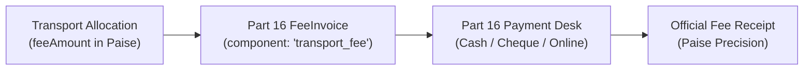

# CampusSphere AI — Part 19: Finance & Fee Integration

## 1. Zero Shadow Ledgers & Part 16 Integration

CampusSphere AI enforces a single institutional ledger for all student financial commitments. Transport fees are not managed in isolated, ad-hoc payment tables; instead, they integrate directly with the Part 16 Student Fee & Financial Administration subsystem.

---

## 2. Integer Indian Paise Currency Standard

To prevent floating-point calculation anomalies, currency truncation, and rounding drift across thousands of transactions, all monetary figures in the transport subsystem are stored and calculated as **integer Indian Paise** (`1 INR = 100 paise`).

### 2.1 Standard Monetary Attributes
| Subsystem Model | Field | Unit | Example Value | Indian Rupee Equivalent |
|---|---|---|---|---|
| `TransportPolicy` | `annualBaseFeePaise` | Integer Paise | `1200000` | ₹12,000.00 |
| `TransportPolicy` | `perKmRatePaise` | Integer Paise | `1000` | ₹10.00 / km |
| `TransportAllocation` | `feeAmount` | Integer Paise | `1500000` | ₹15,000.00 |
| `TransportMaintenance` | `costPaise` | Integer Paise | `450000` | ₹4,500.00 |

### 2.2 Dynamic Fee Calculation Formula
When an application is allocated, the transport fee is determined by institutional policy:
$$\text{Total Fee (Paise)} = \text{annualBaseFeePaise} + (\text{distanceFromStartKm} \times \text{perKmRatePaise})$$

For example:
- Base Fee: ₹12,000 (`1,200,000 paise`)
- Route Stop Distance: 15 km
- Rate per Km: ₹10 (`1,000 paise`)
- Total Fee: $1,200,000 + (15 \times 1,000) = 1,215,000\text{ paise}$ (₹12,150.00).

---

## 3. Workshop Maintenance Ledgers

Fleet maintenance and garage repairs represent a major institutional operating expense:
- Every repair, spare part replacement, or inspection is logged with its exact invoice cost in **integer paise** (`costPaise`).
- Links to workshop invoice numbers (`invoiceNumber`) and service provider identities (`serviceProvider`).
- Institutional transport metrics aggregate total maintenance expenditure directly from `TransportMaintenance` documents via MongoDB aggregation pipeline `$sum: '$costPaise'`.

