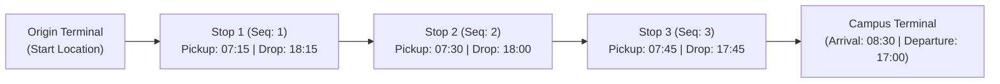

# CampusSphere AI — Part 19: Route & Stop Management

## 1. Route Network Architecture

The CampusSphere transit network organizes campus commuting into distinct corridors. Each route manages its scheduled origin, campus destination, scheduled morning pickup and evening departure times, operational days, and allocated commuter limits.



---

## 2. Ordered Route Stops & Sequence Uniqueness

Route stops represent designated physical boarding and drop-off points for enrolled students.

### 2.1 Sequential Progression Guarantee
- Every stop belongs to a specific `TransportRoute` and possesses an integer `sequence` number.
- MongoDB compound unique index `{ route: 1, sequence: 1 }` strictly prevents conflicting or duplicate sequence numbers within the same transit route.
- Stops must be visited in strict monotonic order during morning pickup (e.g. Stop 1 at 07:15, Stop 2 at 07:30) and reverse or designated drop order in the evening.

### 2.2 Stop Data Invariants
- `morningPickupTime` and `eveningDropTime` use 24-hour military format (`HH:MM`).
- `distanceFromStartKm` tracks cumulative distance from the route origin.
- Optional geographic coordinates (`latitude`, `longitude`) allow future mapping integration without requiring fake GPS trackers.

---

## 3. Route Capacity Management & Invariants

Each route defines a strict physical `maxCapacity` determined by the legal seating capacity of its assigned vehicle.

### 3.1 Capacity Synchronization
- The `allocatedStudentsCount` attribute reflects the real-time count of active student allocations on that route.
- When an allocation is granted, `allocatedStudentsCount` is atomically incremented (`$inc: 1`).
- When an allocation is cancelled or expired, `allocatedStudentsCount` is atomically decremented (`$inc: -1`).
- The transport service provides `syncRouteCapacity(routeId)` which counts actual active allocations (`status: 'active'`) in `TransportAllocation` and updates the route count, ensuring complete data consistency.

### 3.2 Non-Destructive Capacity Reduction Rule
An administrator cannot reduce a route's `maxCapacity` below the number of currently active commuter allocations:
```javascript
// server/controllers/transport.controller.js
if (maxCapacity !== undefined) {
  const activeAllocationsCount = await TransportAllocation.countDocuments({
    route: route._id,
    status: { $in: ['active', 'allocated'] }
  });
  if (Number(maxCapacity) < activeAllocationsCount) {
    throw new AppError(
      `Cannot reduce maximum capacity to ${maxCapacity} because ${activeAllocationsCount} active passes are currently allocated`,
      400
    );
  }
  route.maxCapacity = Number(maxCapacity);
}
```

---

## 4. Vehicle & Crew Binding

A route brings together fleet vehicles, drivers, and attendants into an operational unit:
1. **Capacity Alignment:** The assigned vehicle's `seatingCapacity` must be greater than or equal to the route's configured `maxCapacity`.
2. **Conflict Checking:** The system checks that the vehicle, driver, and attendant are not already assigned to another active route that operates on overlapping days.
3. **Paperwork Verification:** The system verifies that the assigned vehicle's insurance, fitness certificate, and permit, as well as the driver's commercial license, are fully valid.

