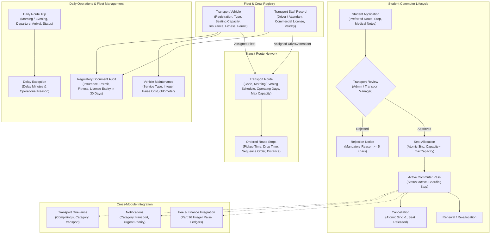

# CampusSphere AI — Part 19: Transport Management Architecture

## 1. Executive Summary

The CampusSphere AI Transport Management System delivers a comprehensive, real-world campus transit and fleet management platform for higher-education institutions. It models real campus commuter logistics across vehicle fleets, certified driving and attendant crews, multi-stop transit routes, student seat allocations, daily trip operations, fleet maintenance lifecycles, regulatory document expiry tracking, and grievance handling. The architecture strictly enforces atomic seat allocation concurrency, prevents double-booking of vehicles and crew across conflicting operational routes, rejects expired regulatory documents, and integrates seamlessly with Part 16 financial ledgers and Part 12 centralized notifications.



---

## 2. Core Architectural Principles

### 2.1 Multi-Tier Fleet & Route Hierarchy
- **Vehicle Fleet (`TransportVehicle.js`):** Enforces registration plate uniqueness, operational status (`active`, `maintenance`, `decommissioned`, `reserved`), physical seating capacity, and compliance tracking (insurance, fitness certificate, road permit, pollution certificates).
- **Staff Registry (`TransportStaffRecord.js`):** Links system user accounts with roles `driver` or `attendant`, tracking heavy commercial driving license numbers, license categories, expiry dates, and medical clearances.
- **Route Network (`TransportRoute.js` & `TransportStop.js`):** Defines transit corridors with distinct route codes, scheduled morning departure/arrival, evening return times, operating days (`Monday` through `Saturday`), and assigned primary/backup vehicles and crew.
- **Ordered Route Stops:** Enforces compound uniqueness on `{ route: 1, sequence: 1 }` ensuring strict boarding sequence progression, pickup timings, and drop-off timings.

### 2.2 Atomic Concurrency & Zero Seat Over-Allocation
In high-demand campus commuting scenarios, concurrent student applications or administrative allocations must never exceed the physical seating capacity of the assigned vehicle or route:
- Allocation uses atomic MongoDB operations:
  ```javascript
  const route = await TransportRoute.findOneAndUpdate(
    { _id: routeId, allocatedStudentsCount: { $lt: route.maxCapacity }, status: 'active' },
    { $inc: { allocatedStudentsCount: 1 } },
    { new: true }
  );
  ```
- If the route is filled to capacity, the atomic query returns `null`, and the API immediately returns `HTTP 409 Conflict: Route capacity reached`.
- Cancellation atomically releases the capacity:
  ```javascript
  await TransportRoute.findByIdAndUpdate(allocation.route, {
    $inc: { allocatedStudentsCount: -1 }
  });
  ```

### 2.3 Operational Conflict Prevention & Crew Safety Guardrails
To prevent operational bottlenecks and scheduling collisions:
- **Vehicle Exclusivity:** A single vehicle cannot be assigned to multiple active routes that operate on overlapping days.
- **Crew Exclusivity:** A driver or attendant cannot be assigned to overlapping routes on the same operating days.
- **Regulatory Expiry Rejection:** Any vehicle with an expired insurance policy, road permit, or fitness certificate, or any driver with an expired commercial driving license, is automatically rejected from active route assignment with `HTTP 400 Bad Request`.

### 2.4 Honest Telematics & Operational Trip Tracking
In compliance with enterprise architectural standards:
- The system rejects synthetic, fabricated GPS "moving dot" simulations.
- It implements an honest, schedule-based operational tracking system (`TransportTrip.js`) recording real trip dispatches (`scheduled`, `boarding`, `in_transit`, `completed`, `cancelled`), actual departure and arrival times, and delay notices with delay minutes and causes.
- The data model provides clean, structured telematics payload hooks (`telematicsData: { latitude, longitude, speed, heading, lastRecordedAt }`) ready for real IoT hardware integration without mock timers.

### 2.5 Centralized Grievance & Notification Integration
- Transport grievances directly utilize the core institutional `Complaint.js` model with `category: 'transport'`, capturing route, stop, vehicle, and driver references.
- Operational alerts (trip delays, document expiries, allocation confirmations, fee generation) deliver via the centralized `Notification.js` and SSE infrastructure under `category: 'transport'`.

### 2.6 Part 16 Finance Integration
- All transport fees, maintenance invoices, and student transit billings strictly operate in **integer Indian Paise** (`1 INR = 100 paise`), eliminating floating-point rounding drift.
- Allocations link to formal Part 16 `FeeInvoice` records, ensuring zero shadow ledgers across the institution.

