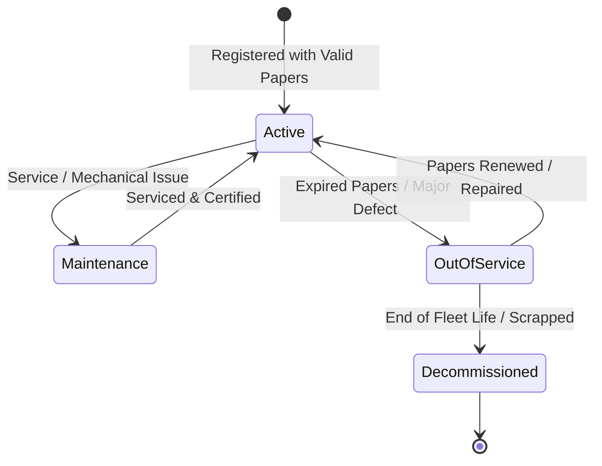

# CampusSphere AI — Part 19: Fleet & Crew Management

## 1. Fleet Vehicle Inventory & Lifecycle

The CampusSphere AI Transport fleet inventory manages all institutional commuting assets. Each vehicle is registered with its official RTO license plate, internal fleet identification code, passenger seating capacity, and compliance papers.

### 1.1 Vehicle Lifecycle States


- **Active:** Available for regular route assignment and daily trips.
- **Maintenance:** Temporarily in garage for routine servicing or repairs; unavailable for assignment.
- **Out of Service:** Grounded due to regulatory non-compliance (expired insurance/fitness/permit) or pending major repairs.
- **Decommissioned:** Permanently retired from the institutional fleet.

---

## 2. Regulatory Compliance & Document Expiry Guardrails

Indian Motor Vehicles Act regulations mandate that commercial educational institution buses carry valid commercial insurance, fitness certificates issued by the Regional Transport Office (RTO), and road permits.

### 2.1 Pre-Assignment Validation Checks
Whenever an administrator or transport manager attempts to assign a vehicle to a route:
```javascript
// server/services/transport.service.js
async validateVehicleForAssignment(vehicleId, requiredCapacity = 0) {
  const vehicle = await TransportVehicle.findById(vehicleId);
  if (!vehicle) throw new AppError('Vehicle not found', 404);
  if (vehicle.status !== 'active') {
    throw new AppError(`Vehicle is currently ${vehicle.status} and cannot be assigned`, 400);
  }

  const now = new Date();
  if (vehicle.insuranceExpiryDate && new Date(vehicle.insuranceExpiryDate) < now) {
    throw new AppError('Vehicle insurance policy has expired', 400);
  }
  if (vehicle.fitnessCertificateExpiryDate && new Date(vehicle.fitnessCertificateExpiryDate) < now) {
    throw new AppError('Vehicle RTO fitness certificate has expired', 400);
  }
  if (vehicle.permitExpiryDate && new Date(vehicle.permitExpiryDate) < now) {
    throw new AppError('Vehicle commercial passenger permit has expired', 400);
  }
  if (requiredCapacity > 0 && vehicle.seatingCapacity < requiredCapacity) {
    throw new AppError(`Vehicle seating capacity (${vehicle.seatingCapacity}) is below route requirement (${requiredCapacity})`, 400);
  }
  return vehicle;
}
```

### 2.2 30-Day Advance Document Expiry Audits
The transport service provides automated inspection of all upcoming expirations:
- Scans `insuranceExpiryDate`, `fitnessCertificateExpiryDate`, `permitExpiryDate` on vehicles.
- Scans `licenseExpiryDate` on all active drivers.
- Identifies any document expiring within the configurable notice window (`default: 30 days`).
- Flags documents as `EXPIRED` (due < today) or `EXPIRING_SOON` (due <= noticeDate).
- Displays high-visibility amber and red alert banners on the Transport Administration desk.

---

## 3. Driver & Attendant Staff Management

Transport personnel are managed through `TransportStaffRecord` linked to user accounts with roles `driver` and `attendant`.

### 3.1 Commercial License Validation
- Commercial drivers must possess a valid Heavy Passenger Motor Vehicle (HPMV) license.
- When assigning a driver to a route, `transportService.validateDriverForAssignment(driverUserId)` verifies:
  1. User exists and possesses the role `driver`.
  2. Staff profile exists and is in `available` or `on_duty` status.
  3. License expiry date is in the future.
  4. If the license is expired, assignment is blocked with `HTTP 400 Bad Request`.

### 3.2 Schedule Conflict Prevention
A vehicle, driver, or attendant cannot be double-booked across conflicting routes:
- When assigning to Route A with operating days `['Monday', 'Tuesday', 'Wednesday']`, the system checks all other active routes assigned to the same vehicle/driver/attendant.
- If Route B operates on `['Wednesday', 'Thursday', 'Friday']`, the intersection (`['Wednesday']`) causes an immediate conflict.
- The assignment is rejected with `HTTP 409 Conflict: Overlapping operational day detected`.

---

## 4. Vehicle Maintenance & Servicing

Fleet reliability and passenger safety depend on timely scheduled maintenance.

### 4.1 Maintenance Logging
- Service types supported: `routine_service`, `repair`, `inspection`, `tire_replacement`, `battery`, `emergency`.
- **Financial Precision:** All workshop bills and servicing charges are stored in **integer paise** (`costPaise`), ensuring zero floating-point ledger drift.
- **Odometer Tracking:** Automatically updates `currentOdometerReading` on the vehicle record.
- **Service Interval Forecast:** Calculates and stores `nextServiceDueOdometer` and `nextServiceDueDate`.

