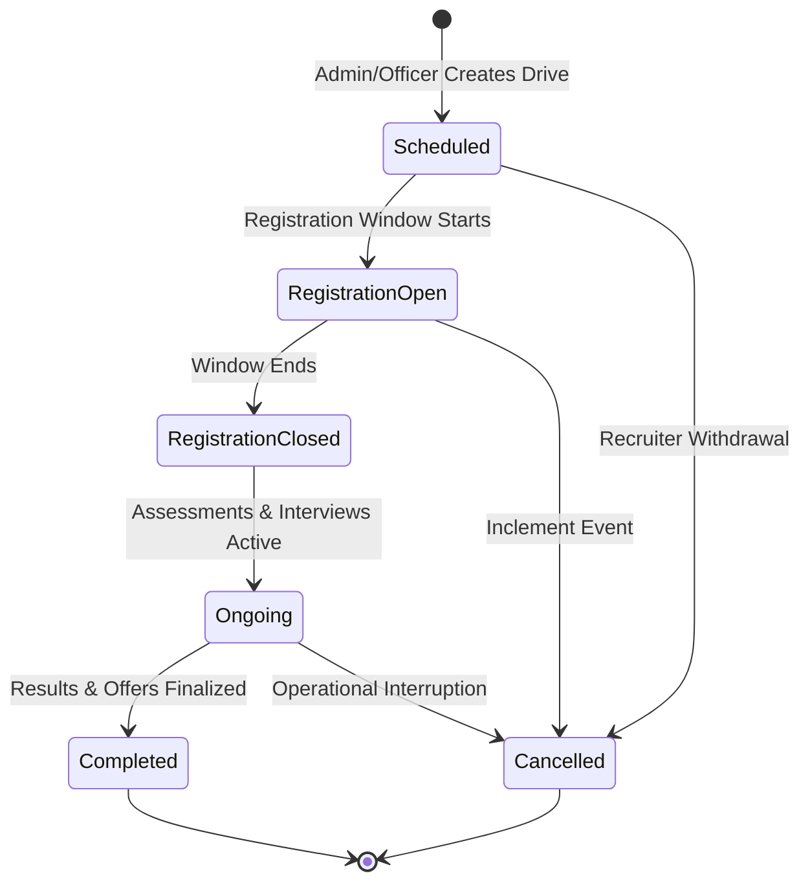

# CampusSphere AI — Part 20: Recruitment Drives & Application Workflow

## 1. Campus Recruitment Drive Lifecycle

A `PlacementDrive` coordinates on-campus and virtual hiring events between companies, opportunities, and student applicants.

### 1.1 Academic Calendar Synchronization
- When a placement drive is scheduled or modified, `placementService.syncDriveWithCalendar(drive, userId)` automatically creates or updates an institutional `AcademicCalendarEvent` under `eventType: 'registration_period'`.
- This ensures campus-wide visibility across student and faculty timetables without duplicating calendar database rows.

---

## 2. Student Application Workflow & Invariants

Students submit applications through the Student Placement Portal (`/student/placement`).

### 2.1 Pre-Application Guardrails
1. **Resume Requirement:** Student must have an uploaded resume file on their `PlacementProfile`.
2. **Server Eligibility:** Student must satisfy all server-evaluated criteria (CGPA, backlogs, branch, batch).
3. **Deadline Guard:** Application deadline must be in the future.
4. **Duplicate Prevention:** MongoDB compound unique index `{ student: 1, opportunity: 1 }` strictly blocks duplicate applications.

### 2.2 Status Transitions
- `submitted` $\rightarrow$ `under_review` $\rightarrow$ `shortlisted` $\rightarrow$ `interview_scheduled` $\rightarrow$ `selected` $\rightarrow$ `offered` $\rightarrow$ `offer_accepted`
- Alternate branches: `rejected`, `withdrawn`, `on_hold`.
- Every status transition appends an immutable entry to `statusHistory: [{ status, changedAt, changedBy, reason }]`.

### 2.3 Application Self-Withdrawal
- Students can withdraw their application with a mandatory reason if it is in `submitted` or `under_review` state.
- Once a candidate is `shortlisted`, `selected`, or `offered`, self-withdrawal is blocked to prevent recruitment disruptions; candidates must contact the Placement Cell.

