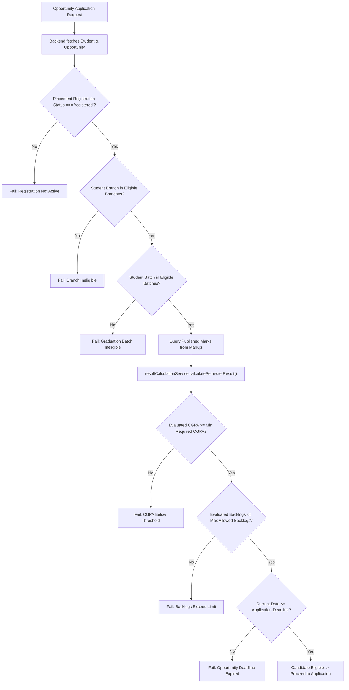

# CampusSphere AI — Part 20: Server-Side Eligibility Engine

## 1. Zero-Trust Server-Side Eligibility Calculation

To prevent student tampering or client-side spoofing, CampusSphere AI strictly evaluates candidate eligibility entirely on the backend (`placementService.evaluateStudentEligibility`).



---

## 2. Dynamic Integration with Mark.js

Instead of storing a separate, potentially conflicting CGPA in the placement module, the eligibility engine computes the authoritative cumulative performance dynamically:
1. Queries all published, unwithheld marks for the candidate from `Mark.js`:
   ```javascript
   const publishedMarks = await Mark.find({
     student: student._id,
     status: 'published',
     isWithheld: false,
   }).populate('subject exam');
   ```
2. Invokes `resultCalculationService.calculateSemesterResult(publishedMarks)`, which calculates the decimal-safe UGC CGPA and counts active failures (`failedSubjects`).
3. If no published marks exist, the system safely evaluates CGPA as `0.0` rather than granting false positive eligibility.

---

## 3. Snapshot Preservation at Application Time

When an eligible candidate applies, the system creates an immutable `eligibilitySnapshot` inside the `PlacementApplication`:
```javascript
eligibilitySnapshot: {
  isEligible: true,
  evaluationStatus: 'eligible',
  evaluatedCgpa: 8.75,
  evaluatedBacklogs: 0,
  studentBranch: 'CSE',
  studentSemester: 7,
  studentBatch: 2026,
  evaluatedAt: new Date(),
  reasons: []
}
```
If the student's CGPA changes in a subsequent semester, the historical application retains the exact criteria and evaluation result from the application timestamp.

