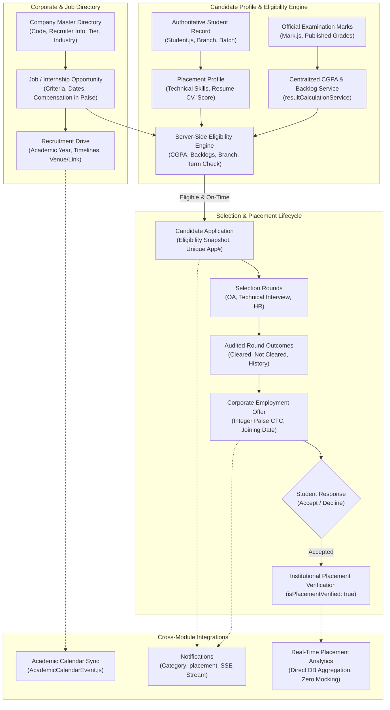

# CampusSphere AI — Part 20: Placement & Career Development Architecture

## 1. Executive Summary

The CampusSphere AI Placement and Career Development Management System delivers a comprehensive, enterprise-grade campus recruitment and career enablement platform for higher-education institutions. It models corporate relations, recruitment drives, vacancies, student profiles, authoritative server-side eligibility evaluation, interview rounds, official employment offers, and real-time database analytics.

---

## 2. Core Architectural Principles

### 2.1 Authoritative Academic Data Consumption
- The placement module **never duplicates or stores conflicting academic numbers** (e.g. CGPA, credit totals, backlog count).
- When evaluating eligibility or submitting an application, the backend dynamically queries published marks from `Mark.js` and invokes `resultCalculationService.calculateSemesterResult()`.
- Client-supplied CGPA, branch, or eligibility values are strictly rejected.

### 2.2 Immutable Eligibility & Document Snapshots
- When a candidate submits an application, the system records an immutable `eligibilitySnapshot` capturing the student's evaluated CGPA, backlog count, branch, semester, and evaluation criteria at that exact moment.
- The submitted resume version (`resumeUrl` and `resumeOriginalName`) is linked to the application, ensuring that later resume updates on the profile do not alter the historical application document.

### 2.3 Drive-Scoped Placement Coordinator Permissions
- System Administrators and Placement Officers have global campus-wide placement authority.
- Student and Faculty Placement Coordinators are strictly scoped to recruitment drives where their `userId` is listed in `drive.coordinators` or assigned via `PlacementCoordinatorAssignment`.
- Unauthorized coordinators attempting to update stages, results, or applications outside their assigned drives are intercepted with `HTTP 403 Forbidden`.

### 2.4 Secure Document Access & Anti-IDOR Protections
- Resume documents and corporate offer letters are stored in protected directories (`uploads/placement/resumes` and `uploads/placement/offers`) with unguessable crypto-random filenames.
- Files cannot be accessed through public static routes. Downloads must pass through `/api/placement/resumes/:filename` and `/api/placement/offers/documents/:filename`.
- Every download request enforces strict ownership validation: students can only download their own documents; authorized placement staff can download candidate resumes only for relevant drives.

### 2.5 Real Database Analytics & Formula Injection Defense
- All executive metrics (placement percentage, average CTC, active companies, application counts) are calculated directly from MongoDB collections using aggregation pipelines.
- All CSV export streams sanitize formula injection triggers (`=`, `+`, `-`, `@`, `\t`, `\r`) with a leading apostrophe (`'`), preventing macro execution in spreadsheet software (CWE-1236).
