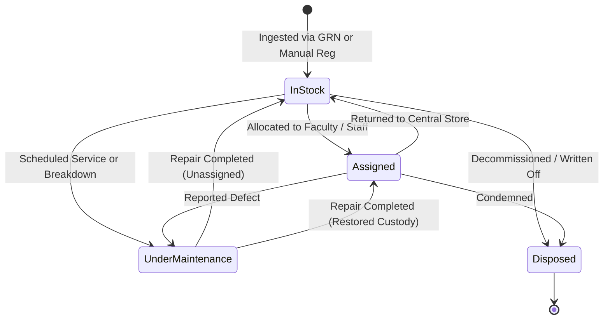

# CampusSphere AI — Part 22: Asset Register & Lifecycle Management

### 1. Capital Asset Registration
Capital assets represent high-value, long-term equipment that requires individual accountability, physical tracking, warranty supervision, and depreciation accounting.

#### 1.1 Ingestion Channels
1. **Automated Procurement Receipt (GRN)**:
   When a Goods Receipt Note (`GoodsReceipt.js`) is inspected and accepted for line items with `itemType === 'asset'`, the fulfillment engine generates serialized `Asset` records automatically.
2. **Direct Manual Registration**:
   Storekeepers and Inventory Managers can register existing uncataloged institutional assets via `POST /api/inventory/assets`.

#### 1.2 Serialization & Identity
- **Asset ID**: Unique generated institutional identifier following the format `AST-<CATEGORY_CODE>-YYYYMMDD-XXXX`.
- **Serial Number**: Manufacturer/OEM serial tag indexed with a sparse unique constraint (`{ serialNumber: 1, sparse: true }`). Duplicate serial numbers are strictly rejected with HTTP 400.

---

### 2. Informational Depreciation Models

Depreciation is calculated dynamically without corrupting historical acquisition records.

#### 2.1 Straight-Line Depreciation
The Straight-Line method apportions equal monthly wear over the estimated useful life of the asset:
$$\text{Depreciable Base} = \max(0, \text{AcquisitionCost} - \text{SalvageValue})$$
$$\text{Monthly Depreciation} = \frac{\text{Depreciable Base}}{\text{Useful Life (Months)}}$$
$$\text{Accumulated Depreciation} = \min(\text{Depreciable Base}, \text{Monthly Depreciation} \times \text{Elapsed Months})$$
$$\text{Current Book Value} = \max(\text{SalvageValue}, \text{AcquisitionCost} - \text{Accumulated Depreciation})$$

#### 2.2 Written Down Value (WDV)
The declining balance method calculates informational value based on a compounding annual rate ($r = 15\%$):
$$\text{Current WDV} = \max(\text{SalvageValue}, \text{AcquisitionCost} \times (1 - r)^{\text{Years Elapsed}})$$

---

### 3. Asset Lifecycle State Machine

