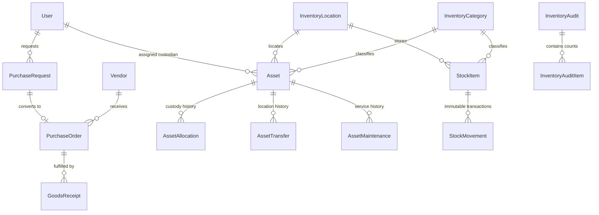

# CampusSphere AI — Part 22: Database Design & Schema Specifications

### 1. Entity-Relationship Overview

---

### 2. Collection Specifications

#### 2.1 `InventoryCategory` (`inventorycategories`)
- `name`: String, required, trim, max 100 chars
- `code`: String, required, unique, uppercase, trim, indexed
- `classification`: String, enum: `['asset', 'consumable']`, required, indexed
- `description`: String, default: ''
- `parentCategory`: ObjectId ref `InventoryCategory`, default: null
- `isActive`: Boolean, default: true, indexed

#### 2.2 `InventoryLocation` (`inventorylocations`)
- `name`: String, required, trim, max 120 chars
- `code`: String, required, unique, uppercase, trim, indexed
- `type`: String, enum: `['store', 'warehouse', 'department', 'laboratory', 'office', 'classroom', 'library', 'hostel', 'other']`, default: `'department'`, indexed
- `department`: String, default: `'Central Stores'`, trim, indexed
- `building`: String, trim
- `roomNumber`: String, trim
- `custodian`: ObjectId ref `User`, default: null
- `isActive`: Boolean, default: true, indexed

#### 2.3 `Asset` (`assets`)
- `assetId`: String, required, unique, uppercase, trim, indexed (e.g. `AST-IT-20261101-ABCD`)
- `name`: String, required, trim, max 200 chars
- `category`: ObjectId ref `InventoryCategory`, required, indexed
- `description`: String, max 2000 chars
- `manufacturer`: String
- `model`: String
- `serialNumber`: String, default: null, trim, sparse: true, indexed
- `purchaseOrder`: ObjectId ref `PurchaseOrder`, default: null
- `goodsReceipt`: ObjectId ref `GoodsReceipt`, default: null
- `purchaseDate`: Date
- `warrantyExpiry`: Date, indexed
- `acquisitionCost`: Number, default: 0, min: 0 (Integer Indian Paise)
- `currentLocation`: ObjectId ref `InventoryLocation`, default: null, indexed
- `department`: String, default: `'Central Stores'`, indexed
- `assignedTo`: ObjectId ref `User`, default: null, indexed
- `assignedDate`: Date
- `condition`: String, enum: `['new', 'good', 'fair', 'poor', 'damaged', 'unusable']`, default: `'new'`
- `status`: String, enum: `['in_stock', 'available', 'assigned', 'under_maintenance', 'damaged', 'lost', 'retired', 'disposed']`, default: `'in_stock'`, indexed
- `depreciation`: `{ usefulLifeYears: Number (min 1, def 5), residualValue: Number (paise), depreciationMethod: 'straight_line' | 'written_down' }`
- `notes`: String
- Compound Indexes: `{ status: 1, department: 1 }`, text index on `{ name, model, manufacturer, description }`

#### 2.4 `StockItem` (`stockitems`)
- `name`: String, required, trim, max 150 chars
- `sku`: String, required, unique, uppercase, trim, indexed
- `category`: ObjectId ref `InventoryCategory`, required, indexed
- `unit`: String, enum: `['pieces', 'boxes', 'packs', 'kilograms', 'litres', 'metres', 'rolls', 'sets', 'other']`, default: `'pieces'`
- `currentQuantity`: Number, required, default: 0, min: 0 (Strict non-negative constraint)
- `minStockLevel`: Number, default: 10, min: 0
- `reorderThreshold`: Number, default: 20, min: 0, indexed
- `unitPrice`: Number, default: 0, min: 0 (Integer Indian Paise)
- `location`: ObjectId ref `InventoryLocation`, default: null, indexed
- `department`: String, default: `'Central Stores'`, indexed
- `isActive`: Boolean, default: true, indexed
- Compound Indexes: `{ currentQuantity: 1, reorderThreshold: 1 }`

#### 2.5 `StockMovement` (`stockmovements`)
- `movementNumber`: String, required, unique, uppercase, trim, indexed
- `stockItem`: ObjectId ref `StockItem`, required, indexed
- `movementType`: String, enum: `['opening_balance', 'purchase_receipt', 'issue', 'return', 'transfer', 'adjustment', 'damaged', 'expired', 'write_off']`, required, indexed
- `quantity`: Number, required, min: 0.0001
- `previousBalance`: Number, required
- `newBalance`: Number, required, min: 0
- `sourceLocation`: ObjectId ref `InventoryLocation`, default: null
- `destinationLocation`: ObjectId ref `InventoryLocation`, default: null
- `purchaseOrder`: ObjectId ref `PurchaseOrder`, default: null
- `purchaseRequest`: ObjectId ref `PurchaseRequest`, default: null
- `department`: String
- `issuedTo`: ObjectId ref `User`, default: null
- `performedBy`: ObjectId ref `User`, required
- `reason`: String, required, trim
- `referenceNumber`: String
- Indexes: `{ stockItem: 1, createdAt: -1 }`

#### 2.6 `Vendor` (`vendors`)
- `name`: String, required, trim, max 150 chars
- `vendorCode`: String, required, unique, uppercase, trim, indexed
- `contactPerson`: String
- `email`: String, required, lowercase, trim
- `phone`: String
- `address`: String
- `gstNumber`: String, uppercase, trim
- `panNumber`: String, uppercase, trim
- `category`: String, default: `'General Supplies'`
- `productsSupplied`: [String]
- `internalRemarks`: String, default: '', `select: false` (confidential)
- `isActive`: Boolean, default: true, indexed

#### 2.7 `PurchaseRequest` (`purchaserequests`)
- `requestNumber`: String, required, unique, uppercase, trim, indexed
- `department`: String, required, indexed
- `requestingEmployee`: ObjectId ref `User`, required, indexed
- `itemDescription`: String, required, max 2000 chars
- `category`: ObjectId ref `InventoryCategory`, required, indexed
- `itemType`: String, enum: `['asset', 'consumable']`, default: `'asset'`
- `quantity`: Number, required, min: 1
- `estimatedUnitCost`: Number, required, min: 0 (Integer Indian Paise)
- `estimatedTotalCost`: Number, required, min: 0 (Integer Indian Paise)
- `justification`: String, required, min 5 chars
- `priority`: String, enum: `['low', 'normal', 'high', 'urgent']`, default: `'normal'`
- `preferredVendor`: ObjectId ref `Vendor`, default: null
- `status`: String, enum: `['draft', 'submitted', 'under_review', 'approved', 'rejected', 'converted_to_po', 'cancelled']`, default: `'draft'`, indexed
- `rejectionReason`: String
- `approvedBy`: ObjectId ref `User`, default: null
- `approvedAt`: Date
- `approvalHistory`: Array of `{ stage, reviewer, status, comments, decisionDate }`

#### 2.8 `PurchaseOrder` (`purchaseorders`)
- `poNumber`: String, required, unique, uppercase, trim, indexed
- `vendor`: ObjectId ref `Vendor`, required, indexed
- `purchaseRequest`: ObjectId ref `PurchaseRequest`, default: null, indexed
- `items`: Subdocuments with `{ itemType, itemName, description, category, stockItem, quantity, unitPricePaise, taxPercent, taxAmountPaise, totalAmountPaise, receivedQuantity }`
- `subtotalPaise`: Number, required, min: 0
- `taxTotalPaise`: Number, default: 0, min: 0
- `totalAmountPaise`: Number, required, min: 0
- `currency`: String, default: `'INR'`
- `status`: String, enum: `['draft', 'issued', 'partially_received', 'fulfilled', 'cancelled']`, default: `'draft'`, indexed

#### 2.9 `GoodsReceipt` (`goodsreceipts`)
- `grnNumber`: String, required, unique, uppercase, trim, indexed
- `purchaseOrder`: ObjectId ref `PurchaseOrder`, required, indexed
- `vendor`: ObjectId ref `Vendor`, required, indexed
- `receivedDate`: Date, default: `Date.now`
- `receivedBy`: ObjectId ref `User`, required
- `destinationLocation`: ObjectId ref `InventoryLocation`, required
- `invoiceNumber`: String
- `deliveryChallanNumber`: String
- `items`: Subdocuments with `{ poItemId, itemType, itemName, category, stockItem, orderedQuantity, receivedQuantity, acceptedQuantity, rejectedQuantity, rejectionReason, unitCostPaise, serialNumbers, generatedAssets }`
- `inspectionStatus`: String, enum: `['pending', 'passed', 'partial_rejection', 'rejected']`, default: `'passed'`, indexed

#### 2.10 `AssetMaintenance` (`assetmaintenances`)
- `maintenanceNumber`: String, required, unique, uppercase, trim, indexed
- `asset`: ObjectId ref `Asset`, required, indexed
- `type`: String, enum: `['preventative', 'corrective', 'calibration', 'upgrade', 'inspection']`, required, indexed
- `title`: String, required, trim
- `priority`: String, enum: `['low', 'medium', 'high', 'critical']`, default: `'medium'`, indexed
- `status`: String, enum: `['scheduled', 'in_progress', 'completed', 'cancelled']`, default: `'scheduled'`, indexed
- `scheduledDate`: Date, required
- `costPaise`: Number, default: 0, min: 0 (Integer Indian Paise)
- `isUnderWarranty`: Boolean, default: false

#### 2.11 `InventoryAudit` & `InventoryAuditItem`
- `InventoryAudit`: Tracks planned physical counts, locations, lead auditors, and summary discrepancy counts.
- `InventoryAuditItem`: Tracks line item physical verification (expectedQuantity vs countedQuantity, variance, expectedCondition vs countedCondition, status: `pending`, `matched`, `discrepancy`, `reconciled`).
