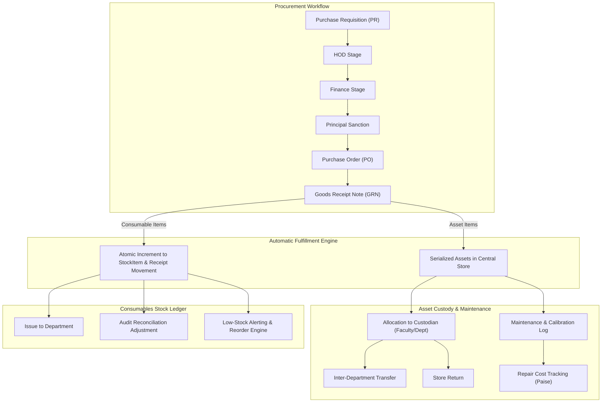

# CampusSphere AI — Part 22: Architecture & System Design
## Campus Asset, Inventory, Procurement & Maintenance Subsystem

### 1. Executive Architecture Summary

The Campus Asset, Inventory, Procurement and Maintenance Subsystem centralizes institutional asset stewardship, consumable materials management, multi-tier procurement workflows, and physical maintenance for **CampusSphere AI**.

The system strictly divides physical resource management into two distinct domains:
1. **Capital Assets (`Asset.js`)**: Individually tracked, serialized equipment with distinct identity, physical location, assigned custodian, maintenance log, and financial depreciation.
2. **Consumable Stock (`StockItem.js`)**: SKU-based bulk inventory (paper, lab reagents, stationery, toner) tracked via an append-only, immutable double-entry style stock ledger (`StockMovement.js`) enforcing strictly non-negative stock balances.



---

### 2. Core Architectural Invariants

1. **Integer Indian Paise Standard**:
   All monetary amounts (`acquisitionCost`, `unitPrice`, `subtotalPaise`, `taxTotalPaise`, `totalAmountPaise`, `costPaise`) are stored strictly as integer Indian Paise (`1 INR = 100 paise`), entirely eliminating binary floating-point rounding drift.
2. **Atomic Non-Negative Stock Balance**:
   Stock decrements are executed via atomic MongoDB conditional updates:
   ```javascript
   { _id: stockItemId, currentQuantity: { $gte: movementQty } }
   ```
   No balance can ever breach zero or enter negative territory under high concurrency.
3. **Immutable Transaction Ledger**:
   Every change in consumable inventory produces a permanent `StockMovement` entry capturing previous balance, new balance, performedBy, reason, and timestamp. Direct database mutations without ledger entries are forbidden.
4. **Separation of Duties in Procurement**:
   A requisitioning employee is strictly blocked by the authorization engine from approving or reviewing their own purchase requisition (`requestingEmployee !== approverId`).
5. **Zero Shadow Ledgers in Finance Integration**:
   Purchase Order commitments link to the institution's existing finance subsystem without creating disjoint accounting balances.
6. **Student Barrier**:
   Students are strictly blocked (`403 Forbidden`) from viewing or executing inventory administrative mutations.
