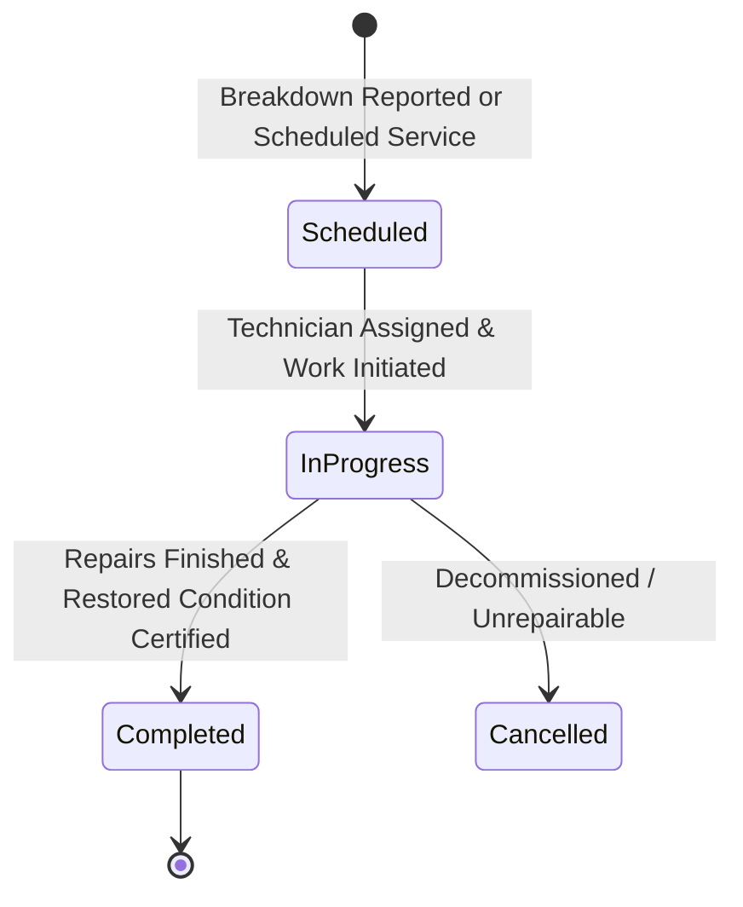

# CampusSphere AI — Part 22: Maintenance, Servicing & Warranty Tracking

### 1. Equipment Maintenance Lifecycle

The maintenance subsystem logs, schedules, and tracks preventative servicing, corrective repairs, inspections, and calibrations for institutional equipment.

---

### 2. Service Classifications
- **Preventative**: Routine periodic servicing (cleaning, lubrication, firmware updates).
- **Corrective**: Unscheduled repair following breakdown or fault diagnosis.
- **Calibration**: Precision calibration for laboratory instruments, balances, and sensors.
- **Upgrade**: Hardware additions (RAM expansions, storage replacements).
- **Inspection**: Regulatory or statutory safety checks.

---

### 3. Warranty Evaluation & Financial Precision
1. **Automated Warranty Verification**:
   When a service task is logged, the engine checks whether `asset.warrantyExpiry > new Date()`. If true, `isUnderWarranty` is set to `true`, indicating that the institution should pursue OEM claims rather than incurring out-of-pocket costs.
2. **Integer Paise Repair Cost**:
   Labor and spare part expenses (`costPaise`) are recorded strictly as integer paise, integrating seamlessly with institutional expenditure analytics.
