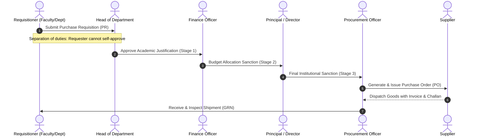

# CampusSphere AI — Part 22: Procurement Workflow & Approval Hierarchy

### 1. Multi-Tier Procurement Architecture

The procurement workflow orchestrates institutional purchasing with strict compliance controls, separation of duties, and audit trail generation.



---

### 2. Separation of Duties Enforcement

To prevent internal fraud and unauthorized financial commitments, the authorization layer enforces a strict barrier:
```javascript
if (purchaseRequest.requestingEmployee.toString() === req.user._id.toString()) {
  return res.status(403).json({
    success: false,
    message: 'Separation of duties violation: You cannot approve your own purchase request'
  });
}
```

### 3. Rejection & Cancellation Protocol
Any reviewer in the workflow chain can reject a requisition with a mandatory written justification (`minlength: 5 chars`). The requisition transitions immediately to `'rejected'`, preventing further approvals or conversion to a Purchase Order.
