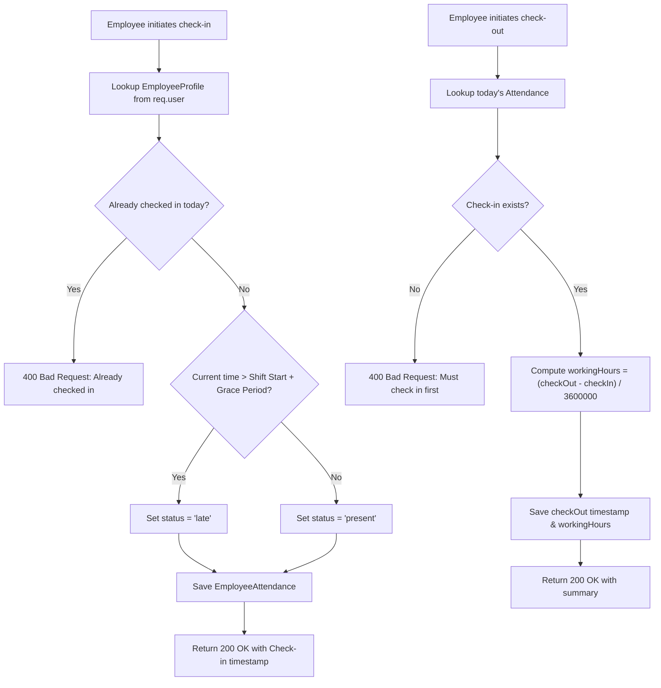

# CampusSphere AI — Part 23/24 Employee Attendance Integration
## Decoupled Architecture, Daily Check-In/Out & Approved Leave Synchronization

---

## 1. Architectural Decoupling: Student vs. Employee Attendance

A critical design requirement of the CampusSphere AI ERP is maintaining total architectural separation between **Student Academic Attendance** and **Employee Institutional Attendance**.

| Dimension | Student Attendance (`Attendance.js`) | Employee Attendance (`EmployeeAttendance.js`) |
| :--- | :--- | :--- |
| **Domain Scope** | Subject lecture, lab session, or seminar attendance | Institutional daily workforce presence |
| **Tracking Unit** | Per class / timetable slot (45–60 min intervals) | Daily shifts (full-day, half-day working hours) |
| **Verification** | Geo-fenced dynamic QR challenge, camera biometrics | Web portal check-in, biometric turnstile, leave sync |
| **Analytics** | Course percentage, eligibility for term examinations | Working hours, late count, approved leave tracking |
| **Ledger Ties** | Academic calendar & examination hall ticket generation | Double-entry leave ledger & HR workforce analytics |

The two systems share zero database tables, preventing student attendance records from polluting workforce metrics or employee leaves from affecting student eligibility.

---

## 2. Daily Check-In & Check-Out Workflow



---

## 3. Approved Leave Synchronization Mechanics

When an employee leave application is approved, the service automatically updates the employee's attendance roster:

1. **Date Range Iteration**: Iterates over every calendar date from `startDate` to `endDate`.
2. **Upsert Operation**:
   ```javascript
   await EmployeeAttendance.findOneAndUpdate(
     { employee: employeeId, date: dateStr },
     {
       $set: {
         status: isHalfDay ? 'half_day' : 'on_leave',
         approvedLeave: application._id,
         notes: `Approved Leave: ${application.applicationNumber}`
       },
       $setOnInsert: {
         attendanceNumber: `ATT-${Date.now().toString().slice(-6)}-${Math.floor(1000 + Math.random() * 9000)}`,
         source: 'leave_sync'
       }
     },
     { upsert: true, new: true }
   );
   ```
3. **Protection from Absenteeism**: Because the date is marked `'on_leave'`, daily automated absence scanners will not mark the employee absent or penalize their attendance record.
4. **Reversal on Cancellation**: If the leave is revoked or cancelled, `revertApprovedLeaveAttendance` restores the status or clears the leave reference if no physical check-in occurred.

---

## 4. Audit-Logged Administrative Attendance Correction

Department Heads and HR Administrators may correct erroneous attendance entries (e.g., in the event of biometric terminal failure or authorized off-campus duties):
- **Mandatory Reason**: Requires non-empty `reason` parameter. Missing reasons are rejected with `400 Bad Request`.
- **History Snapshot**: Pushes previous status, new status, reviewer ID, timestamp, and explanation into `correctionHistory`.
- **Administrative Audit**: Commits an immutable event `ATTENDANCE_CORRECTED` to `HRAuditLog`.

