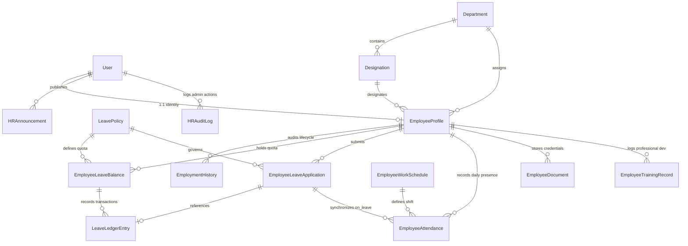

# CampusSphere AI — Part 23/24 Database Design
## Employee Master Records, Leave Policies, Double-Entry Ledger & Workforce Schemas

---

## 1. Overview & Data Philosophy

The database design for Part 23 is built upon MongoDB and Mongoose with strict normalization for institutional catalogs (`Department`, `Designation`), audited relational tracking for employee lifecycles (`EmploymentHistory`), and an immutable double-entry ledger architecture for employee leaves (`LeaveLedgerEntry`).

### Key Invariants
1. **1:1 Identity Integrity**: Every `EmployeeProfile` maintains a strict unique reference to `User._id`.
2. **Canonical Identifiers**: All entities utilize formatted, uppercase, indexed identifiers (`EMP-YYYY-XXXX`, `LV-YYYY-XXXX`, `DOC-YYYY-XXXX`, `HRA-YYYY-XXXX`, `TRN-YYYY-XXXX`, `ATT-YYYY-MMDD-XXXX`).
3. **Compound Indexes**: Unique compound indexes prevent duplicate allocations, such as `{ employee: 1, policy: 1, year: 1 }` on `EmployeeLeaveBalance` and `{ employee: 1, date: 1 }` on `EmployeeAttendance`.
4. **Decoupled Collections**: Student lecture attendance remains strictly in `Attendance.js`, while employee institutional attendance is isolated in `EmployeeAttendance.js`.

---

## 2. Entity Relationship Diagram (ERD)

---

## 3. Detailed Collection Schemas

### 3.1. `Department` (`server/models/Department.js`)
| Field | Type | Rules & Constraints | Purpose |
| :--- | :--- | :--- | :--- |
| `name` | String | Required, trim, max 100 | Department display name |
| `code` | String | Required, unique, uppercase, trim, indexed | Department identifier (e.g. `TEST-CSE`) |
| `type` | String | Enum: `['academic', 'administrative', 'operational', 'support']` | Classification |
| `description` | String | Optional, trim | Department narrative |
| `headOfDepartment` | ObjectId | Ref: `'User'`, default: null | HOD user account |
| `isActive` | Boolean | Default: `true`, indexed | Operational status |

### 3.2. `Designation` (`server/models/Designation.js`)
| Field | Type | Rules & Constraints | Purpose |
| :--- | :--- | :--- | :--- |
| `name` / `title` | String | Required, trim, max 100 | Designation title (e.g. `Associate Professor`) |
| `code` | String | Required, unique, uppercase, trim, indexed | Designation code (e.g. `TEST-ASC-PROF`) |
| `category` | String | Enum: `['teaching_faculty', 'non_teaching_staff', 'administrative_staff', ...]` | Staff classification |
| `department` | ObjectId | Ref: `'Department'`, default: null | Affiliated department |
| `reportingLevel` | Number | Default: `1`, min: 1 | Hierarchy rank for approval escalation |
| `isActive` | Boolean | Default: `true`, indexed | Active status |

### 3.3. `EmployeeProfile` (`server/models/EmployeeProfile.js`)
| Field | Type | Rules & Constraints | Purpose |
| :--- | :--- | :--- | :--- |
| `employeeId` | String | Required, unique, uppercase, trim, indexed | Canonical ID (`EMP-YYYY-XXXX`) |
| `user` | ObjectId | Ref: `'User'`, required, unique, indexed | 1:1 linked user account |
| `firstName` | String | Required, trim | Given name |
| `lastName` | String | Required, trim | Family name |
| `officialEmail` | String | Required, lowercase, trim, indexed | Official campus email |
| `personalEmail` | String | Optional, select: false (confidential) | Private personal email |
| `phone` | String | Optional, trim | Phone number |
| `emergencyContact` | Subdocument | `name`, `relationship`, `phone` | Emergency details |
| `employeeCategory` | String | Enum: `teaching_faculty`, `non_teaching_staff`, etc. | Category classification |
| `department` | ObjectId | Ref: `'Department'`, required, indexed | Primary department |
| `designation` | ObjectId | Ref: `'Designation'`, required, indexed | Primary designation |
| `employmentType` | String | Enum: `['permanent', 'probation', 'contract', 'visiting', 'part_time', 'intern']` | Contractual classification |
| `employmentStatus` | String | Enum: `['active', 'probation', 'confirmed', 'suspended', 'resigned', 'terminated']` | Lifecycle status |
| `joiningDate` | Date | Required | Official date of joining |
| `confirmationDate` | Date | Default: null | Date probation confirmed |
| `reportingManager` | ObjectId | Ref: `'User'`, default: null | Manager for leave routing |
| `workLocation` | String | Default: `'Main Campus'` | Physical office location |
| `qualifications` | Array | Degrees, institution, year | Educational background |
| `onboardingStatus` | String | Enum: `['pending', 'in_progress', 'verified', 'completed']` | HR onboarding verification |
| `separationDetails` | Subdocument | `date`, `reason`, `separationType`, `approvedBy` | Offboarding record |

### 3.4. `LeavePolicy` (`server/models/LeavePolicy.js`)
| Field | Type | Rules & Constraints | Purpose |
| :--- | :--- | :--- | :--- |
| `code` | String | Required, unique, uppercase, trim, indexed | Policy code (e.g. `TEST-CL`) |
| `name` | String | Required, trim, max 100 | Display name |
| `annualEntitlement` | Number | Required, min: 0 | Annual leave allowance |
| `applicableCategories` | Array | Enums or `'all'` | Eligible personnel categories |
| `accrualFrequency` | String | Enum: `['annual', 'monthly', 'quarterly', 'none']` | Accrual mode |
| `maxConsecutiveDays` | Number | Default: 7, min: 1 | Max continuous days per application |
| `minNoticeDays` | Number | Default: 0 | Mandatory advance notice |
| `allowHalfDay` | Boolean | Default: `true` | Half-day permission |
| `allowNegativeBalance` | Boolean | Default: `false` | Deficit leave prevention |
| `isActive` | Boolean | Default: `true`, indexed | Policy state |

### 3.5. `EmployeeLeaveBalance` (`server/models/EmployeeLeaveBalance.js`)
| Field | Type | Rules & Constraints | Purpose |
| :--- | :--- | :--- | :--- |
| `employee` | ObjectId | Ref: `'EmployeeProfile'`, required, indexed | Employee reference |
| `policy` | ObjectId | Ref: `'LeavePolicy'`, required, indexed | Leave policy reference |
| `leaveCode` | String | Uppercase, trim, indexed | Short code (`CL`, `SL`) |
| `year` | Number | Required, indexed | Calendar / Academic year |
| `openingBalance` | Number | Default: 0, min: 0 | Grant at start of year |
| `accrued` | Number | Default: 0, min: 0 | Mid-year accruals |
| `used` | Number | Default: 0, min: 0 | Consumed leave days |
| `adjusted` | Number | Default: 0 | Manual adjustments |
| `currentBalance` | Number | Computed: `opening + accrued - used + adjusted` | Available leave balance |
*Compound Unique Index*: `{ employee: 1, policy: 1, year: 1 }`

### 3.6. `LeaveLedgerEntry` (`server/models/LeaveLedgerEntry.js`)
| Field | Type | Rules & Constraints | Purpose |
| :--- | :--- | :--- | :--- |
| `entryNumber` | String | Required, unique, uppercase, indexed | Transaction ID (`LED-YYYY-XXXX`) |
| `employee` | ObjectId | Ref: `'EmployeeProfile'`, required, indexed | Beneficiary |
| `policy` | ObjectId | Ref: `'LeavePolicy'`, indexed | Leave policy reference |
| `leaveCode` | String | Uppercase, trim | Code snapshot |
| `year` | Number | Required | Year of quota |
| `type` | String | Enum: `['opening_balance', 'CREDIT', 'DEBIT', 'manual_adjustment', ...]` | Debit / Credit indicator |
| `reason` | String | Required, trim | Mandatory audit justification |
| `days` | Number | Required, positive | Number of days transacted |
| `previousBalance` | Number | Required | Balance before transaction |
| `newBalance` | Number | Required | Balance after transaction |
| `referenceApplication` | ObjectId | Ref: `'EmployeeLeaveApplication'`, default: null | Linked requisition |
| `performedBy` | ObjectId | Ref: `'User'`, required | Actor initiating mutation |

### 3.7. `EmployeeAttendance` (`server/models/EmployeeAttendance.js`)
| Field | Type | Rules & Constraints | Purpose |
| :--- | :--- | :--- | :--- |
| `attendanceNumber` | String | Unique, uppercase, indexed | Attendance ID (`ATT-YYYY-MMDD-XXXX`) |
| `employee` | ObjectId | Ref: `'EmployeeProfile'`, required, indexed | Employee record |
| `user` | ObjectId | Ref: `'User'`, indexed | Linked user account |
| `date` | String | Required, match: `YYYY-MM-DD`, indexed | Calendar day string |
| `checkInTime` / `checkIn` | Date | Default: null | Daily check-in timestamp |
| `checkOutTime` / `checkOut` | Date | Default: null | Daily check-out timestamp |
| `status` | String | Enum: `['present', 'absent', 'late', 'half_day', 'on_leave', ...]` | Status for the day |
| `workingHours` / `hoursWorked` | Number | Default: 0 | Effective hours worked |
| `approvedLeave` | ObjectId | Ref: `'EmployeeLeaveApplication'`, default: null | Synchronized leave record |
| `isCorrected` | Boolean | Default: false | Administrative correction flag |
| `correctionHistory` | Array | Previous status, new status, reason, correctedBy, correctedAt | Correction audit trail |
*Compound Unique Index*: `{ employee: 1, date: 1 }`
