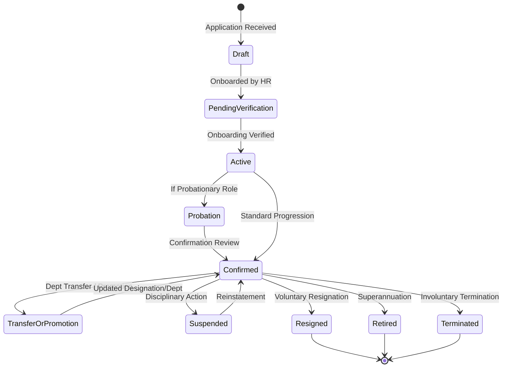

# CampusSphere AI — Part 23/24 Employee Onboarding & Lifecycle Management
## Institutional Staff Lifecycle: Recruitment, Onboarding, Probation, Transfer & Offboarding

---

## 1. Lifecycle Overview

The Institutional HR subsystem governs the full chronological lifecycle of institutional employees across teaching, administrative, technical, and support categories.

---

## 2. Onboarding Workflow & Identity Linking

### 2.1. Zero Duplicate Identity with Existing Faculty
When an employee record is created for an existing academic faculty member (`Faculty.js`):
1. The HR officer inputs or looks up the faculty member's existing email or `employeeId`.
2. The subsystem links to the existing `User` account (`User._id`).
3. An `EmployeeProfile` is established referencing that existing `User`, ensuring a single set of login credentials and unified permissions across the ERP.

### 2.2. New Non-Teaching Staff Onboarding
When onboarding a new staff member without a pre-existing ERP account:
1. HR administrator provides personal details, department, designation, and official email.
2. The controller automatically provisions an authenticated `User` account with a secure default hashed password (`Campus@123`) and sets `mustChangePassword: true`.
3. An employee ID is sequentially generated (`EMP-YYYY-XXXX`) and bound to the profile.
4. Annual leave balances for the current year are immediately initialized across all active leave policies applicable to the employee's category.
5. An initial `EmploymentHistory` entry with `changeType: 'onboarding'` is committed.

---

## 3. Probation & Confirmation Management

Institutions commonly evaluate new personnel during a 6-month or 1-year probation period.
- **Probationary Tagging**: Onboarded staff with `employmentType: 'probation'` are flagged in the HR directory and executive KPI cards.
- **Confirmation Review**: Authorized HR Admins review performance and trigger confirmation via `PATCH /api/hr/employees/:id/confirm-probation`.
- **Audit Logging**: Upon confirmation, `employmentStatus` transitions to `'confirmed'`, `confirmationDate` is stamped with the current timestamp, and an immutable `EmploymentHistory` record is generated.

---

## 4. Transfers & Promotions

Departmental reorganizations and faculty promotions are handled via `PATCH /api/hr/employees/:id/transfer`:
- **Department Reassignment**: Updates `employee.department` to the destination academic or administrative unit.
- **Designation Promotion**: Updates `employee.designation` and adjusts the hierarchy reporting level.
- **Manager Update**: Reassigns `reportingManager` for subsequent leave approval routing.
- **Audit Trail**: Writes an `EmploymentHistory` entry capturing:
  - `changeType`: `'transfer'` or `'promotion'`
  - `previousValue`: Formatted snapshot of previous department and designation
  - `newValue`: Formatted snapshot of new department and designation
  - `reason`: Mandatory institutional reorganization justification
  - `authorizedBy`: Authenticated HR administrator User ID.

---

## 5. Employee Separation & Offboarding

Offboarding transitions (`resigned`, `retired`, `terminated`) follow strict governance:
- **Separation Endpoint**: `PATCH /api/hr/employees/:id/separate` requires `separationType` and `reason`.
- **Status Mutation**: Updates `employee.employmentStatus` to the terminal state and sets `separationDetails` (`date`, `reason`, `separationType`, `approvedBy`).
- **Employment History**: Records `changeType: 'separation'` or specific terminal change type.
- **Access Revocation**: User account status is updated to prevent further administrative actions.
