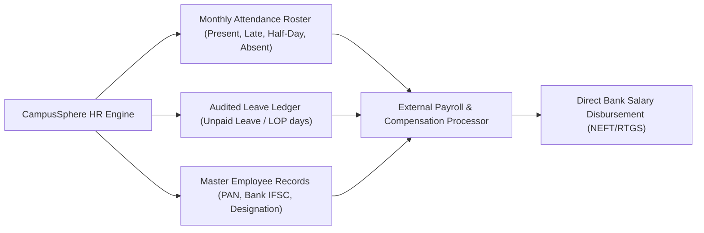

# CampusSphere AI — Part 23/24 Finance & Payroll Domain Boundary
## Architectural Boundaries, Payroll Interface Specifications & Data Protection Invariants

---

## 1. Domain Separation Invariant

A fundamental architectural mandate for Part 23 is maintaining a strict, non-negotiable boundary between:
1. **Institutional HR & Employee Records** (`/api/hr`, `EmployeeProfile.js`, `LeaveLedgerEntry.js`, `EmployeeAttendance.js`).
2. **Student Fees, Invoices & Institutional Finance** (`/api/fees`, `FeeStructure.js`, `StudentFeeInvoice.js`, `FeeTransaction.js`).
3. **Future Institutional Payroll & Compensation** (External ERP / Banking Gateway).

### Architectural Rules
- **No Mock Salary Tables**: The HR subsystem does NOT invent mock payroll tables, fake payslips, or fictional salary disbursements.
- **Zero Ledger Cross-Pollination**: Employee leave deductions, allowances, and attendance calculations NEVER write to or mutate student fee invoices, student fee structures, or student transaction tables.
- **Protected Integers**: Any future institutional compensation or allowance models must use integer-paise representation ($1\text{ INR} = 100\text{ paise}$) following the standard financial precision patterns established in Part 16 and Part 22.

---

## 2. Payroll Export Interface Specification

When an institution integrates CampusSphere AI with an external payroll processing engine (e.g. SAP HCM, Workday, Tally Prime, or an authorized direct bank disbursement gateway), the HR subsystem provides clean, audited feeds:

### Monthly Payroll Inputs Generated by HR Subsystem:
1. **Loss of Pay (LOP) Days**: Calculated directly from approved unpaid leave records or unexcused absence counts from `EmployeeAttendance` where `status: 'absent'`.
2. **Working Days Count**: Total days minus institutional holidays and approved paid leave quotas (`on_leave`).
3. **Employee Status Verification**: Filtering active and confirmed employees while excluding separated or suspended personnel.

---

## 3. Financial Integrity Compliance

All exportable reports and ledger entries strictly implement:
- **Immutable Historical Audits**: No retro-active deletion of past attendance or leave transactions.
- **CWE-1236 Defense**: All exported salary inputs and personnel spreadsheets neutralize formula injections.
- **Audit Trails**: All balance adjustments, compensation modifications, and designations changes are captured with actor IDs and timestamps in `HRAuditLog` and `EmploymentHistory`.

