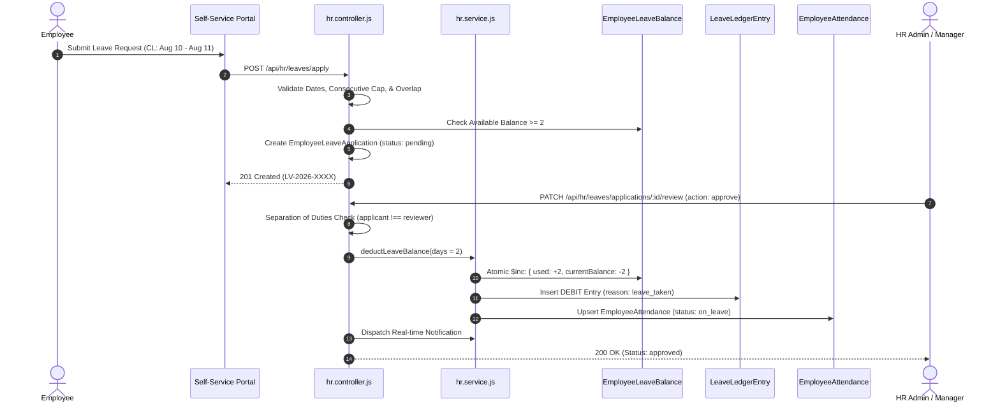

# CampusSphere AI — Part 23/24 Architecture Document
## Institutional HR, Employee Records, Leave & Workforce Management Subsystem

---

## 1. Executive Summary & Purpose

The **Institutional HR & Workforce Management Subsystem** represents Module 23 of the CampusSphere AI Enterprise Resource Planning (ERP) platform. Designed for higher education institutions, university colleges, and polytechnics, this subsystem unifies personnel records across all faculty ranks and non-teaching categories while providing an auditable, self-service leave and attendance portal.

### Core Objectives
1. **Single Source of Truth for Workforce Data**: Centralize teaching faculty, administrative staff, technical personnel, and contract workers into a canonical employee registry (`EmployeeProfile`) linked 1:1 to authenticated `User` accounts.
2. **Zero Duplicate Identities**: Eliminate redundant identities across previously built modules. Faculty profiles (`Faculty.js`) and HR employee profiles (`EmployeeProfile.js`) share the same `User._id` and institutional `employeeId`.
3. **Audited Double-Entry Leave Balance Ledger**: Prevent untracked or balance-tampering mutations by recording every grant, accrual, debit, and cancellation as an immutable transaction in `LeaveLedgerEntry`.
4. **Separation of Duties in Requisition & Approvals**: Multi-tier leave workflows enforce structural separation of duties: an applicant can never approve their own leave requisition.
5. **Decoupled Employee Attendance Architecture**: Maintain complete architectural separation between student lecture attendance and daily employee workforce check-in/out, while automatically synchronizing approved leaves to prevent erroneous absence marking.
6. **Strict Finance & Payroll Boundary**: Enforce explicit domain boundaries protecting student financial ledgers from premature or mock salary entries.

---

## 2. High-Level Architecture & Layer Breakdown

```mermaid
flowchart TD
    subgraph ClientLayer ["Client Layer (React 19 + Tailwind CSS)"]
        AdminDesk["Admin HR Desk (/admin/hr)"]
        SelfService["Faculty & Employee Portal (/faculty/hr, /employee/self-service)"]
        SidebarNav["Dynamic Role-Based Sidebar Navigation"]
    end

    subgraph SecurityLayer ["Security & Authorization Layer"]
        AuthMid["JWT Auth Middleware (campus_token / Bearer)"]
        RBAC["allowRoles Middleware (admin, hr_admin, hr_officer, dept_head, faculty, employee)"]
        StudentBlock["Strict Student Access Denial (403 Forbidden)"]
        TraversalDefense["Path Traversal Defense (path.resolve + basename)"]
        CWE1236["CWE-1236 Formula Injection Sanitizer"]
    end

    subgraph ControllerLayer ["API & Controller Layer (/api/hr)"]
        HRCtrl["hr.controller.js"]
        DeptDesigAPI["Department & Designation APIs"]
        EmpDirAPI["Employee Directory & Lifecycle APIs"]
        LeaveAPI["Leave Policy & Approval APIs"]
        AttAPI["Employee Daily Attendance APIs"]
        DocAPI["Document Vault APIs"]
        ExportAPI["Sanitized CSV Export APIs"]
    end

    subgraph ServiceLayer ["Domain Services & Business Engine"]
        HRService["hr.service.js"]
        LeaveLedger["Double-Entry Leave Ledger Engine"]
        AttSync["Leave-Attendance Synchronizer"]
        AuditLogSvc["HR Audit Logger (HRAuditLog)"]
        NotifSvc["Centralized SSE Notification Service"]
    end

    subgraph DatabaseLayer ["Database Layer (MongoDB + Mongoose)"]
        UserM["User"]
        EmpM["EmployeeProfile"]
        DeptM["Department"]
        DesigM["Designation"]
        HistM["EmploymentHistory"]
        PolM["LeavePolicy"]
        BalM["EmployeeLeaveBalance"]
        LedgerM["LeaveLedgerEntry"]
        AppM["EmployeeLeaveApplication"]
        SchedM["EmployeeWorkSchedule"]
        EmpAttM["EmployeeAttendance"]
        DocM["EmployeeDocument"]
        AnnM["HRAnnouncement"]
        TrnM["EmployeeTrainingRecord"]
        AuditM["HRAuditLog"]
    end

    ClientLayer --> SecurityLayer
    SecurityLayer --> ControllerLayer
    ControllerLayer --> ServiceLayer
    ServiceLayer --> DatabaseLayer
```

---

## 3. Subsystem Domains & Data Flow

### 3.1. Unified Employee Master Directory
- **Identity Unification**: Authenticated `User` accounts hold login credentials (`email`, `passwordHash`, `role`). `EmployeeProfile` encapsulates organizational context: `department`, `designation`, `employeeCategory`, `employmentStatus`, `joiningDate`, `reportingManager`.
- **Confidential Field Protection**: Highly confidential fields (such as personal email, private phone, emergency contact details) are protected by schema-level `select: false` or controller projection filters, accessible only to HR administrators and the profile owner.

### 3.2. Leave Entitlement & Double-Entry Ledger

### 3.3. Daily Attendance Synchronization
- **Decoupled Architecture**: Employee attendance is stored in `EmployeeAttendance`, completely separate from the student lecture attendance table `Attendance`.
- **Automatic Leave Sync**: When a leave application is approved, the service immediately generates or updates attendance roster entries for the exact date range with `status: 'on_leave'`, referencing the leave application. If an employee cancels or HR revokes the leave, the attendance is cleanly reverted.

---

## 4. Architectural Boundaries & Cross-Cutting Constraints

| Dimension | Architectural Boundary & Implementation |
| :--- | :--- |
| **Authentication** | JWT-based auth via HTTP-only cookie (`campus_token`) or `Authorization: Bearer <token>`. |
| **Authorization (RBAC)** | Six authorized staff roles: `admin`, `hr_admin`, `hr_officer`, `department_head`, `faculty`, `employee`. Students are unconditionally rejected with `HTTP 403 Forbidden`. |
| **Separation of Duties** | Hard business rule enforced in controller: An applicant attempting to approve their own requisition triggers `403 Forbidden: Separation of duties violation`. |
| **Storage Security** | Multer disk storage restricted to `server/uploads/hr`. File names are sanitized (`path.basename`), and downloads verify absolute path boundaries preventing directory traversal (`../`). |
| **Export Security** | All CSV exports pass through formula injection sanitizer neutralizing `=`, `+`, `-`, `@`, `\t`, `\r` per OWASP CWE-1236. |
| **Payroll Boundary** | Complete structural isolation: no mock payslips, no salary calculations, no mutations on student fee accounts. |

