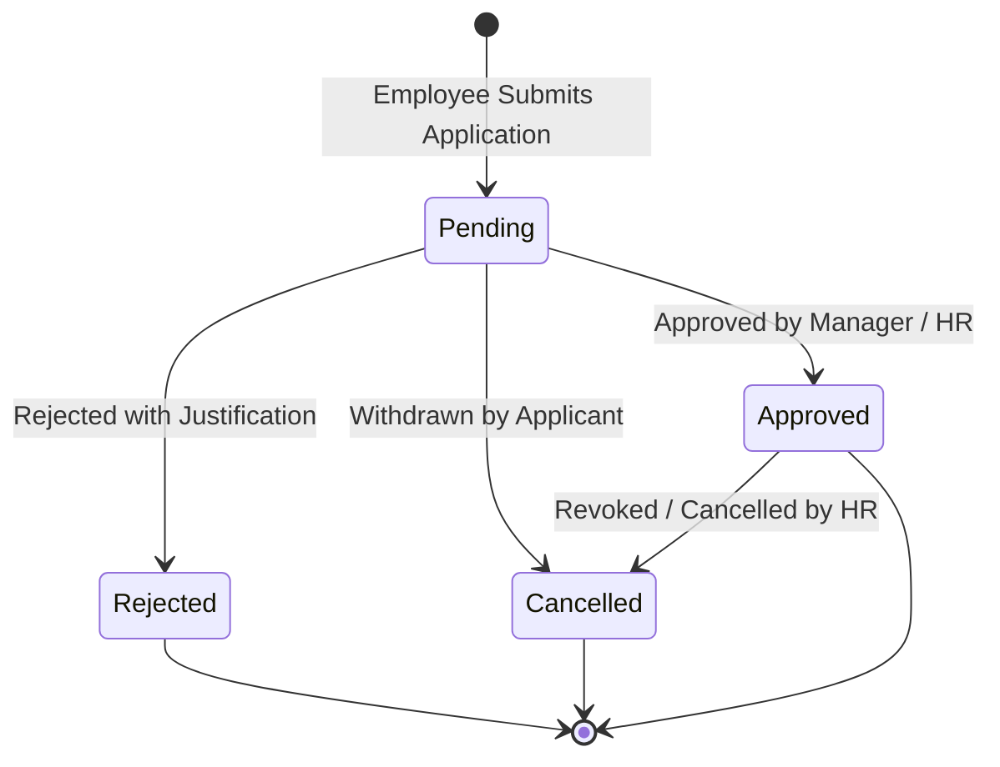

# CampusSphere AI — Part 23/24 Leave Approval Workflow
## Requisition Processing, Multi-Tier Routing & Strict Separation of Duties

---

## 1. Overview & Requisition Lifecycle

The Leave Approval Workflow governs how employee leave requests transition from submission to final resolution (approval, rejection, or cancellation), ensuring proper review while preventing procedural conflicts of interest.



---

## 2. Requisition Submission & Pre-Flight Validation

When an employee submits a leave request via `POST /api/hr/leaves/apply`:
1. **Date Validity Check**: Validates that `startDate <= endDate`. If `startDate > endDate`, rejects with `400 Bad Request`.
2. **Duration Calculation**: Computes working days. Supports half-day applications (0.5 days).
3. **Consecutive Days Cap**: Checks `totalDays <= policy.maxConsecutiveDays`. If exceeded, rejects with `400 Bad Request`.
4. **Quota Availability**: Queries `EmployeeLeaveBalance` for the target year. If `policy.allowNegativeBalance` is false and `currentBalance < totalDays`, rejects with `400 Bad Request: Insufficient leave balance`.
5. **Collision Detection**: Queries existing applications for the employee in `pending` or `approved` status overlapping the requested date range. If an overlap is detected, rejects with `400 Bad Request`.
6. **Requisition Creation**: Generates unique application number (`LV-YYYY-XXXX`) and saves with `status: 'pending'`. Dispatches notification to the designated reporting manager or department head.

---

## 3. Strict Separation of Duties (Self-Approval Defense)

### 3.1. The Conflict of Interest Vulnerability
In academic institutions, senior faculty members, Department Heads, and Deans may possess review and approval roles (`faculty`, `department_head`, `admin`). If a Department Head submits a personal Casual Leave application, allowing them to review and approve their own request represents a severe breach of internal controls and separation of duties.

### 3.2. Implementation & Enforcement
The controller enforces this invariant at the route handling layer before any status transition or ledger mutation can occur:

```javascript
// Separation of Duties Verification
if (application.employee.user.toString() === reviewerUserId.toString()) {
  return res.status(403).json({
    success: false,
    message: 'Separation of duties violation: You cannot approve or review your own leave application'
  });
}
```
Any attempt by an employee to review or approve their own requisition triggers an immediate `HTTP 403 Forbidden` response and generates an administrative alert.

---

## 4. Multi-Tier Review Actions

### 4.1. Approval Flow
When reviewed and approved by an authorized manager (`hr_admin`, `hr_officer`, `department_head`):
1. **Balance Deduction**: Calls `hrService.deductLeaveBalance`, executing an atomic decrement on `EmployeeLeaveBalance` and inserting a `DEBIT` ledger record in `LeaveLedgerEntry`.
2. **Attendance Synchronization**: Calls `hrService.syncApprovedLeaveAttendance`, generating daily `EmployeeAttendance` records marked `status: 'on_leave'` for every day of the approved duration.
3. **Audit Log & Notification**: Appends approval details to `approvalWorkflow`, logs `LEAVE_APPLICATION_APPROVED` in `HRAuditLog`, and sends real-time SSE notification to the applicant.

### 4.2. Rejection Flow
When rejected:
1. **Mandatory Justification**: Rejection requires a detailed reason (`rejectionReason`). Applications without justification are rejected with `400 Bad Request`.
2. **State Transition**: Sets `status: 'rejected'` and appends rejection record to `approvalWorkflow`.
3. **Notification**: Emits high-priority notification to the applicant containing the formal rejection reason.

### 4.3. Cancellation & Refund Flow
If an approved leave is subsequently cancelled by the applicant or revoked by HR:
1. Calls `hrService.refundLeaveBalance`, creating a `CREDIT` ledger entry (`reason: 'cancellation_refund'`) and incrementing available balance.
2. Calls `hrService.revertApprovedLeaveAttendance`, clearing the approved leave assignment from the employee's attendance roster.
3. Sets application status to `'cancelled'`.
