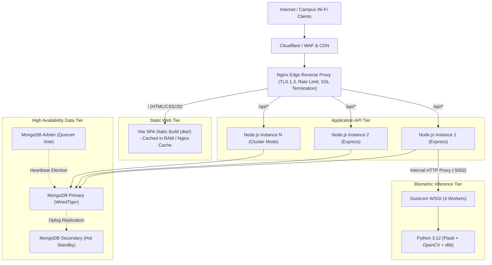

# CampusSphere AI — Deployment Architecture Guide
## Part 24/24 Enterprise Production Topology, High Availability & Scaling

---

## 1. Executive Summary

CampusSphere AI is designed for robust on-premises campus datacenter hosting or multi-cloud virtualization (AWS, GCP, Azure, DigitalOcean). The architecture decouples the responsive Single-Page Application (SPA) frontend, the high-throughput Node.js asynchronous API gateway, the Python AI biometric inference microservice, and the distributed MongoDB data store.

---

## 2. Production Topology Architecture



---

## 3. Tier Specifications & Configuration

### 1. Nginx Edge Reverse Proxy
- **TLS Termination**: Enforces TLS 1.3, HSTS (`max-age=31536000; includeSubDomains; preload`).
- **SSE Stream Configuration**: Buffering is explicitly turned off for `/api/notifications/stream` to preserve real-time push:
  ```nginx
  location /api/notifications/stream {
      proxy_pass http://localhost:5001;
      proxy_http_version 1.1;
      proxy_set_header Connection '';
      proxy_buffering off;
      proxy_cache off;
      proxy_read_timeout 86400s;
  }
  ```
- **Static Asset Caching**: Hashed JS/CSS chunks cached for 1 year (`Cache-Control: public, max-age=31536000, immutable`). `index.html` configured with `no-cache` to ensure instant cache invalidation on deployment.

### 2. Node.js API Cluster (PM2)
- Managed via PM2 Process Manager in cluster mode matching available CPU cores:
  ```bash
  pm2 start server.js -i max --name "campussphere-api" --max-memory-restart 500M
  ```
- Graceful shutdown intercepts `SIGTERM` and `SIGINT`, draining active database transactions before exiting.

### 3. Python AI Biometric Microservice
- Served via Gunicorn with Meinheld or sync workers:
  ```bash
  gunicorn --workers 4 --bind 127.0.0.1:5002 --timeout 120 app:app
  ```
- Isolated on internal loopback network (`127.0.0.1:5002`), inaccessible directly from public internet. All traffic routed through authenticated Node.js proxy endpoints.

### 4. MongoDB Replica Set (High Availability)
- Configured as a 3-node Replica Set (`rs0`):
  - 1 Primary read/write node.
  - 1 Secondary hot standby replica replicating oplog.
  - 1 Arbiter node voting during failover elections.
- Automatic failover promotes secondary to primary in $< 5\text{ seconds}$ if primary hardware fails.

---

## 4. Hardware Sizing Recommendations

| Institutional Scale | Concurrent Users | Recommended Gateway Specs | Database Cluster Specs | AI Service Specs |
| :--- | :---: | :---: | :---: | :---: |
| **Small College** (< 2,000 students) | 250 | 2 vCPU, 4 GB RAM | 2 vCPU, 8 GB RAM, SSD | 2 vCPU, 4 GB RAM |
| **Midsize University** (2,000–10,000) | 1,500 | 4 vCPU, 8 GB RAM (x2) | 4 vCPU, 16 GB RAM (Replica Set) | 4 vCPU, 8 GB RAM |
| **Major University** (> 10,000 students)| 5,000+ | 8 vCPU, 16 GB RAM (x4) | 8 vCPU, 32 GB RAM, NVMe SSD | 8 vCPU, 16 GB RAM (GPU-enabled)|

---

## 5. Deployment Guide Verdict

- **Single Point of Failure (SPOF)**: Eliminated via clustering and replica sets.
- **Microservice Isolation**: Python AI strictly walled behind authenticated API proxy.
- **Status**: **READY FOR ENTERPRISE DEPLOYMENT**
