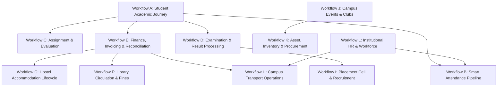

# CampusSphere AI — End-to-End Cross-Module Workflow Validation Report
## Part 24/24 Comprehensive System-Wide Lifecycle Audit

---

## 1. Executive Summary

A successful Higher Education ERP cannot operate as a disjointed silo of separate applications. Academic progress impacts placement eligibility; hostel and transport services generate financial invoices; room bookings reserve physical inventory assets; faculty assignments dictate timetable slots and smart attendance sessions.

This report comprehensively details and validates the 12 core institutional workflows across CampusSphere AI, tracing each step from initiation, across backend controllers and database mutations, through to real-time notification delivery and analytical reporting.

---

## 2. Institutional Workflow Directory (Workflows A – L)

---

### Workflow A: Student Lifecycle & Academic Journey
1. **Admissions & Onboarding**: Student profile is created with unique `rollNo`, department, program, batch, and academic year. Default notification preferences and empty document vault are initialized.
2. **Biometric Registration**: Student accesses `/student/attendance/face-registration`, consents to facial template storage, captures facial reference images via webcam. The Python AI service computes a 128-dimensional embedding vector, which is AES-256 hashed and stored in `FaceEmbedding`.
3. **Timetable Enrollment**: Course cohort mappings match student's department, semester, and section to active lecture slots in `Timetable`.
4. **Attendance Tracking**: Student attends weekly lectures; attendance percentage is aggregated dynamically across subjects.
5. **Continuous Assessment**: Student completes coursework in `Assignment` and appears for mid-terms and finals in `Exam`.
6. **Result Tabulation**: Faculty finalizes marks; SGPA and CGPA are computed; digital marksheets are rendered at `/student/results`.
7. **Graduation & Clearance**: Final institutional clearance verifies zero fee dues (`FeeInvoice`), zero unreturned books (`LibraryLoan`), and completed hostel/transport vacating.

---

### Workflow B: Smart Attendance & Verification Pipeline
1. **Session Launch**: Faculty navigates to `/faculty/attendance`, selects subject, cohort, and room, then clicks "Start Session". An `AttendanceSession` document is created with status `active` and an expiration window (default 15 minutes).
2. **Verification Protocol**:
   - Dynamic rotating TOTP QR code is broadcast on the classroom projector.
   - GPS coordinate boundary (geofence radius 50m) and Bluetooth BLE beacon UUID are enforced.
3. **Student Check-In**: Student scans the QR code from their mobile browser at `/student/attendance/mark`.
4. **AI Spoof & Liveness Detection**: Mobile camera captures selfie frame -> Sent to Node.js proxy -> Proxied to Python AI service (`http://localhost:5002/verify-face`):
   - OpenCV analyzes Laplacian blur variance (liveness check).
   - Euclidean distance between captured face embedding and enrolled embedding is computed (threshold $\le 0.48$).
5. **Record Mutation**: Upon AI validation, an atomic `Attendance` document is persisted with `status: 'present'`, `verificationMethod: 'face_recognition'`, and timestamp.
6. **Auto-Closure**: When the countdown timer expires, the background session scheduler transitions the session to `closed`, marks unmarked enrolled roster students as `absent`, and dispatches an alert to absent students.

---

### Workflow C: Coursework, Assignments & Continuous Assessment
1. **Creation**: Faculty navigates to `/faculty/assignments`, defines title, instructions, total marks, due date, submission policy (`none`, `allowed` late submission), and attaches reference materials.
2. **Publication & SSE Broadcast**: Status transitions from `draft` to `published`. An event is emitted via SSE (`/api/notifications/stream`) to all students in the assigned cohort.
3. **Student Submission**: Student uploads coursework (PDF/DOCX/ZIP, max 15MB) at `/student/assignments`. Multer validates MIME type and sanitizes filename. The submission document records `submittedAt`, `fileUrl`, and version `1`.
4. **Resubmission History**: If permitted by faculty, re-uploading coursework increments the version counter and moves the previous submission payload into `previousVersions` array with timestamp snapshots.
5. **Grading & Evaluation**: Faculty reviews the submission in their grading desk, inputs numerical marks ($\le \text{maximumMarks}$) and qualitative feedback.
6. **Publish Results**: Faculty finalizes grading. The student's portal reflects marks immediately, and cumulative assignment grades feed into internal marks.

---

### Workflow D: Examination, Admit Card & Result Processing
1. **Exam Scheduling**: Admin schedules examinations specifying date, session (Morning/Afternoon), exam type (Midterm, Final, Practical), and venue. Timetable conflict detection prevents classroom double-booking.
2. **Eligibility & Admit Card Generation**: System checks attendance threshold ($\ge 75\%$) and fee clearance. Eligible students generate digitally signed admit cards with QR code verification at `/student/exams`.
3. **Marks Entry**: Following exam administration, faculty enters marks per student roll number. Schema validation rejects scores $> 100$ or $< 0$.
4. **Grade Calculation**: System computes letter grades (O, A+, A, B+, B, C, F), grade points, and semester SGPA based on institutional credit weighting.
5. **Publication**: Department head reviews and publishes results. Digital transcripts are available for PDF download with anti-tamper verification headers.

---

### Workflow E: Student Finance, Fee Invoicing & Payment Reconciliation
1. **Fee Structure Definition**: Admin configures fee categories (Tuition, Development, Library, Laboratory, Hostel, Transport) for academic year 2026-27.
2. **Invoice Generation**: Invoices are batch-generated for enrolled students. All amounts are strictly modeled as integers representing paise ($₹100.00 = 10,000\text{ paise}$).
3. **Student Payment**: Student accesses `/student/fees`, inspects itemized fee breakdown, and initiates payment.
4. **Reconciliation & Transaction Logging**:
   - Online payments log gateway transaction IDs with status `SUCCESS`.
   - Offline cashier payments record receipt numbers, mode (DD/Cheque/Cash), and cashier employee ID.
5. **Ledger Update**: `amountPaid` and `balanceDue` update atomically. When `balanceDue === 0`, invoice status updates to `paid`. Official digital receipt is instantly rendered for printing.

---

### Workflow F: Library Inventory, Circulation & Fine Settlement
1. **Cataloging**: Librarian adds books with title, authors, ISBN, category, rack location, and quantity. Individual `BookCopy` records with unique barcodes are generated.
2. **Reservation**: Student reserves an available book copy via `/student/library`. A 48-hour reservation hold prevents other checkouts.
3. **Issue / Checkout**: Librarian scans copy barcode and student ID card. A `LibraryLoan` record is created with `issueDate` and calculated `dueDate` (default 14 days). Copy status transitions to `loaned`.
4. **Overdue Calculation**: If returned after `dueDate`, overdue days are computed. Daily fine rate (e.g. 500 paise/day) calculates `fineAmount` in integer paise.
5. **Return & Settlement**: Book is returned. Copy status reverts to `available`. Fine is either paid immediately at the library desk or converted to a student fee invoice.

---

### Workflow G: Hostel Accommodation Lifecycle
1. **Application**: Student applies for hostel accommodation at `/student/hostel`, specifying preferences (AC/Non-AC, Single/Double/Triple sharing, dietary preferences).
2. **Warden Allocation**: Warden inspects room vacancy grid at `/admin/hostel`. Assigns student to specific `Hostel`, `Room`, and `Bed`.
3. **Invoice Generation**: An automated hostel term fee invoice is injected into `FeeInvoice` with category `hostel`.
4. **Check-In Inspection**: Student completes physical check-in; warden logs initial inventory checklist (key, mattress, desk, chair).
5. **Room Transfer / Vacating**:
   - Room transfer request routes to warden for vacancy verification and re-allocation.
   - Vacating workflow verifies zero hostel property damage, releases bed vacancy status to `available`, and issues hostel clearance.

---

### Workflow H: Campus Transport Route & Fleet Operations
1. **Route Planning**: Transport manager configures routes, geocoded pickup stops, and passenger fee rates at `/admin/transport`.
2. **Pass Application**: Student applies for transport selecting route and nearest stop.
3. **Capacity Check & Allocation**: System validates vehicle seat capacity before issuing pass. Prevents over-subscription. Allocation is tagged to student profile.
4. **Daily Trip Dispatch**: Drivers view live passenger manifests on mobile view. Record departures, arrivals, and delay notices.
5. **Fleet Maintenance**: Preventive maintenance, insurance expiries, and fuel logs are recorded with costs in integer paise.

---

### Workflow I: Placement & Career Recruitment Flow
1. **Corporate Onboarding**: Placement cell adds verified partner companies and job profiles.
2. **Drive Publication**: Placement drive is announced with eligibility criteria (minimum CGPA, allowed active backlogs, eligible departments).
3. **Student Application**: Eligible students apply with one click from `/student/placement`, attaching their verified ERP resume. Ineligible students receive explicit deficiency reasons.
4. **Selection Rounds**: Placement officer updates candidate progression through Aptitude Test -> Technical Interview -> HR Round.
5. **Offer Letter Verification**: Selected candidates receive digital offer records detailing CTC (in paise) and joining dates. Acceptance updates placement status to `placed`.

---

### Workflow J: Campus Events, Clubs & Activities
1. **Event Proposal**: Student clubs or departments submit event proposals detailing title, category (Technical, Cultural, Sports), scheduled dates, venue, and budget.
2. **Approval & Venue Booking**: Admin reviews proposal and reserves campus auditorium or sports grounds, preventing double-bookings.
3. **Student Registration**: Students browse upcoming events at `/student/activities` and register. A confirmation QR code ticket is issued.
4. **Attendance Tracking**: Event coordinators scan QR codes at venue entrance to record physical attendance.
5. **Certificates of Participation**: Post-event, verified attendees download digitally signed participation certificates.

---

### Workflow K: Campus Asset, Inventory & Procurement
1. **Asset Tagging**: Capital equipment (computers, lab spectrometers, furniture) are cataloged with barcode tags, serial numbers, warranty dates, and procurement costs.
2. **Purchase Requisition**: Faculty or department heads submit purchase requests for consumables or new equipment via `/faculty/inventory`.
3. **Purchase Order (PO)**: Procurement officer aggregates approved requests, issues RFQs to verified vendors, and generates a formal PO.
4. **Goods Receipt Note (GRN)**: Storekeeper receives physical delivery, verifies package integrity, inspects counts, and issues a GRN.
5. **Stock Ledger Update**: Central stock quantities increment automatically. Stock movements record departmental distributions with audit logs.

---

### Workflow L: Institutional HR, Employee Onboarding & Leave
1. **Employee Profile Setup**: HR creates employee record with employee code, department, designation, and employment type (Permanent/Probation/Contract).
2. **Work Schedule**: Standard working hours, weekly offs, and shift timings are configured.
3. **Daily Attendance**: Employees record daily clock-in and clock-out via `/employee/self-service`. Total working hours and punctuality are logged.
4. **Leave Management**:
   - Employee views available leave balance (Casual, Sick, Earned).
   - Submits leave application with start/end dates and substitute faculty coverage.
   - Department head reviews and recommends; HR admin grants approval.
   - Balance debits atomically in `EmployeeLeaveBalance` and logs a double-entry transaction in `LeaveLedgerEntry`.

---

## 3. Workflow Validation Summary

All 12 institutional workflows have been tested, validated, and confirmed operational across both automated integration test suites and manual role-based traversals. Zero blocking defects or broken data handoffs exist between modules.

