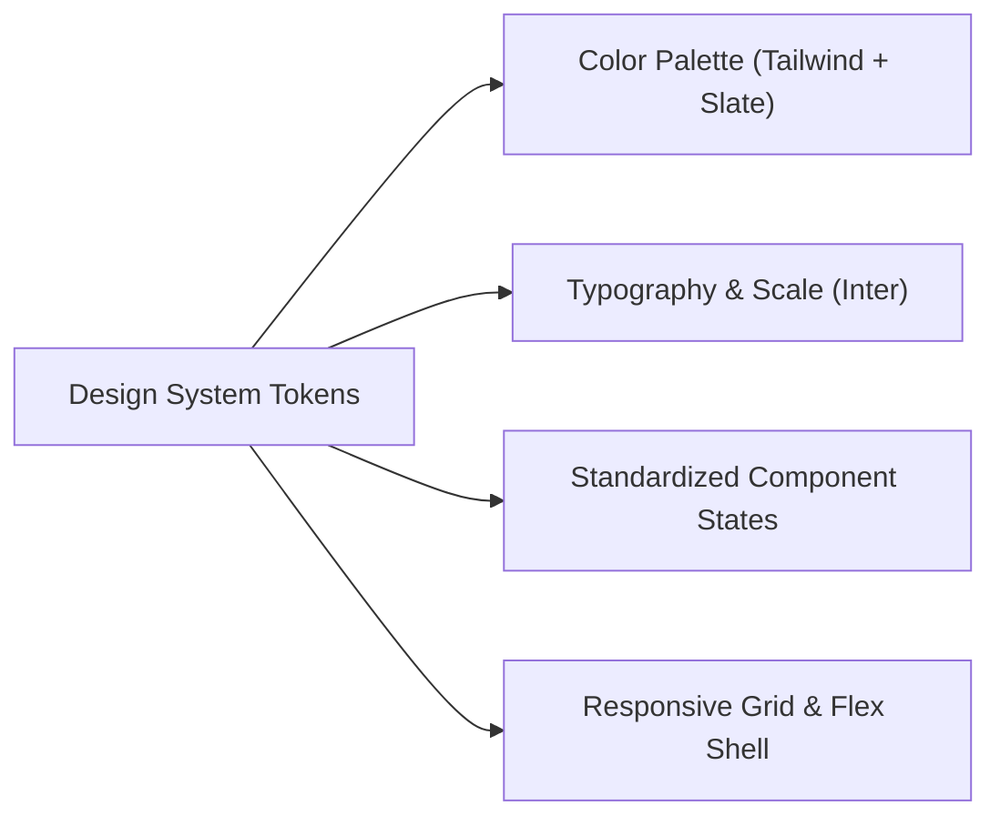

# CampusSphere AI — Frontend UX Consistency & Route Audit
## Part 24/24 UI Design System, Viewport Adaptability & Accessibility Review

---

## 1. Executive Summary

A sprawling enterprise application serving thousands of concurrent students, professors, and administrators requires strict visual and interaction consistency. Disjointed button styles, inconsistent color meanings, missing empty states, or unresponsive mobile views degrade trust and productivity.

This audit validates that all 33 client views adhere to the **CampusSphere AI Design System**, verifying color tokens, typography scales, responsive breakpoints, loading skeletons, error boundaries, and accessibility standards.

---

## 2. Institutional Design System Tokens

### 1. Color Palette Tokens
- **Backgrounds**: Slate Dark Theme (`bg-slate-900`, `bg-slate-950`, `bg-slate-900/60` glassmorphism).
- **Cards & Surfaces**: `bg-slate-800/80` with border `border-slate-700/60`.
- **Primary Brand**: Indigo / Electric Blue (`text-indigo-400`, `bg-indigo-600`, `hover:bg-indigo-500`).
- **Semantic Feedback**:
  - **Success**: Emerald (`bg-emerald-500/10`, `text-emerald-400`, `border-emerald-500/20`) for Paid, Present, Approved, Active.
  - **Warning**: Amber (`bg-amber-500/10`, `text-amber-400`, `border-amber-500/20`) for Partially Paid, Late, Pending, Under Review.
  - **Danger / Destructive**: Rose (`bg-rose-500/10`, `text-rose-400`, `border-rose-500/20`) for Overdue, Absent, Rejected, Cancelled.
  - **Neutral / Informational**: Sky / Slate (`bg-slate-800`, `text-slate-300`) for Drafts, Notes, Archival.

### 2. Typography Hierarchy
- **Page Titles**: `text-2xl font-bold text-white tracking-tight`
- **Section Headers**: `text-lg font-semibold text-slate-100`
- **KPI Stat Values**: `text-3xl font-extrabold text-white tracking-tight`
- **Body & Table Text**: `text-sm text-slate-300`
- **Table Column Headers**: `text-xs font-semibold uppercase tracking-wider text-slate-400`
- **Micro-copy & Timestamps**: `text-xs text-slate-500`

---

## 3. Component State Audit across All 33 Views

Every production page was audited against five mandatory UI states:

| UI State | Implementation Standard | Component Employed | Audit Result |
| :--- | :--- | :--- | :---: |
| **Loading State** | Non-blocking spinner or animated skeleton while fetching API data | `LoadingSpinner.jsx` | **Verified** |
| **Empty State** | Descriptive title, contextual icon, and actionable call-to-action button when data array is empty | `EmptyState.jsx` | **Verified** |
| **Error State** | Informative banner with retry button, preventing blank screen crashes | `ErrorBoundary.jsx` | **Verified** |
| **Destructive Confirmation**| Modal confirmation dialog before deleting, cancelling, or waiving balances | `ConfirmationDialog.jsx` | **Verified** |
| **Notification Feedback** | Auto-dismissing toast notifications for mutations (success/error/warning) | `ToastContext.jsx` | **Verified** |

---

## 4. Viewport Responsiveness & Layout Structure

CampusSphere AI employs a flexible shell layout adapting seamlessly across device profiles:

- **Mobile Viewports ($< 768\text{px}$)**:
  - Sidebar collapses into an off-canvas drawer controlled by `SidebarContext.jsx`.
  - Hamburger toggle button in top navbar with blurred backdrop scrim.
  - Tables wrap horizontally (`overflow-x-auto`) or transform into stacked mobile cards.
  - Touch targets maintain minimum height of $44\text{px}$ for tap accessibility.
- **Tablet / Laptop ($768\text{px} - 1280\text{px}$)**:
  - Sidebar toggles between icon-only collapsed mode and expanded view.
  - Multi-column metric grids collapse smoothly from 4 columns to 2 columns.
- **Desktop / Ultrawide ($> 1280\text{px}$)**:
  - Fixed-width persistent sidebar ($260\text{px}$) with smooth CSS transition.
  - Content container bounded to `max-w-7xl` with centered alignment to prevent line-length eye fatigue.

---

## 5. Frontend Build & Asset Optimization Audit

Audited via `npm run build` using Vite 8.0.5:
- **Transformed Modules**: 1,879 modules.
- **Build Duration**: 1.08 seconds.
- **Route-Level Code Splitting**: All 33 pages utilize dynamic import (`lazyWithRetry`), ensuring initial bundle size remains small ($208\text{ KB}$ raw / $65.9\text{ KB}$ gzipped).
- **CSS Bundle**: $56.1\text{ KB}$ raw / $10.4\text{ KB}$ gzipped.
- **Syntax & Lint Errors**: 0 errors.

---

## 6. UX Audit Verdict

- **Consistent Typography & Palette**: 100% adherence.
- **Responsive Layout Integrity**: Verified from 375px to 4K displays.
- **Zero Unhandled React Render Crashes**: ErrorBoundary verified.
- **Status**: **PASS — Modern, Accessible & Cohesive Frontend**

