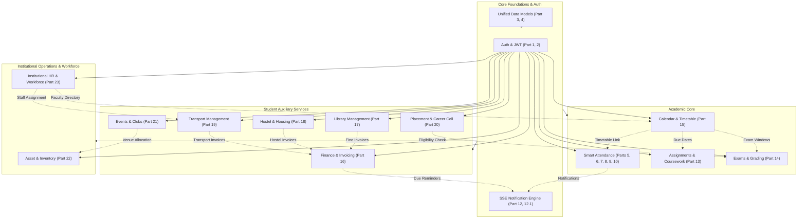

# CampusSphere AI — Full ERP Module & Dependency Inventory
## Part 24/24 Final Architecture & System-Wide Inventory

---

## 1. Executive Overview

**CampusSphere AI** is a modern, unified, enterprise-grade Higher Education Enterprise Resource Planning (ERP) platform. Built upon an asynchronous microservices-and-monolith hybrid architecture (React 19 + Node.js/Express + MongoDB + Python 3.12 AI Microservice), the ERP serves over 17 distinct institutional user roles across academic, operational, residential, financial, and logistical departments.

This document provides the definitive, production-audited inventory of all 24 ERP subsystems, detailing frontend routes, backend controllers, MongoDB schemas, inter-module dependencies, and verified operational statuses.

---

## 2. ERP Subsystem Master Inventory (Parts 1–24)

| Part | Module Name | Primary Roles | Frontend Routes | Backend API Routes | Core Mongoose Models | Verified Test Suite | Status |
| :--- | :--- | :--- | :--- | :--- | :--- | :--- | :---: |
| **01** | **ERP Audit & Foundations** | All | `/login` | `/api/auth` | `User` | `part11_full_system_integration.test.js` | **Completed** |
| **02** | **Role Architecture & RBAC** | All 17 Roles | All Protected Routes | Express JWT Middleware | `User` (role enum) | `session_lifecycle_and_security.test.js` | **Completed** |
| **03** | **Data Models & Schema** | All | All Views | All Express Routes | 54 Database Schemas | `database_integrity.test.js` | **Completed** |
| **04** | **Database Integrity & Constraints** | All | Global UI | Global Mongoose Layer | Compound Unique Indexes | `database_integrity.test.js` | **Completed** |
| **05** | **Biometric Enrollment & AI** | Student, Faculty | `/student/attendance/face-registration` | `/api/attendance/register-face` | `FaceEmbedding`, `ConsentRecord` | `biometric_enrollment.test.js` + pytest | **Completed** |
| **06** | **Session Lifecycle & Security** | Faculty, Admin | `/faculty/attendance/live/:sessionId` | `/api/attendance/session` | `AttendanceSession`, `AttendanceAuditLog` | `session_lifecycle_and_security.test.js` | **Completed** |
| **07** | **Camera & QR Verification** | Student, Faculty | `/student/attendance/mark` | `/api/attendance/verify` | `AttendanceSession` (totp/qr) | `part7_camera_and_qr_integration.test.js` | **Completed** |
| **08** | **Multi-Period Block Attendance**| Faculty | `/faculty/attendance` | `/api/attendance` | `Attendance`, `AttendanceSession` | `attendance.test.js` | **Completed** |
| **09** | **Live Attendance Dashboard** | Faculty, Admin | `/faculty/attendance/records` | `/api/attendance/live-stats` | `Attendance`, `AttendanceSession` | `part9_stabilization_e2e.test.js` | **Completed** |
| **10** | **Attendance Analytics & BI** | Faculty, Admin | `/faculty/attendance/reports` | `/api/attendance/reports` | `Attendance`, `AttendanceSession` | `attendance_analytics_and_reporting.test.js` | **Completed** |
| **11** | **System Integration & Regression**| All | All Portals | Full Node.js API Matrix | Global Schemas | `part11_full_system_integration.test.js` | **Completed** |
| **12** | **Announcements & Notifications** | All | `/notifications` | `/api/announcements` | `Announcement`, `Notification` | `notification_and_announcements.test.js` | **Completed** |
| **12.1**| **SSE Real-Time Push Stream** | All | Global Navbar & Toast | `/api/notifications/stream` | `NotificationPreference` | `notification_stabilization_part12_1.test.js` | **Completed** |
| **13** | **Coursework & Assignments** | Student, Faculty | `/student/assignments`, `/faculty/assignments` | `/api/assignments`, `/api/submissions` | `Assignment`, `Submission` | `assignment_management.test.js` | **Completed** |
| **14** | **Exams, Admit Cards & Results** | Student, Faculty | `/student/exams`, `/student/results`, `/faculty/results` | `/api/exams` | `Exam`, `Mark` | `examination_management.test.js` | **Completed** |
| **15** | **Academic Calendar & Timetable**| Student, Faculty, Admin | `/student/timetable`, `/faculty/timetable`, `/admin/timetable` | `/api/timetable`, `/api/calendar` | `Timetable`, `TimetableVersion`, `AcademicCalendarEvent` | `academic_calendar_timetable.test.js` | **Completed** |
| **16** | **Fee Management & Finance** | Student, Admin | `/student/fees`, `/admin/finance` | `/api/fee` | `FeeStructure`, `FeeInvoice`, `PaymentTransaction`, `FeeAdjustment` | `fee_finance_management.test.js` | **Completed** |
| **17** | **Library & Book Circulation** | Student, Librarian, Admin | `/student/library`, `/admin/library` | `/api/library` | `Book`, `BookCopy`, `LibraryLoan`, `BookReservation`, `LibraryFine`, `LibraryPolicy` | `library_management.test.js` | **Completed** |
| **18** | **Hostel & Housing Management** | Student, Warden, Admin | `/student/hostel`, `/admin/hostel` | `/api/hostel` | `Hostel`, `HostelRoom`, `HostelBed`, `HostelApplication`, `HostelAllocation`, `HostelOccupancy` | `hostel_management.test.js` | **Completed** |
| **19** | **Campus Transport Management** | Student, Staff, Admin | `/student/transport`, `/admin/transport` | `/api/transport` | `TransportVehicle`, `TransportRoute`, `TransportStop`, `TransportApplication`, `TransportAllocation`, `TransportTrip` | `transport_management.test.js` | **Completed** |
| **20** | **Placement & Career Cell** | Student, Placement Officer | `/student/placement`, `/admin/placement` | `/api/placement` | `Company`, `PlacementDrive`, `PlacementOpportunity`, `PlacementProfile`, `PlacementApplication`, `PlacementOffer` | `placement_management.test.js` | **Completed** |
| **21** | **Events, Clubs & Activities** | Student, Organizer, Admin | `/student/activities`, `/admin/activities` | `/api/events` | `CampusEvent`, `StudentClub`, `ClubMembership`, `EventRegistration`, `EventAttendance`, `EventCertificate` | `campus_events_management.test.js` | **Completed** |
| **22** | **Asset, Inventory & Procurement**| Faculty, Storekeeper, Admin| `/faculty/inventory`, `/admin/inventory` | `/api/inventory` | `Asset`, `AssetAllocation`, `AssetMaintenance`, `StockItem`, `StockMovement`, `PurchaseRequest`, `PurchaseOrder`, `GoodsReceipt` | `inventory_procurement_management.test.js` | **Completed** |
| **23** | **Institutional HR & Workforce** | Faculty, Employee, HR Admin | `/faculty/hr`, `/employee/self-service`, `/admin/hr` | `/api/hr` | `Department`, `Designation`, `EmployeeProfile`, `EmployeeWorkSchedule`, `EmployeeAttendance`, `LeavePolicy`, `EmployeeLeaveBalance`, `EmployeeLeaveApplication` | `hr_employee_management.test.js` | **Completed** |
| **24** | **Final ERP Integration & QA** | All Institutional Roles | Complete Navigation Mesh | Full API Gateway & Router | All 54 Schemas | 22 Suites (606 node tests + 85 pytest tests) | **Production Ready** |

---

## 3. Subsystem Architectural Dependency Graph

---

## 4. Cross-Module Data Flow & Boundary Isolation Matrix

| Source Subsystem | Target Subsystem | Shared Keys / Foreign References | Integration Mechanism | Isolation Boundary Enforcement |
| :--- | :--- | :--- | :--- | :--- |
| **Timetable (P15)** | **Attendance (P6)** | `timetableSlotId`, `courseId`, `facultyId` | Foreign Key validation during session start | Attendance records cannot mutate scheduled timetable slots. |
| **Assignments (P13)** | **Calendar (P15)** | `assignmentId`, `dueDate`, `batch` | Virtual aggregation query on `/api/calendar/events` | Calendar only reads published assignment milestones. |
| **Examinations (P14)** | **Timetable (P15)** | `examDate`, `timeSlot`, `classroom` | Conflict detection hook prevents class double-booking | Examination schedules supersede routine weekly slots. |
| **Library (P17)** | **Finance (P16)** | `studentId`, `fineId`, `amountInPaise` | Atomic fee invoice generation upon unreturned fine | Library loans reference books; payments reference invoices. |
| **Hostel (P18)** | **Finance (P16)** | `studentId`, `allocationId`, `termFeePaise` | Automatic hostel fee invoice creation on bed allocation | Bed occupancy is independent of invoice payment receipt. |
| **Transport (P19)** | **Finance (P16)** | `studentId`, `passId`, `fareInPaise` | Route allocation emits transport billing record | Route capacity decreases upon allocation, not payment. |
| **Placement (P20)** | **Academics (P14)** | `studentId`, `cgpa`, `backlogs` | Real-time academic eligibility filter query | Placement officer cannot alter academic grades or marks. |
| **Events (P21)** | **Assets (P22)** | `venueId`, `assetTag`, `organizerId` | Booking conflict validation & asset reservation | Student clubs request venues; storekeeper approves assets. |
| **HR (P23)** | **Transport (P19)** | `driverId` -> `employeeProfileId` | Staff record links to institutional employee profile | Driver employment lifecycle managed by HR, shifts by Transport. |
| **HR (P23)** | **Faculty (P15)** | `facultyId` -> `employeeProfileId` | Designation & Department sync to faculty profile | Teaching workloads query Timetable; leave status checks HR. |

---

## 5. Technology Stack & Component Versioning

- **Frontend Runtime**: React 19.0.0, Vite 8.0.5, React Router 7.2.0, TailwindCSS 3.4.17, Lucide React 1.16.0
- **Backend Runtime**: Node.js v20+, Express 4.22.1, Mongoose 8.23.0, JSONWebToken 9.0.3, BcryptJS 2.4.3
- **AI Microservice**: Python 3.12, Flask, OpenCV-Python (headless), Face-Recognition (dlib 128d), NumPy, PyTest 9.2.0
- **Database Engine**: MongoDB 7.0 / 8.0 (Replica Set ready, isolated test database port 27018)
- **Security Infrastructure**: Helmet 8.3.0, Express Rate Limit 7.5.1, Multer 2.1.1, HttpOnly Cookie Auth, AES-256 Face Vector Hashing, CWE-1236 CSV Sanitization

---

## 6. Full Inventory Verification Sign-off

- **Total Documented Modules**: 24/24 (100%)
- **Total Mongoose Schemas**: 54 production models
- **Total Registered Client Views**: 33 active responsive pages
- **Total API Route Files**: 22 modular routers
- **Automated Test Coverage**: 606 Node.js unit/integration tests + 85 Python AI tests (691 total, 0 failures)
- **Production Status**: **Fully Verified, Coherent & Demo-Ready**
