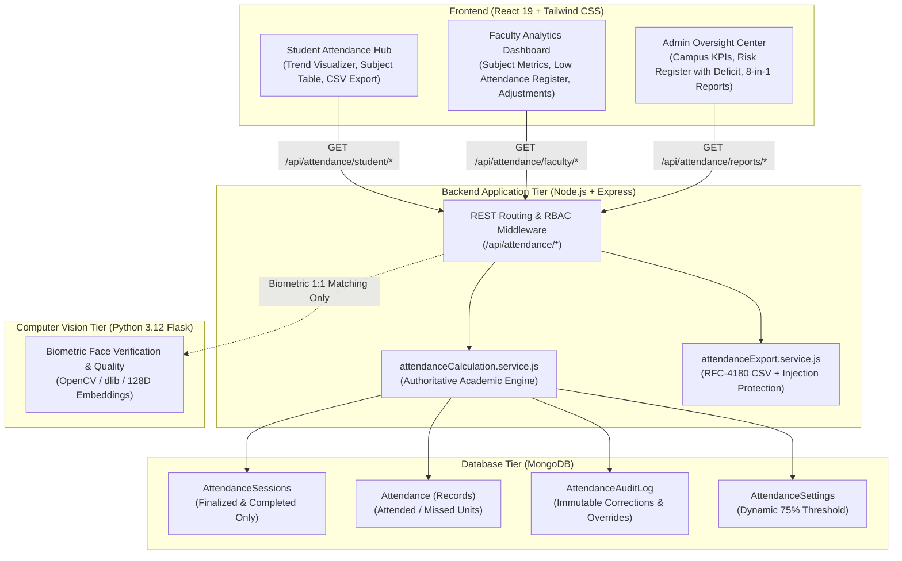

# CampusSphere AI — Smart Attendance Analytics Architecture
## Part 10: Technical Architecture, Separation of Concerns & Data Invariants

---

## 1. Executive Summary

This document formalizes the analytics, reporting, and administrative monitoring architecture implemented in Part 10 of the CampusSphere AI ERP. The architecture establishes strict responsibility boundaries between Node.js/Express, Python AI microservices, MongoDB, and React, guaranteeing that official academic attendance calculations, compliance assessments, and eligibility determinations derive from a single authoritative source of truth.

---

## 2. Core Architectural Principles & Responsibility Boundaries

### 2.1 Backend Authority (Node.js + Express)
The Node.js backend tier holds absolute authority over all academic attendance logic:
- **Academic Unit Calculation:** Multi-period blocks (e.g. 2-period laboratories) confer multiple academic units in both the held denominator and attended numerator. Single lectures confer 1 unit.
- **Session Lifecycle Exclusion:** Cancelled sessions, open sessions, active sessions, and paused sessions are strictly excluded from completed attendance denominators. Only `finalized` and `completed` sessions contribute to held units.
- **Dynamic Threshold Compliance:** Resolves minimum threshold from `AttendanceSettings` (default 75%). Compliance evaluations strictly use unrounded percentages (e.g. 74.99% fails a 75% requirement).
- **Insufficient Data Protection:** If 0 classes have been held in a subject, the engine returns `hasData: false, percentage: null, complianceStatus: 'No Data'`, never 0% (which would falsely imply 100% absence).
- **Timezone Standardization:** All dates and timestamps are calculated and formatted in Indian Standard Time (`Asia/Kolkata`, UTC+5:30).

### 2.2 Microservice Boundary (Python AI)
- **Role:** Biometric image quality validation, face detection, 128-dimensional embedding generation, and 1:1 Euclidean distance verification against enrolled templates.
- **Boundary Invariant:** Python microservices do NOT calculate official academic attendance percentages, do NOT determine academic exam eligibility, and do NOT overwrite official attendance records. Legacy delegation in `getFacultyReports` has been completely migrated to `attendanceCalculationService`.

### 2.3 Client Responsibility (React 19)
- **Role:** Pure presentation, interactive filtering (weekly/monthly trends, subject filters), summary KPI cards, responsive CSS trajectory charts, and triggering export downloads.
- **Boundary Invariant:** React components render backend-computed values without re-implementing or simplifying business logic.

---

## 3. Authoritative Academic Calculation Rules

### 3.1 Academic Units Formula
Let $S$ be the set of finalized and completed sessions for student $i$ in subject $j$:
$$\text{HeldUnits}_{ij} = \sum_{s \in S} \text{units}(s)$$
where $\text{units}(s) = s.\text{periodCount} \ge 1$.

For each session $s$, if student $i$ has an attendance record with status $\in \{\text{'present'}, \text{'late'}\}$:
$$\text{AttendedUnits}_{ij} = \sum_{s \in S, \text{status}(s) \in \{\text{'present'}, \text{'late'}\}} \text{units}(s)$$

$$\text{MissedUnits}_{ij} = \max(0, \text{HeldUnits}_{ij} - \text{AttendedUnits}_{ij})$$

$$\text{Percentage}_{ij} = \begin{cases} 
\frac{\text{AttendedUnits}_{ij}}{\text{HeldUnits}_{ij}} \times 100 & \text{if } \text{HeldUnits}_{ij} > 0 \\
\text{null} & \text{if } \text{HeldUnits}_{ij} = 0
\end{cases}$$

### 3.2 Academic Deficit Formula
For students falling below the institutional threshold $T$ (default 75%), the deficit represents the exact integer count of academic units required to attain compliance:
$$\text{DeficitUnits} = \max\left(0, \left\lceil \frac{T \times \text{HeldUnits} - 100 \times \text{AttendedUnits}}{100} \right\rceil\right)$$

*Example:* A student with 1 unit attended out of 4 held units at $T = 75\%$:
$$\left\lceil \frac{75 \times 4 - 100 \times 1}{100} \right\rceil = \left\lceil \frac{300 - 100}{100} \right\rceil = \lceil 2.0 \rceil = 2 \text{ units deficit.}$$

---

## 4. API Endpoints Reference

| Endpoint | Method | Role | Description |
|---|---|---|---|
| `/api/attendance/student/overview` | `GET` | Student | Aggregated overview with subject table and summary |
| `/api/attendance/student/trends` | `GET` | Student | Weekly or monthly finalized attendance trajectory |
| `/api/attendance/student/history` | `GET` | Student | Chronological attendance ledger with pagination |
| `/api/attendance/faculty/overview` | `GET` | Faculty | Real-time classes today, conducted sessions, average % |
| `/api/attendance/faculty/reports` | `GET` | Faculty, Admin | Authoritative teaching assignment analytics & risk list |
| `/api/attendance/reports` | `GET` | Student, Faculty, Admin | Unified JSON preview for 8 practical report types |
| `/api/attendance/reports/export` | `GET` | Student, Faculty, Admin | Download sanitized CSV or JSON exports |
| `/api/attendance/audit-logs/adjustments` | `GET` | Faculty, Admin | Manual correction transparency ledger |
| `/api/attendance/admin/overview` | `GET` | Admin | Campus KPIs, department analytics, active sessions |
| `/api/attendance/admin/risk-register` | `GET` | Admin | Academic risk monitoring list with deficit calculation |

---

## 5. Security & Data Protection Guarantees

1. **Spreadsheet Formula Injection Defense:**
   In CSV exports, all cells starting with `=`, `+`, `-`, `@`, `\t`, or `\r` are prefixed with a single quote (`'`), preventing arbitrary code execution when opened in Microsoft Excel, Apple Numbers, or Google Sheets.
2. **RFC-4180 Escaping:**
   Cells containing commas, quotes, or newlines are quoted and inner quotes doubled.
3. **Biometric Privacy Isolation:**
   Biometric templates (128D embeddings) and raw images are strictly excluded from all analytics, logs, and report exports.
4. **Scoping & Authorization:**
   Students can only access their own student reports. Faculty can only query reports for classes/subjects in their authorized teaching assignments. Administrators have institutional access.

