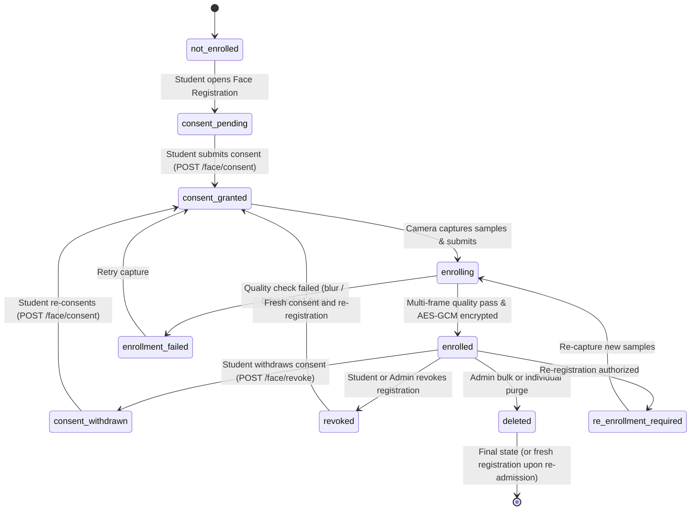

# Smart Attendance Biometric Enrollment & Consent Architecture Audit
## Project: CampusSphere AI — Smart Campus Management ERP

**Document Version:** 1.0.0  
**Phase:** Part 9 of 24 — Biometric Enrollment, Consent Management & Student Face Registration Reliability  
**Date:** November 1, 2026  
**Auditor:** Senior Biometric Security Engineer & Node.js Backend Architect  

---

## 1. Executive Summary

This document provides a comprehensive audit of the biometric enrollment, consent management, and template registration subsystem within the CampusSphere AI ERP. 

Biometric attendance systems in educational institutions require rigorous data minimization, explicit consent workflows, cryptographically enforced template protection, and clear boundary separation between identity authentication and academic attendance record-keeping.

This audit details the current enrollment architecture, endpoints, end-to-end data flows, legacy gaps discovered and remediated, and the complete state machine governing biometric templates.

---

## 2. Enrollment Architecture Overview

The biometric enrollment subsystem spans four integrated tiers:
1. **Frontend Presentation Tier (React 19 + Vite):** Captures multi-frame facial imagery via browser WebRTC MediaDevices, validates real-time posture/lighting, displays explicit non-preselected consent disclosures, and submits registration requests.
2. **API & Business Logic Tier (Node.js + Express):** Authenticates the session via JWT, enforces strict role-based access control (RBAC), records immutable consent records, coordinates with the Python AI microservice, and stores encrypted biometric metadata.
3. **Computer Vision Microservice (Python Flask + OpenCV + dlib):** Performs image preprocessing, facial landmark detection, single-face validation, multi-frame embedding aggregation (128-dimensional ResNet vector), and AES-256-GCM encryption.
4. **Data Persistence Tier (MongoDB 7+):** Enforces unique constraints per student, separates biometric template storage (`FaceEmbedding`) from academic attendance (`Attendance`), and records audit trails (`AttendanceAuditLog`, `ConsentRecord`).

```
┌────────────────────────────────────────────────────────────────────────────────────────┐
│                                 CAMPUSSPHERE AI ERP                                    │
│                                                                                        │
│   ┌────────────────────┐          JWT Session          ┌───────────────────────────┐   │
│   │   Student Client   │ ────────────────────────────► │   Express API Gateway     │   │
│   │   (React / WebRTC) │                               │   (Node.js Backend)       │   │
│   └─────────┬──────────┘                               └─────────────┬─────────────┘   │
│             │                                                        │                 │
│             │ Image Frames (Base64)                                  │ JSON RPC / REST │
│             │ + Consent Confirmation                                 │ (HTTP / Mutual) │
│             ▼                                                        ▼                 │
│   ┌────────────────────┐       Centroid 128-d Vector   ┌───────────────────────────┐   │
│   │ Browser UX / Video │                               │   Python AI Microservice  │   │
│   │ Face Alignment Box │                               │   (OpenCV + dlib ResNet)  │   │
│   └────────────────────┘                               └─────────────┬─────────────┘   │
│                                                                      │                 │
│                                                   AES-256-GCM Encrypt│ (Nonce + CT + Tag)
│                                                                      ▼                 │
│                                                        ┌───────────────────────────┐   │
│                                                        │   MongoDB Database        │   │
│                                                        │   - FaceEmbedding         │   │
│                                                        │   - ConsentRecord         │   │
│                                                        │   - AttendanceAuditLog    │   │
│                                                        │   - Attendance (Academic) │   │
│                                                        └───────────────────────────┘   │
└────────────────────────────────────────────────────────────────────────────────────────┘
```

---

## 3. API Endpoints Specification

### 3.1 Student Biometric Endpoints

| Endpoint | Method | Role | Auth Required | Purpose |
|---|---|---|---|---|
| `/api/student/face-status` | `GET` | Student | Yes (JWT) | Retrieves current enrollment status, consent status, and registration date without exposing template ciphertext. |
| `/api/student/face/consent` | `POST` | Student | Yes (JWT) | Grants explicit consent to policy version `v1.0.0` with purpose disclosures. |
| `/api/student/face/enroll` | `POST` | Student | Yes (JWT) | Submits multi-frame face samples for embedding extraction, validation, and encrypted storage. |
| `/api/student/face/re-enroll` | `POST` | Student | Yes (JWT) | Flags current template as `re_enrollment_required` allowing authorized re-registration. |
| `/api/student/face/revoke` | `POST` | Student | Yes (JWT) | Withdraws consent and cryptographically purges biometric template (`encryptedData: null`). |

### 3.2 Administrative Biometric Endpoints

| Endpoint | Method | Role | Auth Required | Purpose |
|---|---|---|---|---|
| `/api/admin/attendance/face-enrollments` | `GET` | Admin | Yes (JWT) | Lists student enrollment statuses with pagination, branch/semester filters, and consent states. |
| `/api/admin/attendance/face-enrollments/:studentId` | `DELETE` | Admin | Yes (JWT) | Individually purges a student's biometric template with mandatory administrative justification. |
| `/api/admin/attendance/face-enrollments/purge-bulk` | `POST` | Admin | Yes (JWT) | Executes bulk cryptographic purge of specified student templates with audit logging. |

---

## 4. End-to-End Data Flow

### 4.1 Initial Enrollment Flow

1. **Consent Gate:** Student navigates to `/student/face-registration`. Client calls `GET /api/student/face-status`. If `consentStatus !== 'active'`, student is presented with the Biometric Data Collection Consent Modal.
2. **Explicit Consent:** Student reads purpose disclosures, confirms non-preselected checkboxes, and submits. Client issues `POST /api/student/face/consent` with `{ policyVersion: 'v1.0.0', acceptedPurposes: ['smart_attendance_verification'] }`. Node.js verifies version and records active `ConsentRecord` and updates `FaceEmbedding.consentStatus = 'active'`.
3. **Multi-Sample Capture:** Frontend activates camera, guides student into the oval bounding box, and captures 3 distinct frames spaced 400ms apart to account for minor pose variations.
4. **Backend Coordination:** Frontend issues `POST /api/student/face/enroll` with `{ imageData: frame1, imageSamples: [frame1, frame2, frame3], isReEnrollment: false }`.
5. **Node.js Pre-checks:**
   - Validates student authentication and extracts `req.user._id`.
   - Verifies active consent in `ConsentRecord`. Rejects with `403` if consent is missing.
   - Verifies existing enrollment status. If already `enrolled` and `isReEnrollment !== true` and status is not `re_enrollment_required`, rejects with `409 Conflict`.
6. **Python AI Microservice Processing:**
   - Preprocesses images (validates format, converts to RGB).
   - Validates single-face constraint across all samples (`face_locations`). Rejects if 0 or >1 face detected.
   - Evaluates face resolution, sharpness/blurriness (Laplacian variance), and frontal orientation.
   - Computes 128-d face embeddings for all valid frames via dlib ResNet.
   - Averages valid embeddings into a normalized centroid vector (`aggregate_enrollment_embeddings`).
   - Encrypts centroid vector dict using AES-256-GCM with a fresh 12-byte random nonce and 16-byte authentication tag.
   - Returns `{ success: true, encryptedData: combined_b64, templateReference, model: 'dlib-resnet-v1' }`.
7. **Database Persistence:**
   - Node.js saves or updates `FaceEmbedding` document: `encryptedData`, `templateReference`, `enrollmentStatus: 'enrolled'`, `isActive: true`, `enrolledAt: new Date()`.
   - Appends immutable `AttendanceAuditLog` event (`action: 'enroll_biometric'`).
   - Returns sanitized confirmation to frontend (omitting `encryptedData`).

---

## 5. Legacy Defects Discovered & Remediated

| ID | Component | Defect Discovered | Security / Operational Risk | Remediated Behavior |
|---|---|---|---|---|
| GAP-01 | `student.controller.js` | Single frame passed to AI service despite frontend capturing 3 frames. | Sub-optimal template quality and lower recognition tolerance across varying lighting. | Updated controller and `pythonAi.service.js` to forward `imageSamples` array, enabling centroid aggregation. |
| GAP-02 | `student.controller.js` | Attendance verification only verified `FaceEmbedding.isActive`, ignoring consent revocation. | Regulatory non-compliance: student whose consent was revoked could theoretically verify if template flag lingered. | Implemented **double-defense authorization**: verifies both `FaceEmbedding.isActive` AND `ConsentRecord.consentStatus === 'active'`. |
| GAP-03 | `FaceEmbedding.js` | Limited status enum (`['pending', 'registered', 'rejected']`). | Unable to distinguish between withdrawn consent, failed enrollment, and administrative purge. | Expanded enum to `['not_enrolled', 'consent_pending', 'consent_granted', 'enrolling', 'enrolled', 'enrollment_failed', 'consent_withdrawn', 'revoked', 'deleted', 're_enrollment_required']`. |
| GAP-04 | `admin.controller.js` | Missing bulk purge endpoint for cohort graduation or mass withdrawal. | Admins forced to issue individual deletes without batch auditing or confirmation safeguard. | Created `POST /api/admin/attendance/face-enrollments/purge-bulk` with confirmation flag and scoped audit logging. |
| GAP-05 | `FaceRegistration.jsx` | Re-enrollment attempts sent standard enroll request resulting in unhandled 409 error. | Students needing re-registration due to model update or poor original capture were blocked. | UI detects prior enrollment and supplies `isReEnrollment: true` when allowed or prompts for re-enrollment request. |
| GAP-06 | `student.controller.js` | `revokeFace` previously did not clear `encryptedData` in database. | Lingering ciphertext violated data minimization principles upon consent revocation. | `revokeFace` cryptographically purges: sets `encryptedData: null`, `templateReference: null`, `isActive: false`, `status: 'revoked'`. |

---

## 6. Complete Biometric State Machine



---

## 7. Verification Authorization Invariants

To guarantee that no student's facial biometric is used for attendance without lawful and active consent, the following invariants are enforced:

1. **Invariant 1 (Double Defense):** A student cannot check into any attendance session unless:
   $$\text{FaceEmbedding.isActive} == \text{true} \quad \land \quad \text{ConsentRecord.consentStatus} == \text{'active'}$$
2. **Invariant 2 (Zero Plaintext Persistence):** Raw facial images (`imageData`, `imageSamples`) are never written to disk, database, or logging services. They exist in memory exclusively for feature extraction ($<200\text{ms}$).
3. **Invariant 3 (Cryptographic Purge):** When consent is withdrawn or a template is deleted:
   $$\text{encryptedData} \leftarrow \text{null}, \quad \text{templateReference} \leftarrow \text{null}, \quad \text{isActive} \leftarrow \text{false}$$
4. **Invariant 4 (Academic History Preservation):** Revocation or purging of biometric templates **strictly preserves** historical academic attendance records (`Attendance` collection). Past classroom verifications remain intact for accreditation and grading audits.

